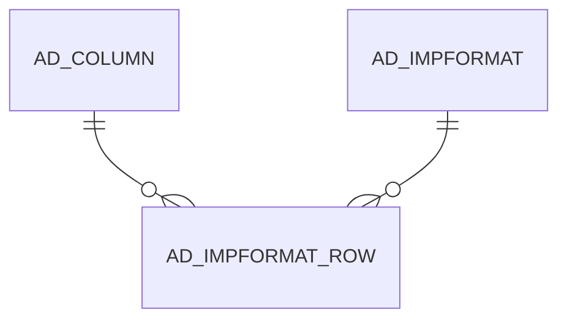

# AD_IMPFORMAT_ROW

Area [AD](../../data-model/ad/index.md) · class **config** (proposed) · read from database `idempiere-db` (owner `ADEMPIERE`) · 163 row(s) when profiled

Application model: `org.compiere.model.X_AD_ImpFormat_Row`, access level 6 - System - Client.

## Columns

| column | type | key | not null | business name | references (code) | nulls | distinct |
|---|---|---|---|---|---|---|---|
| `AD_IMPFORMAT_ROW_ID` | NUMBER(10,0) | PK | yes | Format Field |  | 0 | 163 |
| `AD_CLIENT_ID` | NUMBER(10,0) |  | yes | Tenant |  | 0 | 2 |
| `AD_ORG_ID` | NUMBER(10,0) |  | yes | Organization |  | 0 | 1 |
| `ISACTIVE` | CHAR(1) |  | yes | Active |  | 0 | 1 |
| `CREATED` | DATE |  | yes | Created |  | 0 | 124 |
| `CREATEDBY` | NUMBER(10,0) |  | yes | Created By |  | 0 | 2 |
| `UPDATED` | DATE |  | yes | Updated |  | 0 | 110 |
| `UPDATEDBY` | NUMBER(10,0) |  | yes | Updated By |  | 0 | 2 |
| `AD_IMPFORMAT_ID` | NUMBER(10,0) |  | yes | Import Format | [AD_IMPFORMAT](../../data-model/ad/ad_impformat.md) | 0 | 15 |
| `SEQNO` | NUMBER(10,0) |  | yes | Sequence |  | 0 | 68 |
| `NAME` | VARCHAR2(60 CHAR) |  | yes | Name |  | 0 | 136 |
| `AD_COLUMN_ID` | NUMBER(10,0) |  | yes | Column | [AD_COLUMN](../../data-model/ad/ad_column.md) | 0 | 154 |
| `STARTNO` | NUMBER(10,0) |  |  | Start No |  | 0 | 69 |
| `ENDNO` | NUMBER(10,0) |  |  | End No |  | 0 | 1 |
| `DATATYPE` | CHAR(1) |  | yes | Data Type |  | 0 | 4 |
| `DATAFORMAT` | VARCHAR2(20 CHAR) |  |  | Data Format |  | 154 | 1 |
| `DECIMALPOINT` | CHAR(1) |  | yes | Decimal Point |  | 0 | 1 |
| `DIVIDEBY100` | CHAR(1) |  | yes | Divide by 100 |  | 0 | 2 |
| `CONSTANTVALUE` | VARCHAR2(60 CHAR) |  |  | Constant Value |  | 159 | 4 |
| `CALLOUT` | VARCHAR2(4000 CHAR) |  |  | Callout |  | 163 | 0 |
| `SCRIPT` | VARCHAR2(2000 CHAR) |  |  | Script |  | 163 | 0 |
| `AD_IMPFORMAT_ROW_UU` | VARCHAR2(36 CHAR) |  |  | AD_ImpFormat_Row_UU |  | 0 | 163 |
| `IMPORTPREFIX` | VARCHAR2(20 CHAR) |  |  | Import prefix |  | 163 | 0 |

*references (code)* is the table the application model's code says a column points to; *Foreign keys* below are the constraints the database declares. Counts come from the profile; no value is ever shown.

## Check constraints

| name | expression |
|---|---|
| `SYS_C0020552` | `IsActive in ('Y','N')` |
| `SYS_C0020554` | `DivideBy100 in ('Y','N')` |

## Foreign keys

**References**

| table | columns | on delete |
|---|---|---|
| [AD_COLUMN](../../data-model/ad/ad_column.md) | AD_IMPFORMAT_ROW.AD_COLUMN_ID → AD_COLUMN.AD_COLUMN_ID | NO ACTION |
| [AD_IMPFORMAT](../../data-model/ad/ad_impformat.md) | AD_IMPFORMAT_ROW.AD_IMPFORMAT_ID → AD_IMPFORMAT.AD_IMPFORMAT_ID | CASCADE |

**Referenced by**

_None._

## Write behaviour

- updates: **po_only**
- deletes: **deleted_by_users, deleted_by_cascade**
- change log: **recorded**
- evidence: 2 citation(s)

## Schema history

32 change(s); the latest:

| applied | release | operation | column | tickets |
|---|---|---|---|---|
| 2023-11-03T08:29 | iD11 | `create_index` |  | IDEMPIERE-5905 |
| 2023-11-03T08:29 | iD11 | `create_index` |  | IDEMPIERE-5905 |
| 2023-04-09T15:47 | iD11 | `add_constraint` |  | IDEMPIERE-5567 |
| 2023-04-09T15:47 | iD11 | `add_constraint` |  | IDEMPIERE-5567 |
| 2021-12-05T16:45 | i8.2z | `drop_constraint` |  | IDEMPIERE-5075 |
| 2021-12-05T16:45 | i8.2z | `add_constraint` |  | IDEMPIERE-5075 |
| 2021-12-05T16:45 | i8.2z | `add_constraint` |  | IDEMPIERE-5075 |
| 2021-12-05T16:45 | i8.2z | `drop_constraint` |  | IDEMPIERE-5075 |
| 2021-08-30T11:00 | i8.2z | `modify_column` | Callout | IDEMPIERE-1575 |
| 2021-08-30T11:00 | i8.2z | `modify_column` | Callout | IDEMPIERE-1575 |
| 2021-03-08T10:00 | i8.2z | `add_column` | ImportPrefix | IDEMPIERE-4724 |
| 2021-03-08T10:00 | i8.2z | `add_column` | ImportPrefix | IDEMPIERE-4724 |
| 2020-08-04T01:00 | i7.1z | `add_column` | tmp_col_4_tmp | IDEMPIERE-3862 |
| 2020-08-04T01:00 | i7.1z | `add_column` | tmp_col_3_tmp | IDEMPIERE-3862 |
| 2020-08-04T01:00 | i7.1z | `add_column` | tmp_col_5_tmp | IDEMPIERE-3862 |

## Notes

<!-- ekos:manual id="table.ad_impformat_row.notes" -->
_Business notes about this table._
<!-- /ekos:manual -->
