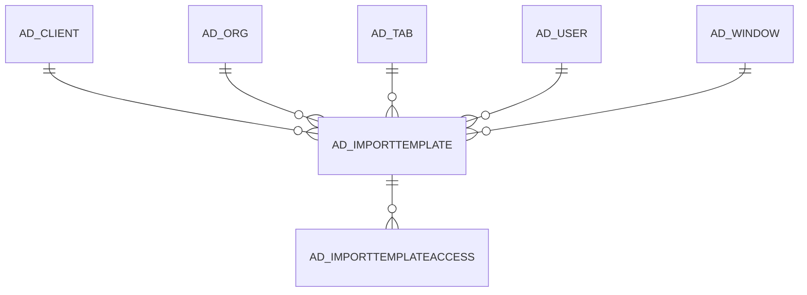

# AD_IMPORTTEMPLATE

Area [AD](../../data-model/ad/index.md) · class **config** (proposed) · read from database `idempiere-db` (owner `ADEMPIERE`) · 0 row(s) when profiled

Application model: `org.compiere.model.X_AD_ImportTemplate`, access level 7 - System - Client - Org.

## Columns

| column | type | key | not null | business name | references (code) | nulls | distinct |
|---|---|---|---|---|---|---|---|
| `AD_CLIENT_ID` | NUMBER(10,0) |  | yes | Tenant |  | 0 | 0 |
| `AD_IMPORTTEMPLATE_ID` | NUMBER(10,0) | PK | yes | Import Template |  | 0 | 0 |
| `AD_IMPORTTEMPLATE_UU` | VARCHAR2(36 CHAR) |  |  | AD_ImportTemplate_UU |  | 0 | 0 |
| `AD_ORG_ID` | NUMBER(10,0) |  | yes | Organization |  | 0 | 0 |
| `AD_TAB_ID` | NUMBER(10,0) |  | yes | Tab | [AD_TAB](../../data-model/ad/ad_tab.md) | 0 | 0 |
| `AD_WINDOW_ID` | NUMBER(10,0) |  | yes | Window | [AD_WINDOW](../../data-model/ad/ad_window.md) | 0 | 0 |
| `CHARACTERSET` | VARCHAR2(20 CHAR) |  | yes | Character Set |  | 0 | 0 |
| `CREATED` | DATE |  | yes | Created |  | 0 | 0 |
| `CREATEDBY` | NUMBER(10,0) |  | yes | Created By |  | 0 | 0 |
| `CSVALIASHEADER` | VARCHAR2(2000 CHAR) |  |  | CSV Alias Header |  | 0 | 0 |
| `CSVHEADER` | VARCHAR2(2000 CHAR) |  | yes | CSV Header |  | 0 | 0 |
| `DESCRIPTION` | VARCHAR2(255 CHAR) |  |  | Description |  | 0 | 0 |
| `ISACTIVE` | CHAR(1) |  | yes | Active |  | 0 | 0 |
| `NAME` | VARCHAR2(60 CHAR) |  | yes | Name |  | 0 | 0 |
| `UPDATED` | DATE |  | yes | Updated |  | 0 | 0 |
| `UPDATEDBY` | NUMBER(10,0) |  | yes | Updated By |  | 0 | 0 |
| `SEPARATORCHAR` | VARCHAR2(1 CHAR) |  | yes | Separator Character |  | 0 | 0 |
| `QUOTECHAR` | VARCHAR2(1 CHAR) |  | yes | Quote Char |  | 0 | 0 |
| `IMPORTTEMPLATETYPE` | VARCHAR2(4 CHAR) |  | yes | Import Template Type |  | 0 | 0 |

*references (code)* is the table the application model's code says a column points to; *Foreign keys* below are the constraints the database declares. Counts come from the profile; no value is ever shown.

## Check constraints

| name | expression |
|---|---|
| `SYS_C0020634` | `IsActive IN ('Y','N')` |

## Foreign keys

**References**

| table | columns | on delete |
|---|---|---|
| [AD_CLIENT](../../data-model/ad/ad_client.md) | AD_IMPORTTEMPLATE.AD_CLIENT_ID → AD_CLIENT.AD_CLIENT_ID | NO ACTION |
| [AD_ORG](../../data-model/ad/ad_org.md) | AD_IMPORTTEMPLATE.AD_ORG_ID → AD_ORG.AD_ORG_ID | NO ACTION |
| [AD_TAB](../../data-model/ad/ad_tab.md) | AD_IMPORTTEMPLATE.AD_TAB_ID → AD_TAB.AD_TAB_ID | NO ACTION |
| [AD_USER](../../data-model/ad/ad_user.md) | AD_IMPORTTEMPLATE.CREATEDBY → AD_USER.AD_USER_ID | NO ACTION |
| [AD_WINDOW](../../data-model/ad/ad_window.md) | AD_IMPORTTEMPLATE.AD_WINDOW_ID → AD_WINDOW.AD_WINDOW_ID | NO ACTION |

**Referenced by**

| table | columns | on delete |
|---|---|---|
| [AD_IMPORTTEMPLATEACCESS](../../data-model/ad/ad_importtemplateaccess.md) | AD_IMPORTTEMPLATEACCESS.AD_IMPORTTEMPLATE_ID → AD_IMPORTTEMPLATE.AD_IMPORTTEMPLATE_ID | NO ACTION |

## Write behaviour

- updates: **po_only**
- deletes: **deleted_by_users**
- change log: **recorded**
- evidence: 1 citation(s)

## Schema history

50 change(s); the latest:

| applied | release | operation | column | tickets |
|---|---|---|---|---|
| 2024-03-26T22:47 | iD11 | `add_column` | ImportTemplateType | IDEMPIERE-6040 |
| 2024-03-26T22:47 | iD11 | `add_column` | QuoteChar | IDEMPIERE-6040 |
| 2024-03-26T22:47 | iD11 | `add_column` | SeparatorChar | IDEMPIERE-6040 |
| 2024-03-26T22:47 | iD11 | `add_column` | ImportTemplateType | IDEMPIERE-6040 |
| 2024-03-26T22:47 | iD11 | `add_column` | QuoteChar | IDEMPIERE-6040 |
| 2024-03-26T22:47 | iD11 | `add_column` | SeparatorChar | IDEMPIERE-6040 |
| 2020-08-04T01:00 | i7.1z | `modify_column` | CSVALIASHEADER | IDEMPIERE-3862 |
| 2020-08-04T01:00 | i7.1z | `modify_column` | AD_IMPORTTEMPLATE_UU | IDEMPIERE-3862 |
| 2020-08-04T01:00 | i7.1z | `modify_column` | DESCRIPTION | IDEMPIERE-3862 |
| 2020-08-04T01:00 | i7.1z | `modify_column` | CHARACTERSET | IDEMPIERE-3862 |
| 2020-08-04T01:00 | i7.1z | `modify_column` | CSVHEADER | IDEMPIERE-3862 |
| 2020-08-04T01:00 | i7.1z | `modify_column` | NAME | IDEMPIERE-3862 |
| 2014-11-04T23:22 | i2.1 | `add_constraint` |  | IDEMPIERE-2113 |
| 2014-11-04T23:22 | i2.1 | `modify_column` | CharacterSet | IDEMPIERE-2113 |
| 2014-11-04T23:22 | i2.1 | `modify_column` | CSVHeader | IDEMPIERE-2113 |

## Notes

<!-- ekos:manual id="table.ad_importtemplate.notes" -->
_Business notes about this table._
<!-- /ekos:manual -->
