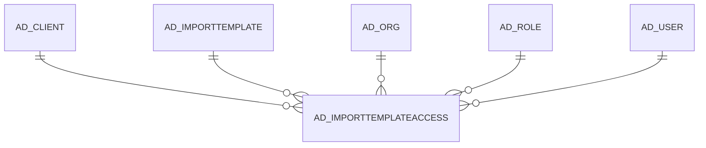

# AD_IMPORTTEMPLATEACCESS

Area [AD](../../data-model/ad/index.md) · class **config** (proposed) · read from database `idempiere-db` (owner `ADEMPIERE`) · 0 row(s) when profiled

Application model: `org.compiere.model.X_AD_ImportTemplateAccess`, access level 7 - System - Client - Org.

## Columns

| column | type | key | not null | business name | references (code) | nulls | distinct |
|---|---|---|---|---|---|---|---|
| `AD_CLIENT_ID` | NUMBER(10,0) |  |  | Tenant |  | 0 | 0 |
| `AD_IMPORTTEMPLATEACCESS_ID` | NUMBER(10,0) | PK | yes | Import Template Access |  | 0 | 0 |
| `AD_IMPORTTEMPLATEACCESS_UU` | VARCHAR2(36 CHAR) |  |  | AD_ImportTemplateAccess_UU |  | 0 | 0 |
| `AD_IMPORTTEMPLATE_ID` | NUMBER(10,0) |  |  | Import Template | [AD_IMPORTTEMPLATE](../../data-model/ad/ad_importtemplate.md) | 0 | 0 |
| `AD_ORG_ID` | NUMBER(10,0) |  |  | Organization |  | 0 | 0 |
| `AD_ROLE_ID` | NUMBER(10,0) |  |  | Role | [AD_ROLE](../../data-model/ad/ad_role.md) | 0 | 0 |
| `CREATED` | DATE |  | yes | Created |  | 0 | 0 |
| `CREATEDBY` | NUMBER(10,0) |  |  | Created By |  | 0 | 0 |
| `ISACTIVE` | CHAR(1) |  |  | Active |  | 0 | 0 |
| `ISALLOWINSERT` | CHAR(1) |  |  | Allow Insert |  | 0 | 0 |
| `ISALLOWMERGE` | CHAR(1) |  |  | Allow Merge |  | 0 | 0 |
| `ISALLOWUPDATE` | CHAR(1) |  |  | Allow Update |  | 0 | 0 |
| `UPDATED` | DATE |  | yes | Updated |  | 0 | 0 |
| `UPDATEDBY` | NUMBER(10,0) |  |  | Updated By |  | 0 | 0 |

*references (code)* is the table the application model's code says a column points to; *Foreign keys* below are the constraints the database declares. Counts come from the profile; no value is ever shown.

## Check constraints

| name | expression |
|---|---|
| `SYS_C0020555` | `IsAllowInsert IN ('Y','N')` |
| `SYS_C0020556` | `IsAllowUpdate IN ('Y','N')` |
| `SYS_C0020558` | `IsActive IN ('Y','N')` |
| `SYS_C0020559` | `IsAllowMerge IN ('Y','N')` |

## Foreign keys

**References**

| table | columns | on delete |
|---|---|---|
| [AD_CLIENT](../../data-model/ad/ad_client.md) | AD_IMPORTTEMPLATEACCESS.AD_CLIENT_ID → AD_CLIENT.AD_CLIENT_ID | NO ACTION |
| [AD_IMPORTTEMPLATE](../../data-model/ad/ad_importtemplate.md) | AD_IMPORTTEMPLATEACCESS.AD_IMPORTTEMPLATE_ID → AD_IMPORTTEMPLATE.AD_IMPORTTEMPLATE_ID | NO ACTION |
| [AD_ORG](../../data-model/ad/ad_org.md) | AD_IMPORTTEMPLATEACCESS.AD_ORG_ID → AD_ORG.AD_ORG_ID | NO ACTION |
| [AD_ROLE](../../data-model/ad/ad_role.md) | AD_IMPORTTEMPLATEACCESS.AD_ROLE_ID → AD_ROLE.AD_ROLE_ID | NO ACTION |
| [AD_USER](../../data-model/ad/ad_user.md) | AD_IMPORTTEMPLATEACCESS.CREATEDBY → AD_USER.AD_USER_ID | NO ACTION |

**Referenced by**

_None._

## Write behaviour

- updates: **po_only**
- deletes: **deleted_by_users**
- change log: **recorded**
- evidence: 1 citation(s)

## Schema history

15 change(s); the latest:

| applied | release | operation | column | tickets |
|---|---|---|---|---|
| 2020-08-04T01:00 | i7.1z | `modify_column` | AD_IMPORTTEMPLATEACCESS_UU | IDEMPIERE-3862 |
| 2014-11-04T23:22 | i2.1 | `add_constraint` |  | IDEMPIERE-2113 |
| 2014-11-04T23:22 | i2.1 | `create_table` |  | IDEMPIERE-2113 |
| 2014-11-04T23:22 | i2.1 | `add_constraint` |  | IDEMPIERE-2113 |
| 2014-11-04T23:22 | i2.1 | `add_constraint` |  | IDEMPIERE-2113 |
| 2014-11-04T23:22 | i2.1 | `add_constraint` |  | IDEMPIERE-2113 |
| 2014-11-04T23:22 | i2.1 | `add_constraint` |  | IDEMPIERE-2113 |
| 2014-11-04T23:22 | i2.1 | `add_constraint` |  | IDEMPIERE-2113 |
| 2014-11-04T23:22 | i2.1 | `add_constraint` |  | IDEMPIERE-2113 |
| 2014-11-04T23:22 | i2.1 | `add_constraint` |  | IDEMPIERE-2113 |
| 2014-11-04T23:22 | i2.1 | `add_constraint` |  | IDEMPIERE-2113 |
| 2014-11-04T23:22 | i2.1 | `add_constraint` |  | IDEMPIERE-2113 |
| 2014-11-04T23:22 | i2.1 | `add_constraint` |  | IDEMPIERE-2113 |
| 2014-11-04T23:22 | i2.1 | `add_constraint` |  | IDEMPIERE-2113 |
| 2014-11-04T23:22 | i2.1 | `create_table` |  | IDEMPIERE-2113 |

## Notes

<!-- ekos:manual id="table.ad_importtemplateaccess.notes" -->
_Business notes about this table._
<!-- /ekos:manual -->
