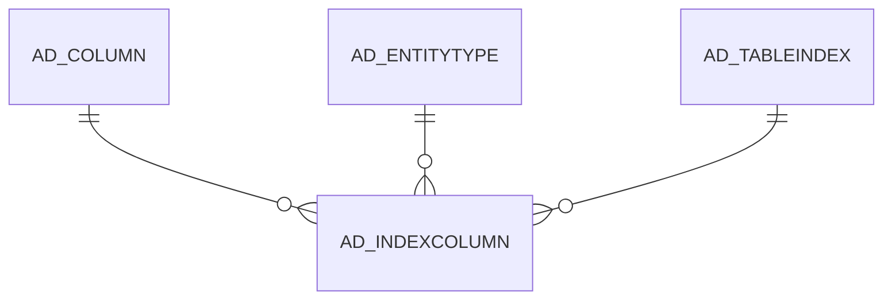

# AD_INDEXCOLUMN

Area [AD](../../data-model/ad/index.md) · class **config** (proposed) · read from database `idempiere-db` (owner `ADEMPIERE`) · 1518 row(s) when profiled

Application model: `org.compiere.model.X_AD_IndexColumn`, access level 4 - System.

## Columns

| column | type | key | not null | business name | references (code) | nulls | distinct |
|---|---|---|---|---|---|---|---|
| `AD_CLIENT_ID` | NUMBER(10,0) |  | yes | Tenant |  | 0 | 1 |
| `AD_COLUMN_ID` | NUMBER(10,0) |  |  | Column | [AD_COLUMN](../../data-model/ad/ad_column.md) | 10 | 1497 |
| `AD_INDEXCOLUMN_ID` | NUMBER(10,0) | PK | yes | Table Index Column |  | 0 | 1518 |
| `AD_INDEXCOLUMN_UU` | VARCHAR2(36 CHAR) |  |  | AD_IndexColumn_UU |  | 0 | 1518 |
| `AD_ORG_ID` | NUMBER(10,0) |  | yes | Organization |  | 0 | 1 |
| `AD_TABLEINDEX_ID` | NUMBER(10,0) |  | yes | Table Index | [AD_TABLEINDEX](../../data-model/ad/ad_tableindex.md) | 0 | 1181 |
| `COLUMNSQL` | VARCHAR2(255 CHAR) |  |  | Column SQL |  | 1485 | 25 |
| `CREATED` | DATE |  | yes | Created |  | 0 | 1362 |
| `CREATEDBY` | NUMBER(10,0) |  | yes | Created By |  | 0 | 3 |
| `ENTITYTYPE` | VARCHAR2(40 CHAR) |  | yes | Entity Type |  | 0 | 2 |
| `ISACTIVE` | CHAR(1) |  | yes | Active |  | 0 | 2 |
| `SEQNO` | NUMBER(10,0) |  |  | Sequence |  | 0 | 23 |
| `UPDATED` | DATE |  | yes | Updated |  | 0 | 1357 |
| `UPDATEDBY` | NUMBER(10,0) |  | yes | Updated By |  | 0 | 3 |

*references (code)* is the table the application model's code says a column points to; *Foreign keys* below are the constraints the database declares. Counts come from the profile; no value is ever shown.

## Check constraints

| name | expression |
|---|---|
| `SYS_C0021513` | `IsActive IN ('Y','N')` |

## Foreign keys

**References**

| table | columns | on delete |
|---|---|---|
| [AD_COLUMN](../../data-model/ad/ad_column.md) | AD_INDEXCOLUMN.AD_COLUMN_ID → AD_COLUMN.AD_COLUMN_ID | NO ACTION |
| [AD_ENTITYTYPE](../../data-model/ad/ad_entitytype.md) | AD_INDEXCOLUMN.ENTITYTYPE → AD_ENTITYTYPE.ENTITYTYPE | NO ACTION |
| [AD_TABLEINDEX](../../data-model/ad/ad_tableindex.md) | AD_INDEXCOLUMN.AD_TABLEINDEX_ID → AD_TABLEINDEX.AD_TABLEINDEX_ID | NO ACTION |

**Referenced by**

_None._

## Write behaviour

- updates: **po_only**
- deletes: **deleted_by_users**
- change log: **recorded**
- evidence: 1 citation(s)

## Schema history

27 change(s); the latest:

| applied | release | operation | column | tickets |
|---|---|---|---|---|
| 2020-08-04T01:00 | i7.1z | `drop_column` | tmp_col_2_tmp | IDEMPIERE-3862 |
| 2020-08-04T01:00 | i7.1z | `modify_column` | COLUMNSQL | IDEMPIERE-3862 |
| 2020-08-04T01:00 | i7.1z | `modify_column` | ENTITYTYPE | IDEMPIERE-3862 |
| 2020-08-04T01:00 | i7.1z | `modify_column` | AD_INDEXCOLUMN_UU | IDEMPIERE-3862 |
| 2020-08-04T01:00 | i7.1z | `drop_column` | tmp_col_1_tmp | IDEMPIERE-3862 |
| 2020-08-04T01:00 | i7.1z | `add_column` | tmp_col_1_tmp | IDEMPIERE-3862 |
| 2020-08-04T01:00 | i7.1z | `add_column` | tmp_col_2_tmp | IDEMPIERE-3862 |
| 2014-05-02T10:09 | i2.0 | `modify_column` | created | IDEMPIERE-709 |
| 2014-05-02T10:09 | i2.0 | `modify_column` | updated | IDEMPIERE-709 |
| 2014-04-17T15:00 | i2.0 | `modify_column` | created | IDEMPIERE-709 |
| 2014-04-17T15:00 | i2.0 | `modify_column` | updated | IDEMPIERE-709 |
| 2014-04-17T15:00 | i2.0 | `modify_column` | created | IDEMPIERE-709 |
| 2014-04-17T15:00 | i2.0 | `modify_column` | created | IDEMPIERE-709 |
| 2014-04-17T15:00 | i2.0 | `modify_column` | updated | IDEMPIERE-709 |
| 2014-04-17T15:00 | i2.0 | `modify_column` | updated | IDEMPIERE-709 |

## Notes

<!-- ekos:manual id="table.ad_indexcolumn.notes" -->
_Business notes about this table._
<!-- /ekos:manual -->
