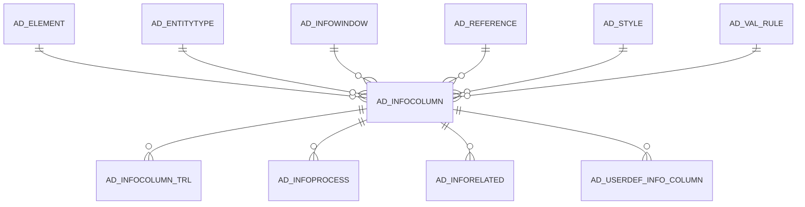

# AD_INFOCOLUMN

Area [AD](../../data-model/ad/index.md) · class **config** (proposed) · read from database `idempiere-db` (owner `ADEMPIERE`) · 198 row(s) when profiled

Application model: `org.compiere.model.X_AD_InfoColumn`, access level 4 - System.

## Columns

| column | type | key | not null | business name | references (code) | nulls | distinct |
|---|---|---|---|---|---|---|---|
| `AD_INFOCOLUMN_ID` | NUMBER(10,0) | PK | yes | Info Column |  | 0 | 198 |
| `AD_CLIENT_ID` | NUMBER(10,0) |  | yes | Tenant |  | 0 | 1 |
| `AD_ORG_ID` | NUMBER(10,0) |  | yes | Organization |  | 0 | 1 |
| `ISACTIVE` | CHAR(1) |  | yes | Active |  | 0 | 1 |
| `CREATED` | DATE |  | yes | Created |  | 0 | 184 |
| `CREATEDBY` | NUMBER(10,0) |  | yes | Created By |  | 0 | 1 |
| `UPDATED` | DATE |  | yes | Updated |  | 0 | 188 |
| `UPDATEDBY` | NUMBER(10,0) |  | yes | Updated By |  | 0 | 2 |
| `NAME` | VARCHAR2(60 CHAR) |  | yes | Name |  | 0 | 112 |
| `DESCRIPTION` | VARCHAR2(255 CHAR) |  |  | Description |  | 20 | 99 |
| `HELP` | VARCHAR2(2000 CHAR) |  |  | Comment/Help |  | 30 | 90 |
| `AD_INFOWINDOW_ID` | NUMBER(10,0) |  | yes | Info Window | [AD_INFOWINDOW](../../data-model/ad/ad_infowindow.md) | 0 | 17 |
| `ENTITYTYPE` | VARCHAR2(40 CHAR) |  | yes | Entity Type |  | 0 | 1 |
| `SELECTCLAUSE` | VARCHAR2(2000 CHAR) |  | yes | Sql SELECT |  | 0 | 161 |
| `SEQNO` | NUMBER(10,0) |  | yes | Sequence |  | 0 | 26 |
| `ISDISPLAYED` | CHAR(1) |  | yes | Displayed |  | 0 | 2 |
| `ISQUERYCRITERIA` | CHAR(1) |  | yes | Query Criteria |  | 0 | 2 |
| `AD_ELEMENT_ID` | NUMBER(10,0) |  |  | System Element | [AD_ELEMENT](../../data-model/ad/ad_element.md) | 8 | 107 |
| `AD_REFERENCE_ID` | NUMBER(10,0) |  | yes | Reference | [AD_REFERENCE](../../data-model/ad/ad_reference.md) | 0 | 18 |
| `AD_INFOCOLUMN_UU` | VARCHAR2(36 CHAR) |  |  | AD_InfoColumn_UU |  | 0 | 198 |
| `AD_REFERENCE_VALUE_ID` | NUMBER(10,0) |  |  | Reference Key | [AD_REFERENCE](../../data-model/ad/ad_reference.md) | 171 | 16 |
| `AD_VAL_RULE_ID` | NUMBER(10,0) |  |  | Dynamic Validation | [AD_VAL_RULE](../../data-model/ad/ad_val_rule.md) | 182 | 14 |
| `ISCENTRALLYMAINTAINED` | CHAR(1) |  | yes | Centrally maintained |  | 0 | 2 |
| `DISPLAYLOGIC` | VARCHAR2(2000 CHAR) |  |  | Display Logic |  | 174 | 14 |
| `COLUMNNAME` | VARCHAR2(63 CHAR) |  | yes | DB Column Name |  | 0 | 113 |
| `QUERYOPERATOR` | VARCHAR2(10 CHAR) |  |  | Query Operator |  | 44 | 4 |
| `QUERYFUNCTION` | VARCHAR2(255 CHAR) |  |  | Query Function |  | 130 | 2 |
| `ISIDENTIFIER` | CHAR(1) |  | yes | Identifier |  | 0 | 2 |
| `SEQNOSELECTION` | NUMBER(10,0) |  |  | Selection Column Sequence |  | 0 | 14 |
| `DEFAULTVALUE` | VARCHAR2(2000 CHAR) |  |  | Default Logic |  | 170 | 16 |
| `ISMANDATORY` | CHAR(1) |  | yes | Mandatory |  | 0 | 2 |
| `ISKEY` | CHAR(1) |  |  | Key column |  | 162 | 2 |
| `ISREADONLY` | CHAR(1) |  | yes | Read Only |  | 0 | 2 |
| `PLACEHOLDER` | VARCHAR2(255 CHAR) |  |  | Placeholder |  | 198 | 0 |
| `INPUTFIELDVALIDATION` | VARCHAR2(2000 CHAR) |  |  | Input field validation |  | 198 | 0 |
| `AD_FIELDSTYLE_ID` | NUMBER(10,0) |  |  | Field Style | [AD_STYLE](../../data-model/ad/ad_style.md) | 198 | 0 |
| `ISAUTOCOMPLETE` | CHAR(1) |  | yes | Auto complete |  | 0 | 1 |
| `ISQUERYAFTERCHANGE` | CHAR(1) |  | yes | Query After Change |  | 0 | 2 |
| `ISRANGE` | CHAR(1) |  | yes | Range |  | 0 | 1 |
| `DEFAULTVALUE2` | VARCHAR2(2000 CHAR) |  |  | Default Logic 2 |  | 198 | 0 |
| `PLACEHOLDER2` | VARCHAR2(255 CHAR) |  |  | Placeholder2 |  | 198 | 0 |

*references (code)* is the table the application model's code says a column points to; *Foreign keys* below are the constraints the database declares. Counts come from the profile; no value is ever shown.

## Check constraints

| name | expression |
|---|---|
| `SYS_C0022105` | `IsMandatory IN ('Y','N')` |
| `SYS_C0022106` | `IsQueryAfterChange IN ('Y','N')` |
| `SYS_C0022107` | `IsReadOnly IN ('Y','N')` |
| `SYS_C0022109` | `IsIdentifier IN ('Y','N')` |
| `SYS_C0022110` | `IsCentrallyMaintained IN ('Y','N')` |
| `SYS_C0022111` | `IsRange IN ('Y','N')` |
| `SYS_C0022112` | `IsActive in ('Y','N')` |
| `SYS_C0022113` | `IsAutocomplete IN ('Y','N')` |
| `SYS_C0022114` | `IsDisplayed in ('Y','N')` |
| `SYS_C0022115` | `IsKey IN ('Y','N')` |
| `SYS_C0022116` | `IsQueryCriteria in ('Y','N')` |

## Foreign keys

**References**

| table | columns | on delete |
|---|---|---|
| [AD_ELEMENT](../../data-model/ad/ad_element.md) | AD_INFOCOLUMN.AD_ELEMENT_ID → AD_ELEMENT.AD_ELEMENT_ID | NO ACTION |
| [AD_ENTITYTYPE](../../data-model/ad/ad_entitytype.md) | AD_INFOCOLUMN.ENTITYTYPE → AD_ENTITYTYPE.ENTITYTYPE | NO ACTION |
| [AD_INFOWINDOW](../../data-model/ad/ad_infowindow.md) | AD_INFOCOLUMN.AD_INFOWINDOW_ID → AD_INFOWINDOW.AD_INFOWINDOW_ID | CASCADE |
| [AD_REFERENCE](../../data-model/ad/ad_reference.md) | AD_INFOCOLUMN.AD_REFERENCE_VALUE_ID → AD_REFERENCE.AD_REFERENCE_ID | NO ACTION |
| [AD_STYLE](../../data-model/ad/ad_style.md) | AD_INFOCOLUMN.AD_FIELDSTYLE_ID → AD_STYLE.AD_STYLE_ID | NO ACTION |
| [AD_VAL_RULE](../../data-model/ad/ad_val_rule.md) | AD_INFOCOLUMN.AD_VAL_RULE_ID → AD_VAL_RULE.AD_VAL_RULE_ID | NO ACTION |

**Referenced by**

| table | columns | on delete |
|---|---|---|
| [AD_INFOCOLUMN_TRL](../../data-model/ad/ad_infocolumn_trl.md) | AD_INFOCOLUMN_TRL.AD_INFOCOLUMN_ID → AD_INFOCOLUMN.AD_INFOCOLUMN_ID | CASCADE |
| [AD_INFOPROCESS](../../data-model/ad/ad_infoprocess.md) | AD_INFOPROCESS.AD_INFOCOLUMN_ID → AD_INFOCOLUMN.AD_INFOCOLUMN_ID | NO ACTION |
| [AD_INFORELATED](../../data-model/ad/ad_inforelated.md) | AD_INFORELATED.PARENTRELATEDCOLUMN_ID → AD_INFOCOLUMN.AD_INFOCOLUMN_ID | NO ACTION |
| [AD_USERDEF_INFO_COLUMN](../../data-model/ad/ad_userdef_info_column.md) | AD_USERDEF_INFO_COLUMN.AD_INFOCOLUMN_ID → AD_INFOCOLUMN.AD_INFOCOLUMN_ID | NO ACTION |

## Write behaviour

- updates: **raw_sql_skips_updated**
- deletes: **deleted_by_users, deleted_by_cascade**
- change log: **recorded**
- evidence: 4 citation(s)

## Schema history

105 change(s); the latest:

| applied | release | operation | column | tickets |
|---|---|---|---|---|
| 2024-04-03T12:26 | iD11 | `modify_column` | ColumnName | IDEMPIERE-6064 |
| 2024-04-03T12:26 | iD11 | `modify_column` | ColumnName | IDEMPIERE-6064 |
| 2023-04-09T15:47 | iD11 | `add_constraint` |  | IDEMPIERE-5567 |
| 2023-04-09T15:47 | iD11 | `add_constraint` |  | IDEMPIERE-5567 |
| 2022-10-31T15:29 | iD10 | `add_column` | DefaultValue2 | IDEMPIERE-5467 |
| 2022-10-31T15:29 | iD10 | `add_column` | IsRange | IDEMPIERE-5467 |
| 2022-10-31T15:29 | iD10 | `add_column` | IsRange | IDEMPIERE-5467 |
| 2022-10-31T15:29 | iD10 | `add_column` | Placeholder2 | IDEMPIERE-5467 |
| 2022-10-31T15:29 | iD10 | `add_column` | Placeholder2 | IDEMPIERE-5467 |
| 2022-10-31T15:29 | iD10 | `add_column` | DefaultValue2 | IDEMPIERE-5467 |
| 2022-09-14T12:37 | i9 | `add_column` | IsQueryAfterChange | IDEMPIERE-5396 |
| 2022-09-14T12:37 | i9 | `add_column` | IsQueryAfterChange | IDEMPIERE-5396 |
| 2021-12-05T16:45 | i8.2z | `add_constraint` |  | IDEMPIERE-5075 |
| 2021-12-05T16:45 | i8.2z | `drop_constraint` |  | IDEMPIERE-5075 |
| 2021-12-05T16:45 | i8.2z | `drop_constraint` |  | IDEMPIERE-5075 |

## Notes

<!-- ekos:manual id="table.ad_infocolumn.notes" -->
_Business notes about this table._
<!-- /ekos:manual -->
