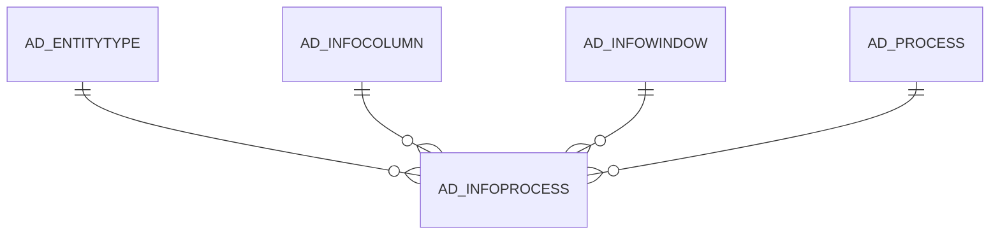

# AD_INFOPROCESS

Area [AD](../../data-model/ad/index.md) · class **config** (proposed) · read from database `idempiere-db` (owner `ADEMPIERE`) · 11 row(s) when profiled

Application model: `org.compiere.model.X_AD_InfoProcess`, access level 4 - System.

## Columns

| column | type | key | not null | business name | references (code) | nulls | distinct |
|---|---|---|---|---|---|---|---|
| `AD_INFOPROCESS_ID` | NUMBER(10,0) | PK | yes | Info Process |  | 0 | 11 |
| `AD_INFOPROCESS_UU` | VARCHAR2(36 CHAR) |  | yes | AD_InfoProcess_UU |  | 0 | 11 |
| `AD_CLIENT_ID` | NUMBER(10,0) |  | yes | Tenant |  | 0 | 1 |
| `AD_ORG_ID` | NUMBER(10,0) |  | yes | Organization |  | 0 | 1 |
| `ISACTIVE` | CHAR(1) |  | yes | Active |  | 0 | 1 |
| `CREATED` | DATE |  | yes | Created |  | 0 | 11 |
| `CREATEDBY` | NUMBER(10,0) |  | yes | Created By |  | 0 | 1 |
| `UPDATED` | DATE |  | yes | Updated |  | 0 | 11 |
| `UPDATEDBY` | NUMBER(10,0) |  | yes | Updated By |  | 0 | 1 |
| `IMAGEURL` | VARCHAR2(120 CHAR) |  |  | Image URL |  | 11 | 0 |
| `SEQNO` | NUMBER(10,0) |  | yes | Sequence |  | 0 | 3 |
| `AD_PROCESS_ID` | NUMBER(10,0) |  | yes | Process | [AD_PROCESS](../../data-model/ad/ad_process.md) | 0 | 11 |
| `AD_INFOWINDOW_ID` | NUMBER(10,0) |  |  | Info Window | [AD_INFOWINDOW](../../data-model/ad/ad_infowindow.md) | 0 | 7 |
| `LAYOUTTYPE` | VARCHAR2(10 CHAR) |  | yes | Layout Type |  | 0 | 1 |
| `DISPLAYLOGIC` | VARCHAR2(2000 CHAR) |  |  | Display Logic |  | 7 | 2 |
| `AD_INFOCOLUMN_ID` | NUMBER(10,0) |  |  | Info Column | [AD_INFOCOLUMN](../../data-model/ad/ad_infocolumn.md) | 6 | 3 |
| `ENTITYTYPE` | VARCHAR2(40 CHAR) |  | yes | Entity Type |  | 0 | 1 |

*references (code)* is the table the application model's code says a column points to; *Foreign keys* below are the constraints the database declares. Counts come from the profile; no value is ever shown.

## Check constraints

| name | expression |
|---|---|
| `SYS_C0021543` | `IsActive IN ('Y','N')` |

## Foreign keys

**References**

| table | columns | on delete |
|---|---|---|
| [AD_ENTITYTYPE](../../data-model/ad/ad_entitytype.md) | AD_INFOPROCESS.ENTITYTYPE → AD_ENTITYTYPE.ENTITYTYPE | NO ACTION |
| [AD_INFOCOLUMN](../../data-model/ad/ad_infocolumn.md) | AD_INFOPROCESS.AD_INFOCOLUMN_ID → AD_INFOCOLUMN.AD_INFOCOLUMN_ID | NO ACTION |
| [AD_INFOWINDOW](../../data-model/ad/ad_infowindow.md) | AD_INFOPROCESS.AD_INFOWINDOW_ID → AD_INFOWINDOW.AD_INFOWINDOW_ID | CASCADE |
| [AD_PROCESS](../../data-model/ad/ad_process.md) | AD_INFOPROCESS.AD_PROCESS_ID → AD_PROCESS.AD_PROCESS_ID | NO ACTION |

**Referenced by**

_None._

## Write behaviour

- updates: **po_only**
- deletes: **deleted_by_users, deleted_by_cascade**
- change log: **recorded**
- evidence: 2 citation(s)

## Schema history

77 change(s); the latest:

| applied | release | operation | column | tickets |
|---|---|---|---|---|
| 2020-08-04T01:00 | i7.1z | `modify_column` | LAYOUTTYPE | IDEMPIERE-3862 |
| 2020-08-04T01:00 | i7.1z | `modify_column` | ENTITYTYPE | IDEMPIERE-3862 |
| 2020-08-04T01:00 | i7.1z | `modify_column` | IMAGEURL | IDEMPIERE-3862 |
| 2020-08-04T01:00 | i7.1z | `modify_column` | DISPLAYLOGIC | IDEMPIERE-3862 |
| 2020-08-04T01:00 | i7.1z | `modify_column` | AD_INFOPROCESS_UU | IDEMPIERE-3862 |
| 2019-12-27T17:15 | i7.1 | `modify_column` | EntityType | IDEMPIERE-3952 |
| 2019-12-27T17:15 | i7.1 | `modify_column` | EntityType | IDEMPIERE-3952 |
| 2019-04-21T12:40 | i6.2z | `modify_column` | EntityType | IDEMPIERE-3952 |
| 2019-04-21T12:40 | i6.2z | `modify_column` | EntityType | IDEMPIERE-3952 |
| 2019-04-15T18:10 | i6.2z | `add_column` | EntityType | IDEMPIERE-3952 |
| 2019-04-15T18:10 | i6.2z | `add_constraint` |  | IDEMPIERE-3952 |
| 2019-04-15T18:10 | i6.2z | `add_constraint` |  | IDEMPIERE-3952 |
| 2019-04-15T18:10 | i6.2z | `add_column` | EntityType | IDEMPIERE-3952 |
| 2014-10-30T19:04 | i2.0z | `add_constraint` |  |  |
| 2014-10-30T19:04 | i2.0z | `add_constraint` |  |  |

## Notes

<!-- ekos:manual id="table.ad_infoprocess.notes" -->
_Business notes about this table._
<!-- /ekos:manual -->
