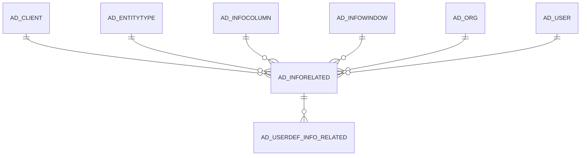

# AD_INFORELATED

Area [AD](../../data-model/ad/index.md) · class **config** (proposed) · read from database `idempiere-db` (owner `ADEMPIERE`) · 0 row(s) when profiled

Application model: `org.compiere.model.X_AD_InfoRelated`, access level 4 - System.

## Columns

| column | type | key | not null | business name | references (code) | nulls | distinct |
|---|---|---|---|---|---|---|---|
| `AD_INFORELATED_ID` | NUMBER(10,0) | PK | yes | Info Related |  | 0 | 0 |
| `AD_CLIENT_ID` | NUMBER(10,0) |  | yes | Tenant |  | 0 | 0 |
| `AD_ORG_ID` | NUMBER(10,0) |  | yes | Organization |  | 0 | 0 |
| `ISACTIVE` | CHAR(1) |  | yes | Active |  | 0 | 0 |
| `CREATED` | DATE |  | yes | Created |  | 0 | 0 |
| `CREATEDBY` | NUMBER(10,0) |  | yes | Created By |  | 0 | 0 |
| `UPDATED` | DATE |  | yes | Updated |  | 0 | 0 |
| `UPDATEDBY` | NUMBER(10,0) |  | yes | Updated By |  | 0 | 0 |
| `NAME` | VARCHAR2(60 CHAR) |  | yes | Name |  | 0 | 0 |
| `DESCRIPTION` | VARCHAR2(255 CHAR) |  |  | Description |  | 0 | 0 |
| `HELP` | VARCHAR2(2000 CHAR) |  |  | Comment/Help |  | 0 | 0 |
| `AD_INFOWINDOW_ID` | NUMBER(10,0) |  | yes | Info Window | [AD_INFOWINDOW](../../data-model/ad/ad_infowindow.md) | 0 | 0 |
| `SEQNO` | NUMBER(10,0) |  | yes | Sequence |  | 0 | 0 |
| `RELATEDINFO_ID` | NUMBER(10,0) |  | yes | Related Info Window | [AD_INFOWINDOW](../../data-model/ad/ad_infowindow.md) | 0 | 0 |
| `RELATEDCOLUMN_ID` | NUMBER(10,0) |  | yes | Related Info Column | [AD_INFOCOLUMN](../../data-model/ad/ad_infocolumn.md) | 0 | 0 |
| `AD_INFORELATED_UU` | VARCHAR2(36 CHAR) |  |  | AD_InfoRelated_UU |  | 0 | 0 |
| `PARENTRELATEDCOLUMN_ID` | NUMBER(10,0) |  |  | Parent Related Column | [AD_INFOCOLUMN](../../data-model/ad/ad_infocolumn.md) | 0 | 0 |
| `ENTITYTYPE` | VARCHAR2(40 CHAR) |  | yes | Entity Type |  | 0 | 0 |
| `DISPLAYLOGIC` | VARCHAR2(2000 CHAR) |  |  | Display Logic |  | 0 | 0 |

*references (code)* is the table the application model's code says a column points to; *Foreign keys* below are the constraints the database declares. Counts come from the profile; no value is ever shown.

## Check constraints

| name | expression |
|---|---|
| `SYS_C0022596` | `IsActive IN ('Y','N')` |

## Foreign keys

**References**

| table | columns | on delete |
|---|---|---|
| [AD_CLIENT](../../data-model/ad/ad_client.md) | AD_INFORELATED.AD_CLIENT_ID → AD_CLIENT.AD_CLIENT_ID | NO ACTION |
| [AD_ENTITYTYPE](../../data-model/ad/ad_entitytype.md) | AD_INFORELATED.ENTITYTYPE → AD_ENTITYTYPE.ENTITYTYPE | NO ACTION |
| [AD_INFOCOLUMN](../../data-model/ad/ad_infocolumn.md) | AD_INFORELATED.PARENTRELATEDCOLUMN_ID → AD_INFOCOLUMN.AD_INFOCOLUMN_ID | NO ACTION |
| [AD_INFOWINDOW](../../data-model/ad/ad_infowindow.md) | AD_INFORELATED.AD_INFOWINDOW_ID → AD_INFOWINDOW.AD_INFOWINDOW_ID | NO ACTION |
| [AD_ORG](../../data-model/ad/ad_org.md) | AD_INFORELATED.AD_ORG_ID → AD_ORG.AD_ORG_ID | NO ACTION |
| [AD_USER](../../data-model/ad/ad_user.md) | AD_INFORELATED.CREATEDBY → AD_USER.AD_USER_ID | NO ACTION |

**Referenced by**

| table | columns | on delete |
|---|---|---|
| [AD_USERDEF_INFO_RELATED](../../data-model/ad/ad_userdef_info_related.md) | AD_USERDEF_INFO_RELATED.AD_INFORELATED_ID → AD_INFORELATED.AD_INFORELATED_ID | NO ACTION |

## Write behaviour

- updates: **po_only**
- deletes: **deleted_by_users**
- change log: **recorded**
- evidence: 1 citation(s)

## Schema history

77 change(s); the latest:

| applied | release | operation | column | tickets |
|---|---|---|---|---|
| 2020-10-15T09:40 | i7.1z | `add_column` | DisplayLogic | IDEMPIERE-4459 |
| 2020-10-15T09:40 | i7.1z | `add_column` | DisplayLogic | IDEMPIERE-4459 |
| 2020-08-04T01:00 | i7.1z | `modify_column` | NAME | IDEMPIERE-3862 |
| 2020-08-04T01:00 | i7.1z | `modify_column` | NAME | IDEMPIERE-3862 |
| 2020-08-04T01:00 | i7.1z | `modify_column` | DESCRIPTION | IDEMPIERE-3862 |
| 2020-08-04T01:00 | i7.1z | `modify_column` | ENTITYTYPE | IDEMPIERE-3862 |
| 2020-08-04T01:00 | i7.1z | `drop_column` | tmp_col_1_tmp | IDEMPIERE-3862 |
| 2020-08-04T01:00 | i7.1z | `add_column` | tmp_col_1_tmp | IDEMPIERE-3862 |
| 2020-08-04T01:00 | i7.1z | `add_column` | tmp_col_3_tmp | IDEMPIERE-3862 |
| 2020-08-04T01:00 | i7.1z | `add_column` | tmp_col_2_tmp | IDEMPIERE-3862 |
| 2020-08-04T01:00 | i7.1z | `drop_column` | tmp_col_2_tmp | IDEMPIERE-3862 |
| 2020-08-04T01:00 | i7.1z | `add_column` | tmp_col_4_tmp | IDEMPIERE-3862 |
| 2020-08-04T01:00 | i7.1z | `modify_column` | HELP | IDEMPIERE-3862 |
| 2020-08-04T01:00 | i7.1z | `modify_column` | AD_INFORELATED_UU | IDEMPIERE-3862 |
| 2020-08-04T01:00 | i7.1z | `drop_column` | tmp_col_3_tmp | IDEMPIERE-3862 |

## Notes

<!-- ekos:manual id="table.ad_inforelated.notes" -->
_Business notes about this table._
<!-- /ekos:manual -->
