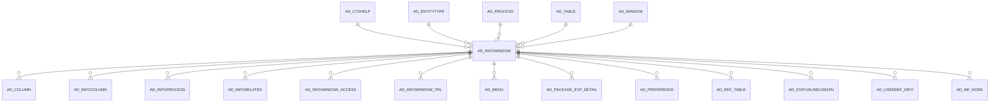

# AD_INFOWINDOW

Area [AD](../../data-model/ad/index.md) · class **config** (proposed) · read from database `idempiere-db` (owner `ADEMPIERE`) · 17 row(s) when profiled

Application model: `org.compiere.model.X_AD_InfoWindow`, access level 4 - System.

## Columns

| column | type | key | not null | business name | references (code) | nulls | distinct |
|---|---|---|---|---|---|---|---|
| `AD_INFOWINDOW_ID` | NUMBER(10,0) | PK | yes | Info Window |  | 0 | 17 |
| `AD_CLIENT_ID` | NUMBER(10,0) |  | yes | Tenant |  | 0 | 1 |
| `AD_ORG_ID` | NUMBER(10,0) |  | yes | Organization |  | 0 | 1 |
| `ISACTIVE` | CHAR(1) |  | yes | Active |  | 0 | 1 |
| `CREATED` | DATE |  | yes | Created |  | 0 | 17 |
| `CREATEDBY` | NUMBER(10,0) |  | yes | Created By |  | 0 | 1 |
| `UPDATED` | DATE |  | yes | Updated |  | 0 | 17 |
| `UPDATEDBY` | NUMBER(10,0) |  | yes | Updated By |  | 0 | 1 |
| `NAME` | VARCHAR2(60 CHAR) |  | yes | Name |  | 0 | 17 |
| `DESCRIPTION` | VARCHAR2(255 CHAR) |  |  | Description |  | 14 | 3 |
| `HELP` | VARCHAR2(2000 CHAR) |  |  | Comment/Help |  | 17 | 0 |
| `AD_TABLE_ID` | NUMBER(10,0) |  | yes | Table | [AD_TABLE](../../data-model/ad/ad_table.md) | 0 | 16 |
| `ENTITYTYPE` | VARCHAR2(40 CHAR) |  | yes | Entity Type |  | 0 | 1 |
| `FROMCLAUSE` | VARCHAR2(2000 CHAR) |  | yes | Sql FROM |  | 0 | 17 |
| `OTHERCLAUSE` | VARCHAR2(2000 CHAR) |  |  | Other SQL Clause |  | 17 | 0 |
| `PROCESSING` | CHAR(1) |  |  | Process Now |  | 0 | 1 |
| `AD_INFOWINDOW_UU` | VARCHAR2(36 CHAR) |  |  | AD_InfoWindow_UU |  | 0 | 17 |
| `WHERECLAUSE` | VARCHAR2(2000 CHAR) |  |  | Sql WHERE |  | 13 | 4 |
| `ISDEFAULT` | CHAR(1) |  | yes | Default |  | 0 | 2 |
| `ISDISTINCT` | CHAR(1) |  | yes | Distinct |  | 0 | 2 |
| `ORDERBYCLAUSE` | VARCHAR2(2000 CHAR) |  |  | Sql ORDER BY |  | 3 | 10 |
| `ISVALID` | CHAR(1) |  | yes | Valid |  | 0 | 1 |
| `AD_CTXHELP_ID` | NUMBER(10,0) |  |  | Context Help | [AD_CTXHELP](../../data-model/ad/ad_ctxhelp.md) | 17 | 0 |
| `IMAGEURL` | VARCHAR2(120 CHAR) |  |  | Image URL |  | 15 | 2 |
| `SEQNO` | NUMBER(10,0) |  |  | Sequence |  | 0 | 12 |
| `ISSHOWINDASHBOARD` | CHAR(1) |  | yes | Show in Dashboard |  | 0 | 2 |
| `AD_PROCESS_ID` | NUMBER(10,0) |  |  |  |  | 17 | 0 |
| `MAXQUERYRECORDS` | NUMBER(10,0) |  | yes | Max Query Records |  | 0 | 1 |
| `ISLOADPAGENUM` | CHAR(1) |  |  | Load Page Num |  | 0 | 1 |
| `PAGINGSIZE` | NUMBER(10,0) |  | yes | Paging Size |  | 0 | 2 |
| `AD_WINDOW_ID` | NUMBER(10,0) |  |  | Window | [AD_WINDOW](../../data-model/ad/ad_window.md) | 17 | 0 |
| `PO_WINDOW_ID` | NUMBER(10,0) |  |  | PO Window | [AD_WINDOW](../../data-model/ad/ad_window.md) | 17 | 0 |

*references (code)* is the table the application model's code says a column points to; *Foreign keys* below are the constraints the database declares. Counts come from the profile; no value is ever shown.

## Check constraints

| name | expression |
|---|---|
| `SYS_C0021240` | `IsDefault IN ('Y','N')` |
| `SYS_C0021241` | `IsValid IN ('Y','N')` |
| `SYS_C0021243` | `isLoadPageNum IN ('Y','N')` |
| `SYS_C0021244` | `IsShowInDashboard IN ('Y','N')` |
| `SYS_C0021246` | `IsDistinct IN ('Y','N')` |
| `SYS_C0021247` | `IsActive in ('Y','N')` |

## Foreign keys

**References**

| table | columns | on delete |
|---|---|---|
| [AD_CTXHELP](../../data-model/ad/ad_ctxhelp.md) | AD_INFOWINDOW.AD_CTXHELP_ID → AD_CTXHELP.AD_CTXHELP_ID | NO ACTION |
| [AD_ENTITYTYPE](../../data-model/ad/ad_entitytype.md) | AD_INFOWINDOW.ENTITYTYPE → AD_ENTITYTYPE.ENTITYTYPE | NO ACTION |
| [AD_PROCESS](../../data-model/ad/ad_process.md) | AD_INFOWINDOW.AD_PROCESS_ID → AD_PROCESS.AD_PROCESS_ID | NO ACTION |
| [AD_TABLE](../../data-model/ad/ad_table.md) | AD_INFOWINDOW.AD_TABLE_ID → AD_TABLE.AD_TABLE_ID | NO ACTION |
| [AD_WINDOW](../../data-model/ad/ad_window.md) | AD_INFOWINDOW.AD_WINDOW_ID → AD_WINDOW.AD_WINDOW_ID | NO ACTION |

**Referenced by**

| table | columns | on delete |
|---|---|---|
| [AD_COLUMN](../../data-model/ad/ad_column.md) | AD_COLUMN.AD_INFOWINDOW_ID → AD_INFOWINDOW.AD_INFOWINDOW_ID | SET NULL |
| [AD_INFOCOLUMN](../../data-model/ad/ad_infocolumn.md) | AD_INFOCOLUMN.AD_INFOWINDOW_ID → AD_INFOWINDOW.AD_INFOWINDOW_ID | CASCADE |
| [AD_INFOPROCESS](../../data-model/ad/ad_infoprocess.md) | AD_INFOPROCESS.AD_INFOWINDOW_ID → AD_INFOWINDOW.AD_INFOWINDOW_ID | CASCADE |
| [AD_INFORELATED](../../data-model/ad/ad_inforelated.md) | AD_INFORELATED.AD_INFOWINDOW_ID → AD_INFOWINDOW.AD_INFOWINDOW_ID | NO ACTION |
| [AD_INFOWINDOW_ACCESS](../../data-model/ad/ad_infowindow_access.md) | AD_INFOWINDOW_ACCESS.AD_INFOWINDOW_ID → AD_INFOWINDOW.AD_INFOWINDOW_ID | CASCADE |
| [AD_INFOWINDOW_TRL](../../data-model/ad/ad_infowindow_trl.md) | AD_INFOWINDOW_TRL.AD_INFOWINDOW_ID → AD_INFOWINDOW.AD_INFOWINDOW_ID | CASCADE |
| [AD_MENU](../../data-model/ad/ad_menu.md) | AD_MENU.AD_INFOWINDOW_ID → AD_INFOWINDOW.AD_INFOWINDOW_ID | NO ACTION |
| [AD_PACKAGE_EXP_DETAIL](../../data-model/ad/ad_package_exp_detail.md) | AD_PACKAGE_EXP_DETAIL.AD_INFOWINDOW_ID → AD_INFOWINDOW.AD_INFOWINDOW_ID | NO ACTION |
| [AD_PREFERENCE](../../data-model/ad/ad_preference.md) | AD_PREFERENCE.AD_INFOWINDOW_ID → AD_INFOWINDOW.AD_INFOWINDOW_ID | NO ACTION |
| [AD_REF_TABLE](../../data-model/ad/ad_ref_table.md) | AD_REF_TABLE.AD_INFOWINDOW_ID → AD_INFOWINDOW.AD_INFOWINDOW_ID | NO ACTION |
| [AD_STATUSLINEUSEDIN](../../data-model/ad/ad_statuslineusedin.md) | AD_STATUSLINEUSEDIN.AD_INFOWINDOW_ID → AD_INFOWINDOW.AD_INFOWINDOW_ID | CASCADE |
| [AD_USERDEF_INFO](../../data-model/ad/ad_userdef_info.md) | AD_USERDEF_INFO.AD_INFOWINDOW_ID → AD_INFOWINDOW.AD_INFOWINDOW_ID | CASCADE |
| [AD_WF_NODE](../../data-model/ad/ad_wf_node.md) | AD_WF_NODE.AD_INFOWINDOW_ID → AD_INFOWINDOW.AD_INFOWINDOW_ID | NO ACTION |

## Write behaviour

- updates: **po_only**
- deletes: **deleted_by_users**
- change log: **recorded**
- evidence: 1 citation(s)

## Schema history

79 change(s); the latest:

| applied | release | operation | column | tickets |
|---|---|---|---|---|
| 2023-04-09T15:47 | iD11 | `add_constraint` |  | IDEMPIERE-5567 |
| 2023-04-09T15:47 | iD11 | `add_constraint` |  | IDEMPIERE-5567 |
| 2022-01-03T11:30 | i9 | `add_constraint` |  | IDEMPIERE-3561 |
| 2022-01-03T11:30 | i9 | `add_column` | AD_Window_ID | IDEMPIERE-3561 |
| 2022-01-03T11:30 | i9 | `add_column` | AD_Window_ID | IDEMPIERE-3561 |
| 2022-01-03T11:30 | i9 | `add_constraint` |  | IDEMPIERE-3561 |
| 2022-01-03T11:30 | i9 | `add_constraint` |  | IDEMPIERE-3561 |
| 2022-01-03T11:30 | i9 | `add_constraint` |  | IDEMPIERE-3561 |
| 2022-01-03T11:30 | i9 | `add_column` | PO_Window_ID | IDEMPIERE-3561 |
| 2022-01-03T11:30 | i9 | `add_column` | PO_Window_ID | IDEMPIERE-3561 |
| 2021-12-05T16:45 | i8.2z | `add_constraint` |  | IDEMPIERE-5075 |
| 2021-12-05T16:45 | i8.2z | `add_constraint` |  | IDEMPIERE-5075 |
| 2021-12-05T16:45 | i8.2z | `drop_constraint` |  | IDEMPIERE-5075 |
| 2021-12-05T16:45 | i8.2z | `drop_constraint` |  | IDEMPIERE-5075 |
| 2020-08-04T01:00 | i7.1z | `modify_column` | FROMCLAUSE | IDEMPIERE-3862 |

## Notes

<!-- ekos:manual id="table.ad_infowindow.notes" -->
_Business notes about this table._
<!-- /ekos:manual -->
