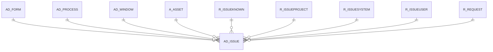

# AD_ISSUE

Compiere Automatic Issue Reporting

Area [AD](../../data-model/ad/index.md) · class **config** (proposed) · read from database `idempiere-db` (owner `ADEMPIERE`) · 0 row(s) when profiled

Application model: `org.compiere.model.X_AD_Issue`, access level 6 - System - Client.

## Columns

| column | type | key | not null | business name | references (code) | nulls | distinct |
|---|---|---|---|---|---|---|---|
| `AD_ISSUE_ID` | NUMBER(10,0) | PK | yes | System Issue |  | 0 | 0 |
| `AD_CLIENT_ID` | NUMBER(10,0) |  | yes | Tenant |  | 0 | 0 |
| `AD_ORG_ID` | NUMBER(10,0) |  | yes | Organization |  | 0 | 0 |
| `ISACTIVE` | CHAR(1) |  | yes | Active |  | 0 | 0 |
| `CREATED` | DATE |  | yes | Created |  | 0 | 0 |
| `CREATEDBY` | NUMBER(10,0) |  | yes | Created By |  | 0 | 0 |
| `UPDATED` | DATE |  | yes | Updated |  | 0 | 0 |
| `UPDATEDBY` | NUMBER(10,0) |  | yes | Updated By |  | 0 | 0 |
| `RELEASENO` | VARCHAR2(10 CHAR) |  | yes | Release No |  | 0 | 0 |
| `VERSION` | VARCHAR2(40 CHAR) |  | yes | Version |  | 0 | 0 |
| `NAME` | VARCHAR2(60 CHAR) |  | yes | Name |  | 0 | 0 |
| `USERNAME` | VARCHAR2(60 CHAR) |  | yes | User Name |  | 0 | 0 |
| `SUPPORTEMAIL` | VARCHAR2(60 CHAR) |  |  | Support EMail |  | 0 | 0 |
| `DBADDRESS` | VARCHAR2(255 CHAR) |  |  | DB Address |  | 0 | 0 |
| `LOCAL_HOST` | VARCHAR2(120 CHAR) |  |  | Local Host |  | 0 | 0 |
| `OPERATINGSYSTEMINFO` | VARCHAR2(255 CHAR) |  |  | Operating System |  | 0 | 0 |
| `RELEASETAG` | VARCHAR2(60 CHAR) |  |  | Release Tag |  | 0 | 0 |
| `DATABASEINFO` | VARCHAR2(255 CHAR) |  |  | Database |  | 0 | 0 |
| `JAVAINFO` | VARCHAR2(255 CHAR) |  |  | Java Info |  | 0 | 0 |
| `REMOTE_ADDR` | VARCHAR2(60 CHAR) |  |  | Remote Addr |  | 0 | 0 |
| `REMOTE_HOST` | VARCHAR2(120 CHAR) |  |  | Remote Host |  | 0 | 0 |
| `ISSUESUMMARY` | VARCHAR2(2000 CHAR) |  | yes | Issue Summary |  | 0 | 0 |
| `COMMENTS` | VARCHAR2(2000 CHAR) |  |  | Comments |  | 0 | 0 |
| `SOURCECLASSNAME` | VARCHAR2(255 CHAR) |  |  | Source Class |  | 0 | 0 |
| `SOURCEMETHODNAME` | VARCHAR2(60 CHAR) |  |  | Source Method |  | 0 | 0 |
| `LOGGERNAME` | VARCHAR2(255 CHAR) |  |  | Logger |  | 0 | 0 |
| `LINENO` | NUMBER(10,0) |  |  | Line |  | 0 | 0 |
| `STACKTRACE` | VARCHAR2(2000 CHAR) |  |  | Stack Trace |  | 0 | 0 |
| `ERRORTRACE` | VARCHAR2(2000 CHAR) |  |  | Error Trace |  | 0 | 0 |
| `RECORD_ID` | NUMBER(10,0) |  |  | Record ID |  | 0 | 0 |
| `REQUESTDOCUMENTNO` | VARCHAR2(30 CHAR) |  |  | Request Document No |  | 0 | 0 |
| `A_ASSET_ID` | NUMBER(10,0) |  |  | Asset | [A_ASSET](../../data-model/a/a_asset.md) | 0 | 0 |
| `R_REQUEST_ID` | NUMBER(10,0) |  |  | Request | [R_REQUEST](../../data-model/r/r_request.md) | 0 | 0 |
| `RESPONSETEXT` | VARCHAR2(2000 CHAR) |  |  | Response Text |  | 0 | 0 |
| `PROCESSING` | CHAR(1) |  |  | Process Now |  | 0 | 0 |
| `PROCESSED` | CHAR(1) |  | yes | Processed |  | 0 | 0 |
| `ISVANILLASYSTEM` | CHAR(1) |  |  | Vanilla System |  | 0 | 0 |
| `ISREPRODUCIBLE` | CHAR(1) |  |  | Reproducible |  | 0 | 0 |
| `R_ISSUEKNOWN_ID` | NUMBER(10,0) |  |  | Known Issue | [R_ISSUEKNOWN](../../data-model/r/r_issueknown.md) | 0 | 0 |
| `STATISTICSINFO` | VARCHAR2(255 CHAR) |  |  | Statistics |  | 0 | 0 |
| `PROFILEINFO` | VARCHAR2(4000 CHAR) |  |  | Profile |  | 0 | 0 |
| `SYSTEMSTATUS` | CHAR(1) |  | yes | System Status |  | 0 | 0 |
| `R_ISSUEPROJECT_ID` | NUMBER(10,0) |  |  | Issue Project | [R_ISSUEPROJECT](../../data-model/r/r_issueproject.md) | 0 | 0 |
| `R_ISSUEUSER_ID` | NUMBER(10,0) |  |  | Issue User | [R_ISSUEUSER](../../data-model/r/r_issueuser.md) | 0 | 0 |
| `R_ISSUESYSTEM_ID` | NUMBER(10,0) |  |  | Issue System | [R_ISSUESYSTEM](../../data-model/r/r_issuesystem.md) | 0 | 0 |
| `ISSUESOURCE` | CHAR(1) |  |  | Source |  | 0 | 0 |
| `AD_WINDOW_ID` | NUMBER(10,0) |  |  | Window | [AD_WINDOW](../../data-model/ad/ad_window.md) | 0 | 0 |
| `AD_PROCESS_ID` | NUMBER(10,0) |  |  | Process | [AD_PROCESS](../../data-model/ad/ad_process.md) | 0 | 0 |
| `AD_FORM_ID` | NUMBER(10,0) |  |  | Special Form | [AD_FORM](../../data-model/ad/ad_form.md) | 0 | 0 |
| `AD_ISSUE_UU` | VARCHAR2(36 CHAR) |  |  | AD_Issue_UU |  | 0 | 0 |

*references (code)* is the table the application model's code says a column points to; *Foreign keys* below are the constraints the database declares. Counts come from the profile; no value is ever shown.

## Check constraints

| name | expression |
|---|---|
| `SYS_C0021627` | `IsActive in ('Y','N')` |
| `SYS_C0021628` | `IsVanillaSystem in ('Y','N')` |
| `SYS_C0021629` | `IsReproducible in ('Y','N')` |
| `SYS_C0021631` | `Processed in ('Y','N')` |

## Foreign keys

**References**

| table | columns | on delete |
|---|---|---|
| [AD_FORM](../../data-model/ad/ad_form.md) | AD_ISSUE.AD_FORM_ID → AD_FORM.AD_FORM_ID | SET NULL |
| [AD_PROCESS](../../data-model/ad/ad_process.md) | AD_ISSUE.AD_PROCESS_ID → AD_PROCESS.AD_PROCESS_ID | SET NULL |
| [AD_WINDOW](../../data-model/ad/ad_window.md) | AD_ISSUE.AD_WINDOW_ID → AD_WINDOW.AD_WINDOW_ID | SET NULL |
| [A_ASSET](../../data-model/a/a_asset.md) | AD_ISSUE.A_ASSET_ID → A_ASSET.A_ASSET_ID | SET NULL |
| [R_ISSUEKNOWN](../../data-model/r/r_issueknown.md) | AD_ISSUE.R_ISSUEKNOWN_ID → R_ISSUEKNOWN.R_ISSUEKNOWN_ID | NO ACTION |
| [R_ISSUEPROJECT](../../data-model/r/r_issueproject.md) | AD_ISSUE.R_ISSUEPROJECT_ID → R_ISSUEPROJECT.R_ISSUEPROJECT_ID | NO ACTION |
| [R_ISSUESYSTEM](../../data-model/r/r_issuesystem.md) | AD_ISSUE.R_ISSUESYSTEM_ID → R_ISSUESYSTEM.R_ISSUESYSTEM_ID | NO ACTION |
| [R_ISSUEUSER](../../data-model/r/r_issueuser.md) | AD_ISSUE.R_ISSUEUSER_ID → R_ISSUEUSER.R_ISSUEUSER_ID | NO ACTION |
| [R_REQUEST](../../data-model/r/r_request.md) | AD_ISSUE.R_REQUEST_ID → R_REQUEST.R_REQUEST_ID | SET NULL |

**Referenced by**

_None._

## Write behaviour

- updates: **po_only**
- deletes: **deleted_by_users**
- change log: **not_recorded**
- evidence: 1 citation(s)

## Schema history

111 change(s); the latest:

| applied | release | operation | column | tickets |
|---|---|---|---|---|
| 2023-04-09T15:47 | iD11 | `add_constraint` |  | IDEMPIERE-5567 |
| 2023-04-09T15:47 | iD11 | `add_constraint` |  | IDEMPIERE-5567 |
| 2022-09-01T09:24 | i9 | `modify_column` | ProfileInfo | IDEMPIERE-5342 |
| 2022-09-01T09:24 | i9 | `modify_column` | ProfileInfo | IDEMPIERE-5342 |
| 2021-12-05T16:45 | i8.2z | `add_constraint` |  | IDEMPIERE-5075 |
| 2021-12-05T16:45 | i8.2z | `drop_constraint` |  | IDEMPIERE-5075 |
| 2021-12-05T16:45 | i8.2z | `add_constraint` |  | IDEMPIERE-5075 |
| 2021-12-05T16:45 | i8.2z | `add_constraint` |  | IDEMPIERE-5075 |
| 2021-12-05T16:45 | i8.2z | `add_constraint` |  | IDEMPIERE-5075 |
| 2021-12-05T16:45 | i8.2z | `drop_constraint` |  | IDEMPIERE-5075 |
| 2021-12-05T16:45 | i8.2z | `add_constraint` |  | IDEMPIERE-5075 |
| 2021-12-05T16:45 | i8.2z | `drop_constraint` |  | IDEMPIERE-5075 |
| 2021-12-05T16:45 | i8.2z | `add_constraint` |  | IDEMPIERE-5075 |
| 2021-12-05T16:45 | i8.2z | `drop_constraint` |  | IDEMPIERE-5075 |
| 2021-12-05T16:45 | i8.2z | `drop_constraint` |  | IDEMPIERE-5075 |

## Notes

<!-- ekos:manual id="table.ad_issue.notes" -->
_Business notes about this table._
<!-- /ekos:manual -->
