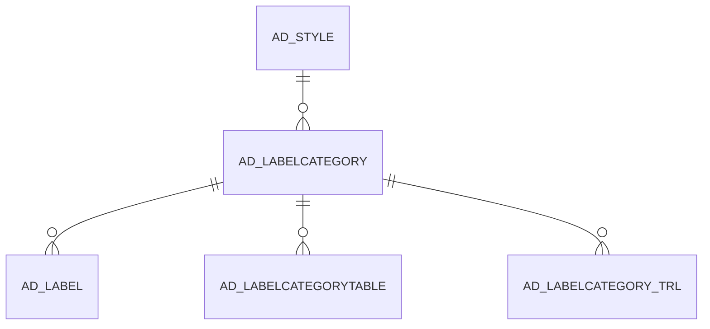

# AD_LABELCATEGORY

Area [AD](../../data-model/ad/index.md) · class **config** (proposed) · read from database `idempiere-db` (owner `ADEMPIERE`) · 0 row(s) when profiled

Application model: `org.compiere.model.X_AD_LabelCategory`, access level 6 - System - Client.

## Columns

| column | type | key | not null | business name | references (code) | nulls | distinct |
|---|---|---|---|---|---|---|---|
| `AD_LABELCATEGORY_ID` | NUMBER(10,0) | PK | yes | Label Category |  | 0 | 0 |
| `AD_LABELCATEGORY_UU` | VARCHAR2(36 CHAR) |  |  | Label Category |  | 0 | 0 |
| `AD_CLIENT_ID` | NUMBER(10,0) |  |  | Tenant |  | 0 | 0 |
| `AD_ORG_ID` | NUMBER(10,0) |  |  | Organization |  | 0 | 0 |
| `CREATED` | DATE |  |  | Created |  | 0 | 0 |
| `CREATEDBY` | NUMBER(10,0) |  |  | Created By |  | 0 | 0 |
| `UPDATED` | DATE |  |  | Updated |  | 0 | 0 |
| `UPDATEDBY` | NUMBER(10,0) |  |  | Updated By |  | 0 | 0 |
| `ISACTIVE` | CHAR(1) |  |  | Active |  | 0 | 0 |
| `DESCRIPTION` | VARCHAR2(255 CHAR) |  |  | Description |  | 0 | 0 |
| `NAME` | VARCHAR2(60 CHAR) |  | yes | Name |  | 0 | 0 |
| `AD_LABELSTYLE_ID` | NUMBER(10,0) |  |  | Label Style | [AD_STYLE](../../data-model/ad/ad_style.md) | 0 | 0 |
| `ISCANBEUSEDINALLTABLES` | CHAR(1) |  |  | Can Be Used in All Tables |  | 0 | 0 |

*references (code)* is the table the application model's code says a column points to; *Foreign keys* below are the constraints the database declares. Counts come from the profile; no value is ever shown.

## Check constraints

| name | expression |
|---|---|
| `SYS_C0020645` | `IsCanBeUsedInAllTables IN ('Y','N')` |
| `SYS_C0020648` | `IsActive IN ('Y','N')` |

## Foreign keys

**References**

| table | columns | on delete |
|---|---|---|
| [AD_STYLE](../../data-model/ad/ad_style.md) | AD_LABELCATEGORY.AD_LABELSTYLE_ID → AD_STYLE.AD_STYLE_ID | NO ACTION |

**Referenced by**

| table | columns | on delete |
|---|---|---|
| [AD_LABEL](../../data-model/ad/ad_label.md) | AD_LABEL.AD_LABELCATEGORY_ID → AD_LABELCATEGORY.AD_LABELCATEGORY_ID | NO ACTION |
| [AD_LABELCATEGORYTABLE](../../data-model/ad/ad_labelcategorytable.md) | AD_LABELCATEGORYTABLE.AD_LABELCATEGORY_ID → AD_LABELCATEGORY.AD_LABELCATEGORY_ID | NO ACTION |
| [AD_LABELCATEGORY_TRL](../../data-model/ad/ad_labelcategory_trl.md) | AD_LABELCATEGORY_TRL.AD_LABELCATEGORY_ID → AD_LABELCATEGORY.AD_LABELCATEGORY_ID | CASCADE |

## Write behaviour

- updates: **po_only**
- deletes: **deleted_by_users**
- change log: **recorded**
- evidence: 1 citation(s)

## Schema history

30 change(s); the latest:

| applied | release | operation | column | tickets |
|---|---|---|---|---|
| 2022-05-13T11:18 | iD10 | `add_column` | AD_LabelStyle_ID | IDEMPIERE-5259 |
| 2022-05-13T11:18 | iD10 | `add_column` | IsCanBeUsedInAllTables | IDEMPIERE-5259 |
| 2022-05-13T11:18 | iD10 | `add_constraint` |  | IDEMPIERE-5259 |
| 2022-05-13T11:18 | iD10 | `add_column` | Description | IDEMPIERE-5259 |
| 2022-05-13T11:18 | iD10 | `add_column` | UpdatedBy | IDEMPIERE-5259 |
| 2022-05-13T11:18 | iD10 | `add_column` | Updated | IDEMPIERE-5259 |
| 2022-05-13T11:18 | iD10 | `add_column` | Description | IDEMPIERE-5259 |
| 2022-05-13T11:18 | iD10 | `add_column` | AD_LabelCategory_UU | IDEMPIERE-5259 |
| 2022-05-13T11:18 | iD10 | `add_column` | UpdatedBy | IDEMPIERE-5259 |
| 2022-05-13T11:18 | iD10 | `add_column` | IsActive | IDEMPIERE-5259 |
| 2022-05-13T11:18 | iD10 | `add_column` | AD_Client_ID | IDEMPIERE-5259 |
| 2022-05-13T11:18 | iD10 | `add_column` | IsCanBeUsedInAllTables | IDEMPIERE-5259 |
| 2022-05-13T11:18 | iD10 | `create_table` |  | IDEMPIERE-5259 |
| 2022-05-13T11:18 | iD10 | `add_column` | Created | IDEMPIERE-5259 |
| 2022-05-13T11:18 | iD10 | `add_constraint` |  | IDEMPIERE-5259 |

## Notes

<!-- ekos:manual id="table.ad_labelcategory.notes" -->
_Business notes about this table._
<!-- /ekos:manual -->
