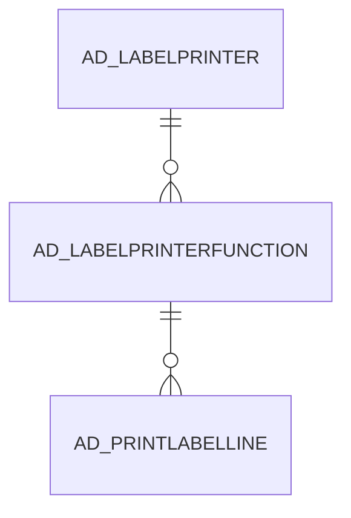

# AD_LABELPRINTERFUNCTION

Area [AD](../../data-model/ad/index.md) · class **config** (proposed) · read from database `idempiere-db` (owner `ADEMPIERE`) · 0 row(s) when profiled

Application model: `org.compiere.model.X_AD_LabelPrinterFunction`, access level 6 - System - Client.

## Columns

| column | type | key | not null | business name | references (code) | nulls | distinct |
|---|---|---|---|---|---|---|---|
| `AD_LABELPRINTERFUNCTION_ID` | NUMBER(10,0) | PK | yes | Label printer Function |  | 0 | 0 |
| `AD_CLIENT_ID` | NUMBER(10,0) |  | yes | Tenant |  | 0 | 0 |
| `AD_ORG_ID` | NUMBER(10,0) |  | yes | Organization |  | 0 | 0 |
| `ISACTIVE` | CHAR(1) |  | yes | Active |  | 0 | 0 |
| `CREATED` | DATE |  | yes | Created |  | 0 | 0 |
| `CREATEDBY` | NUMBER(10,0) |  | yes | Created By |  | 0 | 0 |
| `UPDATED` | DATE |  | yes | Updated |  | 0 | 0 |
| `UPDATEDBY` | NUMBER(10,0) |  | yes | Updated By |  | 0 | 0 |
| `NAME` | VARCHAR2(60 CHAR) |  | yes | Name |  | 0 | 0 |
| `DESCRIPTION` | VARCHAR2(255 CHAR) |  |  | Description |  | 0 | 0 |
| `AD_LABELPRINTER_ID` | NUMBER(10,0) |  | yes | Label printer | [AD_LABELPRINTER](../../data-model/ad/ad_labelprinter.md) | 0 | 0 |
| `FUNCTIONPREFIX` | VARCHAR2(40 CHAR) |  |  | Function Prefix |  | 0 | 0 |
| `FUNCTIONSUFFIX` | VARCHAR2(40 CHAR) |  |  | Function Suffix |  | 0 | 0 |
| `ISXYPOSITION` | CHAR(1) |  | yes | XY Position |  | 0 | 0 |
| `XYSEPARATOR` | VARCHAR2(20 CHAR) |  |  | XY Separator |  | 0 | 0 |
| `AD_LABELPRINTERFUNCTION_UU` | VARCHAR2(36 CHAR) |  |  | AD_LabelPrinterFunction_UU |  | 0 | 0 |

*references (code)* is the table the application model's code says a column points to; *Foreign keys* below are the constraints the database declares. Counts come from the profile; no value is ever shown.

## Check constraints

| name | expression |
|---|---|
| `SYS_C0021780` | `IsActive in ('Y','N')` |
| `SYS_C0021781` | `IsXYPosition in ('Y','N')` |

## Foreign keys

**References**

| table | columns | on delete |
|---|---|---|
| [AD_LABELPRINTER](../../data-model/ad/ad_labelprinter.md) | AD_LABELPRINTERFUNCTION.AD_LABELPRINTER_ID → AD_LABELPRINTER.AD_LABELPRINTER_ID | NO ACTION |

**Referenced by**

| table | columns | on delete |
|---|---|---|
| [AD_PRINTLABELLINE](../../data-model/ad/ad_printlabelline.md) | AD_PRINTLABELLINE.AD_LABELPRINTERFUNCTION_ID → AD_LABELPRINTERFUNCTION.AD_LABELPRINTERFUNCTION_ID | NO ACTION |

## Write behaviour

- updates: **po_only**
- deletes: **deleted_by_users**
- change log: **recorded**
- evidence: 1 citation(s)

## Schema history

24 change(s); the latest:

| applied | release | operation | column | tickets |
|---|---|---|---|---|
| 2023-04-09T15:47 | iD11 | `add_constraint` |  | IDEMPIERE-5567 |
| 2023-04-09T15:47 | iD11 | `add_constraint` |  | IDEMPIERE-5567 |
| 2021-12-05T16:45 | i8.2z | `drop_constraint` |  | IDEMPIERE-5075 |
| 2021-12-05T16:45 | i8.2z | `add_constraint` |  | IDEMPIERE-5075 |
| 2020-08-04T01:00 | i7.1z | `modify_column` | DESCRIPTION | IDEMPIERE-3862 |
| 2020-08-04T01:00 | i7.1z | `drop_column` | tmp_col_3_tmp | IDEMPIERE-3862 |
| 2020-08-04T01:00 | i7.1z | `modify_column` | FUNCTIONSUFFIX | IDEMPIERE-3862 |
| 2020-08-04T01:00 | i7.1z | `modify_column` | NAME | IDEMPIERE-3862 |
| 2020-08-04T01:00 | i7.1z | `add_column` | tmp_col_3_tmp | IDEMPIERE-3862 |
| 2020-08-04T01:00 | i7.1z | `add_column` | tmp_col_4_tmp | IDEMPIERE-3862 |
| 2020-08-04T01:00 | i7.1z | `modify_column` | NAME | IDEMPIERE-3862 |
| 2020-08-04T01:00 | i7.1z | `add_column` | tmp_col_1_tmp | IDEMPIERE-3862 |
| 2020-08-04T01:00 | i7.1z | `modify_column` | NAME | IDEMPIERE-3862 |
| 2020-08-04T01:00 | i7.1z | `drop_column` | tmp_col_1_tmp | IDEMPIERE-3862 |
| 2020-08-04T01:00 | i7.1z | `drop_column` | tmp_col_6_tmp | IDEMPIERE-3862 |

## Notes

<!-- ekos:manual id="table.ad_labelprinterfunction.notes" -->
_Business notes about this table._
<!-- /ekos:manual -->
