# AD_LANGUAGE

Area [AD](../../data-model/ad/index.md) · class **config** (proposed) · read from database `idempiere-db` (owner `ADEMPIERE`) · 109 row(s) when profiled

Application model: `org.compiere.model.X_AD_Language`, access level 4 - System.

## Columns

| column | type | key | not null | business name | references (code) | nulls | distinct |
|---|---|---|---|---|---|---|---|
| `AD_LANGUAGE` | VARCHAR2(6 CHAR) | PK | yes | Language |  | 0 | 109 |
| `AD_CLIENT_ID` | NUMBER(10,0) |  | yes | Tenant |  | 0 | 1 |
| `AD_ORG_ID` | NUMBER(10,0) |  | yes | Organization |  | 0 | 1 |
| `ISACTIVE` | CHAR(1) |  | yes | Active |  | 0 | 1 |
| `CREATED` | DATE |  | yes | Created |  | 0 | 35 |
| `CREATEDBY` | NUMBER(10,0) |  | yes | Created By |  | 0 | 2 |
| `UPDATED` | DATE |  | yes | Updated |  | 0 | 51 |
| `UPDATEDBY` | NUMBER(10,0) |  | yes | Updated By |  | 0 | 2 |
| `NAME` | VARCHAR2(60 CHAR) |  | yes | Name |  | 0 | 109 |
| `LANGUAGEISO` | CHAR(2) |  |  | ISO Language Code |  | 0 | 46 |
| `COUNTRYCODE` | CHAR(2) |  |  | ISO Country Code |  | 0 | 97 |
| `ISBASELANGUAGE` | CHAR(1) |  | yes | Base Language |  | 0 | 2 |
| `ISSYSTEMLANGUAGE` | CHAR(1) |  | yes | System Language |  | 0 | 2 |
| `PROCESSING` | CHAR(1) |  |  | Process Now |  | 92 | 1 |
| `AD_LANGUAGE_ID` | NUMBER(10,0) |  | yes | Language ID |  | 0 | 109 |
| `ISDECIMALPOINT` | CHAR(1) |  |  | Decimal Point |  | 103 | 2 |
| `DATEPATTERN` | VARCHAR2(20 CHAR) |  |  | Date Pattern |  | 78 | 6 |
| `TIMEPATTERN` | VARCHAR2(20 CHAR) |  |  | Time Pattern |  | 109 | 0 |
| `AD_LANGUAGE_UU` | VARCHAR2(36 CHAR) |  |  | AD_Language_UU |  | 0 | 109 |
| `ISLOGINLOCALE` | CHAR(1) |  |  | Login Locale |  | 0 | 2 |
| `AD_PRINTPAPER_ID` | NUMBER(10,0) |  |  | Print Paper | [AD_PRINTPAPER](../../data-model/ad/ad_printpaper.md) | 105 | 1 |
| `PRINTNAME` | VARCHAR2(60 CHAR) |  | yes | Print Text |  | 0 | 109 |

*references (code)* is the table the application model's code says a column points to; *Foreign keys* below are the constraints the database declares. Counts come from the profile; no value is ever shown.

## Check constraints

| name | expression |
|---|---|
| `SYS_C0022163` | `IsBaseLanguage in ('Y','N')` |
| `SYS_C0022165` | `IsActive in ('Y','N')` |
| `SYS_C0022166` | `IsSystemLanguage in ('Y','N')` |
| `SYS_C0022168` | `IsLoginLocale IN ('Y','N')` |

## Foreign keys

**References**

| table | columns | on delete |
|---|---|---|
| [AD_CLIENT](../../data-model/ad/ad_client.md) | AD_LANGUAGE.AD_CLIENT_ID → AD_CLIENT.AD_CLIENT_ID | NO ACTION |
| [AD_ORG](../../data-model/ad/ad_org.md) | AD_LANGUAGE.AD_ORG_ID → AD_ORG.AD_ORG_ID | NO ACTION |
| [AD_PRINTPAPER](../../data-model/ad/ad_printpaper.md) | AD_LANGUAGE.AD_PRINTPAPER_ID → AD_PRINTPAPER.AD_PRINTPAPER_ID | NO ACTION |

**Referenced by**

| table | columns | on delete |
|---|---|---|
| [AD_BROADCASTMESSAGE_TRL](../../data-model/ad/ad_broadcastmessage_trl.md) | AD_BROADCASTMESSAGE_TRL.AD_LANGUAGE → AD_LANGUAGE.AD_LANGUAGE | NO ACTION |
| [AD_CHARTDATASOURCE_TRL](../../data-model/ad/ad_chartdatasource_trl.md) | AD_CHARTDATASOURCE_TRL.AD_LANGUAGE → AD_LANGUAGE.AD_LANGUAGE | NO ACTION |
| [AD_CHART_TRL](../../data-model/ad/ad_chart_trl.md) | AD_CHART_TRL.AD_LANGUAGE → AD_LANGUAGE.AD_LANGUAGE | NO ACTION |
| [AD_CLIENT](../../data-model/ad/ad_client.md) | AD_CLIENT.AD_LANGUAGE → AD_LANGUAGE.AD_LANGUAGE | NO ACTION |
| [AD_COLOR_TRL](../../data-model/ad/ad_color_trl.md) | AD_COLOR_TRL.AD_LANGUAGE → AD_LANGUAGE.AD_LANGUAGE | NO ACTION |
| [AD_COLUMN_TRL](../../data-model/ad/ad_column_trl.md) | AD_COLUMN_TRL.AD_LANGUAGE → AD_LANGUAGE.AD_LANGUAGE | NO ACTION |
| [AD_CTXHELPMSG_TRL](../../data-model/ad/ad_ctxhelpmsg_trl.md) | AD_CTXHELPMSG_TRL.AD_LANGUAGE → AD_LANGUAGE.AD_LANGUAGE | NO ACTION |
| [AD_CTXHELPSUGGESTION](../../data-model/ad/ad_ctxhelpsuggestion.md) | AD_CTXHELPSUGGESTION.AD_LANGUAGE → AD_LANGUAGE.AD_LANGUAGE | NO ACTION |
| [AD_DESKTOP_TRL](../../data-model/ad/ad_desktop_trl.md) | AD_DESKTOP_TRL.AD_LANGUAGE → AD_LANGUAGE.AD_LANGUAGE | NO ACTION |
| [AD_ELEMENT_TRL](../../data-model/ad/ad_element_trl.md) | AD_ELEMENT_TRL.AD_LANGUAGE → AD_LANGUAGE.AD_LANGUAGE | NO ACTION |
| [AD_ERROR](../../data-model/ad/ad_error.md) | AD_ERROR.AD_LANGUAGE → AD_LANGUAGE.AD_LANGUAGE | NO ACTION |
| [AD_FIELDGROUP_TRL](../../data-model/ad/ad_fieldgroup_trl.md) | AD_FIELDGROUP_TRL.AD_LANGUAGE → AD_LANGUAGE.AD_LANGUAGE | NO ACTION |
| [AD_FIELDSUGGESTION](../../data-model/ad/ad_fieldsuggestion.md) | AD_FIELDSUGGESTION.AD_LANGUAGE → AD_LANGUAGE.AD_LANGUAGE | NO ACTION |
| [AD_FIELD_TRL](../../data-model/ad/ad_field_trl.md) | AD_FIELD_TRL.AD_LANGUAGE → AD_LANGUAGE.AD_LANGUAGE | NO ACTION |
| [AD_FORM_TRL](../../data-model/ad/ad_form_trl.md) | AD_FORM_TRL.AD_LANGUAGE → AD_LANGUAGE.AD_LANGUAGE | NO ACTION |
| [AD_INFOCOLUMN_TRL](../../data-model/ad/ad_infocolumn_trl.md) | AD_INFOCOLUMN_TRL.AD_LANGUAGE → AD_LANGUAGE.AD_LANGUAGE | CASCADE |
| [AD_INFOWINDOW_TRL](../../data-model/ad/ad_infowindow_trl.md) | AD_INFOWINDOW_TRL.AD_LANGUAGE → AD_LANGUAGE.AD_LANGUAGE | CASCADE |
| [AD_LABELCATEGORY_TRL](../../data-model/ad/ad_labelcategory_trl.md) | AD_LABELCATEGORY_TRL.AD_LANGUAGE → AD_LANGUAGE.AD_LANGUAGE | NO ACTION |
| [AD_LABEL_TRL](../../data-model/ad/ad_label_trl.md) | AD_LABEL_TRL.AD_LANGUAGE → AD_LANGUAGE.AD_LANGUAGE | NO ACTION |
| [AD_MENU_TRL](../../data-model/ad/ad_menu_trl.md) | AD_MENU_TRL.AD_LANGUAGE → AD_LANGUAGE.AD_LANGUAGE | NO ACTION |
| [AD_MESSAGE_TRL](../../data-model/ad/ad_message_trl.md) | AD_MESSAGE_TRL.AD_LANGUAGE → AD_LANGUAGE.AD_LANGUAGE | NO ACTION |
| [AD_PINSTANCE](../../data-model/ad/ad_pinstance.md) | AD_PINSTANCE.AD_LANGUAGE_ID → AD_LANGUAGE.AD_LANGUAGE_ID | NO ACTION |
| [AD_PRINTCOLOR_TRL](../../data-model/ad/ad_printcolor_trl.md) | AD_PRINTCOLOR_TRL.AD_LANGUAGE → AD_LANGUAGE.AD_LANGUAGE | NO ACTION |
| [AD_PRINTFORMATITEM_TRL](../../data-model/ad/ad_printformatitem_trl.md) | AD_PRINTFORMATITEM_TRL.AD_LANGUAGE → AD_LANGUAGE.AD_LANGUAGE | NO ACTION |
| [AD_PRINTFORMAT_TRL](../../data-model/ad/ad_printformat_trl.md) | AD_PRINTFORMAT_TRL.AD_LANGUAGE → AD_LANGUAGE.AD_LANGUAGE | NO ACTION |
| [AD_PRINTLABELLINE_TRL](../../data-model/ad/ad_printlabelline_trl.md) | AD_PRINTLABELLINE_TRL.AD_LANGUAGE → AD_LANGUAGE.AD_LANGUAGE | NO ACTION |
| [AD_PROCESS_DRILLRULE_TRL](../../data-model/ad/ad_process_drillrule_trl.md) | AD_PROCESS_DRILLRULE_TRL.AD_LANGUAGE → AD_LANGUAGE.AD_LANGUAGE | NO ACTION |
| [AD_PROCESS_PARA_TRL](../../data-model/ad/ad_process_para_trl.md) | AD_PROCESS_PARA_TRL.AD_LANGUAGE → AD_LANGUAGE.AD_LANGUAGE | NO ACTION |
| [AD_PROCESS_TRL](../../data-model/ad/ad_process_trl.md) | AD_PROCESS_TRL.AD_LANGUAGE → AD_LANGUAGE.AD_LANGUAGE | NO ACTION |
| [AD_REFERENCE_TRL](../../data-model/ad/ad_reference_trl.md) | AD_REFERENCE_TRL.AD_LANGUAGE → AD_LANGUAGE.AD_LANGUAGE | NO ACTION |
| [AD_REF_LIST_TRL](../../data-model/ad/ad_ref_list_trl.md) | AD_REF_LIST_TRL.AD_LANGUAGE → AD_LANGUAGE.AD_LANGUAGE | NO ACTION |
| [AD_TABLE_TRL](../../data-model/ad/ad_table_trl.md) | AD_TABLE_TRL.AD_LANGUAGE → AD_LANGUAGE.AD_LANGUAGE | NO ACTION |
| [AD_TAB_TRL](../../data-model/ad/ad_tab_trl.md) | AD_TAB_TRL.AD_LANGUAGE → AD_LANGUAGE.AD_LANGUAGE | NO ACTION |
| [AD_TASK_TRL](../../data-model/ad/ad_task_trl.md) | AD_TASK_TRL.AD_LANGUAGE → AD_LANGUAGE.AD_LANGUAGE | NO ACTION |
| [AD_USERDEF_INFO](../../data-model/ad/ad_userdef_info.md) | AD_USERDEF_INFO.AD_LANGUAGE → AD_LANGUAGE.AD_LANGUAGE | NO ACTION |
| [AD_USERDEF_PROC](../../data-model/ad/ad_userdef_proc.md) | AD_USERDEF_PROC.AD_LANGUAGE → AD_LANGUAGE.AD_LANGUAGE | NO ACTION |
| [AD_USERDEF_WIN](../../data-model/ad/ad_userdef_win.md) | AD_USERDEF_WIN.AD_LANGUAGE → AD_LANGUAGE.AD_LANGUAGE | NO ACTION |
| [AD_WF_NODE_TRL](../../data-model/ad/ad_wf_node_trl.md) | AD_WF_NODE_TRL.AD_LANGUAGE → AD_LANGUAGE.AD_LANGUAGE | NO ACTION |
| [AD_WINDOW_TRL](../../data-model/ad/ad_window_trl.md) | AD_WINDOW_TRL.AD_LANGUAGE → AD_LANGUAGE.AD_LANGUAGE | NO ACTION |
| [AD_WORKBENCH_TRL](../../data-model/ad/ad_workbench_trl.md) | AD_WORKBENCH_TRL.AD_LANGUAGE → AD_LANGUAGE.AD_LANGUAGE | NO ACTION |
| [AD_WORKFLOW_TRL](../../data-model/ad/ad_workflow_trl.md) | AD_WORKFLOW_TRL.AD_LANGUAGE → AD_LANGUAGE.AD_LANGUAGE | NO ACTION |
| [A_ASSET_GROUP_TRL](../../data-model/a/a_asset_group_trl.md) | A_ASSET_GROUP_TRL.AD_LANGUAGE → AD_LANGUAGE.AD_LANGUAGE | NO ACTION |
| [CM_CONTAINER_ELEMENT_TRL](../../data-model/cm/cm_container_element_trl.md) | CM_CONTAINER_ELEMENT_TRL.AD_LANGUAGE → AD_LANGUAGE.AD_LANGUAGE | CASCADE |
| [CM_CONTAINER_TRL](../../data-model/cm/cm_container_trl.md) | CM_CONTAINER_TRL.AD_LANGUAGE → AD_LANGUAGE.AD_LANGUAGE | CASCADE |
| [CM_CSTAGE_ELEMENT_TRL](../../data-model/cm/cm_cstage_element_trl.md) | CM_CSTAGE_ELEMENT_TRL.AD_LANGUAGE → AD_LANGUAGE.AD_LANGUAGE | CASCADE |
| [CM_CSTAGE_TRL](../../data-model/cm/cm_cstage_trl.md) | CM_CSTAGE_TRL.AD_LANGUAGE → AD_LANGUAGE.AD_LANGUAGE | CASCADE |
| [CM_NEWSCHANNEL](../../data-model/cm/cm_newschannel.md) | CM_NEWSCHANNEL.AD_LANGUAGE → AD_LANGUAGE.AD_LANGUAGE | NO ACTION |
| [C_ACTIVITY_TRL](../../data-model/c/c_activity_trl.md) | C_ACTIVITY_TRL.AD_LANGUAGE → AD_LANGUAGE.AD_LANGUAGE | NO ACTION |
| [C_BPARTNER](../../data-model/c/c_bpartner.md) | C_BPARTNER.AD_LANGUAGE → AD_LANGUAGE.AD_LANGUAGE | NO ACTION |
| [C_CAMPAIGN_TRL](../../data-model/c/c_campaign_trl.md) | C_CAMPAIGN_TRL.AD_LANGUAGE → AD_LANGUAGE.AD_LANGUAGE | NO ACTION |
| [C_CHARGE_TRL](../../data-model/c/c_charge_trl.md) | C_CHARGE_TRL.AD_LANGUAGE → AD_LANGUAGE.AD_LANGUAGE | NO ACTION |
| [C_COUNTRY](../../data-model/c/c_country.md) | C_COUNTRY.AD_LANGUAGE → AD_LANGUAGE.AD_LANGUAGE | NO ACTION |
| [C_COUNTRYGROUP_TRL](../../data-model/c/c_countrygroup_trl.md) | C_COUNTRYGROUP_TRL.AD_LANGUAGE → AD_LANGUAGE.AD_LANGUAGE | NO ACTION |
| [C_COUNTRY_TRL](../../data-model/c/c_country_trl.md) | C_COUNTRY_TRL.AD_LANGUAGE → AD_LANGUAGE.AD_LANGUAGE | CASCADE |
| [C_CURRENCY_TRL](../../data-model/c/c_currency_trl.md) | C_CURRENCY_TRL.AD_LANGUAGE → AD_LANGUAGE.AD_LANGUAGE | CASCADE |
| [C_DOCTYPE_TRL](../../data-model/c/c_doctype_trl.md) | C_DOCTYPE_TRL.AD_LANGUAGE → AD_LANGUAGE.AD_LANGUAGE | NO ACTION |
| [C_DUNNINGLEVEL_TRL](../../data-model/c/c_dunninglevel_trl.md) | C_DUNNINGLEVEL_TRL.AD_LANGUAGE → AD_LANGUAGE.AD_LANGUAGE | NO ACTION |
| [C_ELEMENTVALUE_TRL](../../data-model/c/c_elementvalue_trl.md) | C_ELEMENTVALUE_TRL.AD_LANGUAGE → AD_LANGUAGE.AD_LANGUAGE | NO ACTION |
| [C_GREETING_TRL](../../data-model/c/c_greeting_trl.md) | C_GREETING_TRL.AD_LANGUAGE → AD_LANGUAGE.AD_LANGUAGE | NO ACTION |
| [C_PAYMENTTERM_TRL](../../data-model/c/c_paymentterm_trl.md) | C_PAYMENTTERM_TRL.AD_LANGUAGE → AD_LANGUAGE.AD_LANGUAGE | NO ACTION |
| [C_REGION_TRL](../../data-model/c/c_region_trl.md) | C_REGION_TRL.AD_LANGUAGE → AD_LANGUAGE.AD_LANGUAGE | NO ACTION |
| [C_SALESREGION_TRL](../../data-model/c/c_salesregion_trl.md) | C_SALESREGION_TRL.AD_LANGUAGE → AD_LANGUAGE.AD_LANGUAGE | NO ACTION |
| [C_SALESSTAGE_TRL](../../data-model/c/c_salesstage_trl.md) | C_SALESSTAGE_TRL.AD_LANGUAGE → AD_LANGUAGE.AD_LANGUAGE | NO ACTION |
| [C_TAXCATEGORY_TRL](../../data-model/c/c_taxcategory_trl.md) | C_TAXCATEGORY_TRL.AD_LANGUAGE → AD_LANGUAGE.AD_LANGUAGE | NO ACTION |
| [C_TAX_TRL](../../data-model/c/c_tax_trl.md) | C_TAX_TRL.AD_LANGUAGE → AD_LANGUAGE.AD_LANGUAGE | CASCADE |
| [C_UOM_TRL](../../data-model/c/c_uom_trl.md) | C_UOM_TRL.AD_LANGUAGE → AD_LANGUAGE.AD_LANGUAGE | CASCADE |
| [GL_CATEGORY_TRL](../../data-model/gl/gl_category_trl.md) | GL_CATEGORY_TRL.AD_LANGUAGE → AD_LANGUAGE.AD_LANGUAGE | NO ACTION |
| [K_SYNONYM](../../data-model/k/k_synonym.md) | K_SYNONYM.AD_LANGUAGE → AD_LANGUAGE.AD_LANGUAGE | NO ACTION |
| [M_PRICELIST_TRL](../../data-model/m/m_pricelist_trl.md) | M_PRICELIST_TRL.AD_LANGUAGE → AD_LANGUAGE.AD_LANGUAGE | NO ACTION |
| [M_PRICELIST_VERSION_TRL](../../data-model/m/m_pricelist_version_trl.md) | M_PRICELIST_VERSION_TRL.AD_LANGUAGE → AD_LANGUAGE.AD_LANGUAGE | NO ACTION |
| [M_PRODUCT_CATEGORY_TRL](../../data-model/m/m_product_category_trl.md) | M_PRODUCT_CATEGORY_TRL.AD_LANGUAGE → AD_LANGUAGE.AD_LANGUAGE | NO ACTION |
| [M_PRODUCT_TRL](../../data-model/m/m_product_trl.md) | M_PRODUCT_TRL.AD_LANGUAGE → AD_LANGUAGE.AD_LANGUAGE | NO ACTION |
| [PA_DASHBOARDCONTENT_TRL](../../data-model/pa/pa_dashboardcontent_trl.md) | PA_DASHBOARDCONTENT_TRL.AD_LANGUAGE → AD_LANGUAGE.AD_LANGUAGE | NO ACTION |
| [PA_DOCUMENTSTATUS_TRL](../../data-model/pa/pa_documentstatus_trl.md) | PA_DOCUMENTSTATUS_TRL.AD_LANGUAGE → AD_LANGUAGE.AD_LANGUAGE | NO ACTION |
| [PA_REPORTCOLUMN_TRL](../../data-model/pa/pa_reportcolumn_trl.md) | PA_REPORTCOLUMN_TRL.AD_LANGUAGE → AD_LANGUAGE.AD_LANGUAGE | NO ACTION |
| [PA_REPORTLINE_TRL](../../data-model/pa/pa_reportline_trl.md) | PA_REPORTLINE_TRL.AD_LANGUAGE → AD_LANGUAGE.AD_LANGUAGE | NO ACTION |
| [PP_ORDER_BOMLINE_TRL](../../data-model/pp/pp_order_bomline_trl.md) | PP_ORDER_BOMLINE_TRL.AD_LANGUAGE → AD_LANGUAGE.AD_LANGUAGE | NO ACTION |
| [PP_ORDER_BOM_TRL](../../data-model/pp/pp_order_bom_trl.md) | PP_ORDER_BOM_TRL.AD_LANGUAGE → AD_LANGUAGE.AD_LANGUAGE | NO ACTION |
| [PP_ORDER_NODE_TRL](../../data-model/pp/pp_order_node_trl.md) | PP_ORDER_NODE_TRL.AD_LANGUAGE → AD_LANGUAGE.AD_LANGUAGE | NO ACTION |
| [PP_ORDER_WORKFLOW_TRL](../../data-model/pp/pp_order_workflow_trl.md) | PP_ORDER_WORKFLOW_TRL.AD_LANGUAGE → AD_LANGUAGE.AD_LANGUAGE | NO ACTION |
| [PP_PRODUCT_BOMLINE_TRL](../../data-model/pp/pp_product_bomline_trl.md) | PP_PRODUCT_BOMLINE_TRL.AD_LANGUAGE → AD_LANGUAGE.AD_LANGUAGE | NO ACTION |
| [PP_PRODUCT_BOM_TRL](../../data-model/pp/pp_product_bom_trl.md) | PP_PRODUCT_BOM_TRL.AD_LANGUAGE → AD_LANGUAGE.AD_LANGUAGE | NO ACTION |
| [R_MAILTEXT_TRL](../../data-model/r/r_mailtext_trl.md) | R_MAILTEXT_TRL.AD_LANGUAGE → AD_LANGUAGE.AD_LANGUAGE | NO ACTION |
| [TESTUU_TRL](../../data-model/testuu/testuu_trl.md) | TESTUU_TRL.AD_LANGUAGE → AD_LANGUAGE.AD_LANGUAGE | NO ACTION |
| [W_MAILMSG_TRL](../../data-model/w/w_mailmsg_trl.md) | W_MAILMSG_TRL.AD_LANGUAGE → AD_LANGUAGE.AD_LANGUAGE | CASCADE |
| [W_STORE_TRL](../../data-model/w/w_store_trl.md) | W_STORE_TRL.AD_LANGUAGE → AD_LANGUAGE.AD_LANGUAGE | CASCADE |

```mermaid
erDiagram
  AD_CLIENT ||--o{ AD_LANGUAGE : ""
  AD_LANGUAGE ||--o{ AD_BROADCASTMESSAGE_TRL : ""
  AD_LANGUAGE ||--o{ AD_CHARTDATASOURCE_TRL : ""
  AD_LANGUAGE ||--o{ AD_CHART_TRL : ""
  AD_LANGUAGE ||--o{ AD_CLIENT : ""
  AD_LANGUAGE ||--o{ AD_COLOR_TRL : ""
  AD_LANGUAGE ||--o{ AD_COLUMN_TRL : ""
  AD_LANGUAGE ||--o{ AD_CTXHELPMSG_TRL : ""
  AD_LANGUAGE ||--o{ AD_CTXHELPSUGGESTION : ""
  AD_LANGUAGE ||--o{ AD_DESKTOP_TRL : ""
  AD_LANGUAGE ||--o{ AD_ELEMENT_TRL : ""
  AD_LANGUAGE ||--o{ AD_ERROR : ""
  AD_LANGUAGE ||--o{ AD_FIELDGROUP_TRL : ""
  AD_LANGUAGE ||--o{ AD_FIELDSUGGESTION : ""
  AD_LANGUAGE ||--o{ AD_FIELD_TRL : ""
  AD_LANGUAGE ||--o{ AD_FORM_TRL : ""
  AD_LANGUAGE ||--o{ AD_INFOCOLUMN_TRL : ""
  AD_LANGUAGE ||--o{ AD_INFOWINDOW_TRL : ""
  AD_LANGUAGE ||--o{ AD_LABELCATEGORY_TRL : ""
  AD_LANGUAGE ||--o{ AD_LABEL_TRL : ""
  AD_LANGUAGE ||--o{ AD_MENU_TRL : ""
  AD_LANGUAGE ||--o{ AD_MESSAGE_TRL : ""
  AD_LANGUAGE ||--o{ AD_PINSTANCE : ""
  AD_LANGUAGE ||--o{ AD_PRINTCOLOR_TRL : ""
  AD_LANGUAGE ||--o{ AD_PRINTFORMATITEM_TRL : ""
  AD_LANGUAGE ||--o{ AD_PRINTFORMAT_TRL : ""
  AD_LANGUAGE ||--o{ AD_PRINTLABELLINE_TRL : ""
  AD_LANGUAGE ||--o{ AD_PROCESS_DRILLRULE_TRL : ""
  AD_ORG ||--o{ AD_LANGUAGE : ""
  AD_PRINTPAPER ||--o{ AD_LANGUAGE : ""
```

59 more neighbour(s) not drawn.

## Write behaviour

- updates: **po_only**
- deletes: **deleted_by_users**
- change log: **recorded**
- evidence: 1 citation(s)

## Read by

| kind | name |
|---|---|
| Procedure | [AD_Synchronize](../../logic/ad_synchronize.md) |
| Procedure | [nextBusinessDay](../../logic/nextbusinessday.md) |
| Procedure | [nextbusinessday](../../logic/nextbusinessday.md) |
| View | `C_INVOICE_LINETAX_VT` |
| View | `C_ORDER_LINETAX_VT` |
| View | `C_PAYSELECTION_CHECK_VT` |
| View | `C_PAYSELECTION_REMITTANCE_VT` |
| View | `C_PROJECT_DETAILS_VT` |
| View | `C_RFQRESPONSELINEQTY_VT` |
| View | `C_RFQRESPONSELINE_VT` |
| View | `C_RFQRESPONSE_VT` |
| View | `c_invoice_linetax_vt` |
| View | `c_order_linetax_vt` |
| View | `c_payselection_check_vt` |
| View | `c_payselection_remittance_vt` |
| View | `c_project_details_vt` |
| View | `c_rfqresponse_vt` |
| View | `c_rfqresponseline_vt` |
| View | `c_rfqresponselineqty_vt` |

## Schema history

42 change(s); the latest:

| applied | release | operation | column | tickets |
|---|---|---|---|---|
| 2023-04-09T15:47 | iD11 | `add_constraint` |  | IDEMPIERE-5567 |
| 2023-04-09T15:47 | iD11 | `add_constraint` |  | IDEMPIERE-5567 |
| 2021-12-05T16:45 | i8.2z | `add_constraint` |  | IDEMPIERE-5075 |
| 2021-12-05T16:45 | i8.2z | `drop_constraint` |  | IDEMPIERE-5075 |
| 2021-12-05T16:45 | i8.2z | `drop_constraint` |  | IDEMPIERE-5075 |
| 2021-12-05T16:45 | i8.2z | `add_constraint` |  | IDEMPIERE-5075 |
| 2020-08-04T01:00 | i7.1z | `modify_column` | DATEPATTERN | IDEMPIERE-3862 |
| 2020-08-04T01:00 | i7.1z | `add_column` | tmp_col_5_tmp | IDEMPIERE-3862 |
| 2020-08-04T01:00 | i7.1z | `modify_column` | PRINTNAME | IDEMPIERE-3862 |
| 2020-08-04T01:00 | i7.1z | `drop_column` | tmp_col_4_tmp | IDEMPIERE-3862 |
| 2020-08-04T01:00 | i7.1z | `modify_column` | PRINTNAME | IDEMPIERE-3862 |
| 2020-08-04T01:00 | i7.1z | `add_column` | tmp_col_1_tmp | IDEMPIERE-3862 |
| 2020-08-04T01:00 | i7.1z | `drop_column` | tmp_col_5_tmp | IDEMPIERE-3862 |
| 2020-08-04T01:00 | i7.1z | `modify_column` | AD_LANGUAGE | IDEMPIERE-3862 |
| 2020-08-04T01:00 | i7.1z | `drop_column` | tmp_col_3_tmp | IDEMPIERE-3862 |

## Notes

<!-- ekos:manual id="table.ad_language.notes" -->
_Business notes about this table._
<!-- /ekos:manual -->
