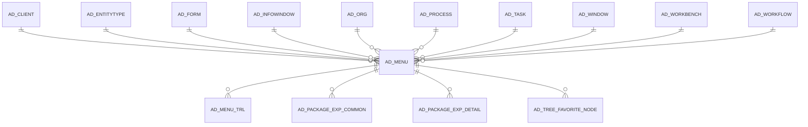

# AD_MENU

Area [AD](../../data-model/ad/index.md) · class **config** (proposed) · read from database `idempiere-db` (owner `ADEMPIERE`) · 808 row(s) when profiled

Application model: `org.compiere.model.X_AD_Menu`, access level 4 - System.

## Columns

| column | type | key | not null | business name | references (code) | nulls | distinct |
|---|---|---|---|---|---|---|---|
| `AD_MENU_ID` | NUMBER(10,0) | PK | yes | Menu |  | 0 | 808 |
| `AD_CLIENT_ID` | NUMBER(10,0) |  | yes | Tenant |  | 0 | 1 |
| `AD_ORG_ID` | NUMBER(10,0) |  | yes | Organization |  | 0 | 1 |
| `ISACTIVE` | CHAR(1) |  | yes | Active |  | 0 | 2 |
| `CREATED` | DATE |  | yes | Created |  | 0 | 731 |
| `CREATEDBY` | NUMBER(10,0) |  | yes | Created By |  | 0 | 3 |
| `UPDATED` | DATE |  | yes | Updated |  | 0 | 533 |
| `NAME` | VARCHAR2(60 CHAR) |  | yes | Name |  | 0 | 798 |
| `UPDATEDBY` | NUMBER(10,0) |  | yes | Updated By |  | 0 | 3 |
| `DESCRIPTION` | VARCHAR2(255 CHAR) |  |  | Description |  | 162 | 630 |
| `ISSUMMARY` | CHAR(1) |  | yes | Summary Level |  | 0 | 2 |
| `ISSOTRX` | CHAR(1) |  | yes | Sales Transaction |  | 0 | 2 |
| `ISREADONLY` | CHAR(1) |  | yes | Read Only |  | 0 | 2 |
| `ACTION` | CHAR(1) |  |  | Action |  | 76 | 8 |
| `AD_WINDOW_ID` | NUMBER(10,0) |  |  | Window | [AD_WINDOW](../../data-model/ad/ad_window.md) | 365 | 440 |
| `AD_WORKFLOW_ID` | NUMBER(10,0) |  |  | Workflow | [AD_WORKFLOW](../../data-model/ad/ad_workflow.md) | 786 | 22 |
| `AD_TASK_ID` | NUMBER(10,0) |  |  | OS Task | [AD_TASK](../../data-model/ad/ad_task.md) | 805 | 3 |
| `AD_PROCESS_ID` | NUMBER(10,0) |  |  | Process | [AD_PROCESS](../../data-model/ad/ad_process.md) | 588 | 220 |
| `AD_FORM_ID` | NUMBER(10,0) |  |  | Special Form | [AD_FORM](../../data-model/ad/ad_form.md) | 769 | 39 |
| `AD_WORKBENCH_ID` | NUMBER(10,0) |  |  |  |  | 807 | 1 |
| `ENTITYTYPE` | VARCHAR2(40 CHAR) |  | yes | Entity Type |  | 0 | 6 |
| `ISCENTRALLYMAINTAINED` | CHAR(1) |  |  | Centrally maintained |  | 0 | 2 |
| `AD_MENU_UU` | VARCHAR2(36 CHAR) |  |  | AD_Menu_UU |  | 0 | 808 |
| `AD_INFOWINDOW_ID` | NUMBER(10,0) |  |  | Info Window | [AD_INFOWINDOW](../../data-model/ad/ad_infowindow.md) | 804 | 4 |
| `PREDEFINEDCONTEXTVARIABLES` | VARCHAR2(4000 CHAR) |  |  | Predefined Context Variables |  | 769 | 2 |

*references (code)* is the table the application model's code says a column points to; *Foreign keys* below are the constraints the database declares. Counts come from the profile; no value is ever shown.

## Check constraints

| name | expression |
|---|---|
| `SYS_C0021310` | `IsCentrallyMaintained IN ('Y','N')` |
| `SYS_C0021312` | `IsReadOnly in ('Y','N')` |
| `SYS_C0021313` | `IsActive in ('Y','N')` |
| `SYS_C0021314` | `IsSOTrx in ('Y','N')` |

## Foreign keys

**References**

| table | columns | on delete |
|---|---|---|
| [AD_CLIENT](../../data-model/ad/ad_client.md) | AD_MENU.AD_CLIENT_ID → AD_CLIENT.AD_CLIENT_ID | NO ACTION |
| [AD_ENTITYTYPE](../../data-model/ad/ad_entitytype.md) | AD_MENU.ENTITYTYPE → AD_ENTITYTYPE.ENTITYTYPE | NO ACTION |
| [AD_FORM](../../data-model/ad/ad_form.md) | AD_MENU.AD_FORM_ID → AD_FORM.AD_FORM_ID | NO ACTION |
| [AD_INFOWINDOW](../../data-model/ad/ad_infowindow.md) | AD_MENU.AD_INFOWINDOW_ID → AD_INFOWINDOW.AD_INFOWINDOW_ID | NO ACTION |
| [AD_ORG](../../data-model/ad/ad_org.md) | AD_MENU.AD_ORG_ID → AD_ORG.AD_ORG_ID | NO ACTION |
| [AD_PROCESS](../../data-model/ad/ad_process.md) | AD_MENU.AD_PROCESS_ID → AD_PROCESS.AD_PROCESS_ID | NO ACTION |
| [AD_TASK](../../data-model/ad/ad_task.md) | AD_MENU.AD_TASK_ID → AD_TASK.AD_TASK_ID | NO ACTION |
| [AD_WINDOW](../../data-model/ad/ad_window.md) | AD_MENU.AD_WINDOW_ID → AD_WINDOW.AD_WINDOW_ID | NO ACTION |
| [AD_WORKBENCH](../../data-model/ad/ad_workbench.md) | AD_MENU.AD_WORKBENCH_ID → AD_WORKBENCH.AD_WORKBENCH_ID | NO ACTION |
| [AD_WORKFLOW](../../data-model/ad/ad_workflow.md) | AD_MENU.AD_WORKFLOW_ID → AD_WORKFLOW.AD_WORKFLOW_ID | NO ACTION |

**Referenced by**

| table | columns | on delete |
|---|---|---|
| [AD_MENU_TRL](../../data-model/ad/ad_menu_trl.md) | AD_MENU_TRL.AD_MENU_ID → AD_MENU.AD_MENU_ID | CASCADE |
| [AD_PACKAGE_EXP_COMMON](../../data-model/ad/ad_package_exp_common.md) | AD_PACKAGE_EXP_COMMON.AD_MENU_ID → AD_MENU.AD_MENU_ID | NO ACTION |
| [AD_PACKAGE_EXP_DETAIL](../../data-model/ad/ad_package_exp_detail.md) | AD_PACKAGE_EXP_DETAIL.AD_MENU_ID → AD_MENU.AD_MENU_ID | NO ACTION |
| [AD_TREE_FAVORITE_NODE](../../data-model/ad/ad_tree_favorite_node.md) | AD_TREE_FAVORITE_NODE.AD_MENU_ID → AD_MENU.AD_MENU_ID | NO ACTION |

## Write behaviour

- updates: **raw_sql_skips_updated**
- deletes: **deleted_by_users**
- change log: **recorded**
- evidence: 13 citation(s)

## Read by

| kind | name |
|---|---|
| Procedure | [AD_Synchronize](../../logic/ad_synchronize.md) |

## Written by

| kind | name |
|---|---|
| Procedure | [AD_Synchronize](../../logic/ad_synchronize.md) |

## Schema history

38 change(s); the latest:

| applied | release | operation | column | tickets |
|---|---|---|---|---|
| 2023-04-09T15:47 | iD11 | `add_constraint` |  | IDEMPIERE-5567 |
| 2023-04-09T15:47 | iD11 | `add_constraint` |  | IDEMPIERE-5567 |
| 2021-12-05T16:45 | i8.2z | `drop_constraint` |  | IDEMPIERE-5075 |
| 2021-12-05T16:45 | i8.2z | `add_constraint` |  | IDEMPIERE-5075 |
| 2021-12-05T16:45 | i8.2z | `drop_constraint` |  | IDEMPIERE-5075 |
| 2021-12-05T16:45 | i8.2z | `drop_constraint` |  | IDEMPIERE-5075 |
| 2021-12-05T16:45 | i8.2z | `drop_constraint` |  | IDEMPIERE-5075 |
| 2021-12-05T16:45 | i8.2z | `drop_constraint` |  | IDEMPIERE-5075 |
| 2021-12-05T16:45 | i8.2z | `add_constraint` |  | IDEMPIERE-5075 |
| 2021-12-05T16:45 | i8.2z | `drop_constraint` |  | IDEMPIERE-5075 |
| 2021-12-05T16:45 | i8.2z | `drop_constraint` |  | IDEMPIERE-5075 |
| 2021-12-05T16:45 | i8.2z | `drop_constraint` |  | IDEMPIERE-5075 |
| 2021-12-05T16:45 | i8.2z | `add_constraint` |  | IDEMPIERE-5075 |
| 2021-12-05T16:45 | i8.2z | `drop_constraint` |  | IDEMPIERE-5075 |
| 2021-12-05T16:45 | i8.2z | `add_constraint` |  | IDEMPIERE-5075 |

## Notes

<!-- ekos:manual id="table.ad_menu.notes" -->
_Business notes about this table._
<!-- /ekos:manual -->
