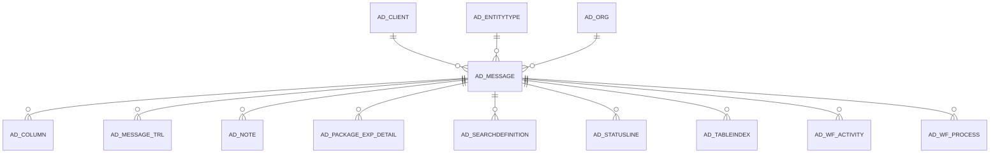

# AD_MESSAGE

Area [AD](../../data-model/ad/index.md) · class **config** (proposed) · read from database `idempiere-db` (owner `ADEMPIERE`) · 2061 row(s) when profiled

Application model: `org.compiere.model.X_AD_Message`, access level 4 - System.

## Columns

| column | type | key | not null | business name | references (code) | nulls | distinct |
|---|---|---|---|---|---|---|---|
| `AD_MESSAGE_ID` | NUMBER(10,0) | PK | yes | Message |  | 0 | 2061 |
| `AD_CLIENT_ID` | NUMBER(10,0) |  | yes | Tenant |  | 0 | 1 |
| `AD_ORG_ID` | NUMBER(10,0) |  | yes | Organization |  | 0 | 1 |
| `ISACTIVE` | CHAR(1) |  | yes | Active |  | 0 | 2 |
| `CREATED` | DATE |  | yes | Created |  | 0 | 1427 |
| `CREATEDBY` | NUMBER(10,0) |  | yes | Created By |  | 0 | 3 |
| `UPDATED` | DATE |  | yes | Updated |  | 0 | 934 |
| `UPDATEDBY` | NUMBER(10,0) |  | yes | Updated By |  | 0 | 3 |
| `VALUE` | VARCHAR2(255 CHAR) |  | yes | Search Key |  | 0 | 2061 |
| `MSGTEXT` | VARCHAR2(2000 CHAR) |  | yes | Message Text |  | 0 | 1962 |
| `MSGTIP` | VARCHAR2(2000 CHAR) |  |  | Message Tip |  | 1481 | 125 |
| `MSGTYPE` | CHAR(1) |  | yes | Message Type |  | 0 | 3 |
| `ENTITYTYPE` | VARCHAR2(40 CHAR) |  | yes | Entity Type |  | 0 | 2 |
| `AD_MESSAGE_UU` | VARCHAR2(36 CHAR) |  |  | AD_Message_UU |  | 0 | 2061 |

*references (code)* is the table the application model's code says a column points to; *Foreign keys* below are the constraints the database declares. Counts come from the profile; no value is ever shown.

## Check constraints

| name | expression |
|---|---|
| `SYS_C0021691` | `IsActive in ('Y','N')` |

## Foreign keys

**References**

| table | columns | on delete |
|---|---|---|
| [AD_CLIENT](../../data-model/ad/ad_client.md) | AD_MESSAGE.AD_CLIENT_ID → AD_CLIENT.AD_CLIENT_ID | NO ACTION |
| [AD_ENTITYTYPE](../../data-model/ad/ad_entitytype.md) | AD_MESSAGE.ENTITYTYPE → AD_ENTITYTYPE.ENTITYTYPE | NO ACTION |
| [AD_ORG](../../data-model/ad/ad_org.md) | AD_MESSAGE.AD_ORG_ID → AD_ORG.AD_ORG_ID | NO ACTION |

**Referenced by**

| table | columns | on delete |
|---|---|---|
| [AD_COLUMN](../../data-model/ad/ad_column.md) | AD_COLUMN.FKCONSTRAINTMSG_ID → AD_MESSAGE.AD_MESSAGE_ID | NO ACTION |
| [AD_MESSAGE_TRL](../../data-model/ad/ad_message_trl.md) | AD_MESSAGE_TRL.AD_MESSAGE_ID → AD_MESSAGE.AD_MESSAGE_ID | CASCADE |
| [AD_NOTE](../../data-model/ad/ad_note.md) | AD_NOTE.AD_MESSAGE_ID → AD_MESSAGE.AD_MESSAGE_ID | NO ACTION |
| [AD_PACKAGE_EXP_DETAIL](../../data-model/ad/ad_package_exp_detail.md) | AD_PACKAGE_EXP_DETAIL.AD_MESSAGE_ID → AD_MESSAGE.AD_MESSAGE_ID | NO ACTION |
| [AD_SEARCHDEFINITION](../../data-model/ad/ad_searchdefinition.md) | AD_SEARCHDEFINITION.AD_MESSAGE_ID → AD_MESSAGE.AD_MESSAGE_ID | NO ACTION |
| [AD_STATUSLINE](../../data-model/ad/ad_statusline.md) | AD_STATUSLINE.AD_MESSAGE_ID → AD_MESSAGE.AD_MESSAGE_ID | NO ACTION |
| [AD_TABLEINDEX](../../data-model/ad/ad_tableindex.md) | AD_TABLEINDEX.AD_MESSAGE_ID → AD_MESSAGE.AD_MESSAGE_ID | NO ACTION |
| [AD_WF_ACTIVITY](../../data-model/ad/ad_wf_activity.md) | AD_WF_ACTIVITY.AD_MESSAGE_ID → AD_MESSAGE.AD_MESSAGE_ID | NO ACTION |
| [AD_WF_PROCESS](../../data-model/ad/ad_wf_process.md) | AD_WF_PROCESS.AD_MESSAGE_ID → AD_MESSAGE.AD_MESSAGE_ID | NO ACTION |

## Write behaviour

- updates: **po_only**
- deletes: **deleted_by_users**
- change log: **recorded**
- evidence: 1 citation(s)

## Schema history

25 change(s); the latest:

| applied | release | operation | column | tickets |
|---|---|---|---|---|
| 2023-04-09T15:47 | iD11 | `add_constraint` |  | IDEMPIERE-5567 |
| 2023-04-09T15:47 | iD11 | `add_constraint` |  | IDEMPIERE-5567 |
| 2021-12-05T16:45 | i8.2z | `drop_constraint` |  | IDEMPIERE-5075 |
| 2021-12-05T16:45 | i8.2z | `add_constraint` |  | IDEMPIERE-5075 |
| 2021-12-05T16:45 | i8.2z | `add_constraint` |  | IDEMPIERE-5075 |
| 2021-12-05T16:45 | i8.2z | `drop_constraint` |  | IDEMPIERE-5075 |
| 2021-12-05T16:45 | i8.2z | `add_constraint` |  | IDEMPIERE-5075 |
| 2021-12-05T16:45 | i8.2z | `drop_constraint` |  | IDEMPIERE-5075 |
| 2020-08-04T01:00 | i7.1z | `modify_column` | MSGTEXT | IDEMPIERE-3862 |
| 2020-08-04T01:00 | i7.1z | `add_column` | tmp_col_4_tmp | IDEMPIERE-3862 |
| 2020-08-04T01:00 | i7.1z | `add_column` | tmp_col_2_tmp | IDEMPIERE-3862 |
| 2020-08-04T01:00 | i7.1z | `drop_column` | tmp_col_3_tmp | IDEMPIERE-3862 |
| 2020-08-04T01:00 | i7.1z | `modify_column` | ENTITYTYPE | IDEMPIERE-3862 |
| 2020-08-04T01:00 | i7.1z | `modify_column` | VALUE | IDEMPIERE-3862 |
| 2020-08-04T01:00 | i7.1z | `modify_column` | MSGTEXT | IDEMPIERE-3862 |

## Notes

<!-- ekos:manual id="table.ad_message.notes" -->
_Business notes about this table._
<!-- /ekos:manual -->
