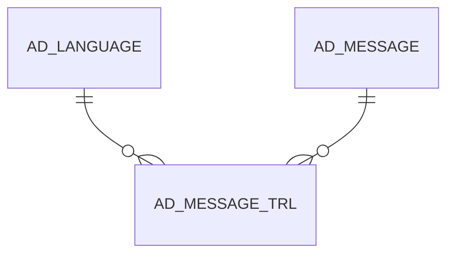

# AD_MESSAGE_TRL

Area [AD](../../data-model/ad/index.md) · class **translation** (proposed) · read from database `idempiere-db` (owner `ADEMPIERE`) · 2061 row(s) when profiled

## Columns

| column | type | key | not null | business name | references (code) | nulls | distinct |
|---|---|---|---|---|---|---|---|
| `AD_MESSAGE_ID` | NUMBER(10,0) | PK | yes |  |  | 0 | 2061 |
| `AD_LANGUAGE` | VARCHAR2(6 CHAR) | PK | yes |  |  | 0 | 1 |
| `AD_CLIENT_ID` | NUMBER(10,0) | PK | yes |  |  | 0 | 1 |
| `AD_ORG_ID` | NUMBER(10,0) |  | yes |  |  | 0 | 1 |
| `ISACTIVE` | CHAR(1) |  | yes |  |  | 0 | 1 |
| `CREATED` | DATE |  | yes |  |  | 0 | 754 |
| `CREATEDBY` | NUMBER(10,0) |  | yes |  |  | 0 | 3 |
| `UPDATED` | DATE |  | yes |  |  | 0 | 354 |
| `UPDATEDBY` | NUMBER(10,0) |  | yes |  |  | 0 | 3 |
| `MSGTEXT` | VARCHAR2(2000 CHAR) |  | yes |  |  | 0 | 1982 |
| `MSGTIP` | VARCHAR2(2000 CHAR) |  |  |  |  | 1898 | 124 |
| `ISTRANSLATED` | CHAR(1) |  | yes |  |  | 0 | 2 |
| `AD_MESSAGE_TRL_UU` | VARCHAR2(36 CHAR) |  |  |  |  | 420 | 1641 |

*references (code)* is the table the application model's code says a column points to; *Foreign keys* below are the constraints the database declares. Counts come from the profile; no value is ever shown.

## Check constraints

| name | expression |
|---|---|
| `SYS_C0022280` | `IsTranslated in ('Y','N')` |
| `SYS_C0022282` | `IsActive in ('Y','N')` |

## Foreign keys

**References**

| table | columns | on delete |
|---|---|---|
| [AD_LANGUAGE](../../data-model/ad/ad_language.md) | AD_MESSAGE_TRL.AD_LANGUAGE → AD_LANGUAGE.AD_LANGUAGE | NO ACTION |
| [AD_MESSAGE](../../data-model/ad/ad_message.md) | AD_MESSAGE_TRL.AD_MESSAGE_ID → AD_MESSAGE.AD_MESSAGE_ID | CASCADE |

**Referenced by**

_None._

## Write behaviour

- updates: **po_only**
- deletes: **deleted_by_users, deleted_by_cascade**
- change log: **not_recorded**
- evidence: 2 citation(s)

## Schema history

22 change(s); the latest:

| applied | release | operation | column | tickets |
|---|---|---|---|---|
| 2023-04-09T15:47 | iD11 | `add_constraint` |  | IDEMPIERE-5567 |
| 2023-04-09T15:47 | iD11 | `add_constraint` |  | IDEMPIERE-5567 |
| 2022-01-04T11:30 | i9 | `drop_constraint` |  | IDEMPIERE-5136 |
| 2022-01-04T11:30 | i9 | `drop_constraint` |  | IDEMPIERE-5136 |
| 2022-01-04T11:30 | i9 | `add_constraint` |  | IDEMPIERE-5136 |
| 2022-01-04T11:30 | i9 | `add_constraint` |  | IDEMPIERE-5136 |
| 2021-12-05T16:45 | i8.2z | `drop_constraint` |  | IDEMPIERE-5075 |
| 2021-12-05T16:45 | i8.2z | `add_constraint` |  | IDEMPIERE-5075 |
| 2021-12-05T16:45 | i8.2z | `add_constraint` |  | IDEMPIERE-5075 |
| 2021-12-05T16:45 | i8.2z | `drop_constraint` |  | IDEMPIERE-5075 |
| 2020-08-04T01:00 | i7.1z | `modify_column` | MSGTEXT | IDEMPIERE-3862 |
| 2020-08-04T01:00 | i7.1z | `add_column` | tmp_col_1_tmp | IDEMPIERE-3862 |
| 2020-08-04T01:00 | i7.1z | `modify_column` | MSGTEXT | IDEMPIERE-3862 |
| 2020-08-04T01:00 | i7.1z | `modify_column` | MSGTIP | IDEMPIERE-3862 |
| 2020-08-04T01:00 | i7.1z | `add_column` | tmp_col_3_tmp | IDEMPIERE-3862 |

## Open conflicts

| type | attribute | explanation |
|---|---|---|
| `table_without_model` | `model_class` | unexplained |

## Notes

<!-- ekos:manual id="table.ad_message_trl.notes" -->
_Business notes about this table._
<!-- /ekos:manual -->
