# AD_ORG

Area [AD](../../data-model/ad/index.md) · class **config** (proposed) · read from database `idempiere-db` (owner `ADEMPIERE`) · 10 row(s) when profiled

Application model: `org.compiere.model.X_AD_Org`, access level 7 - System - Client - Org.

## Columns

| column | type | key | not null | business name | references (code) | nulls | distinct |
|---|---|---|---|---|---|---|---|
| `AD_ORG_ID` | NUMBER(10,0) | PK | yes | Organization |  | 0 | 10 |
| `AD_CLIENT_ID` | NUMBER(10,0) |  | yes | Tenant |  | 0 | 2 |
| `ISACTIVE` | CHAR(1) |  | yes | Active |  | 0 | 1 |
| `CREATED` | DATE |  | yes | Created |  | 0 | 10 |
| `CREATEDBY` | NUMBER(10,0) |  | yes | Created By |  | 0 | 2 |
| `UPDATED` | DATE |  | yes | Updated |  | 0 | 10 |
| `UPDATEDBY` | NUMBER(10,0) |  | yes | Updated By |  | 0 | 2 |
| `VALUE` | VARCHAR2(40 CHAR) |  | yes | Search Key |  | 0 | 10 |
| `NAME` | VARCHAR2(60 CHAR) |  | yes | Name |  | 0 | 10 |
| `DESCRIPTION` | VARCHAR2(255 CHAR) |  |  | Description |  | 1 | 9 |
| `ISSUMMARY` | CHAR(1) |  | yes | Summary Level |  | 0 | 2 |
| `AD_REPLICATIONSTRATEGY_ID` | NUMBER(10,0) |  |  | Replication Strategy | [AD_REPLICATIONSTRATEGY](../../data-model/ad/ad_replicationstrategy.md) | 10 | 0 |
| `AD_ORG_UU` | VARCHAR2(36 CHAR) |  |  | AD_Org_UU |  | 0 | 10 |

*references (code)* is the table the application model's code says a column points to; *Foreign keys* below are the constraints the database declares. Counts come from the profile; no value is ever shown.

## Check constraints

| name | expression |
|---|---|
| `SYS_C0021794` | `IsActive in ('Y','N')` |

## Foreign keys

**References**

| table | columns | on delete |
|---|---|---|
| [AD_CLIENT](../../data-model/ad/ad_client.md) | AD_ORG.AD_CLIENT_ID → AD_CLIENT.AD_CLIENT_ID | NO ACTION |
| [AD_REPLICATIONSTRATEGY](../../data-model/ad/ad_replicationstrategy.md) | AD_ORG.AD_REPLICATIONSTRATEGY_ID → AD_REPLICATIONSTRATEGY.AD_REPLICATIONSTRATEGY_ID | NO ACTION |

**Referenced by**

| table | columns | on delete |
|---|---|---|
| [AD_BROADCASTMESSAGE_TRL](../../data-model/ad/ad_broadcastmessage_trl.md) | AD_BROADCASTMESSAGE_TRL.AD_ORG_ID → AD_ORG.AD_ORG_ID | NO ACTION |
| [AD_CHART_TRL](../../data-model/ad/ad_chart_trl.md) | AD_CHART_TRL.AD_ORG_ID → AD_ORG.AD_ORG_ID | NO ACTION |
| [AD_CLIENTSHARE](../../data-model/ad/ad_clientshare.md) | AD_CLIENTSHARE.AD_ORG_ID → AD_ORG.AD_ORG_ID | NO ACTION |
| [AD_COLOR_TRL](../../data-model/ad/ad_color_trl.md) | AD_COLOR_TRL.AD_ORG_ID → AD_ORG.AD_ORG_ID | NO ACTION |
| [AD_COLUMN](../../data-model/ad/ad_column.md) | AD_COLUMN.AD_ORG_ID → AD_ORG.AD_ORG_ID | NO ACTION |
| [AD_FIELD](../../data-model/ad/ad_field.md) | AD_FIELD.AD_ORG_ID → AD_ORG.AD_ORG_ID | NO ACTION |
| [AD_IMPORTTEMPLATE](../../data-model/ad/ad_importtemplate.md) | AD_IMPORTTEMPLATE.AD_ORG_ID → AD_ORG.AD_ORG_ID | NO ACTION |
| [AD_IMPORTTEMPLATEACCESS](../../data-model/ad/ad_importtemplateaccess.md) | AD_IMPORTTEMPLATEACCESS.AD_ORG_ID → AD_ORG.AD_ORG_ID | NO ACTION |
| [AD_INFORELATED](../../data-model/ad/ad_inforelated.md) | AD_INFORELATED.AD_ORG_ID → AD_ORG.AD_ORG_ID | NO ACTION |
| [AD_LABELCATEGORY_TRL](../../data-model/ad/ad_labelcategory_trl.md) | AD_LABELCATEGORY_TRL.AD_ORG_ID → AD_ORG.AD_ORG_ID | NO ACTION |
| [AD_LABEL_TRL](../../data-model/ad/ad_label_trl.md) | AD_LABEL_TRL.AD_ORG_ID → AD_ORG.AD_ORG_ID | NO ACTION |
| [AD_LANGUAGE](../../data-model/ad/ad_language.md) | AD_LANGUAGE.AD_ORG_ID → AD_ORG.AD_ORG_ID | NO ACTION |
| [AD_MENU](../../data-model/ad/ad_menu.md) | AD_MENU.AD_ORG_ID → AD_ORG.AD_ORG_ID | NO ACTION |
| [AD_MESSAGE](../../data-model/ad/ad_message.md) | AD_MESSAGE.AD_ORG_ID → AD_ORG.AD_ORG_ID | NO ACTION |
| [AD_MODELGENERATORTEMPLATE](../../data-model/ad/ad_modelgeneratortemplate.md) | AD_MODELGENERATORTEMPLATE.AD_ORG_ID → AD_ORG.AD_ORG_ID | NO ACTION |
| [AD_ORGINFO](../../data-model/ad/ad_orginfo.md) | AD_ORGINFO.PARENT_ORG_ID → AD_ORG.AD_ORG_ID | SET NULL |
| [AD_PASSWORD_HISTORY](../../data-model/ad/ad_password_history.md) | AD_PASSWORD_HISTORY.AD_ORG_ID → AD_ORG.AD_ORG_ID | NO ACTION |
| [AD_POSTIT](../../data-model/ad/ad_postit.md) | AD_POSTIT.AD_ORG_ID → AD_ORG.AD_ORG_ID | NO ACTION |
| [AD_PREFERENCE](../../data-model/ad/ad_preference.md) | AD_PREFERENCE.AD_ORG_ID → AD_ORG.AD_ORG_ID | NO ACTION |
| [AD_PRINTCOLOR_TRL](../../data-model/ad/ad_printcolor_trl.md) | AD_PRINTCOLOR_TRL.AD_ORG_ID → AD_ORG.AD_ORG_ID | NO ACTION |
| [AD_PROCESS_ACCESS](../../data-model/ad/ad_process_access.md) | AD_PROCESS_ACCESS.AD_ORG_ID → AD_ORG.AD_ORG_ID | NO ACTION |
| [AD_REFERENCE](../../data-model/ad/ad_reference.md) | AD_REFERENCE.AD_ORG_ID → AD_ORG.AD_ORG_ID | NO ACTION |
| [AD_REF_LIST](../../data-model/ad/ad_ref_list.md) | AD_REF_LIST.AD_ORG_ID → AD_ORG.AD_ORG_ID | NO ACTION |
| [AD_REF_TABLE](../../data-model/ad/ad_ref_table.md) | AD_REF_TABLE.AD_ORG_ID → AD_ORG.AD_ORG_ID | NO ACTION |
| [AD_REPLICATION](../../data-model/ad/ad_replication.md) | AD_REPLICATION.REMOTE_ORG_ID → AD_ORG.AD_ORG_ID | NO ACTION |
| [AD_REPORTVIEW_COLUMN](../../data-model/ad/ad_reportview_column.md) | AD_REPORTVIEW_COLUMN.AD_ORG_ID → AD_ORG.AD_ORG_ID | NO ACTION |
| [AD_ROLE](../../data-model/ad/ad_role.md) | AD_ROLE.AD_ORG_ID → AD_ORG.AD_ORG_ID | NO ACTION |
| [AD_ROLE_ORGACCESS](../../data-model/ad/ad_role_orgaccess.md) | AD_ROLE_ORGACCESS.AD_ORG_ID → AD_ORG.AD_ORG_ID | CASCADE |
| [AD_SEQUENCE](../../data-model/ad/ad_sequence.md) | AD_SEQUENCE.AD_ORG_ID → AD_ORG.AD_ORG_ID | NO ACTION |
| [AD_SEQUENCE_AUDIT](../../data-model/ad/ad_sequence_audit.md) | AD_SEQUENCE_AUDIT.AD_ORG_ID → AD_ORG.AD_ORG_ID | NO ACTION |
| [AD_SEQUENCE_NO](../../data-model/ad/ad_sequence_no.md) | AD_SEQUENCE_NO.AD_ORG_ID → AD_ORG.AD_ORG_ID | NO ACTION |
| [AD_STATUSLINE](../../data-model/ad/ad_statusline.md) | AD_STATUSLINE.AD_ORG_ID → AD_ORG.AD_ORG_ID | NO ACTION |
| [AD_STATUSLINEUSEDIN](../../data-model/ad/ad_statuslineusedin.md) | AD_STATUSLINEUSEDIN.AD_ORG_ID → AD_ORG.AD_ORG_ID | NO ACTION |
| [AD_TAB](../../data-model/ad/ad_tab.md) | AD_TAB.AD_ORG_ID → AD_ORG.AD_ORG_ID | NO ACTION |
| [AD_TABLE](../../data-model/ad/ad_table.md) | AD_TABLE.AD_ORG_ID → AD_ORG.AD_ORG_ID | NO ACTION |
| [AD_TABLEVALRULE](../../data-model/ad/ad_tablevalrule.md) | AD_TABLEVALRULE.AD_ORG_ID → AD_ORG.AD_ORG_ID | NO ACTION |
| [AD_TABLE_ACCESS](../../data-model/ad/ad_table_access.md) | AD_TABLE_ACCESS.AD_ORG_ID → AD_ORG.AD_ORG_ID | NO ACTION |
| [AD_TASK](../../data-model/ad/ad_task.md) | AD_TASK.AD_ORG_ID → AD_ORG.AD_ORG_ID | NO ACTION |
| [AD_TASKINSTANCE](../../data-model/ad/ad_taskinstance.md) | AD_TASKINSTANCE.AD_ORG_ID → AD_ORG.AD_ORG_ID | NO ACTION |
| [AD_TASK_ACCESS](../../data-model/ad/ad_task_access.md) | AD_TASK_ACCESS.AD_ORG_ID → AD_ORG.AD_ORG_ID | NO ACTION |
| [AD_USER](../../data-model/ad/ad_user.md) | AD_USER.AD_ORGTRX_ID → AD_ORG.AD_ORG_ID | NO ACTION |
| [AD_USERDEF_THEME](../../data-model/ad/ad_userdef_theme.md) | AD_USERDEF_THEME.AD_ORG_ID → AD_ORG.AD_ORG_ID | NO ACTION |
| [AD_USERDEF_THEME_DETAIL](../../data-model/ad/ad_userdef_theme_detail.md) | AD_USERDEF_THEME_DETAIL.AD_ORG_ID → AD_ORG.AD_ORG_ID | NO ACTION |
| [AD_USERPREFERENCE](../../data-model/ad/ad_userpreference.md) | AD_USERPREFERENCE.AD_ORG_ID → AD_ORG.AD_ORG_ID | NO ACTION |
| [AD_USER_ORGACCESS](../../data-model/ad/ad_user_orgaccess.md) | AD_USER_ORGACCESS.AD_ORG_ID → AD_ORG.AD_ORG_ID | NO ACTION |
| [AD_USER_ROLES](../../data-model/ad/ad_user_roles.md) | AD_USER_ROLES.AD_ORG_ID → AD_ORG.AD_ORG_ID | NO ACTION |
| [AD_VAL_RULE](../../data-model/ad/ad_val_rule.md) | AD_VAL_RULE.AD_ORG_ID → AD_ORG.AD_ORG_ID | NO ACTION |
| [AD_VERIFYMIGRATION](../../data-model/ad/ad_verifymigration.md) | AD_VERIFYMIGRATION.AD_ORG_ID → AD_ORG.AD_ORG_ID | NO ACTION |
| [AD_WF_NODE](../../data-model/ad/ad_wf_node.md) | AD_WF_NODE.AD_ORG_ID → AD_ORG.AD_ORG_ID | NO ACTION |
| [AD_WF_NODENEXT](../../data-model/ad/ad_wf_nodenext.md) | AD_WF_NODENEXT.AD_ORG_ID → AD_ORG.AD_ORG_ID | NO ACTION |
| [AD_WF_PROCESS](../../data-model/ad/ad_wf_process.md) | AD_WF_PROCESS.AD_ORG_ID → AD_ORG.AD_ORG_ID | NO ACTION |
| [AD_WF_RESPONSIBLE](../../data-model/ad/ad_wf_responsible.md) | AD_WF_RESPONSIBLE.AD_ORG_ID → AD_ORG.AD_ORG_ID | NO ACTION |
| [AD_WINDOW](../../data-model/ad/ad_window.md) | AD_WINDOW.AD_ORG_ID → AD_ORG.AD_ORG_ID | NO ACTION |
| [AD_WINDOW_ACCESS](../../data-model/ad/ad_window_access.md) | AD_WINDOW_ACCESS.AD_ORG_ID → AD_ORG.AD_ORG_ID | NO ACTION |
| [AD_WORKFLOW](../../data-model/ad/ad_workflow.md) | AD_WORKFLOW.AD_ORG_ID → AD_ORG.AD_ORG_ID | NO ACTION |
| [AD_WORKFLOW_ACCESS](../../data-model/ad/ad_workflow_access.md) | AD_WORKFLOW_ACCESS.AD_ORG_ID → AD_ORG.AD_ORG_ID | NO ACTION |
| [A_ASSET_GROUP_TRL](../../data-model/a/a_asset_group_trl.md) | A_ASSET_GROUP_TRL.AD_ORG_ID → AD_ORG.AD_ORG_ID | NO ACTION |
| [C_ACCTSCHEMA](../../data-model/c/c_acctschema.md) | C_ACCTSCHEMA.AD_ORGONLY_ID → AD_ORG.AD_ORG_ID | NO ACTION |
| [C_ACCTSCHEMA_ELEMENT](../../data-model/c/c_acctschema_element.md) | C_ACCTSCHEMA_ELEMENT.AD_ORG_ID → AD_ORG.AD_ORG_ID | NO ACTION |
| [C_ACTIVITY_TRL](../../data-model/c/c_activity_trl.md) | C_ACTIVITY_TRL.AD_ORG_ID → AD_ORG.AD_ORG_ID | NO ACTION |
| [C_ADDRESSTRANSACTION](../../data-model/c/c_addresstransaction.md) | C_ADDRESSTRANSACTION.AD_ORG_ID → AD_ORG.AD_ORG_ID | NO ACTION |
| [C_ADDRESSVALIDATION](../../data-model/c/c_addressvalidation.md) | C_ADDRESSVALIDATION.AD_ORG_ID → AD_ORG.AD_ORG_ID | NO ACTION |
| [C_ADDRESSVALIDATIONCFG](../../data-model/c/c_addressvalidationcfg.md) | C_ADDRESSVALIDATIONCFG.AD_ORG_ID → AD_ORG.AD_ORG_ID | NO ACTION |
| [C_BANKTRANSFER](../../data-model/c/c_banktransfer.md) | C_BANKTRANSFER.FROM_AD_ORG_ID → AD_ORG.AD_ORG_ID | NO ACTION |
| [C_BPARTNER](../../data-model/c/c_bpartner.md) | C_BPARTNER.AD_ORG_ID → AD_ORG.AD_ORG_ID | NO ACTION |
| [C_BPARTNER_LOCATION](../../data-model/c/c_bpartner_location.md) | C_BPARTNER_LOCATION.AD_ORG_ID → AD_ORG.AD_ORG_ID | NO ACTION |
| [C_CALENDAR](../../data-model/c/c_calendar.md) | C_CALENDAR.AD_ORG_ID → AD_ORG.AD_ORG_ID | NO ACTION |
| [C_CAMPAIGN_TRL](../../data-model/c/c_campaign_trl.md) | C_CAMPAIGN_TRL.AD_ORG_ID → AD_ORG.AD_ORG_ID | NO ACTION |
| [C_CASH](../../data-model/c/c_cash.md) | C_CASH.AD_ORGTRX_ID → AD_ORG.AD_ORG_ID | NO ACTION |
| [C_CASHPLAN](../../data-model/c/c_cashplan.md) | C_CASHPLAN.AD_ORGTRX_ID → AD_ORG.AD_ORG_ID | NO ACTION |
| [C_CASHPLANLINE](../../data-model/c/c_cashplanline.md) | C_CASHPLANLINE.AD_ORGTRX_ID → AD_ORG.AD_ORG_ID | NO ACTION |
| [C_CITY](../../data-model/c/c_city.md) | C_CITY.AD_ORG_ID → AD_ORG.AD_ORG_ID | NO ACTION |
| [C_COMMISSIONLINE](../../data-model/c/c_commissionline.md) | C_COMMISSIONLINE.ORG_ID → AD_ORG.AD_ORG_ID | NO ACTION |
| [C_CONVERSION_RATE](../../data-model/c/c_conversion_rate.md) | C_CONVERSION_RATE.AD_ORG_ID → AD_ORG.AD_ORG_ID | NO ACTION |
| [C_COUNTRY](../../data-model/c/c_country.md) | C_COUNTRY.AD_ORG_ID → AD_ORG.AD_ORG_ID | NO ACTION |
| [C_COUNTRYGROUP](../../data-model/c/c_countrygroup.md) | C_COUNTRYGROUP.AD_ORG_ID → AD_ORG.AD_ORG_ID | NO ACTION |
| [C_COUNTRYGROUPCOUNTRY](../../data-model/c/c_countrygroupcountry.md) | C_COUNTRYGROUPCOUNTRY.AD_ORG_ID → AD_ORG.AD_ORG_ID | NO ACTION |
| [C_COUNTRYGROUP_TRL](../../data-model/c/c_countrygroup_trl.md) | C_COUNTRYGROUP_TRL.AD_ORG_ID → AD_ORG.AD_ORG_ID | NO ACTION |
| [C_CURRENCY](../../data-model/c/c_currency.md) | C_CURRENCY.AD_ORG_ID → AD_ORG.AD_ORG_ID | NO ACTION |
| [C_DOCBASEGROUP](../../data-model/c/c_docbasegroup.md) | C_DOCBASEGROUP.AD_ORG_ID → AD_ORG.AD_ORG_ID | NO ACTION |
| [C_DOCBASEGROUPLINE](../../data-model/c/c_docbasegroupline.md) | C_DOCBASEGROUPLINE.AD_ORG_ID → AD_ORG.AD_ORG_ID | NO ACTION |
| [C_ELEMENT](../../data-model/c/c_element.md) | C_ELEMENT.AD_ORG_ID → AD_ORG.AD_ORG_ID | NO ACTION |
| [C_ELEMENTVALUE](../../data-model/c/c_elementvalue.md) | C_ELEMENTVALUE.AD_ORG_ID → AD_ORG.AD_ORG_ID | NO ACTION |
| [C_INTERORG_ACCT](../../data-model/c/c_interorg_acct.md) | C_INTERORG_ACCT.AD_ORGTO_ID → AD_ORG.AD_ORG_ID | CASCADE |
| [C_INVOICE](../../data-model/c/c_invoice.md) | C_INVOICE.AD_ORGTRX_ID → AD_ORG.AD_ORG_ID | NO ACTION |
| [C_INVOICEBATCHLINE](../../data-model/c/c_invoicebatchline.md) | C_INVOICEBATCHLINE.AD_ORGTRX_ID → AD_ORG.AD_ORG_ID | NO ACTION |
| [C_INVOICELINE](../../data-model/c/c_invoiceline.md) | C_INVOICELINE.AD_ORGTRX_ID → AD_ORG.AD_ORG_ID | NO ACTION |
| [C_LOCATION](../../data-model/c/c_location.md) | C_LOCATION.AD_ORG_ID → AD_ORG.AD_ORG_ID | NO ACTION |
| [C_NONBUSINESSDAY](../../data-model/c/c_nonbusinessday.md) | C_NONBUSINESSDAY.AD_ORG_ID → AD_ORG.AD_ORG_ID | NO ACTION |
| [C_ORDER](../../data-model/c/c_order.md) | C_ORDER.AD_ORGTRX_ID → AD_ORG.AD_ORG_ID | NO ACTION |
| [C_ORDERLINE](../../data-model/c/c_orderline.md) | C_ORDERLINE.AD_ORGTRX_ID → AD_ORG.AD_ORG_ID | NO ACTION |
| [C_ORDERSOURCE](../../data-model/c/c_ordersource.md) | C_ORDERSOURCE.AD_ORG_ID → AD_ORG.AD_ORG_ID | NO ACTION |
| [C_ORGASSIGNMENT](../../data-model/c/c_orgassignment.md) | C_ORGASSIGNMENT.AD_ORG_ID → AD_ORG.AD_ORG_ID | NO ACTION |
| [C_PAYMENT](../../data-model/c/c_payment.md) | C_PAYMENT.AD_ORGTRX_ID → AD_ORG.AD_ORG_ID | NO ACTION |
| [C_PAYMENTTRANSACTION](../../data-model/c/c_paymenttransaction.md) | C_PAYMENTTRANSACTION.AD_ORGTRX_ID → AD_ORG.AD_ORG_ID | NO ACTION |
| [C_PERIOD](../../data-model/c/c_period.md) | C_PERIOD.AD_ORG_ID → AD_ORG.AD_ORG_ID | NO ACTION |
| [C_PROJECT](../../data-model/c/c_project.md) | C_PROJECT.AD_ORGTRX_ID → AD_ORG.AD_ORG_ID | NO ACTION |
| [C_RECURRINGGROUP](../../data-model/c/c_recurringgroup.md) | C_RECURRINGGROUP.AD_ORG_ID → AD_ORG.AD_ORG_ID | NO ACTION |
| [C_REGION](../../data-model/c/c_region.md) | C_REGION.AD_ORG_ID → AD_ORG.AD_ORG_ID | NO ACTION |
| [C_REGION_TRL](../../data-model/c/c_region_trl.md) | C_REGION_TRL.AD_ORG_ID → AD_ORG.AD_ORG_ID | NO ACTION |
| [C_REVENUERECOG_SERVICE](../../data-model/c/c_revenuerecog_service.md) | C_REVENUERECOG_SERVICE.AD_ORG_ID → AD_ORG.AD_ORG_ID | NO ACTION |
| [C_SALESREGION_TRL](../../data-model/c/c_salesregion_trl.md) | C_SALESREGION_TRL.AD_ORG_ID → AD_ORG.AD_ORG_ID | NO ACTION |
| [C_SALESSTAGE_TRL](../../data-model/c/c_salesstage_trl.md) | C_SALESSTAGE_TRL.AD_ORG_ID → AD_ORG.AD_ORG_ID | NO ACTION |
| [C_TAXPROVIDER](../../data-model/c/c_taxprovider.md) | C_TAXPROVIDER.AD_ORG_ID → AD_ORG.AD_ORG_ID | NO ACTION |
| [C_TAXPROVIDERCFG](../../data-model/c/c_taxprovidercfg.md) | C_TAXPROVIDERCFG.AD_ORG_ID → AD_ORG.AD_ORG_ID | NO ACTION |
| [C_UOM](../../data-model/c/c_uom.md) | C_UOM.AD_ORG_ID → AD_ORG.AD_ORG_ID | NO ACTION |
| [C_UOM_CONVERSION](../../data-model/c/c_uom_conversion.md) | C_UOM_CONVERSION.AD_ORG_ID → AD_ORG.AD_ORG_ID | NO ACTION |
| [C_VALIDCOMBINATION](../../data-model/c/c_validcombination.md) | C_VALIDCOMBINATION.AD_ORGTRX_ID → AD_ORG.AD_ORG_ID | NO ACTION |
| [C_YEAR](../../data-model/c/c_year.md) | C_YEAR.AD_ORG_ID → AD_ORG.AD_ORG_ID | NO ACTION |
| [DD_ORDER](../../data-model/dd/dd_order.md) | DD_ORDER.AD_ORGTRX_ID → AD_ORG.AD_ORG_ID | NO ACTION |
| [DD_ORDERLINE](../../data-model/dd/dd_orderline.md) | DD_ORDERLINE.AD_ORGTRX_ID → AD_ORG.AD_ORG_ID | NO ACTION |
| [FACT_ACCT](../../data-model/fact/fact_acct.md) | FACT_ACCT.AD_ORGTRX_ID → AD_ORG.AD_ORG_ID | NO ACTION |
| [FACT_ACCT_SUMMARY](../../data-model/fact/fact_acct_summary.md) | FACT_ACCT_SUMMARY.AD_ORGTRX_ID → AD_ORG.AD_ORG_ID | NO ACTION |
| [GL_CATEGORY_TRL](../../data-model/gl/gl_category_trl.md) | GL_CATEGORY_TRL.AD_ORG_ID → AD_ORG.AD_ORG_ID | NO ACTION |
| [GL_DISTRIBUTION](../../data-model/gl/gl_distribution.md) | GL_DISTRIBUTION.ORG_ID → AD_ORG.AD_ORG_ID | NO ACTION |
| [GL_DISTRIBUTIONLINE](../../data-model/gl/gl_distributionline.md) | GL_DISTRIBUTIONLINE.ORG_ID → AD_ORG.AD_ORG_ID | NO ACTION |
| [GL_JOURNALLINE](../../data-model/gl/gl_journalline.md) | GL_JOURNALLINE.AD_ORGTRX_ID → AD_ORG.AD_ORG_ID | NO ACTION |
| [HR_MOVEMENT](../../data-model/hr/hr_movement.md) | HR_MOVEMENT.AD_ORGTRX_ID → AD_ORG.AD_ORG_ID | NO ACTION |
| `I_FAJOURNAL` | I_FAJOURNAL.AD_ORGDOC_ID → AD_ORG.AD_ORG_ID | NO ACTION |
| `I_GLJOURNAL` | I_GLJOURNAL.AD_ORGDOC_ID → AD_ORG.AD_ORG_ID | SET NULL |
| `I_INVOICE` | I_INVOICE.AD_ORGTRX_ID → AD_ORG.AD_ORG_ID | SET NULL |
| `I_MOVEMENT` | I_MOVEMENT.AD_ORGTRX_ID → AD_ORG.AD_ORG_ID | NO ACTION |
| `I_ORDER` | I_ORDER.AD_ORGTRX_ID → AD_ORG.AD_ORG_ID | SET NULL |
| [M_ATTRIBUTEINSTANCELINE](../../data-model/m/m_attributeinstanceline.md) | M_ATTRIBUTEINSTANCELINE.AD_ORG_ID → AD_ORG.AD_ORG_ID | NO ACTION |
| [M_COST](../../data-model/m/m_cost.md) | M_COST.AD_ORG_ID → AD_ORG.AD_ORG_ID | NO ACTION |
| [M_COSTDETAIL](../../data-model/m/m_costdetail.md) | M_COSTDETAIL.AD_ORG_ID → AD_ORG.AD_ORG_ID | NO ACTION |
| [M_INOUT](../../data-model/m/m_inout.md) | M_INOUT.AD_ORGTRX_ID → AD_ORG.AD_ORG_ID | NO ACTION |
| [M_INOUTLINE](../../data-model/m/m_inoutline.md) | M_INOUTLINE.AD_ORGTRX_ID → AD_ORG.AD_ORG_ID | NO ACTION |
| [M_INVENTORY](../../data-model/m/m_inventory.md) | M_INVENTORY.AD_ORGTRX_ID → AD_ORG.AD_ORG_ID | NO ACTION |
| [M_LOCATOR](../../data-model/m/m_locator.md) | M_LOCATOR.AD_ORG_ID → AD_ORG.AD_ORG_ID | NO ACTION |
| [M_LOCATORTYPE](../../data-model/m/m_locatortype.md) | M_LOCATORTYPE.AD_ORG_ID → AD_ORG.AD_ORG_ID | NO ACTION |
| [M_MOVEMENT](../../data-model/m/m_movement.md) | M_MOVEMENT.AD_ORGTRX_ID → AD_ORG.AD_ORG_ID | NO ACTION |
| [M_PRICELIST_TRL](../../data-model/m/m_pricelist_trl.md) | M_PRICELIST_TRL.AD_ORG_ID → AD_ORG.AD_ORG_ID | NO ACTION |
| [M_PRICELIST_VERSION_TRL](../../data-model/m/m_pricelist_version_trl.md) | M_PRICELIST_VERSION_TRL.AD_ORG_ID → AD_ORG.AD_ORG_ID | NO ACTION |
| [M_PRODUCT](../../data-model/m/m_product.md) | M_PRODUCT.AD_ORG_ID → AD_ORG.AD_ORG_ID | NO ACTION |
| [M_PRODUCTION](../../data-model/m/m_production.md) | M_PRODUCTION.AD_ORGTRX_ID → AD_ORG.AD_ORG_ID | NO ACTION |
| [M_PRODUCT_CATEGORY_TRL](../../data-model/m/m_product_category_trl.md) | M_PRODUCT_CATEGORY_TRL.AD_ORG_ID → AD_ORG.AD_ORG_ID | NO ACTION |
| [M_PRODUCT_PO](../../data-model/m/m_product_po.md) | M_PRODUCT_PO.AD_ORG_ID → AD_ORG.AD_ORG_ID | NO ACTION |
| `M_STORAGERESERVATIONLOG` | M_STORAGERESERVATIONLOG.AD_ORG_ID → AD_ORG.AD_ORG_ID | NO ACTION |
| [M_SUBSTITUTE](../../data-model/m/m_substitute.md) | M_SUBSTITUTE.AD_ORG_ID → AD_ORG.AD_ORG_ID | NO ACTION |
| [M_WAREHOUSE](../../data-model/m/m_warehouse.md) | M_WAREHOUSE.AD_ORG_ID → AD_ORG.AD_ORG_ID | NO ACTION |
| [PA_DASHBOARDCONTENT_ACCESS](../../data-model/pa/pa_dashboardcontent_access.md) | PA_DASHBOARDCONTENT_ACCESS.AD_ORG_ID → AD_ORG.AD_ORG_ID | NO ACTION |
| [PA_GOALRESTRICTION](../../data-model/pa/pa_goalrestriction.md) | PA_GOALRESTRICTION.ORG_ID → AD_ORG.AD_ORG_ID | NO ACTION |
| [PA_REPORT](../../data-model/pa/pa_report.md) | PA_REPORT.AD_ORG_ID → AD_ORG.AD_ORG_ID | CASCADE |
| [PA_REPORTCOLUMN](../../data-model/pa/pa_reportcolumn.md) | PA_REPORTCOLUMN.AD_ORGTRX_ID → AD_ORG.AD_ORG_ID | NO ACTION |
| [PA_REPORTSOURCE](../../data-model/pa/pa_reportsource.md) | PA_REPORTSOURCE.AD_ORGTRX_ID → AD_ORG.AD_ORG_ID | NO ACTION |
| [PP_COST_COLLECTOR](../../data-model/pp/pp_cost_collector.md) | PP_COST_COLLECTOR.AD_ORGTRX_ID → AD_ORG.AD_ORG_ID | NO ACTION |
| [PP_ORDER](../../data-model/pp/pp_order.md) | PP_ORDER.AD_ORGTRX_ID → AD_ORG.AD_ORG_ID | NO ACTION |
| [TESTUU](../../data-model/other/testuu.md) | TESTUU.AD_ORG_ID → AD_ORG.AD_ORG_ID | NO ACTION |
| [TESTUUDET](../../data-model/other/testuudet.md) | TESTUUDET.AD_ORG_ID → AD_ORG.AD_ORG_ID | NO ACTION |
| [TESTUU_TRL](../../data-model/testuu/testuu_trl.md) | TESTUU_TRL.AD_ORG_ID → AD_ORG.AD_ORG_ID | NO ACTION |

```mermaid
erDiagram
  AD_CLIENT ||--o{ AD_ORG : ""
  AD_ORG ||--o{ AD_BROADCASTMESSAGE_TRL : ""
  AD_ORG ||--o{ AD_CHART_TRL : ""
  AD_ORG ||--o{ AD_CLIENTSHARE : ""
  AD_ORG ||--o{ AD_COLOR_TRL : ""
  AD_ORG ||--o{ AD_COLUMN : ""
  AD_ORG ||--o{ AD_FIELD : ""
  AD_ORG ||--o{ AD_IMPORTTEMPLATE : ""
  AD_ORG ||--o{ AD_IMPORTTEMPLATEACCESS : ""
  AD_ORG ||--o{ AD_INFORELATED : ""
  AD_ORG ||--o{ AD_LABELCATEGORY_TRL : ""
  AD_ORG ||--o{ AD_LABEL_TRL : ""
  AD_ORG ||--o{ AD_LANGUAGE : ""
  AD_ORG ||--o{ AD_MENU : ""
  AD_ORG ||--o{ AD_MESSAGE : ""
  AD_ORG ||--o{ AD_MODELGENERATORTEMPLATE : ""
  AD_ORG ||--o{ AD_ORGINFO : ""
  AD_ORG ||--o{ AD_PASSWORD_HISTORY : ""
  AD_ORG ||--o{ AD_POSTIT : ""
  AD_ORG ||--o{ AD_PREFERENCE : ""
  AD_ORG ||--o{ AD_PRINTCOLOR_TRL : ""
  AD_ORG ||--o{ AD_PROCESS_ACCESS : ""
  AD_ORG ||--o{ AD_REFERENCE : ""
  AD_ORG ||--o{ AD_REF_LIST : ""
  AD_ORG ||--o{ AD_REF_TABLE : ""
  AD_ORG ||--o{ AD_REPLICATION : ""
  AD_ORG ||--o{ AD_REPORTVIEW_COLUMN : ""
  AD_ORG ||--o{ AD_ROLE : ""
  AD_REPLICATIONSTRATEGY ||--o{ AD_ORG : ""
```

124 more neighbour(s) not drawn.

## Write behaviour

- updates: **po_only**
- deletes: **soft_delete_only**
- change log: **recorded**
- evidence: 1 citation(s)

## Read by

| kind | name |
|---|---|
| Procedure | [IsMemberOfAcctSchema](../../logic/ismemberofacctschema.md) |
| Procedure | [ismemberofacctschema](../../logic/ismemberofacctschema.md) |
| View | `AD_ORG_V` |
| View | `AD_SESSIONINFO_V` |
| View | `M_INOUT_CANDIDATE_V` |
| View | `M_PRODUCT_SUBSTITUTERELATED_V` |
| View | `RV_FACT_ACCT` |
| View | `RV_FACT_ADAXA` |
| View | `ad_org_v` |
| View | `ad_sessioninfo_v` |
| View | `m_inout_candidate_v` |
| View | `m_product_substituterelated_v` |
| View | `rv_fact_acct` |
| View | `rv_fact_adaxa` |

## Schema history

23 change(s); the latest:

| applied | release | operation | column | tickets |
|---|---|---|---|---|
| 2023-04-09T15:47 | iD11 | `add_constraint` |  | IDEMPIERE-5567 |
| 2023-04-09T15:47 | iD11 | `add_constraint` |  | IDEMPIERE-5567 |
| 2021-12-05T16:45 | i8.2z | `drop_constraint` |  | IDEMPIERE-5075 |
| 2021-12-05T16:45 | i8.2z | `add_constraint` |  | IDEMPIERE-5075 |
| 2021-12-05T16:45 | i8.2z | `drop_constraint` |  | IDEMPIERE-5075 |
| 2021-12-05T16:45 | i8.2z | `add_constraint` |  | IDEMPIERE-5075 |
| 2020-08-04T01:00 | i7.1z | `modify_column` | VALUE | IDEMPIERE-3862 |
| 2020-08-04T01:00 | i7.1z | `modify_column` | VALUE | IDEMPIERE-3862 |
| 2020-08-04T01:00 | i7.1z | `drop_column` | tmp_col_1_tmp | IDEMPIERE-3862 |
| 2020-08-04T01:00 | i7.1z | `create_index` |  | IDEMPIERE-3862 |
| 2020-08-04T01:00 | i7.1z | `add_column` | tmp_col_1_tmp | IDEMPIERE-3862 |
| 2020-08-04T01:00 | i7.1z | `drop_column` | tmp_col_2_tmp | IDEMPIERE-3862 |
| 2020-08-04T01:00 | i7.1z | `drop_column` | tmp_col_4_tmp | IDEMPIERE-3862 |
| 2020-08-04T01:00 | i7.1z | `add_column` | tmp_col_2_tmp | IDEMPIERE-3862 |
| 2020-08-04T01:00 | i7.1z | `modify_column` | DESCRIPTION | IDEMPIERE-3862 |

## Notes

<!-- ekos:manual id="table.ad_org.notes" -->
_Business notes about this table._
<!-- /ekos:manual -->
