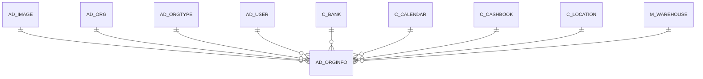

# AD_ORGINFO

Area [AD](../../data-model/ad/index.md) · class **config** (proposed) · read from database `idempiere-db` (owner `ADEMPIERE`) · 10 row(s) when profiled

Application model: `org.compiere.model.X_AD_OrgInfo`, access level 7 - System - Client - Org.

## Columns

| column | type | key | not null | business name | references (code) | nulls | distinct |
|---|---|---|---|---|---|---|---|
| `AD_ORG_ID` | NUMBER(10,0) | PK | yes | Organization |  | 0 | 10 |
| `AD_CLIENT_ID` | NUMBER(10,0) |  | yes | Tenant |  | 0 | 2 |
| `ISACTIVE` | CHAR(1) |  | yes | Active |  | 0 | 1 |
| `CREATED` | DATE |  | yes | Created |  | 0 | 10 |
| `CREATEDBY` | NUMBER(10,0) |  | yes | Created By |  | 0 | 2 |
| `UPDATED` | DATE |  | yes | Updated |  | 0 | 10 |
| `UPDATEDBY` | NUMBER(10,0) |  | yes | Updated By |  | 0 | 2 |
| `C_LOCATION_ID` | NUMBER(10,0) |  |  | Address | [C_LOCATION](../../data-model/c/c_location.md) | 5 | 5 |
| `DUNS` | VARCHAR2(11 CHAR) |  | yes | D-U-N-S |  | 0 | 3 |
| `TAXID` | VARCHAR2(20 CHAR) |  | yes | Tax ID |  | 0 | 2 |
| `PA_GOAL_ID` | NUMBER(10,0) |  |  |  |  | 10 | 0 |
| `SUPERVISOR_ID` | NUMBER(10,0) |  |  | Supervisor | [AD_USER](../../data-model/ad/ad_user.md) | 8 | 2 |
| `PARENT_ORG_ID` | NUMBER(10,0) |  |  | Parent Organization |  | 9 | 1 |
| `AD_ORGTYPE_ID` | NUMBER(10,0) |  |  | Organization Type | [AD_ORGTYPE](../../data-model/ad/ad_orgtype.md) | 4 | 2 |
| `M_WAREHOUSE_ID` | NUMBER(10,0) |  |  | Warehouse | [M_WAREHOUSE](../../data-model/m/m_warehouse.md) | 2 | 8 |
| `TRANSFERBANK_ID` | NUMBER(10,0) |  |  | Bank for transfers | [C_BANK](../../data-model/c/c_bank.md) | 10 | 0 |
| `TRANSFERCASHBOOK_ID` | NUMBER(10,0) |  |  | CashBook for transfers | [C_CASHBOOK](../../data-model/c/c_cashbook.md) | 10 | 0 |
| `RECEIPTFOOTERMSG` | VARCHAR2(1023 CHAR) |  |  | Receipt Footer Msg |  | 10 | 0 |
| `DROPSHIP_WAREHOUSE_ID` | NUMBER(10,0) |  |  | Drop Ship Warehouse | [M_WAREHOUSE](../../data-model/m/m_warehouse.md) | 10 | 0 |
| `C_CALENDAR_ID` | NUMBER(10,0) |  |  | Calendar | [C_CALENDAR](../../data-model/c/c_calendar.md) | 10 | 0 |
| `LOGO_ID` | NUMBER(10,0) |  |  | Logo |  | 10 | 0 |
| `PHONE` | VARCHAR2(40 CHAR) |  |  | Phone |  | 10 | 0 |
| `PHONE2` | VARCHAR2(40 CHAR) |  |  | 2nd Phone |  | 10 | 0 |
| `FAX` | VARCHAR2(40 CHAR) |  |  | Fax |  | 10 | 0 |
| `EMAIL` | VARCHAR2(60 CHAR) |  |  | EMail Address |  | 10 | 0 |
| `AD_ORGINFO_UU` | VARCHAR2(36 CHAR) |  |  | AD_OrgInfo_UU |  | 0 | 10 |
| `TIMEZONE` | VARCHAR2(60 CHAR) |  |  | Time Zone |  | 10 | 0 |

*references (code)* is the table the application model's code says a column points to; *Foreign keys* below are the constraints the database declares. Counts come from the profile; no value is ever shown.

## Check constraints

| name | expression |
|---|---|
| `SYS_C0022738` | `IsActive in ('Y','N')` |

## Foreign keys

**References**

| table | columns | on delete |
|---|---|---|
| [AD_IMAGE](../../data-model/ad/ad_image.md) | AD_ORGINFO.LOGO_ID → AD_IMAGE.AD_IMAGE_ID | NO ACTION |
| [AD_ORG](../../data-model/ad/ad_org.md) | AD_ORGINFO.PARENT_ORG_ID → AD_ORG.AD_ORG_ID | SET NULL |
| [AD_ORGTYPE](../../data-model/ad/ad_orgtype.md) | AD_ORGINFO.AD_ORGTYPE_ID → AD_ORGTYPE.AD_ORGTYPE_ID | NO ACTION |
| [AD_USER](../../data-model/ad/ad_user.md) | AD_ORGINFO.SUPERVISOR_ID → AD_USER.AD_USER_ID | SET NULL |
| [C_BANK](../../data-model/c/c_bank.md) | AD_ORGINFO.TRANSFERBANK_ID → C_BANK.C_BANK_ID | NO ACTION |
| [C_CALENDAR](../../data-model/c/c_calendar.md) | AD_ORGINFO.C_CALENDAR_ID → C_CALENDAR.C_CALENDAR_ID | NO ACTION |
| [C_CASHBOOK](../../data-model/c/c_cashbook.md) | AD_ORGINFO.TRANSFERCASHBOOK_ID → C_CASHBOOK.C_CASHBOOK_ID | NO ACTION |
| [C_LOCATION](../../data-model/c/c_location.md) | AD_ORGINFO.C_LOCATION_ID → C_LOCATION.C_LOCATION_ID | NO ACTION |
| [M_WAREHOUSE](../../data-model/m/m_warehouse.md) | AD_ORGINFO.DROPSHIP_WAREHOUSE_ID → M_WAREHOUSE.M_WAREHOUSE_ID | NO ACTION |

**Referenced by**

_None._

## Write behaviour

- updates: **raw_sql_skips_updated**
- deletes: **soft_delete_only**
- change log: **recorded**
- evidence: 2 citation(s)

## Read by

| kind | name |
|---|---|
| View | `AD_ORG_V` |
| View | `C_DUNNING_HEADER_V` |
| View | `C_DUNNING_HEADER_VT` |
| View | `C_INVOICE_HEADER_V` |
| View | `C_INVOICE_HEADER_VT` |
| View | `C_ORDER_HEADER_V` |
| View | `C_ORDER_HEADER_VT` |
| View | `C_PAYSELECTION_CHECK_V` |
| View | `C_PAYSELECTION_CHECK_VT` |
| View | `C_PROJECT_HEADER_V` |
| View | `C_PROJECT_HEADER_VT` |
| View | `C_RFQRESPONSE_V` |
| View | `C_RFQRESPONSE_VT` |
| View | `DD_ORDER_HEADER_V` |
| View | `DD_ORDER_HEADER_VT` |
| View | `M_INOUT_HEADER_V` |
| View | `M_INOUT_HEADER_VT` |
| View | `PP_ORDER_BOM_HEADER_V` |
| View | `PP_ORDER_BOM_HEADER_VT` |
| View | `PP_ORDER_HEADER_V` |
| View | `PP_ORDER_HEADER_VT` |
| View | `PP_ORDER_WORKFLOW_HEADER_V` |
| View | `PP_ORDER_WORKFLOW_HEADER_VT` |
| View | `ad_org_v` |
| View | `c_dunning_header_v` |
| View | `c_dunning_header_vt` |
| View | `c_invoice_header_v` |
| View | `c_invoice_header_vt` |
| View | `c_order_header_v` |
| View | `c_order_header_vt` |
| View | `c_payselection_check_v` |
| View | `c_payselection_check_vt` |
| View | `c_project_header_v` |
| View | `c_project_header_vt` |
| View | `c_rfqresponse_v` |
| View | `c_rfqresponse_vt` |
| View | `dd_order_header_v` |
| View | `dd_order_header_vt` |
| View | `m_inout_header_v` |
| View | `m_inout_header_vt` |
| View | `pp_order_bom_header_v` |
| View | `pp_order_bom_header_vt` |
| View | `pp_order_header_v` |
| View | `pp_order_header_vt` |
| View | `pp_order_workflow_header_v` |
| View | `pp_order_workflow_header_vt` |
| View | `pp_product_bom_header_v` |
| View | `pp_product_bom_header_vt` |

## Schema history

45 change(s); the latest:

| applied | release | operation | column | tickets |
|---|---|---|---|---|
| 2023-04-09T15:47 | iD11 | `add_constraint` |  | IDEMPIERE-5567 |
| 2023-04-09T15:47 | iD11 | `add_constraint` |  | IDEMPIERE-5567 |
| 2022-11-01T13:31 | iD11 | `add_column` | TimeZone | IDEMPIERE-5458 |
| 2022-11-01T13:31 | iD11 | `add_column` | TimeZone | IDEMPIERE-5458 |
| 2021-12-05T16:45 | i8.2z | `drop_constraint` |  | IDEMPIERE-5075 |
| 2021-12-05T16:45 | i8.2z | `drop_constraint` |  | IDEMPIERE-5075 |
| 2021-12-05T16:45 | i8.2z | `drop_constraint` |  | IDEMPIERE-5075 |
| 2021-12-05T16:45 | i8.2z | `add_constraint` |  | IDEMPIERE-5075 |
| 2021-12-05T16:45 | i8.2z | `drop_constraint` |  | IDEMPIERE-5075 |
| 2021-12-05T16:45 | i8.2z | `add_constraint` |  | IDEMPIERE-5075 |
| 2021-12-05T16:45 | i8.2z | `add_constraint` |  | IDEMPIERE-5075 |
| 2021-12-05T16:45 | i8.2z | `add_constraint` |  | IDEMPIERE-5075 |
| 2021-12-05T16:45 | i8.2z | `drop_constraint` |  | IDEMPIERE-5075 |
| 2021-12-05T16:45 | i8.2z | `add_constraint` |  | IDEMPIERE-5075 |
| 2021-12-05T16:45 | i8.2z | `drop_constraint` |  | IDEMPIERE-5075 |

## Open conflicts

| type | attribute | explanation |
|---|---|---|
| `mandatory_but_nullable` | `columns.ReceiptFooterMsg.nullable` | unexplained |

## Notes

<!-- ekos:manual id="table.ad_orginfo.notes" -->
_Business notes about this table._
<!-- /ekos:manual -->
