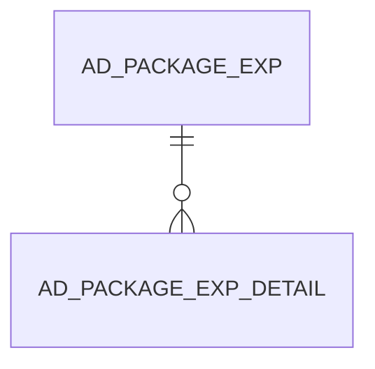

# AD_PACKAGE_EXP

Area [AD](../../data-model/ad/index.md) · class **config** (proposed) · read from database `idempiere-db` (owner `ADEMPIERE`) · 0 row(s) when profiled

Application model: `org.compiere.model.X_AD_Package_Exp`, access level 6 - System - Client.

## Columns

| column | type | key | not null | business name | references (code) | nulls | distinct |
|---|---|---|---|---|---|---|---|
| `AD_PACKAGE_EXP_ID` | NUMBER(10,0) | PK | yes | Package Exp |  | 0 | 0 |
| `AD_CLIENT_ID` | NUMBER(10,0) |  | yes | Tenant |  | 0 | 0 |
| `AD_ORG_ID` | NUMBER(10,0) |  | yes | Organization |  | 0 | 0 |
| `ISACTIVE` | CHAR(1) |  | yes | Active |  | 0 | 0 |
| `CREATED` | DATE |  | yes | Created |  | 0 | 0 |
| `CREATEDBY` | NUMBER(10,0) |  | yes | Created By |  | 0 | 0 |
| `UPDATED` | DATE |  | yes | Updated |  | 0 | 0 |
| `UPDATEDBY` | NUMBER(10,0) |  | yes | Updated By |  | 0 | 0 |
| `AD_PACKAGE_TYPE` | VARCHAR2(1 CHAR) |  |  | Package Type |  | 0 | 0 |
| `EMAIL` | VARCHAR2(30 CHAR) |  |  | EMail Address |  | 0 | 0 |
| `INSTRUCTIONS` | VARCHAR2(1000 CHAR) |  |  | Instructions |  | 0 | 0 |
| `NAME` | VARCHAR2(60 CHAR) |  | yes | Name |  | 0 | 0 |
| `PROCESSED` | CHAR(1) |  |  | Processed |  | 0 | 0 |
| `RELEASENO` | VARCHAR2(20 CHAR) |  |  | Release No |  | 0 | 0 |
| `VERSION` | VARCHAR2(20 CHAR) |  |  | Version |  | 0 | 0 |
| `USERNAME` | VARCHAR2(30 CHAR) |  |  | User Name |  | 0 | 0 |
| `PROCESSING` | CHAR(1) |  | yes | Process Now |  | 0 | 0 |
| `PK_VERSION` | VARCHAR2(20 CHAR) |  | yes | Package Version |  | 0 | 0 |
| `FILE_DIRECTORY` | VARCHAR2(255 CHAR) |  |  | File_Directory |  | 0 | 0 |
| `DESCRIPTION` | VARCHAR2(1000 CHAR) |  |  | Description |  | 0 | 0 |
| `AD_PACKAGE_EXP_UU` | VARCHAR2(36 CHAR) |  |  | AD_Package_Exp_UU |  | 0 | 0 |
| `DATEFROM` | DATE |  |  | Date From |  | 0 | 0 |
| `ISEXPORTDICTIONARYENTITY` | CHAR(1) |  | yes | Export Dictionary Entity |  | 0 | 0 |

*references (code)* is the table the application model's code says a column points to; *Foreign keys* below are the constraints the database declares. Counts come from the profile; no value is ever shown.

## Check constraints

| name | expression |
|---|---|
| `SYS_C0023021` | `IsExportDictionaryEntity IN ('Y','N')` |

## Foreign keys

**References**

_None._

**Referenced by**

| table | columns | on delete |
|---|---|---|
| [AD_PACKAGE_EXP_DETAIL](../../data-model/ad/ad_package_exp_detail.md) | AD_PACKAGE_EXP_DETAIL.AD_PACKAGE_EXP_ID → AD_PACKAGE_EXP.AD_PACKAGE_EXP_ID | NO ACTION |

## Write behaviour

- updates: **po_only**
- deletes: **deleted_by_users**
- change log: **recorded**
- evidence: 1 citation(s)

## Schema history

43 change(s); the latest:

| applied | release | operation | column | tickets |
|---|---|---|---|---|
| 2025-10-27T15:12 | iD12 | `add_column` | IsIncludeOrganizationId | IDEMPIERE-6706 |
| 2025-10-27T15:12 | iD12 | `add_column` | IsIncludeOrganizationId | IDEMPIERE-6706 |
| 2023-04-09T15:47 | iD11 | `add_constraint` |  | IDEMPIERE-5567 |
| 2023-04-09T15:47 | iD11 | `add_constraint` |  | IDEMPIERE-5567 |
| 2020-08-04T01:00 | i7.1z | `modify_column` | AD_PACKAGE_EXP_UU | IDEMPIERE-3862 |
| 2020-08-04T01:00 | i7.1z | `modify_column` | PK_VERSION | IDEMPIERE-3862 |
| 2020-08-04T01:00 | i7.1z | `drop_column` | tmp_col_11_tmp | IDEMPIERE-3862 |
| 2020-08-04T01:00 | i7.1z | `add_column` | tmp_col_6_tmp | IDEMPIERE-3862 |
| 2020-08-04T01:00 | i7.1z | `add_column` | tmp_col_11_tmp | IDEMPIERE-3862 |
| 2020-08-04T01:00 | i7.1z | `modify_column` | PK_VERSION | IDEMPIERE-3862 |
| 2020-08-04T01:00 | i7.1z | `drop_column` | tmp_col_1_tmp | IDEMPIERE-3862 |
| 2020-08-04T01:00 | i7.1z | `add_column` | tmp_col_5_tmp | IDEMPIERE-3862 |
| 2020-08-04T01:00 | i7.1z | `add_column` | tmp_col_8_tmp | IDEMPIERE-3862 |
| 2020-08-04T01:00 | i7.1z | `modify_column` | RELEASENO | IDEMPIERE-3862 |
| 2020-08-04T01:00 | i7.1z | `modify_column` | NAME | IDEMPIERE-3862 |

## Open conflicts

| type | attribute | explanation |
|---|---|---|
| `model_column_missing` | `columns.IsIncludeOrganizationId` | unexplained |

## Notes

<!-- ekos:manual id="table.ad_package_exp.notes" -->
_Business notes about this table._
<!-- /ekos:manual -->
