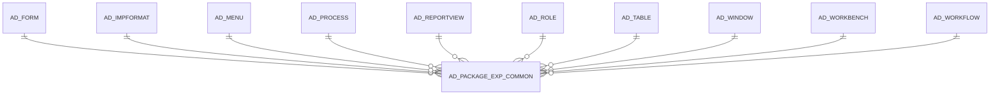

# AD_PACKAGE_EXP_COMMON

Area [AD](../../data-model/ad/index.md) · class **config** (proposed) · read from database `idempiere-db` (owner `ADEMPIERE`) · 0 row(s) when profiled

## Columns

| column | type | key | not null | business name | references (code) | nulls | distinct |
|---|---|---|---|---|---|---|---|
| `AD_PACKAGE_EXP_COMMON_ID` | NUMBER(10,0) | PK | yes |  |  | 0 | 0 |
| `AD_CLIENT_ID` | NUMBER(10,0) |  | yes |  |  | 0 | 0 |
| `AD_ORG_ID` | NUMBER(10,0) |  | yes |  |  | 0 | 0 |
| `ISACTIVE` | CHAR(1) |  | yes |  |  | 0 | 0 |
| `CREATED` | DATE |  | yes |  |  | 0 | 0 |
| `CREATEDBY` | NUMBER(10,0) |  | yes |  |  | 0 | 0 |
| `UPDATED` | DATE |  | yes |  |  | 0 | 0 |
| `UPDATEDBY` | NUMBER(10,0) |  | yes |  |  | 0 | 0 |
| `AD_FORM_ID` | NUMBER(10,0) |  |  |  |  | 0 | 0 |
| `AD_IMPFORMAT_ID` | NUMBER(10,0) |  |  |  |  | 0 | 0 |
| `AD_REPORTVIEW_ID` | NUMBER(10,0) |  |  |  |  | 0 | 0 |
| `AD_TABLE_ID` | NUMBER(10,0) |  |  |  |  | 0 | 0 |
| `AD_WORKBENCH_ID` | NUMBER(10,0) |  |  |  |  | 0 | 0 |
| `DBTYPE` | VARCHAR2(22 CHAR) |  |  |  |  | 0 | 0 |
| `PROCESSED` | CHAR(1) |  |  |  |  | 0 | 0 |
| `NAME` | VARCHAR2(60 CHAR) |  |  |  |  | 0 | 0 |
| `NAME2` | VARCHAR2(60 CHAR) |  |  |  |  | 0 | 0 |
| `LINE` | NUMBER |  |  |  |  | 0 | 0 |
| `FILE_DIRECTORY` | VARCHAR2(255 CHAR) |  |  |  |  | 0 | 0 |
| `FILENAME` | VARCHAR2(255 CHAR) |  |  |  |  | 0 | 0 |
| `DESTINATION_DIRECTORY` | VARCHAR2(255 CHAR) |  |  |  |  | 0 | 0 |
| `DESCRIPTION` | VARCHAR2(1000 CHAR) |  |  |  |  | 0 | 0 |
| `TYPE` | VARCHAR2(10 CHAR) |  |  |  |  | 0 | 0 |
| `TARGET_DIRECTORY` | VARCHAR2(255 CHAR) |  |  |  |  | 0 | 0 |
| `SQLSTATEMENT` | VARCHAR2(255 CHAR) |  |  |  |  | 0 | 0 |
| `PROCESSING` | CHAR(1) |  |  |  |  | 0 | 0 |
| `AD_WORKFLOW_ID` | NUMBER(10,0) |  |  |  |  | 0 | 0 |
| `AD_WINDOW_ID` | NUMBER(10,0) |  |  |  |  | 0 | 0 |
| `AD_ROLE_ID` | NUMBER(10,0) |  |  |  |  | 0 | 0 |
| `AD_PROCESS_ID` | NUMBER(10,0) |  |  |  |  | 0 | 0 |
| `AD_MENU_ID` | NUMBER(10,0) |  |  |  |  | 0 | 0 |
| `AD_PACKAGE_EXP_COMMON_UU` | VARCHAR2(36 CHAR) |  |  |  |  | 0 | 0 |

*references (code)* is the table the application model's code says a column points to; *Foreign keys* below are the constraints the database declares. Counts come from the profile; no value is ever shown.

## Foreign keys

**References**

| table | columns | on delete |
|---|---|---|
| [AD_FORM](../../data-model/ad/ad_form.md) | AD_PACKAGE_EXP_COMMON.AD_FORM_ID → AD_FORM.AD_FORM_ID | NO ACTION |
| [AD_IMPFORMAT](../../data-model/ad/ad_impformat.md) | AD_PACKAGE_EXP_COMMON.AD_IMPFORMAT_ID → AD_IMPFORMAT.AD_IMPFORMAT_ID | NO ACTION |
| [AD_MENU](../../data-model/ad/ad_menu.md) | AD_PACKAGE_EXP_COMMON.AD_MENU_ID → AD_MENU.AD_MENU_ID | NO ACTION |
| [AD_PROCESS](../../data-model/ad/ad_process.md) | AD_PACKAGE_EXP_COMMON.AD_PROCESS_ID → AD_PROCESS.AD_PROCESS_ID | NO ACTION |
| [AD_REPORTVIEW](../../data-model/ad/ad_reportview.md) | AD_PACKAGE_EXP_COMMON.AD_REPORTVIEW_ID → AD_REPORTVIEW.AD_REPORTVIEW_ID | NO ACTION |
| [AD_ROLE](../../data-model/ad/ad_role.md) | AD_PACKAGE_EXP_COMMON.AD_ROLE_ID → AD_ROLE.AD_ROLE_ID | NO ACTION |
| [AD_TABLE](../../data-model/ad/ad_table.md) | AD_PACKAGE_EXP_COMMON.AD_TABLE_ID → AD_TABLE.AD_TABLE_ID | NO ACTION |
| [AD_WINDOW](../../data-model/ad/ad_window.md) | AD_PACKAGE_EXP_COMMON.AD_WINDOW_ID → AD_WINDOW.AD_WINDOW_ID | NO ACTION |
| [AD_WORKBENCH](../../data-model/ad/ad_workbench.md) | AD_PACKAGE_EXP_COMMON.AD_WORKBENCH_ID → AD_WORKBENCH.AD_WORKBENCH_ID | NO ACTION |
| [AD_WORKFLOW](../../data-model/ad/ad_workflow.md) | AD_PACKAGE_EXP_COMMON.AD_WORKFLOW_ID → AD_WORKFLOW.AD_WORKFLOW_ID | NO ACTION |

**Referenced by**

_None._

## Write behaviour

- updates: **po_only**
- deletes: **deleted_by_users**
- change log: **recorded**
- evidence: 1 citation(s)

## Schema history

55 change(s); the latest:

| applied | release | operation | column | tickets |
|---|---|---|---|---|
| 2023-04-09T15:47 | iD11 | `add_constraint` |  | IDEMPIERE-5567 |
| 2023-04-09T15:47 | iD11 | `add_constraint` |  | IDEMPIERE-5567 |
| 2021-12-05T16:45 | i8.2z | `drop_constraint` |  | IDEMPIERE-5075 |
| 2021-12-05T16:45 | i8.2z | `drop_constraint` |  | IDEMPIERE-5075 |
| 2021-12-05T16:45 | i8.2z | `drop_constraint` |  | IDEMPIERE-5075 |
| 2021-12-05T16:45 | i8.2z | `drop_constraint` |  | IDEMPIERE-5075 |
| 2021-12-05T16:45 | i8.2z | `add_constraint` |  | IDEMPIERE-5075 |
| 2021-12-05T16:45 | i8.2z | `drop_constraint` |  | IDEMPIERE-5075 |
| 2021-12-05T16:45 | i8.2z | `add_constraint` |  | IDEMPIERE-5075 |
| 2021-12-05T16:45 | i8.2z | `add_constraint` |  | IDEMPIERE-5075 |
| 2021-12-05T16:45 | i8.2z | `add_constraint` |  | IDEMPIERE-5075 |
| 2021-12-05T16:45 | i8.2z | `drop_constraint` |  | IDEMPIERE-5075 |
| 2021-12-05T16:45 | i8.2z | `add_constraint` |  | IDEMPIERE-5075 |
| 2021-12-05T16:45 | i8.2z | `add_constraint` |  | IDEMPIERE-5075 |
| 2021-12-05T16:45 | i8.2z | `add_constraint` |  | IDEMPIERE-5075 |

## Open conflicts

| type | attribute | explanation |
|---|---|---|
| `table_without_model` | `model_class` | unexplained |

## Notes

<!-- ekos:manual id="table.ad_package_exp_common.notes" -->
_Business notes about this table._
<!-- /ekos:manual -->
