# AD_PACKAGE_EXP_DETAIL

Area [AD](../../data-model/ad/index.md) · class **config** (proposed) · read from database `idempiere-db` (owner `ADEMPIERE`) · 0 row(s) when profiled

Application model: `org.compiere.model.X_AD_Package_Exp_Detail`, access level 6 - System - Client.

## Columns

| column | type | key | not null | business name | references (code) | nulls | distinct |
|---|---|---|---|---|---|---|---|
| `AD_PACKAGE_EXP_DETAIL_ID` | NUMBER(10,0) | PK | yes | Package Exp. Detail |  | 0 | 0 |
| `AD_CLIENT_ID` | NUMBER(10,0) |  | yes | Tenant |  | 0 | 0 |
| `AD_ORG_ID` | NUMBER(10,0) |  | yes | Organization |  | 0 | 0 |
| `ISACTIVE` | CHAR(1) |  | yes | Active |  | 0 | 0 |
| `CREATED` | DATE |  | yes | Created |  | 0 | 0 |
| `CREATEDBY` | NUMBER |  | yes | Created By |  | 0 | 0 |
| `UPDATED` | DATE |  | yes | Updated |  | 0 | 0 |
| `UPDATEDBY` | NUMBER |  | yes | Updated By |  | 0 | 0 |
| `AD_FORM_ID` | NUMBER(10,0) |  |  | Special Form | [AD_FORM](../../data-model/ad/ad_form.md) | 0 | 0 |
| `AD_IMPFORMAT_ID` | NUMBER(10,0) |  |  | Import Format | [AD_IMPFORMAT](../../data-model/ad/ad_impformat.md) | 0 | 0 |
| `AD_MENU_ID` | NUMBER(10,0) |  |  | Menu | [AD_MENU](../../data-model/ad/ad_menu.md) | 0 | 0 |
| `AD_PROCESS_ID` | NUMBER(10,0) |  |  | Process | [AD_PROCESS](../../data-model/ad/ad_process.md) | 0 | 0 |
| `AD_ROLE_ID` | NUMBER(10,0) |  |  | Role | [AD_ROLE](../../data-model/ad/ad_role.md) | 0 | 0 |
| `AD_WINDOW_ID` | NUMBER(10,0) |  |  | Window | [AD_WINDOW](../../data-model/ad/ad_window.md) | 0 | 0 |
| `AD_WORKFLOW_ID` | NUMBER(10,0) |  |  | Workflow | [AD_WORKFLOW](../../data-model/ad/ad_workflow.md) | 0 | 0 |
| `FILE_DIRECTORY` | VARCHAR2(255 CHAR) |  |  | File_Directory |  | 0 | 0 |
| `FILENAME` | VARCHAR2(255 CHAR) |  |  | File Name |  | 0 | 0 |
| `DESTINATION_FILENAME` | VARCHAR2(255 CHAR) |  |  | Destination_FileName |  | 0 | 0 |
| `DESTINATION_DIRECTORY` | VARCHAR2(255 CHAR) |  |  | Destination_Directory |  | 0 | 0 |
| `DESCRIPTION` | VARCHAR2(1000 CHAR) |  |  | Description |  | 0 | 0 |
| `DBTYPE` | VARCHAR2(22 CHAR) |  |  | DB Type |  | 0 | 0 |
| `TYPE` | VARCHAR2(10 CHAR) |  | yes | Type |  | 0 | 0 |
| `TARGET_DIRECTORY` | VARCHAR2(255 CHAR) |  |  | Target_Directory |  | 0 | 0 |
| `RELEASENO` | VARCHAR2(20 CHAR) |  |  | Release No |  | 0 | 0 |
| `PROCESSING` | CHAR(1) |  | yes | Process Now |  | 0 | 0 |
| `PROCESSED` | CHAR(1) |  |  | Processed |  | 0 | 0 |
| `NAME2` | VARCHAR2(60 CHAR) |  |  | Name 2 |  | 0 | 0 |
| `LINE` | NUMBER |  |  | Line No |  | 0 | 0 |
| `AD_WORKBENCH_ID` | NUMBER(10,0) |  |  |  |  | 0 | 0 |
| `AD_TABLE_ID` | NUMBER(10,0) |  |  | Table | [AD_TABLE](../../data-model/ad/ad_table.md) | 0 | 0 |
| `AD_REPORTVIEW_ID` | NUMBER(10,0) |  |  | Report View | [AD_REPORTVIEW](../../data-model/ad/ad_reportview.md) | 0 | 0 |
| `AD_PACKAGE_EXP_ID` | NUMBER(10,0) |  | yes | Package Exp | [AD_PACKAGE_EXP](../../data-model/ad/ad_package_exp.md) | 0 | 0 |
| `AD_PACKAGE_CODE_NEW` | VARCHAR2(2000 CHAR) |  |  | New Package Code |  | 0 | 0 |
| `AD_PACKAGE_CODE_OLD` | VARCHAR2(2000 CHAR) |  |  | Old Package Code |  | 0 | 0 |
| `AD_VAL_RULE_ID` | NUMBER(10,0) |  |  | Dynamic Validation | [AD_VAL_RULE](../../data-model/ad/ad_val_rule.md) | 0 | 0 |
| `AD_MESSAGE_ID` | NUMBER(10,0) |  |  | Message | [AD_MESSAGE](../../data-model/ad/ad_message.md) | 0 | 0 |
| `AD_PRINTFORMAT_ID` | NUMBER(10,0) |  |  | Print Format | [AD_PRINTFORMAT](../../data-model/ad/ad_printformat.md) | 0 | 0 |
| `AD_REFERENCE_ID` | NUMBER(10,0) |  |  | Reference | [AD_REFERENCE](../../data-model/ad/ad_reference.md) | 0 | 0 |
| `AD_MODELVALIDATOR_ID` | NUMBER(10,0) |  |  | Model Validator | [AD_MODELVALIDATOR](../../data-model/ad/ad_modelvalidator.md) | 0 | 0 |
| `AD_ENTITYTYPE_ID` | NUMBER(10,0) |  |  | Entity Type | [AD_ENTITYTYPE](../../data-model/ad/ad_entitytype.md) | 0 | 0 |
| `AD_PACKAGE_EXP_DETAIL_UU` | VARCHAR2(36 CHAR) |  |  | AD_Package_Exp_Detail_UU |  | 0 | 0 |
| `SQLSTATEMENT` | VARCHAR2(4000 CHAR) |  |  | SQL Expression/Statement |  | 0 | 0 |
| `AD_INFOWINDOW_ID` | NUMBER(10,0) |  |  | Info Window | [AD_INFOWINDOW](../../data-model/ad/ad_infowindow.md) | 0 | 0 |
| `EXECCODE` | CLOB |  |  | Execution Code |  | 0 |  |

*references (code)* is the table the application model's code says a column points to; *Foreign keys* below are the constraints the database declares. Counts come from the profile; no value is ever shown.

## Foreign keys

**References**

| table | columns | on delete |
|---|---|---|
| [AD_ENTITYTYPE](../../data-model/ad/ad_entitytype.md) | AD_PACKAGE_EXP_DETAIL.AD_ENTITYTYPE_ID → AD_ENTITYTYPE.AD_ENTITYTYPE_ID | NO ACTION |
| [AD_FORM](../../data-model/ad/ad_form.md) | AD_PACKAGE_EXP_DETAIL.AD_FORM_ID → AD_FORM.AD_FORM_ID | NO ACTION |
| [AD_IMPFORMAT](../../data-model/ad/ad_impformat.md) | AD_PACKAGE_EXP_DETAIL.AD_IMPFORMAT_ID → AD_IMPFORMAT.AD_IMPFORMAT_ID | NO ACTION |
| [AD_INFOWINDOW](../../data-model/ad/ad_infowindow.md) | AD_PACKAGE_EXP_DETAIL.AD_INFOWINDOW_ID → AD_INFOWINDOW.AD_INFOWINDOW_ID | NO ACTION |
| [AD_MENU](../../data-model/ad/ad_menu.md) | AD_PACKAGE_EXP_DETAIL.AD_MENU_ID → AD_MENU.AD_MENU_ID | NO ACTION |
| [AD_MESSAGE](../../data-model/ad/ad_message.md) | AD_PACKAGE_EXP_DETAIL.AD_MESSAGE_ID → AD_MESSAGE.AD_MESSAGE_ID | NO ACTION |
| [AD_MODELVALIDATOR](../../data-model/ad/ad_modelvalidator.md) | AD_PACKAGE_EXP_DETAIL.AD_MODELVALIDATOR_ID → AD_MODELVALIDATOR.AD_MODELVALIDATOR_ID | NO ACTION |
| [AD_PACKAGE_EXP](../../data-model/ad/ad_package_exp.md) | AD_PACKAGE_EXP_DETAIL.AD_PACKAGE_EXP_ID → AD_PACKAGE_EXP.AD_PACKAGE_EXP_ID | NO ACTION |
| [AD_PRINTFORMAT](../../data-model/ad/ad_printformat.md) | AD_PACKAGE_EXP_DETAIL.AD_PRINTFORMAT_ID → AD_PRINTFORMAT.AD_PRINTFORMAT_ID | NO ACTION |
| [AD_PROCESS](../../data-model/ad/ad_process.md) | AD_PACKAGE_EXP_DETAIL.AD_PROCESS_ID → AD_PROCESS.AD_PROCESS_ID | NO ACTION |
| [AD_REFERENCE](../../data-model/ad/ad_reference.md) | AD_PACKAGE_EXP_DETAIL.AD_REFERENCE_ID → AD_REFERENCE.AD_REFERENCE_ID | NO ACTION |
| [AD_REPORTVIEW](../../data-model/ad/ad_reportview.md) | AD_PACKAGE_EXP_DETAIL.AD_REPORTVIEW_ID → AD_REPORTVIEW.AD_REPORTVIEW_ID | NO ACTION |
| [AD_ROLE](../../data-model/ad/ad_role.md) | AD_PACKAGE_EXP_DETAIL.AD_ROLE_ID → AD_ROLE.AD_ROLE_ID | NO ACTION |
| [AD_TABLE](../../data-model/ad/ad_table.md) | AD_PACKAGE_EXP_DETAIL.AD_TABLE_ID → AD_TABLE.AD_TABLE_ID | NO ACTION |
| [AD_VAL_RULE](../../data-model/ad/ad_val_rule.md) | AD_PACKAGE_EXP_DETAIL.AD_VAL_RULE_ID → AD_VAL_RULE.AD_VAL_RULE_ID | NO ACTION |
| [AD_WINDOW](../../data-model/ad/ad_window.md) | AD_PACKAGE_EXP_DETAIL.AD_WINDOW_ID → AD_WINDOW.AD_WINDOW_ID | NO ACTION |
| [AD_WORKBENCH](../../data-model/ad/ad_workbench.md) | AD_PACKAGE_EXP_DETAIL.AD_WORKBENCH_ID → AD_WORKBENCH.AD_WORKBENCH_ID | NO ACTION |
| [AD_WORKFLOW](../../data-model/ad/ad_workflow.md) | AD_PACKAGE_EXP_DETAIL.AD_WORKFLOW_ID → AD_WORKFLOW.AD_WORKFLOW_ID | NO ACTION |

**Referenced by**

_None._

```mermaid
erDiagram
  AD_ENTITYTYPE ||--o{ AD_PACKAGE_EXP_DETAIL : ""
  AD_FORM ||--o{ AD_PACKAGE_EXP_DETAIL : ""
  AD_IMPFORMAT ||--o{ AD_PACKAGE_EXP_DETAIL : ""
  AD_INFOWINDOW ||--o{ AD_PACKAGE_EXP_DETAIL : ""
  AD_MENU ||--o{ AD_PACKAGE_EXP_DETAIL : ""
  AD_MESSAGE ||--o{ AD_PACKAGE_EXP_DETAIL : ""
  AD_MODELVALIDATOR ||--o{ AD_PACKAGE_EXP_DETAIL : ""
  AD_PACKAGE_EXP ||--o{ AD_PACKAGE_EXP_DETAIL : ""
  AD_PRINTFORMAT ||--o{ AD_PACKAGE_EXP_DETAIL : ""
  AD_PROCESS ||--o{ AD_PACKAGE_EXP_DETAIL : ""
  AD_REFERENCE ||--o{ AD_PACKAGE_EXP_DETAIL : ""
  AD_REPORTVIEW ||--o{ AD_PACKAGE_EXP_DETAIL : ""
  AD_ROLE ||--o{ AD_PACKAGE_EXP_DETAIL : ""
  AD_TABLE ||--o{ AD_PACKAGE_EXP_DETAIL : ""
  AD_VAL_RULE ||--o{ AD_PACKAGE_EXP_DETAIL : ""
  AD_WINDOW ||--o{ AD_PACKAGE_EXP_DETAIL : ""
  AD_WORKBENCH ||--o{ AD_PACKAGE_EXP_DETAIL : ""
  AD_WORKFLOW ||--o{ AD_PACKAGE_EXP_DETAIL : ""
```

## Write behaviour

- updates: **po_only**
- deletes: **deleted_by_app, deleted_by_users**
- change log: **recorded**
- evidence: 2 citation(s)

## Schema history

88 change(s); the latest:

| applied | release | operation | column | tickets |
|---|---|---|---|---|
| 2023-04-09T15:47 | iD11 | `add_constraint` |  | IDEMPIERE-5567 |
| 2023-04-09T15:47 | iD11 | `add_constraint` |  | IDEMPIERE-5567 |
| 2021-12-05T16:45 | i8.2z | `add_constraint` |  | IDEMPIERE-5075 |
| 2021-12-05T16:45 | i8.2z | `add_constraint` |  | IDEMPIERE-5075 |
| 2021-12-05T16:45 | i8.2z | `drop_constraint` |  | IDEMPIERE-5075 |
| 2021-12-05T16:45 | i8.2z | `drop_constraint` |  | IDEMPIERE-5075 |
| 2021-12-05T16:45 | i8.2z | `drop_constraint` |  | IDEMPIERE-5075 |
| 2021-12-05T16:45 | i8.2z | `add_constraint` |  | IDEMPIERE-5075 |
| 2021-12-05T16:45 | i8.2z | `drop_constraint` |  | IDEMPIERE-5075 |
| 2021-12-05T16:45 | i8.2z | `add_constraint` |  | IDEMPIERE-5075 |
| 2021-12-05T16:45 | i8.2z | `add_constraint` |  | IDEMPIERE-5075 |
| 2021-12-05T16:45 | i8.2z | `add_constraint` |  | IDEMPIERE-5075 |
| 2021-12-05T16:45 | i8.2z | `drop_constraint` |  | IDEMPIERE-5075 |
| 2021-12-05T16:45 | i8.2z | `drop_constraint` |  | IDEMPIERE-5075 |
| 2021-12-05T16:45 | i8.2z | `drop_constraint` |  | IDEMPIERE-5075 |

## Notes

<!-- ekos:manual id="table.ad_package_exp_detail.notes" -->
_Business notes about this table._
<!-- /ekos:manual -->
