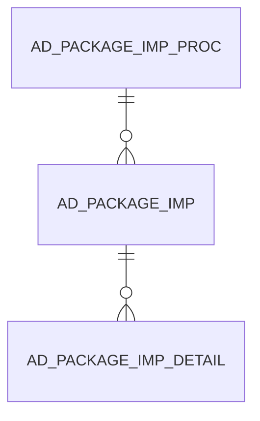

# AD_PACKAGE_IMP

Area [AD](../../data-model/ad/index.md) · class **config** (proposed) · read from database `idempiere-db` (owner `ADEMPIERE`) · 0 row(s) when profiled

Application model: `org.compiere.model.X_AD_Package_Imp`, access level 6 - System - Client.

## Columns

| column | type | key | not null | business name | references (code) | nulls | distinct |
|---|---|---|---|---|---|---|---|
| `AD_PACKAGE_IMP_ID` | NUMBER(10,0) | PK | yes | Package Imp |  | 0 | 0 |
| `AD_CLIENT_ID` | NUMBER(10,0) |  | yes | Tenant |  | 0 | 0 |
| `AD_ORG_ID` | NUMBER(10,0) |  | yes | Organization |  | 0 | 0 |
| `ISACTIVE` | CHAR(1) |  | yes | Active |  | 0 | 0 |
| `CREATED` | DATE |  | yes | Created |  | 0 | 0 |
| `CREATEDBY` | NUMBER(10,0) |  | yes | Created By |  | 0 | 0 |
| `UPDATED` | DATE |  | yes | Updated |  | 0 | 0 |
| `UPDATEDBY` | NUMBER(10,0) |  | yes | Updated By |  | 0 | 0 |
| `NAME` | VARCHAR2(500 CHAR) |  | yes | Name |  | 0 | 0 |
| `PK_STATUS` | VARCHAR2(22 CHAR) |  |  | Package Status |  | 0 | 0 |
| `RELEASENO` | VARCHAR2(20 CHAR) |  |  | Release No |  | 0 | 0 |
| `PK_VERSION` | VARCHAR2(20 CHAR) |  |  | Package Version |  | 0 | 0 |
| `VERSION` | VARCHAR2(20 CHAR) |  |  | Version |  | 0 | 0 |
| `DESCRIPTION` | VARCHAR2(1000 CHAR) |  |  | Description |  | 0 | 0 |
| `EMAIL` | VARCHAR2(60 CHAR) |  |  | EMail Address |  | 0 | 0 |
| `PROCESSED` | CHAR(1) |  |  | Processed |  | 0 | 0 |
| `PROCESSING` | CHAR(1) |  | yes | Process Now |  | 0 | 0 |
| `CREATOR` | VARCHAR2(60 CHAR) |  |  | Creator |  | 0 | 0 |
| `CREATORCONTACT` | VARCHAR2(255 CHAR) |  |  | Creator Contact |  | 0 | 0 |
| `CREATEDDATE` | VARCHAR2(25 CHAR) |  |  | Created Date |  | 0 | 0 |
| `UPDATEDDATE` | VARCHAR2(25 CHAR) |  |  | Updated Date |  | 0 | 0 |
| `UNINSTALL` | CHAR(1) |  |  | Uninstall |  | 0 | 0 |
| `AD_PACKAGE_IMP_UU` | VARCHAR2(36 CHAR) |  |  | AD_Package_Imp_UU |  | 0 | 0 |
| `AD_PACKAGE_IMP_PROC_ID` | NUMBER(10,0) |  |  | Package Imp. Proc | [AD_PACKAGE_IMP_PROC](../../data-model/ad/ad_package_imp_proc.md) | 0 | 0 |

*references (code)* is the table the application model's code says a column points to; *Foreign keys* below are the constraints the database declares. Counts come from the profile; no value is ever shown.

## Foreign keys

**References**

| table | columns | on delete |
|---|---|---|
| [AD_PACKAGE_IMP_PROC](../../data-model/ad/ad_package_imp_proc.md) | AD_PACKAGE_IMP.AD_PACKAGE_IMP_PROC_ID → AD_PACKAGE_IMP_PROC.AD_PACKAGE_IMP_PROC_ID | NO ACTION |

**Referenced by**

| table | columns | on delete |
|---|---|---|
| [AD_PACKAGE_IMP_DETAIL](../../data-model/ad/ad_package_imp_detail.md) | AD_PACKAGE_IMP_DETAIL.AD_PACKAGE_IMP_ID → AD_PACKAGE_IMP.AD_PACKAGE_IMP_ID | NO ACTION |

## Write behaviour

- updates: **raw_sql_skips_updated**
- deletes: **soft_delete_only**
- change log: **recorded**
- evidence: 4 citation(s)

## Schema history

46 change(s); the latest:

| applied | release | operation | column | tickets |
|---|---|---|---|---|
| 2023-04-09T15:47 | iD11 | `add_constraint` |  | IDEMPIERE-5567 |
| 2023-04-09T15:47 | iD11 | `add_constraint` |  | IDEMPIERE-5567 |
| 2022-03-30T15:14 | iD10 | `modify_column` | Name | IDEMPIERE-5243 |
| 2022-03-30T15:14 | iD10 | `modify_column` | Name | IDEMPIERE-5243 |
| 2020-08-04T01:00 | i7.1z | `modify_column` | NAME | IDEMPIERE-3862 |
| 2020-08-04T01:00 | i7.1z | `add_column` | tmp_col_9_tmp | IDEMPIERE-3862 |
| 2020-08-04T01:00 | i7.1z | `modify_column` | PK_STATUS | IDEMPIERE-3862 |
| 2020-08-04T01:00 | i7.1z | `add_column` | tmp_col_8_tmp | IDEMPIERE-3862 |
| 2020-08-04T01:00 | i7.1z | `drop_column` | tmp_col_1_tmp | IDEMPIERE-3862 |
| 2020-08-04T01:00 | i7.1z | `modify_column` | AD_PACKAGE_IMP_UU | IDEMPIERE-3862 |
| 2020-08-04T01:00 | i7.1z | `modify_column` | CREATEDDATE | IDEMPIERE-3862 |
| 2020-08-04T01:00 | i7.1z | `add_column` | tmp_col_6_tmp | IDEMPIERE-3862 |
| 2020-08-04T01:00 | i7.1z | `add_column` | tmp_col_1_tmp | IDEMPIERE-3862 |
| 2020-08-04T01:00 | i7.1z | `modify_column` | EMAIL | IDEMPIERE-3862 |
| 2020-08-04T01:00 | i7.1z | `add_column` | tmp_col_10_tmp | IDEMPIERE-3862 |

## Notes

<!-- ekos:manual id="table.ad_package_imp.notes" -->
_Business notes about this table._
<!-- /ekos:manual -->
