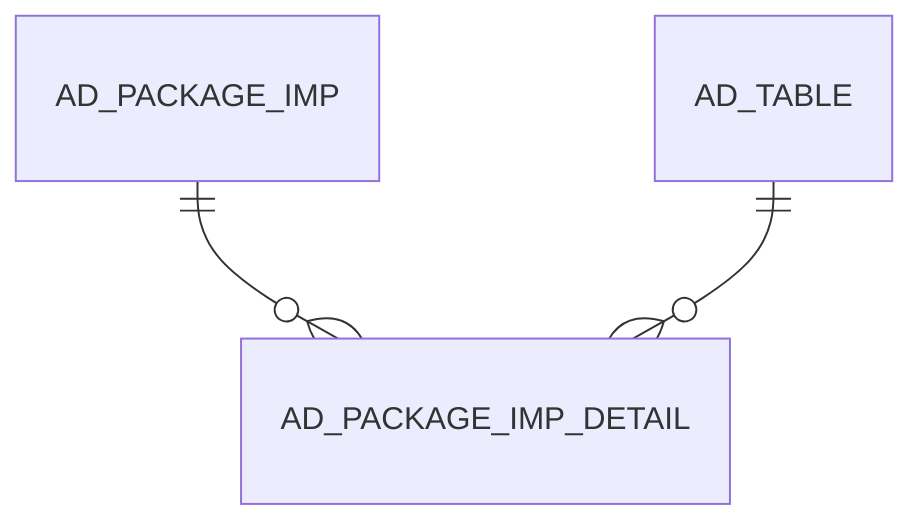

# AD_PACKAGE_IMP_DETAIL

Area [AD](../../data-model/ad/index.md) · class **config** (proposed) · read from database `idempiere-db` (owner `ADEMPIERE`) · 0 row(s) when profiled

Application model: `org.compiere.model.X_AD_Package_Imp_Detail`, access level 6 - System - Client.

## Columns

| column | type | key | not null | business name | references (code) | nulls | distinct |
|---|---|---|---|---|---|---|---|
| `AD_PACKAGE_IMP_DETAIL_ID` | NUMBER(10,0) | PK | yes | Imp. Package Detail |  | 0 | 0 |
| `AD_CLIENT_ID` | NUMBER(10,0) |  | yes | Tenant |  | 0 | 0 |
| `AD_ORG_ID` | NUMBER(10,0) |  | yes | Organization |  | 0 | 0 |
| `ISACTIVE` | CHAR(1) |  | yes | Active |  | 0 | 0 |
| `CREATED` | DATE |  | yes | Created |  | 0 | 0 |
| `CREATEDBY` | NUMBER(10,0) |  | yes | Created By |  | 0 | 0 |
| `UPDATED` | DATE |  | yes | Updated |  | 0 | 0 |
| `UPDATEDBY` | NUMBER(10,0) |  | yes | Updated By |  | 0 | 0 |
| `NAME` | VARCHAR2(2000 CHAR) |  |  | Name |  | 0 | 0 |
| `AD_PACKAGE_IMP_ID` | NUMBER(10,0) |  | yes | Package Imp | [AD_PACKAGE_IMP](../../data-model/ad/ad_package_imp.md) | 0 | 0 |
| `RECORD_ID` | NUMBER(10,0) |  | yes | Record ID |  | 0 | 0 |
| `AD_BACKUP_ID` | NUMBER(10,0) |  |  | Backup |  | 0 | 0 |
| `ACTION` | VARCHAR2(20 CHAR) |  |  | Action |  | 0 | 0 |
| `SUCCESS` | VARCHAR2(20 CHAR) |  |  | Success |  | 0 | 0 |
| `TYPE` | VARCHAR2(60 CHAR) |  |  | Type |  | 0 | 0 |
| `TABLENAME` | VARCHAR2(60 CHAR) |  |  | DB Table Name |  | 0 | 0 |
| `AD_TABLE_ID` | NUMBER(10,0) |  |  | Table | [AD_TABLE](../../data-model/ad/ad_table.md) | 0 | 0 |
| `UNINSTALL` | CHAR(1) |  |  | Uninstall |  | 0 | 0 |
| `AD_PACKAGE_IMP_DETAIL_UU` | VARCHAR2(36 CHAR) |  |  | AD_Package_Imp_Detail_UU |  | 0 | 0 |
| `EXECCODE` | CLOB |  |  | Execution Code |  | 0 |  |
| `RESULT` | CLOB |  |  | Result |  | 0 |  |
| `RECORD_UU` | VARCHAR2(36 CHAR) |  |  | Record UUID |  | 0 | 0 |

*references (code)* is the table the application model's code says a column points to; *Foreign keys* below are the constraints the database declares. Counts come from the profile; no value is ever shown.

## Foreign keys

**References**

| table | columns | on delete |
|---|---|---|
| [AD_PACKAGE_IMP](../../data-model/ad/ad_package_imp.md) | AD_PACKAGE_IMP_DETAIL.AD_PACKAGE_IMP_ID → AD_PACKAGE_IMP.AD_PACKAGE_IMP_ID | NO ACTION |
| [AD_TABLE](../../data-model/ad/ad_table.md) | AD_PACKAGE_IMP_DETAIL.AD_TABLE_ID → AD_TABLE.AD_TABLE_ID | NO ACTION |

**Referenced by**

_None._

## Write behaviour

- updates: **po_only**
- deletes: **soft_delete_only**
- change log: **not_recorded**
- evidence: 1 citation(s)

## Schema history

34 change(s); the latest:

| applied | release | operation | column | tickets |
|---|---|---|---|---|
| 2023-11-26T16:58 | iD11 | `add_column` | Record_UU |  |
| 2023-11-26T16:58 | iD11 | `add_column` | Record_UU |  |
| 2023-04-09T15:47 | iD11 | `add_constraint` |  | IDEMPIERE-5567 |
| 2023-04-09T15:47 | iD11 | `add_constraint` |  | IDEMPIERE-5567 |
| 2021-09-17T18:08 | i8.2 | `add_column` | ExecCode | IDEMPIERE-4968 |
| 2021-09-17T18:08 | i8.2 | `add_column` | Result | IDEMPIERE-4968 |
| 2021-09-17T18:08 | i8.2 | `add_column` | ExecCode | IDEMPIERE-4968 |
| 2021-09-17T18:08 | i8.2 | `add_column` | Result | IDEMPIERE-4968 |
| 2020-08-04T01:00 | i7.1z | `drop_column` | tmp_col_3_tmp | IDEMPIERE-3862 |
| 2020-08-04T01:00 | i7.1z | `modify_column` | TYPE | IDEMPIERE-3862 |
| 2020-08-04T01:00 | i7.1z | `modify_column` | NAME | IDEMPIERE-3862 |
| 2020-08-04T01:00 | i7.1z | `drop_column` | tmp_col_4_tmp | IDEMPIERE-3862 |
| 2020-08-04T01:00 | i7.1z | `modify_column` | ACTION | IDEMPIERE-3862 |
| 2020-08-04T01:00 | i7.1z | `add_column` | tmp_col_2_tmp | IDEMPIERE-3862 |
| 2020-08-04T01:00 | i7.1z | `add_column` | tmp_col_3_tmp | IDEMPIERE-3862 |

## Notes

<!-- ekos:manual id="table.ad_package_imp_detail.notes" -->
_Business notes about this table._
<!-- /ekos:manual -->
