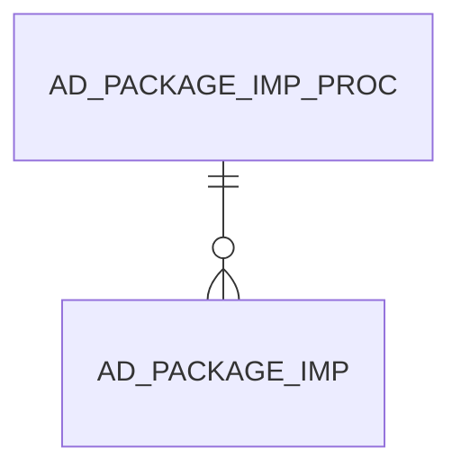

# AD_PACKAGE_IMP_PROC

Area [AD](../../data-model/ad/index.md) · class **config** (proposed) · read from database `idempiere-db` (owner `ADEMPIERE`) · 0 row(s) when profiled

Application model: `org.compiere.model.X_AD_Package_Imp_Proc`, access level 6 - System - Client.

## Columns

| column | type | key | not null | business name | references (code) | nulls | distinct |
|---|---|---|---|---|---|---|---|
| `AD_PACKAGE_IMP_PROC_ID` | NUMBER(10,0) | PK | yes | Package Imp. Proc |  | 0 | 0 |
| `AD_CLIENT_ID` | NUMBER(10,0) |  | yes | Tenant |  | 0 | 0 |
| `AD_ORG_ID` | NUMBER(10,0) |  | yes | Organization |  | 0 | 0 |
| `ISACTIVE` | CHAR(1) |  | yes | Active |  | 0 | 0 |
| `CREATED` | DATE |  | yes | Created |  | 0 | 0 |
| `CREATEDBY` | NUMBER(10,0) |  | yes | Created By |  | 0 | 0 |
| `UPDATED` | DATE |  | yes | Updated |  | 0 | 0 |
| `UPDATEDBY` | NUMBER(10,0) |  | yes | Updated By |  | 0 | 0 |
| `AD_OVERRIDE_DICT` | CHAR(1) |  |  | Update System Maintained Application Dictionary |  | 0 | 0 |
| `AD_PACKAGE_DIR` | VARCHAR2(255 CHAR) |  |  | Package Directory |  | 0 | 0 |
| `AD_PACKAGE_SOURCE` | VARCHAR2(255 CHAR) |  |  | Package Source |  | 0 | 0 |
| `AD_PACKAGE_SOURCE_TYPE` | VARCHAR2(10 CHAR) |  | yes | Package Source Type |  | 0 | 0 |
| `PROCESSING` | CHAR(1) |  |  | Process Now |  | 0 | 0 |
| `AD_PACKAGE_IMP_PROC_UU` | VARCHAR2(36 CHAR) |  |  | AD_Package_Imp_Proc_UU |  | 0 | 0 |
| `DATEPROCESSED` | DATE |  |  | Date Processed |  | 0 | 0 |
| `P_MSG` | VARCHAR2(2000 CHAR) |  |  | Process Message |  | 0 | 0 |
| `NAME` | VARCHAR2(500 CHAR) |  | yes | Name |  | 0 | 0 |

*references (code)* is the table the application model's code says a column points to; *Foreign keys* below are the constraints the database declares. Counts come from the profile; no value is ever shown.

## Foreign keys

**References**

_None._

**Referenced by**

| table | columns | on delete |
|---|---|---|
| [AD_PACKAGE_IMP](../../data-model/ad/ad_package_imp.md) | AD_PACKAGE_IMP.AD_PACKAGE_IMP_PROC_ID → AD_PACKAGE_IMP_PROC.AD_PACKAGE_IMP_PROC_ID | NO ACTION |

## Write behaviour

- updates: **po_only**
- deletes: **deleted_by_users**
- change log: **not_recorded**
- evidence: 1 citation(s)

## Schema history

26 change(s); the latest:

| applied | release | operation | column | tickets |
|---|---|---|---|---|
| 2023-04-09T15:47 | iD11 | `add_constraint` |  | IDEMPIERE-5567 |
| 2023-04-09T15:47 | iD11 | `add_constraint` |  | IDEMPIERE-5567 |
| 2022-03-30T15:14 | iD10 | `modify_column` | Name | IDEMPIERE-5243 |
| 2022-03-30T15:14 | iD10 | `modify_column` | Name | IDEMPIERE-5243 |
| 2020-08-04T01:00 | i7.1z | `modify_column` | AD_PACKAGE_SOURCE_TYPE | IDEMPIERE-3862 |
| 2020-08-04T01:00 | i7.1z | `modify_column` | P_MSG | IDEMPIERE-3862 |
| 2020-08-04T01:00 | i7.1z | `drop_column` | tmp_col_2_tmp | IDEMPIERE-3862 |
| 2020-08-04T01:00 | i7.1z | `drop_column` | tmp_col_3_tmp | IDEMPIERE-3862 |
| 2020-08-04T01:00 | i7.1z | `add_column` | tmp_col_4_tmp | IDEMPIERE-3862 |
| 2020-08-04T01:00 | i7.1z | `modify_column` | NAME | IDEMPIERE-3862 |
| 2020-08-04T01:00 | i7.1z | `add_column` | tmp_col_2_tmp | IDEMPIERE-3862 |
| 2020-08-04T01:00 | i7.1z | `modify_column` | AD_PACKAGE_DIR | IDEMPIERE-3862 |
| 2020-08-04T01:00 | i7.1z | `drop_column` | tmp_col_6_tmp | IDEMPIERE-3862 |
| 2020-08-04T01:00 | i7.1z | `modify_column` | AD_PACKAGE_IMP_PROC_UU | IDEMPIERE-3862 |
| 2020-08-04T01:00 | i7.1z | `drop_column` | tmp_col_4_tmp | IDEMPIERE-3862 |

## Notes

<!-- ekos:manual id="table.ad_package_imp_proc.notes" -->
_Business notes about this table._
<!-- /ekos:manual -->
