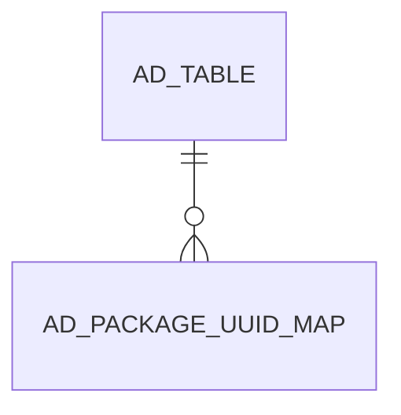

# AD_PACKAGE_UUID_MAP

Area [AD](../../data-model/ad/index.md) · class **config** (proposed) · read from database `idempiere-db` (owner `ADEMPIERE`) · 0 row(s) when profiled

Application model: `org.compiere.model.X_AD_Package_UUID_Map`, access level 2 - Client.

## Columns

| column | type | key | not null | business name | references (code) | nulls | distinct |
|---|---|---|---|---|---|---|---|
| `AD_CLIENT_ID` | NUMBER(10,0) |  | yes | Tenant |  | 0 | 0 |
| `AD_ORG_ID` | NUMBER(10,0) |  | yes | Organization |  | 0 | 0 |
| `AD_PACKAGE_UUID_MAP_ID` | NUMBER(10,0) | PK | yes | UUID Mapping |  | 0 | 0 |
| `AD_PACKAGE_UUID_MAP_UU` | VARCHAR2(36 CHAR) |  | yes | AD_Package_UUID_Map_UU |  | 0 | 0 |
| `AD_TABLE_ID` | NUMBER(10,0) |  | yes | Table | [AD_TABLE](../../data-model/ad/ad_table.md) | 0 | 0 |
| `CREATED` | DATE |  | yes | Created |  | 0 | 0 |
| `CREATEDBY` | NUMBER(10,0) |  | yes | Created By |  | 0 | 0 |
| `ISACTIVE` | CHAR(1) |  | yes | Active |  | 0 | 0 |
| `SOURCE_UUID` | VARCHAR2(36 CHAR) |  | yes | Source UUID |  | 0 | 0 |
| `TARGET_UUID` | VARCHAR2(36 CHAR) |  | yes | Target UUID |  | 0 | 0 |
| `UPDATED` | DATE |  | yes | Updated |  | 0 | 0 |
| `UPDATEDBY` | NUMBER(10,0) |  | yes | Updated By |  | 0 | 0 |

*references (code)* is the table the application model's code says a column points to; *Foreign keys* below are the constraints the database declares. Counts come from the profile; no value is ever shown.

## Check constraints

| name | expression |
|---|---|
| `SYS_C0019907` | `IsActive IN ('Y','N')` |

## Foreign keys

**References**

| table | columns | on delete |
|---|---|---|
| [AD_TABLE](../../data-model/ad/ad_table.md) | AD_PACKAGE_UUID_MAP.AD_TABLE_ID → AD_TABLE.AD_TABLE_ID | NO ACTION |

**Referenced by**

_None._

## Write behaviour

- updates: **raw_sql_skips_updated**
- deletes: **deleted_by_users**
- change log: **not_recorded**
- evidence: 3 citation(s)

## Schema history

31 change(s); the latest:

| applied | release | operation | column | tickets |
|---|---|---|---|---|
| 2020-08-04T01:00 | i7.1z | `add_column` | tmp_col_3_tmp | IDEMPIERE-3862 |
| 2020-08-04T01:00 | i7.1z | `modify_column` | SOURCE_UUID | IDEMPIERE-3862 |
| 2020-08-04T01:00 | i7.1z | `add_column` | tmp_col_2_tmp | IDEMPIERE-3862 |
| 2020-08-04T01:00 | i7.1z | `modify_column` | SOURCE_UUID | IDEMPIERE-3862 |
| 2020-08-04T01:00 | i7.1z | `modify_column` | AD_PACKAGE_UUID_MAP_UU | IDEMPIERE-3862 |
| 2020-08-04T01:00 | i7.1z | `add_constraint` |  | IDEMPIERE-3862 |
| 2020-08-04T01:00 | i7.1z | `drop_column` | tmp_col_1_tmp | IDEMPIERE-3862 |
| 2020-08-04T01:00 | i7.1z | `drop_column` | tmp_col_3_tmp | IDEMPIERE-3862 |
| 2020-08-04T01:00 | i7.1z | `modify_column` | AD_PACKAGE_UUID_MAP_UU | IDEMPIERE-3862 |
| 2020-08-04T01:00 | i7.1z | `modify_column` | TARGET_UUID | IDEMPIERE-3862 |
| 2020-08-04T01:00 | i7.1z | `modify_column` | AD_PACKAGE_UUID_MAP_UU | IDEMPIERE-3862 |
| 2020-08-04T01:00 | i7.1z | `add_column` | tmp_col_1_tmp | IDEMPIERE-3862 |
| 2020-08-04T01:00 | i7.1z | `modify_column` | TARGET_UUID | IDEMPIERE-3862 |
| 2020-08-04T01:00 | i7.1z | `drop_constraint` |  | IDEMPIERE-3862 |
| 2020-08-04T01:00 | i7.1z | `modify_column` | SOURCE_UUID | IDEMPIERE-3862 |

## Notes

<!-- ekos:manual id="table.ad_package_uuid_map.notes" -->
_Business notes about this table._
<!-- /ekos:manual -->
