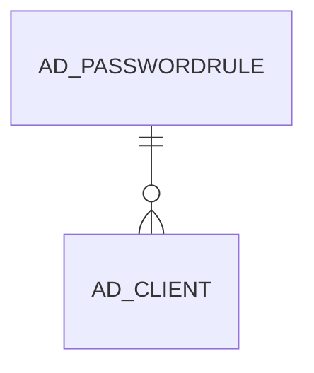

# AD_PASSWORDRULE

Area [AD](../../data-model/ad/index.md) · class **config** (proposed) · read from database `idempiere-db` (owner `ADEMPIERE`) · 0 row(s) when profiled

Application model: `org.compiere.model.X_AD_PasswordRule`, access level 4 - System.

## Columns

| column | type | key | not null | business name | references (code) | nulls | distinct |
|---|---|---|---|---|---|---|---|
| `AD_CLIENT_ID` | NUMBER(10,0) |  | yes | Tenant |  | 0 | 0 |
| `AD_ORG_ID` | NUMBER(10,0) |  | yes | Organization |  | 0 | 0 |
| `AD_PASSWORDRULE_ID` | NUMBER(10,0) | PK | yes | Password Policies |  | 0 | 0 |
| `ALPHABETICALCHARACTER` | NUMBER(10,0) |  |  | Alphabetical Character |  | 0 | 0 |
| `CREATED` | DATE |  | yes | Created |  | 0 | 0 |
| `CREATEDBY` | NUMBER(10,0) |  | yes | Created By |  | 0 | 0 |
| `ISDICTMATCHBACKWARDS` | CHAR(1) |  |  | Match Backwards of Dictionary |  | 0 | 0 |
| `DIGITCHARACTER` | NUMBER(10,0) |  |  | Digit Character |  | 0 | 0 |
| `ISACTIVE` | CHAR(1) |  | yes | Active |  | 0 | 0 |
| `LOWERCASECHARACTER` | NUMBER(10,0) |  |  | Lowercase Character |  | 0 | 0 |
| `MAXLENGTH` | NUMBER(10,0) |  |  | Maximum Length |  | 0 | 0 |
| `MINLENGTH` | NUMBER(10,0) |  |  | Minimum Length |  | 0 | 0 |
| `NAME` | VARCHAR2(60 CHAR) |  | yes | Name |  | 0 | 0 |
| `NONALPHANUMERICCHARACTER` | NUMBER(10,0) |  |  | Non Alpha Numeric Character |  | 0 | 0 |
| `NUMERICALSEQUENCE` | NUMBER(10,0) |  |  | Numerical Sequence |  | 0 | 0 |
| `PATHDICTIONARY` | VARCHAR2(255 CHAR) |  |  | Path Dictionary |  | 0 | 0 |
| `REPEATCHARACTERREGEX` | NUMBER(10,0) |  |  | Repeat Character Regex |  | 0 | 0 |
| `UPDATED` | DATE |  | yes | Updated |  | 0 | 0 |
| `UPDATEDBY` | NUMBER(10,0) |  |  | Updated By |  | 0 | 0 |
| `UPPERCASECHARACTER` | NUMBER(10,0) |  |  | Uppercase Character |  | 0 | 0 |
| `ISUSERNAMERULE` | CHAR(1) |  |  | User Name Rule |  | 0 | 0 |
| `ISUSINGDICTIONARY` | CHAR(1) |  |  | Using Dictionary |  | 0 | 0 |
| `ISWHITESPACE` | CHAR(1) |  |  | Whitespace |  | 0 | 0 |
| `AD_PASSWORDRULE_UU` | VARCHAR2(36 CHAR) |  |  | AD_PasswordRule_UU |  | 0 | 0 |
| `ALPHABETICALSEQUENCE` | NUMBER(10,0) |  |  | Alphabetical Sequence |  | 0 | 0 |
| `QWERTYSEQUENCE` | NUMBER(10,0) |  |  | QWERTY Sequence |  | 0 | 0 |
| `DAYS_REUSE_PASSWORD` | NUMBER(10,0) |  |  |  |  | 0 | 0 |

*references (code)* is the table the application model's code says a column points to; *Foreign keys* below are the constraints the database declares. Counts come from the profile; no value is ever shown.

## Check constraints

| name | expression |
|---|---|
| `SYS_C0020710` | `"ISDICTMATCHBACKWARDS"='Y' OR "ISDICTMATCHBACKWARDS"='N'` |
| `SYS_C0020712` | `IsActive IN ('Y','N')` |
| `SYS_C0020713` | `"ISUSERNAMERULE"='Y' OR "ISUSERNAMERULE"='N'` |
| `SYS_C0020715` | `"ISUSINGDICTIONARY"='Y' OR "ISUSINGDICTIONARY"='N'` |
| `SYS_C0020716` | `"ISWHITESPACE"='Y' OR "ISWHITESPACE"='N'` |

## Foreign keys

**References**

_None._

**Referenced by**

| table | columns | on delete |
|---|---|---|
| [AD_CLIENT](../../data-model/ad/ad_client.md) | AD_CLIENT.AD_PASSWORDRULE_ID → AD_PASSWORDRULE.AD_PASSWORDRULE_ID | NO ACTION |

## Write behaviour

- updates: **po_only**
- deletes: **deleted_by_users**
- change log: **recorded**
- evidence: 1 citation(s)

## Schema history

21 change(s); the latest:

| applied | release | operation | column | tickets |
|---|---|---|---|---|
| 2023-04-09T15:47 | iD11 | `add_constraint` |  | IDEMPIERE-5567 |
| 2023-04-09T15:47 | iD11 | `add_constraint` |  | IDEMPIERE-5567 |
| 2020-08-04T01:00 | i7.1z | `modify_column` | NAME | IDEMPIERE-3862 |
| 2020-08-04T01:00 | i7.1z | `drop_column` | tmp_col_3_tmp | IDEMPIERE-3862 |
| 2020-08-04T01:00 | i7.1z | `modify_column` | AD_PASSWORDRULE_UU | IDEMPIERE-3862 |
| 2020-08-04T01:00 | i7.1z | `add_column` | tmp_col_1_tmp | IDEMPIERE-3862 |
| 2020-08-04T01:00 | i7.1z | `drop_column` | tmp_col_1_tmp | IDEMPIERE-3862 |
| 2020-08-04T01:00 | i7.1z | `add_column` | tmp_col_2_tmp | IDEMPIERE-3862 |
| 2020-08-04T01:00 | i7.1z | `modify_column` | NAME | IDEMPIERE-3862 |
| 2020-08-04T01:00 | i7.1z | `add_column` | tmp_col_3_tmp | IDEMPIERE-3862 |
| 2020-08-04T01:00 | i7.1z | `drop_column` | tmp_col_2_tmp | IDEMPIERE-3862 |
| 2020-08-04T01:00 | i7.1z | `modify_column` | NAME | IDEMPIERE-3862 |
| 2020-08-04T01:00 | i7.1z | `modify_column` | PATHDICTIONARY | IDEMPIERE-3862 |
| 2014-05-02T10:09 | i2.0 | `modify_column` | updated | IDEMPIERE-709 |
| 2014-05-02T10:09 | i2.0 | `modify_column` | created | IDEMPIERE-709 |

## Open conflicts

| type | attribute | explanation |
|---|---|---|
| `mandatory_but_nullable` | `columns.IsDictMatchBackwards.nullable` | unexplained |
| `mandatory_but_nullable` | `columns.IsUserNameRule.nullable` | unexplained |
| `mandatory_but_nullable` | `columns.IsUsingDictionary.nullable` | unexplained |
| `mandatory_but_nullable` | `columns.IsWhitespace.nullable` | unexplained |

## Notes

<!-- ekos:manual id="table.ad_passwordrule.notes" -->
_Business notes about this table._
<!-- /ekos:manual -->
