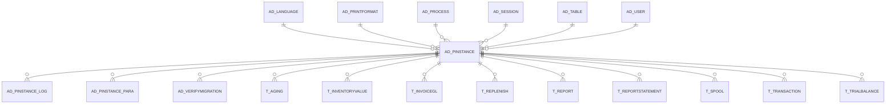

# AD_PINSTANCE

Internal Process Table

Area [AD](../../data-model/ad/index.md) · class **config** (proposed) · read from database `idempiere-db` (owner `ADEMPIERE`) · 0 row(s) when profiled

Application model: `org.compiere.model.X_AD_PInstance`, access level 6 - System - Client.

## Columns

| column | type | key | not null | business name | references (code) | nulls | distinct |
|---|---|---|---|---|---|---|---|
| `AD_PINSTANCE_ID` | NUMBER(10,0) | PK | yes | Process Instance |  | 0 | 0 |
| `AD_PROCESS_ID` | NUMBER(10,0) |  | yes | Process | [AD_PROCESS](../../data-model/ad/ad_process.md) | 0 | 0 |
| `RECORD_ID` | NUMBER(10,0) |  | yes | Record ID |  | 0 | 0 |
| `ISPROCESSING` | CHAR(1) |  | yes | Processing |  | 0 | 0 |
| `CREATED` | DATE |  | yes | Created |  | 0 | 0 |
| `AD_USER_ID` | NUMBER(10,0) |  |  | User/Contact | [AD_USER](../../data-model/ad/ad_user.md) | 0 | 0 |
| `UPDATED` | DATE |  | yes | Updated |  | 0 | 0 |
| `RESULT` | NUMBER(10,0) |  |  | Result |  | 0 | 0 |
| `ERRORMSG` | VARCHAR2(2000 CHAR) |  |  | Error Msg |  | 0 | 0 |
| `AD_CLIENT_ID` | NUMBER(10,0) |  |  | Tenant |  | 0 | 0 |
| `AD_ORG_ID` | NUMBER(10,0) |  |  | Organization |  | 0 | 0 |
| `CREATEDBY` | NUMBER(10,0) |  |  | Created By |  | 0 | 0 |
| `UPDATEDBY` | NUMBER(10,0) |  | yes | Updated By |  | 0 | 0 |
| `ISACTIVE` | CHAR(1) |  |  | Active |  | 0 | 0 |
| `AD_PINSTANCE_UU` | VARCHAR2(36 CHAR) |  |  | AD_PInstance_UU |  | 0 | 0 |
| `ISRUNASJOB` | CHAR(1) |  |  | Run as Job |  | 0 | 0 |
| `NOTIFICATIONTYPE` | VARCHAR2(2 CHAR) |  |  | Notification Type |  | 0 | 0 |
| `NAME` | VARCHAR2(60 CHAR) |  |  | Name |  | 0 | 0 |
| `REPORTTYPE` | VARCHAR2(5 CHAR) |  |  | Report Type |  | 0 | 0 |
| `AD_PRINTFORMAT_ID` | NUMBER(10,0) |  |  | Print Format | [AD_PRINTFORMAT](../../data-model/ad/ad_printformat.md) | 0 | 0 |
| `ISSUMMARY` | CHAR(1) |  |  | Summary Level |  | 0 | 0 |
| `AD_LANGUAGE_ID` | NUMBER(10,0) |  |  | Language ID | [AD_LANGUAGE](../../data-model/ad/ad_language.md) | 0 | 0 |
| `AD_SESSION_ID` | NUMBER(10,0) |  |  | Session | [AD_SESSION](../../data-model/ad/ad_session.md) | 0 | 0 |
| `AD_TABLE_ID` | NUMBER(10,0) |  |  | Table | [AD_TABLE](../../data-model/ad/ad_table.md) | 0 | 0 |
| `RECORD_UU` | VARCHAR2(36 CHAR) |  |  | Record UUID |  | 0 | 0 |
| `JSONDATA` | CLOB |  |  | JSON Data |  | 0 |  |

*references (code)* is the table the application model's code says a column points to; *Foreign keys* below are the constraints the database declares. Counts come from the profile; no value is ever shown.

## Check constraints

| name | expression |
|---|---|
| `AD_PINSTANCE_JSONDATA_ISJSON` | `JsonData IS JSON` |
| `SYS_C0022159` | `IsProcessing in ('Y','N')` |
| `SYS_C0022160` | `IsSummary IN ('Y','N')` |

## Foreign keys

**References**

| table | columns | on delete |
|---|---|---|
| [AD_LANGUAGE](../../data-model/ad/ad_language.md) | AD_PINSTANCE.AD_LANGUAGE_ID → AD_LANGUAGE.AD_LANGUAGE_ID | NO ACTION |
| [AD_PRINTFORMAT](../../data-model/ad/ad_printformat.md) | AD_PINSTANCE.AD_PRINTFORMAT_ID → AD_PRINTFORMAT.AD_PRINTFORMAT_ID | NO ACTION |
| [AD_PROCESS](../../data-model/ad/ad_process.md) | AD_PINSTANCE.AD_PROCESS_ID → AD_PROCESS.AD_PROCESS_ID | NO ACTION |
| [AD_SESSION](../../data-model/ad/ad_session.md) | AD_PINSTANCE.AD_SESSION_ID → AD_SESSION.AD_SESSION_ID | NO ACTION |
| [AD_TABLE](../../data-model/ad/ad_table.md) | AD_PINSTANCE.AD_TABLE_ID → AD_TABLE.AD_TABLE_ID | NO ACTION |
| [AD_USER](../../data-model/ad/ad_user.md) | AD_PINSTANCE.AD_USER_ID → AD_USER.AD_USER_ID | NO ACTION |

**Referenced by**

| table | columns | on delete |
|---|---|---|
| `AD_PINSTANCE_LOG` | AD_PINSTANCE_LOG.AD_PINSTANCE_ID → AD_PINSTANCE.AD_PINSTANCE_ID | CASCADE |
| [AD_PINSTANCE_PARA](../../data-model/ad/ad_pinstance_para.md) | AD_PINSTANCE_PARA.AD_PINSTANCE_ID → AD_PINSTANCE.AD_PINSTANCE_ID | CASCADE |
| [AD_VERIFYMIGRATION](../../data-model/ad/ad_verifymigration.md) | AD_VERIFYMIGRATION.AD_PINSTANCE_ID → AD_PINSTANCE.AD_PINSTANCE_ID | CASCADE |
| `T_AGING` | T_AGING.AD_PINSTANCE_ID → AD_PINSTANCE.AD_PINSTANCE_ID | CASCADE |
| `T_INVENTORYVALUE` | T_INVENTORYVALUE.AD_PINSTANCE_ID → AD_PINSTANCE.AD_PINSTANCE_ID | CASCADE |
| `T_INVOICEGL` | T_INVOICEGL.AD_PINSTANCE_ID → AD_PINSTANCE.AD_PINSTANCE_ID | CASCADE |
| `T_REPLENISH` | T_REPLENISH.AD_PINSTANCE_ID → AD_PINSTANCE.AD_PINSTANCE_ID | CASCADE |
| [T_REPORT](../../data-model/t/t_report.md) | T_REPORT.AD_PINSTANCE_ID → AD_PINSTANCE.AD_PINSTANCE_ID | CASCADE |
| `T_REPORTSTATEMENT` | T_REPORTSTATEMENT.AD_PINSTANCE_ID → AD_PINSTANCE.AD_PINSTANCE_ID | CASCADE |
| `T_SPOOL` | T_SPOOL.AD_PINSTANCE_ID → AD_PINSTANCE.AD_PINSTANCE_ID | CASCADE |
| `T_TRANSACTION` | T_TRANSACTION.AD_PINSTANCE_ID → AD_PINSTANCE.AD_PINSTANCE_ID | CASCADE |
| `T_TRIALBALANCE` | T_TRIALBALANCE.AD_PINSTANCE_ID → AD_PINSTANCE.AD_PINSTANCE_ID | CASCADE |

## Write behaviour

- updates: **raw_sql_skips_updated**
- deletes: **deleted_by_users, purged**
- change log: **not_recorded**
- evidence: 23 citation(s)

## Written by

| kind | name |
|---|---|
| Procedure | [AD_Column_Sync](../../logic/ad_column_sync.md) |
| Procedure | [AD_Synchronize](../../logic/ad_synchronize.md) |
| Procedure | [C_AcctSchema_Default_Copy](../../logic/c_acctschema_default_copy.md) |
| Procedure | [C_BP_Group_Acct_Copy](../../logic/c_bp_group_acct_copy.md) |
| Procedure | [C_ORDER_DRILLDOWN](../../logic/c_order_drilldown.md) |
| Procedure | [Cleanup](../../logic/cleanup.md) |
| Procedure | [DBA_Cleanup](../../logic/dba_cleanup.md) |
| Procedure | [DBA_Recompile](../../logic/dba_recompile.md) |
| Procedure | [M_PRICELIST_CREATE](../../logic/m_pricelist_create.md) |
| Procedure | [M_PriceList_Create](../../logic/m_pricelist_create.md) |
| Procedure | [M_Product_BOM_Check](../../logic/m_product_bom_check.md) |
| Procedure | [M_Product_Category_Acct_Copy](../../logic/m_product_category_acct_copy.md) |

## Schema history

59 change(s); the latest:

| applied | release | operation | column | tickets |
|---|---|---|---|---|
| 2026-03-26T12:59 | iD12 | `add_column` | ExternalTraceId | IDEMPIERE-6910 |
| 2026-03-26T12:59 | iD12 | `create_index` |  | IDEMPIERE-6910 |
| 2026-03-26T12:59 | iD12 | `create_index` |  | IDEMPIERE-6910 |
| 2026-03-26T12:59 | iD12 | `add_column` | ExternalTraceId | IDEMPIERE-6910 |
| 2024-09-04T15:33 | iD11 | `add_column` | JsonData | IDEMPIERE-6223 |
| 2024-09-04T15:33 | iD11 | `add_column` | JsonData | IDEMPIERE-6223 |
| 2023-09-11T18:44 | iD11 | `add_column` | Record_UU | IDEMPIERE-5567 |
| 2023-09-11T18:44 | iD11 | `add_column` | AD_Table_ID | IDEMPIERE-5567 |
| 2023-09-11T18:44 | iD11 | `add_column` | AD_Table_ID | IDEMPIERE-5567 |
| 2023-09-11T18:44 | iD11 | `add_constraint` |  | IDEMPIERE-5567 |
| 2023-09-11T18:44 | iD11 | `add_column` | Record_UU | IDEMPIERE-5567 |
| 2023-09-11T18:44 | iD11 | `add_constraint` |  | IDEMPIERE-5567 |
| 2023-04-09T15:47 | iD11 | `add_constraint` |  | IDEMPIERE-5567 |
| 2023-04-09T15:47 | iD11 | `add_constraint` |  | IDEMPIERE-5567 |
| 2022-11-11T11:43 | iD10 | `add_constraint` |  | IDEMPIERE-5371 |

## Open conflicts

| type | attribute | explanation |
|---|---|---|
| `model_column_missing` | `columns.ExternalTraceId` | unexplained |
| `mandatory_but_nullable` | `columns.IsRunAsJob.nullable` | unexplained |

## Notes

<!-- ekos:manual id="table.ad_pinstance.notes" -->
_Business notes about this table._
<!-- /ekos:manual -->
