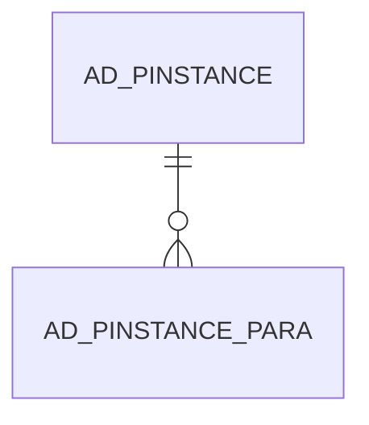

# AD_PINSTANCE_PARA

Area [AD](../../data-model/ad/index.md) · class **config** (proposed) · read from database `idempiere-db` (owner `ADEMPIERE`) · 0 row(s) when profiled

Application model: `org.compiere.model.X_AD_PInstance_Para`, access level 6 - System - Client.

## Columns

| column | type | key | not null | business name | references (code) | nulls | distinct |
|---|---|---|---|---|---|---|---|
| `AD_PINSTANCE_ID` | NUMBER(10,0) | PK | yes | Process Instance | [AD_PINSTANCE](../../data-model/ad/ad_pinstance.md) | 0 | 0 |
| `SEQNO` | NUMBER(10,0) | PK | yes | Sequence |  | 0 | 0 |
| `PARAMETERNAME` | VARCHAR2(60 CHAR) |  |  | Parameter Name |  | 0 | 0 |
| `P_NUMBER` | NUMBER |  |  | Process Number |  | 0 | 0 |
| `P_NUMBER_TO` | NUMBER |  |  | Process Number To |  | 0 | 0 |
| `P_DATE` | DATE |  |  | Process Date |  | 0 | 0 |
| `P_DATE_TO` | DATE |  |  | Process Date To |  | 0 | 0 |
| `AD_CLIENT_ID` | NUMBER(10,0) |  |  | Tenant |  | 0 | 0 |
| `AD_ORG_ID` | NUMBER(10,0) |  |  | Organization |  | 0 | 0 |
| `CREATED` | DATE |  | yes | Created |  | 0 | 0 |
| `CREATEDBY` | NUMBER(10,0) |  |  | Created By |  | 0 | 0 |
| `UPDATED` | DATE |  | yes | Updated |  | 0 | 0 |
| `UPDATEDBY` | NUMBER(10,0) |  |  | Updated By |  | 0 | 0 |
| `ISACTIVE` | CHAR(1) |  |  | Active |  | 0 | 0 |
| `AD_PINSTANCE_PARA_UU` | VARCHAR2(36 CHAR) |  |  | AD_PInstance_Para_UU |  | 0 | 0 |
| `INFO` | VARCHAR2(4000 CHAR) |  |  | Info |  | 0 | 0 |
| `INFO_TO` | VARCHAR2(4000 CHAR) |  |  | Info To |  | 0 | 0 |
| `P_STRING` | VARCHAR2(4000 CHAR) |  |  | Process String |  | 0 | 0 |
| `P_STRING_TO` | VARCHAR2(4000 CHAR) |  |  | Process String To |  | 0 | 0 |
| `ISNOTCLAUSE` | CHAR(1) |  | yes | Not Clause |  | 0 | 0 |

*references (code)* is the table the application model's code says a column points to; *Foreign keys* below are the constraints the database declares. Counts come from the profile; no value is ever shown.

## Check constraints

| name | expression |
|---|---|
| `SYS_C0021343` | `IsNotClause IN ('Y','N')` |

## Foreign keys

**References**

| table | columns | on delete |
|---|---|---|
| [AD_PINSTANCE](../../data-model/ad/ad_pinstance.md) | AD_PINSTANCE_PARA.AD_PINSTANCE_ID → AD_PINSTANCE.AD_PINSTANCE_ID | CASCADE |

**Referenced by**

_None._

## Write behaviour

- updates: **po_only**
- deletes: **deleted_by_app, deleted_by_users, deleted_by_cascade**
- change log: **not_recorded**
- evidence: 3 citation(s)

## Schema history

44 change(s); the latest:

| applied | release | operation | column | tickets |
|---|---|---|---|---|
| 2023-04-09T15:47 | iD11 | `add_constraint` |  | IDEMPIERE-5567 |
| 2023-04-09T15:47 | iD11 | `add_constraint` |  | IDEMPIERE-5567 |
| 2022-10-31T14:20 | iD10 | `modify_column` | IsNotClause | IDEMPIERE-5468 |
| 2022-10-31T14:20 | iD10 | `modify_column` | IsNotClause | IDEMPIERE-5468 |
| 2022-10-31T14:20 | iD10 | `add_column` | IsNotClause | IDEMPIERE-5468 |
| 2022-10-31T14:20 | iD10 | `add_column` | IsNotClause | IDEMPIERE-5468 |
| 2021-12-05T16:45 | i8.2z | `add_constraint` |  | IDEMPIERE-5075 |
| 2021-12-05T16:45 | i8.2z | `drop_constraint` |  | IDEMPIERE-5075 |
| 2020-08-04T01:00 | i7.1z | `drop_column` | tmp_col_1_tmp | IDEMPIERE-3862 |
| 2020-08-04T01:00 | i7.1z | `modify_column` | P_STRING | IDEMPIERE-3862 |
| 2020-08-04T01:00 | i7.1z | `modify_column` | AD_PINSTANCE_PARA_UU | IDEMPIERE-3862 |
| 2020-08-04T01:00 | i7.1z | `add_column` | tmp_col_1_tmp | IDEMPIERE-3862 |
| 2020-08-04T01:00 | i7.1z | `drop_column` | tmp_col_2_tmp | IDEMPIERE-3862 |
| 2020-08-04T01:00 | i7.1z | `add_column` | tmp_col_2_tmp | IDEMPIERE-3862 |
| 2020-08-04T01:00 | i7.1z | `modify_column` | PARAMETERNAME | IDEMPIERE-3862 |

## Notes

<!-- ekos:manual id="table.ad_pinstance_para.notes" -->
_Business notes about this table._
<!-- /ekos:manual -->
