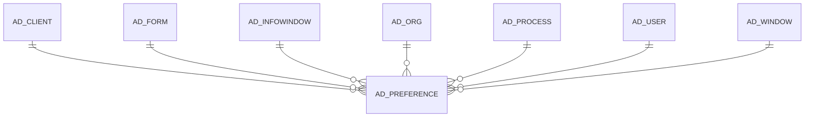

# AD_PREFERENCE

Area [AD](../../data-model/ad/index.md) · class **config** (proposed) · read from database `idempiere-db` (owner `ADEMPIERE`) · 17 row(s) when profiled

Application model: `org.compiere.model.X_AD_Preference`, access level 7 - System - Client - Org.

## Columns

| column | type | key | not null | business name | references (code) | nulls | distinct |
|---|---|---|---|---|---|---|---|
| `AD_PREFERENCE_ID` | NUMBER(10,0) | PK | yes | Preference |  | 0 | 17 |
| `AD_CLIENT_ID` | NUMBER(10,0) |  | yes | Tenant |  | 0 | 2 |
| `AD_ORG_ID` | NUMBER(10,0) |  | yes | Organization |  | 0 | 1 |
| `ISACTIVE` | CHAR(1) |  | yes | Active |  | 0 | 1 |
| `CREATED` | DATE |  | yes | Created |  | 0 | 17 |
| `CREATEDBY` | NUMBER(10,0) |  | yes | Created By |  | 0 | 2 |
| `UPDATED` | DATE |  | yes | Updated |  | 0 | 17 |
| `UPDATEDBY` | NUMBER(10,0) |  | yes | Updated By |  | 0 | 2 |
| `AD_WINDOW_ID` | NUMBER(10,0) |  |  | Window | [AD_WINDOW](../../data-model/ad/ad_window.md) | 2 | 15 |
| `AD_USER_ID` | NUMBER(10,0) |  |  | User/Contact | `AD_ALLUSERS_V` | 17 | 0 |
| `ATTRIBUTE` | VARCHAR2(60 CHAR) |  | yes | Attribute |  | 0 | 10 |
| `VALUE` | VARCHAR2(60 CHAR) |  | yes | Search Key |  | 0 | 11 |
| `AD_PREFERENCE_UU` | VARCHAR2(36 CHAR) |  |  | AD_Preference_UU |  | 0 | 17 |
| `AD_PROCESS_ID` | NUMBER(10,0) |  |  | Process | [AD_PROCESS](../../data-model/ad/ad_process.md) | 17 | 0 |
| `PREFERENCEFOR` | CHAR(1) |  | yes | Preference For |  | 0 | 1 |
| `AD_INFOWINDOW_ID` | NUMBER(10,0) |  |  | Info Window | [AD_INFOWINDOW](../../data-model/ad/ad_infowindow.md) | 17 | 0 |
| `AD_FORM_ID` | NUMBER(10,0) |  |  | Special Form | [AD_FORM](../../data-model/ad/ad_form.md) | 17 | 0 |

*references (code)* is the table the application model's code says a column points to; *Foreign keys* below are the constraints the database declares. Counts come from the profile; no value is ever shown.

## Check constraints

| name | expression |
|---|---|
| `SYS_C0023063` | `IsActive in ('Y','N')` |

## Foreign keys

**References**

| table | columns | on delete |
|---|---|---|
| [AD_CLIENT](../../data-model/ad/ad_client.md) | AD_PREFERENCE.AD_CLIENT_ID → AD_CLIENT.AD_CLIENT_ID | NO ACTION |
| [AD_FORM](../../data-model/ad/ad_form.md) | AD_PREFERENCE.AD_FORM_ID → AD_FORM.AD_FORM_ID | NO ACTION |
| [AD_INFOWINDOW](../../data-model/ad/ad_infowindow.md) | AD_PREFERENCE.AD_INFOWINDOW_ID → AD_INFOWINDOW.AD_INFOWINDOW_ID | NO ACTION |
| [AD_ORG](../../data-model/ad/ad_org.md) | AD_PREFERENCE.AD_ORG_ID → AD_ORG.AD_ORG_ID | NO ACTION |
| [AD_PROCESS](../../data-model/ad/ad_process.md) | AD_PREFERENCE.AD_PROCESS_ID → AD_PROCESS.AD_PROCESS_ID | NO ACTION |
| [AD_USER](../../data-model/ad/ad_user.md) | AD_PREFERENCE.AD_USER_ID → AD_USER.AD_USER_ID | NO ACTION |
| [AD_WINDOW](../../data-model/ad/ad_window.md) | AD_PREFERENCE.AD_WINDOW_ID → AD_WINDOW.AD_WINDOW_ID | NO ACTION |

**Referenced by**

_None._

## Write behaviour

- updates: **raw_sql_skips_updated**
- deletes: **deleted_by_app, deleted_by_users**
- change log: **recorded**
- evidence: 4 citation(s)

## Schema history

40 change(s); the latest:

| applied | release | operation | column | tickets |
|---|---|---|---|---|
| 2023-08-10T13:31 | iD11 | `add_constraint` |  | IDEMPIERE-5827 |
| 2023-08-10T13:31 | iD11 | `add_column` | AD_Form_ID | IDEMPIERE-5827 |
| 2023-08-10T13:31 | iD11 | `add_column` | AD_Form_ID | IDEMPIERE-5827 |
| 2023-08-10T13:31 | iD11 | `add_constraint` |  | IDEMPIERE-5827 |
| 2023-04-09T15:47 | iD11 | `add_constraint` |  | IDEMPIERE-5567 |
| 2023-04-09T15:47 | iD11 | `add_constraint` |  | IDEMPIERE-5567 |
| 2021-12-05T16:45 | i8.2z | `drop_constraint` |  | IDEMPIERE-5075 |
| 2021-12-05T16:45 | i8.2z | `add_constraint` |  | IDEMPIERE-5075 |
| 2021-12-05T16:45 | i8.2z | `drop_constraint` |  | IDEMPIERE-5075 |
| 2021-12-05T16:45 | i8.2z | `add_constraint` |  | IDEMPIERE-5075 |
| 2021-12-05T16:45 | i8.2z | `add_constraint` |  | IDEMPIERE-5075 |
| 2021-12-05T16:45 | i8.2z | `drop_constraint` |  | IDEMPIERE-5075 |
| 2021-12-05T16:45 | i8.2z | `add_constraint` |  | IDEMPIERE-5075 |
| 2021-12-05T16:45 | i8.2z | `drop_constraint` |  | IDEMPIERE-5075 |
| 2020-08-04T01:00 | i7.1z | `modify_column` | VALUE | IDEMPIERE-3862 |

## Notes

<!-- ekos:manual id="table.ad_preference.notes" -->
_Business notes about this table._
<!-- /ekos:manual -->
