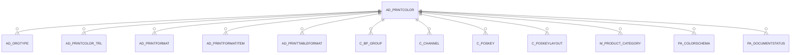

# AD_PRINTCOLOR

Area [AD](../../data-model/ad/index.md) · class **config** (proposed) · read from database `idempiere-db` (owner `ADEMPIERE`) · 23 row(s) when profiled

Application model: `org.compiere.model.X_AD_PrintColor`, access level 6 - System - Client.

## Columns

| column | type | key | not null | business name | references (code) | nulls | distinct |
|---|---|---|---|---|---|---|---|
| `AD_PRINTCOLOR_ID` | NUMBER(10,0) | PK | yes | Print Color |  | 0 | 23 |
| `AD_CLIENT_ID` | NUMBER(10,0) |  | yes | Tenant |  | 0 | 1 |
| `AD_ORG_ID` | NUMBER(10,0) |  | yes | Organization |  | 0 | 1 |
| `ISACTIVE` | CHAR(1) |  | yes | Active |  | 0 | 1 |
| `CREATED` | DATE |  | yes | Created |  | 0 | 11 |
| `CREATEDBY` | NUMBER(10,0) |  | yes | Created By |  | 0 | 2 |
| `UPDATED` | DATE |  | yes | Updated |  | 0 | 4 |
| `UPDATEDBY` | NUMBER(10,0) |  | yes | Updated By |  | 0 | 2 |
| `NAME` | VARCHAR2(60 CHAR) |  | yes | Name |  | 0 | 23 |
| `ISDEFAULT` | CHAR(1) |  | yes | Default |  | 0 | 2 |
| `CODE` | VARCHAR2(2000 CHAR) |  | yes | Validation code |  | 0 | 23 |
| `AD_PRINTCOLOR_UU` | VARCHAR2(36 CHAR) |  |  | AD_PrintColor_UU |  | 0 | 23 |

*references (code)* is the table the application model's code says a column points to; *Foreign keys* below are the constraints the database declares. Counts come from the profile; no value is ever shown.

## Check constraints

| name | expression |
|---|---|
| `SYS_C0020578` | `IsActive in ('Y','N')` |

## Foreign keys

**References**

_None._

**Referenced by**

| table | columns | on delete |
|---|---|---|
| [AD_ORGTYPE](../../data-model/ad/ad_orgtype.md) | AD_ORGTYPE.AD_PRINTCOLOR_ID → AD_PRINTCOLOR.AD_PRINTCOLOR_ID | NO ACTION |
| [AD_PRINTCOLOR_TRL](../../data-model/ad/ad_printcolor_trl.md) | AD_PRINTCOLOR_TRL.AD_PRINTCOLOR_ID → AD_PRINTCOLOR.AD_PRINTCOLOR_ID | CASCADE |
| [AD_PRINTFORMAT](../../data-model/ad/ad_printformat.md) | AD_PRINTFORMAT.AD_PRINTCOLOR_ID → AD_PRINTCOLOR.AD_PRINTCOLOR_ID | NO ACTION |
| [AD_PRINTFORMATITEM](../../data-model/ad/ad_printformatitem.md) | AD_PRINTFORMATITEM.AD_PRINTCOLOR_ID → AD_PRINTCOLOR.AD_PRINTCOLOR_ID | NO ACTION |
| [AD_PRINTTABLEFORMAT](../../data-model/ad/ad_printtableformat.md) | AD_PRINTTABLEFORMAT.FUNCTBG_PRINTCOLOR_ID → AD_PRINTCOLOR.AD_PRINTCOLOR_ID | NO ACTION |
| [C_BP_GROUP](../../data-model/c/c_bp_group.md) | C_BP_GROUP.AD_PRINTCOLOR_ID → AD_PRINTCOLOR.AD_PRINTCOLOR_ID | NO ACTION |
| [C_CHANNEL](../../data-model/c/c_channel.md) | C_CHANNEL.AD_PRINTCOLOR_ID → AD_PRINTCOLOR.AD_PRINTCOLOR_ID | NO ACTION |
| [C_POSKEY](../../data-model/c/c_poskey.md) | C_POSKEY.AD_PRINTCOLOR_ID → AD_PRINTCOLOR.AD_PRINTCOLOR_ID | NO ACTION |
| [C_POSKEYLAYOUT](../../data-model/c/c_poskeylayout.md) | C_POSKEYLAYOUT.AD_PRINTCOLOR_ID → AD_PRINTCOLOR.AD_PRINTCOLOR_ID | NO ACTION |
| [M_PRODUCT_CATEGORY](../../data-model/m/m_product_category.md) | M_PRODUCT_CATEGORY.AD_PRINTCOLOR_ID → AD_PRINTCOLOR.AD_PRINTCOLOR_ID | NO ACTION |
| [PA_COLORSCHEMA](../../data-model/pa/pa_colorschema.md) | PA_COLORSCHEMA.AD_PRINTCOLOR1_ID → AD_PRINTCOLOR.AD_PRINTCOLOR_ID | NO ACTION |
| [PA_DOCUMENTSTATUS](../../data-model/pa/pa_documentstatus.md) | PA_DOCUMENTSTATUS.NAME_PRINTCOLOR_ID → AD_PRINTCOLOR.AD_PRINTCOLOR_ID | NO ACTION |

## Write behaviour

- updates: **po_only**
- deletes: **deleted_by_users**
- change log: **recorded**
- evidence: 1 citation(s)

## Schema history

16 change(s); the latest:

| applied | release | operation | column | tickets |
|---|---|---|---|---|
| 2023-04-09T15:47 | iD11 | `add_constraint` |  | IDEMPIERE-5567 |
| 2023-04-09T15:47 | iD11 | `add_constraint` |  | IDEMPIERE-5567 |
| 2020-08-04T01:00 | i7.1z | `drop_column` | tmp_col_3_tmp | IDEMPIERE-3862 |
| 2020-08-04T01:00 | i7.1z | `add_column` | tmp_col_2_tmp | IDEMPIERE-3862 |
| 2020-08-04T01:00 | i7.1z | `add_column` | tmp_col_1_tmp | IDEMPIERE-3862 |
| 2020-08-04T01:00 | i7.1z | `modify_column` | AD_PRINTCOLOR_UU | IDEMPIERE-3862 |
| 2020-08-04T01:00 | i7.1z | `modify_column` | CODE | IDEMPIERE-3862 |
| 2020-08-04T01:00 | i7.1z | `modify_column` | NAME | IDEMPIERE-3862 |
| 2020-08-04T01:00 | i7.1z | `modify_column` | CODE | IDEMPIERE-3862 |
| 2020-08-04T01:00 | i7.1z | `add_column` | tmp_col_3_tmp | IDEMPIERE-3862 |
| 2020-08-04T01:00 | i7.1z | `drop_column` | tmp_col_1_tmp | IDEMPIERE-3862 |
| 2020-08-04T01:00 | i7.1z | `modify_column` | NAME | IDEMPIERE-3862 |
| 2020-08-04T01:00 | i7.1z | `modify_column` | NAME | IDEMPIERE-3862 |
| 2020-08-04T01:00 | i7.1z | `drop_column` | tmp_col_2_tmp | IDEMPIERE-3862 |
| 2020-08-04T01:00 | i7.1z | `modify_column` | CODE | IDEMPIERE-3862 |

## Notes

<!-- ekos:manual id="table.ad_printcolor.notes" -->
_Business notes about this table._
<!-- /ekos:manual -->
