# AD_PRINTFORMAT

Area [AD](../../data-model/ad/index.md) · class **config** (proposed) · read from database `idempiere-db` (owner `ADEMPIERE`) · 92 row(s) when profiled

Application model: `org.compiere.model.X_AD_PrintFormat`, access level 7 - System - Client - Org.

## Columns

| column | type | key | not null | business name | references (code) | nulls | distinct |
|---|---|---|---|---|---|---|---|
| `AD_PRINTFORMAT_ID` | NUMBER(10,0) | PK | yes | Print Format |  | 0 | 92 |
| `AD_CLIENT_ID` | NUMBER(10,0) |  | yes | Tenant |  | 0 | 2 |
| `AD_ORG_ID` | NUMBER(10,0) |  | yes | Organization |  | 0 | 1 |
| `ISACTIVE` | CHAR(1) |  | yes | Active |  | 0 | 2 |
| `CREATED` | DATE |  | yes | Created |  | 0 | 83 |
| `CREATEDBY` | NUMBER(10,0) |  | yes | Created By |  | 0 | 2 |
| `UPDATED` | DATE |  | yes | Updated |  | 0 | 73 |
| `UPDATEDBY` | NUMBER(10,0) |  | yes | Updated By |  | 0 | 2 |
| `NAME` | VARCHAR2(60 CHAR) |  | yes | Name |  | 0 | 92 |
| `DESCRIPTION` | VARCHAR2(255 CHAR) |  |  | Description |  | 51 | 25 |
| `ISTABLEBASED` | CHAR(1) |  | yes | Table Based |  | 0 | 2 |
| `ISFORM` | CHAR(1) |  | yes | Form |  | 0 | 2 |
| `AD_TABLE_ID` | NUMBER(10,0) |  | yes | Table | [AD_TABLE](../../data-model/ad/ad_table.md) | 0 | 63 |
| `AD_PRINTPAPER_ID` | NUMBER(10,0) |  | yes | Print Paper | [AD_PRINTPAPER](../../data-model/ad/ad_printpaper.md) | 0 | 3 |
| `AD_PRINTCOLOR_ID` | NUMBER(10,0) |  | yes | Print Color | [AD_PRINTCOLOR](../../data-model/ad/ad_printcolor.md) | 0 | 1 |
| `AD_PRINTFONT_ID` | NUMBER(10,0) |  | yes | Print Font | [AD_PRINTFONT](../../data-model/ad/ad_printfont.md) | 0 | 5 |
| `ISSTANDARDHEADERFOOTER` | CHAR(1) |  | yes | Standard Header/Footer |  | 0 | 2 |
| `HEADERMARGIN` | NUMBER(10,0) |  | yes | Header Margin |  | 0 | 4 |
| `FOOTERMARGIN` | NUMBER(10,0) |  | yes | Footer Margin |  | 0 | 1 |
| `CREATECOPY` | CHAR(1) |  |  | Create Copy |  | 61 | 1 |
| `AD_REPORTVIEW_ID` | NUMBER(10,0) |  |  | Report View | [AD_REPORTVIEW](../../data-model/ad/ad_reportview.md) | 49 | 33 |
| `AD_PRINTTABLEFORMAT_ID` | NUMBER(10,0) |  |  | Print Table Format | [AD_PRINTTABLEFORMAT](../../data-model/ad/ad_printtableformat.md) | 45 | 2 |
| `PRINTERNAME` | VARCHAR2(40 CHAR) |  |  | Printer Name |  | 92 | 0 |
| `ISDEFAULT` | CHAR(1) |  | yes | Default |  | 0 | 2 |
| `JASPERPROCESS_ID` | NUMBER(10,0) |  |  | Jasper Process | [AD_PROCESS](../../data-model/ad/ad_process.md) | 92 | 0 |
| `CLASSNAME` | VARCHAR2(240 CHAR) |  |  |  |  | 92 | 0 |
| `ARGS` | VARCHAR2(510 CHAR) |  |  |  |  | 92 | 0 |
| `AD_PRINTFORMAT_UU` | VARCHAR2(36 CHAR) |  |  | AD_PrintFormat_UU |  | 0 | 92 |
| `AD_WINDOW_ID` | NUMBER(10,0) |  |  | Window | [AD_WINDOW](../../data-model/ad/ad_window.md) | 92 | 0 |
| `ISBREAKPAGEPERRECORD` | CHAR(1) |  | yes | Page break per record |  | 0 | 2 |
| `AD_PRINTHEADERFOOTER_ID` | NUMBER(10,0) |  |  | Print Header/Footer | [AD_PRINTHEADERFOOTER](../../data-model/ad/ad_printheaderfooter.md) | 92 | 0 |
| `FILENAMEPATTERN` | VARCHAR2(255 CHAR) |  |  | File Name Pattern |  | 92 | 0 |

*references (code)* is the table the application model's code says a column points to; *Foreign keys* below are the constraints the database declares. Counts come from the profile; no value is ever shown.

## Check constraints

| name | expression |
|---|---|
| `SYS_C0021108` | `IsTableBased in ('Y','N')` |
| `SYS_C0021109` | `IsStandardHeaderFooter in ('Y','N')` |
| `SYS_C0021111` | `IsForm in ('Y','N')` |
| `SYS_C0021113` | `IsActive in ('Y','N')` |
| `SYS_C0021114` | `IsBreakPagePerRecord IN ('Y','N')` |

## Foreign keys

**References**

| table | columns | on delete |
|---|---|---|
| [AD_PRINTCOLOR](../../data-model/ad/ad_printcolor.md) | AD_PRINTFORMAT.AD_PRINTCOLOR_ID → AD_PRINTCOLOR.AD_PRINTCOLOR_ID | NO ACTION |
| [AD_PRINTFONT](../../data-model/ad/ad_printfont.md) | AD_PRINTFORMAT.AD_PRINTFONT_ID → AD_PRINTFONT.AD_PRINTFONT_ID | NO ACTION |
| [AD_PRINTHEADERFOOTER](../../data-model/ad/ad_printheaderfooter.md) | AD_PRINTFORMAT.AD_PRINTHEADERFOOTER_ID → AD_PRINTHEADERFOOTER.AD_PRINTHEADERFOOTER_ID | NO ACTION |
| [AD_PRINTPAPER](../../data-model/ad/ad_printpaper.md) | AD_PRINTFORMAT.AD_PRINTPAPER_ID → AD_PRINTPAPER.AD_PRINTPAPER_ID | NO ACTION |
| [AD_PRINTTABLEFORMAT](../../data-model/ad/ad_printtableformat.md) | AD_PRINTFORMAT.AD_PRINTTABLEFORMAT_ID → AD_PRINTTABLEFORMAT.AD_PRINTTABLEFORMAT_ID | NO ACTION |
| [AD_PROCESS](../../data-model/ad/ad_process.md) | AD_PRINTFORMAT.JASPERPROCESS_ID → AD_PROCESS.AD_PROCESS_ID | NO ACTION |
| [AD_REPORTVIEW](../../data-model/ad/ad_reportview.md) | AD_PRINTFORMAT.AD_REPORTVIEW_ID → AD_REPORTVIEW.AD_REPORTVIEW_ID | NO ACTION |
| [AD_TABLE](../../data-model/ad/ad_table.md) | AD_PRINTFORMAT.AD_TABLE_ID → AD_TABLE.AD_TABLE_ID | NO ACTION |
| [AD_WINDOW](../../data-model/ad/ad_window.md) | AD_PRINTFORMAT.AD_WINDOW_ID → AD_WINDOW.AD_WINDOW_ID | NO ACTION |

**Referenced by**

| table | columns | on delete |
|---|---|---|
| [AD_PACKAGE_EXP_DETAIL](../../data-model/ad/ad_package_exp_detail.md) | AD_PACKAGE_EXP_DETAIL.AD_PRINTFORMAT_ID → AD_PRINTFORMAT.AD_PRINTFORMAT_ID | NO ACTION |
| [AD_PINSTANCE](../../data-model/ad/ad_pinstance.md) | AD_PINSTANCE.AD_PRINTFORMAT_ID → AD_PRINTFORMAT.AD_PRINTFORMAT_ID | NO ACTION |
| [AD_PRINTFORM](../../data-model/ad/ad_printform.md) | AD_PRINTFORM.INVOICE_PRINTFORMAT_ID → AD_PRINTFORMAT.AD_PRINTFORMAT_ID | NO ACTION |
| [AD_PRINTFORMATITEM](../../data-model/ad/ad_printformatitem.md) | AD_PRINTFORMATITEM.AD_PRINTFORMATCHILD_ID → AD_PRINTFORMAT.AD_PRINTFORMAT_ID | SET NULL |
| [AD_PRINTFORMAT_TRL](../../data-model/ad/ad_printformat_trl.md) | AD_PRINTFORMAT_TRL.AD_PRINTFORMAT_ID → AD_PRINTFORMAT.AD_PRINTFORMAT_ID | NO ACTION |
| [AD_PRINTGRAPH](../../data-model/ad/ad_printgraph.md) | AD_PRINTGRAPH.AD_PRINTFORMAT_ID → AD_PRINTFORMAT.AD_PRINTFORMAT_ID | NO ACTION |
| [AD_PROCESS](../../data-model/ad/ad_process.md) | AD_PROCESS.AD_PRINTFORMAT_ID → AD_PRINTFORMAT.AD_PRINTFORMAT_ID | NO ACTION |
| [AD_PROCESS_DRILLRULE](../../data-model/ad/ad_process_drillrule.md) | AD_PROCESS_DRILLRULE.AD_PRINTFORMAT_ID → AD_PRINTFORMAT.AD_PRINTFORMAT_ID | NO ACTION |
| [AD_SCHEDULER](../../data-model/ad/ad_scheduler.md) | AD_SCHEDULER.AD_PRINTFORMAT_ID → AD_PRINTFORMAT.AD_PRINTFORMAT_ID | SET NULL |
| [C_BANKACCOUNTDOC](../../data-model/c/c_bankaccountdoc.md) | C_BANKACCOUNTDOC.CHECK_PRINTFORMAT_ID → AD_PRINTFORMAT.AD_PRINTFORMAT_ID | NO ACTION |
| [C_BPARTNER](../../data-model/c/c_bpartner.md) | C_BPARTNER.INVOICE_PRINTFORMAT_ID → AD_PRINTFORMAT.AD_PRINTFORMAT_ID | NO ACTION |
| [C_DOCTYPE](../../data-model/c/c_doctype.md) | C_DOCTYPE.AD_PRINTFORMAT_ID → AD_PRINTFORMAT.AD_PRINTFORMAT_ID | NO ACTION |
| [C_DUNNINGLEVEL](../../data-model/c/c_dunninglevel.md) | C_DUNNINGLEVEL.DUNNING_PRINTFORMAT_ID → AD_PRINTFORMAT.AD_PRINTFORMAT_ID | NO ACTION |
| [C_RFQ_TOPIC](../../data-model/c/c_rfq_topic.md) | C_RFQ_TOPIC.AD_PRINTFORMAT_ID → AD_PRINTFORMAT.AD_PRINTFORMAT_ID | SET NULL |
| [HR_PAYROLL](../../data-model/hr/hr_payroll.md) | HR_PAYROLL.AD_PRINTFORMAT_ID → AD_PRINTFORMAT.AD_PRINTFORMAT_ID | NO ACTION |
| [HR_PROCESS](../../data-model/hr/hr_process.md) | HR_PROCESS.AD_PRINTFORMAT_ID → AD_PRINTFORMAT.AD_PRINTFORMAT_ID | NO ACTION |
| [PA_DASHBOARDCONTENT](../../data-model/pa/pa_dashboardcontent.md) | PA_DASHBOARDCONTENT.AD_PRINTFORMAT_ID → AD_PRINTFORMAT.AD_PRINTFORMAT_ID | NO ACTION |
| [PA_REPORT](../../data-model/pa/pa_report.md) | PA_REPORT.AD_PRINTFORMAT_ID → AD_PRINTFORMAT.AD_PRINTFORMAT_ID | SET NULL |

```mermaid
erDiagram
  AD_PRINTCOLOR ||--o{ AD_PRINTFORMAT : ""
  AD_PRINTFONT ||--o{ AD_PRINTFORMAT : ""
  AD_PRINTFORMAT ||--o{ AD_PACKAGE_EXP_DETAIL : ""
  AD_PRINTFORMAT ||--o{ AD_PINSTANCE : ""
  AD_PRINTFORMAT ||--o{ AD_PRINTFORM : ""
  AD_PRINTFORMAT ||--o{ AD_PRINTFORMATITEM : ""
  AD_PRINTFORMAT ||--o{ AD_PRINTFORMAT_TRL : ""
  AD_PRINTFORMAT ||--o{ AD_PRINTGRAPH : ""
  AD_PRINTFORMAT ||--o{ AD_PROCESS : ""
  AD_PRINTFORMAT ||--o{ AD_PROCESS_DRILLRULE : ""
  AD_PRINTFORMAT ||--o{ AD_SCHEDULER : ""
  AD_PRINTFORMAT ||--o{ C_BANKACCOUNTDOC : ""
  AD_PRINTFORMAT ||--o{ C_BPARTNER : ""
  AD_PRINTFORMAT ||--o{ C_DOCTYPE : ""
  AD_PRINTFORMAT ||--o{ C_DUNNINGLEVEL : ""
  AD_PRINTFORMAT ||--o{ C_RFQ_TOPIC : ""
  AD_PRINTFORMAT ||--o{ HR_PAYROLL : ""
  AD_PRINTFORMAT ||--o{ HR_PROCESS : ""
  AD_PRINTFORMAT ||--o{ PA_DASHBOARDCONTENT : ""
  AD_PRINTFORMAT ||--o{ PA_REPORT : ""
  AD_PRINTHEADERFOOTER ||--o{ AD_PRINTFORMAT : ""
  AD_PRINTPAPER ||--o{ AD_PRINTFORMAT : ""
  AD_PRINTTABLEFORMAT ||--o{ AD_PRINTFORMAT : ""
  AD_PROCESS ||--o{ AD_PRINTFORMAT : ""
  AD_REPORTVIEW ||--o{ AD_PRINTFORMAT : ""
  AD_TABLE ||--o{ AD_PRINTFORMAT : ""
  AD_WINDOW ||--o{ AD_PRINTFORMAT : ""
```

## Write behaviour

- updates: **raw_sql_skips_updated**
- deletes: **deleted_by_app, deleted_by_users**
- change log: **recorded**
- evidence: 3 citation(s)

## Read by

| kind | name |
|---|---|
| Procedure | [AD_Synchronize](../../logic/ad_synchronize.md) |
| View | `RV_PRINTFORMATDETAIL` |
| View | `rv_printformatdetail` |

## Schema history

49 change(s); the latest:

| applied | release | operation | column | tickets |
|---|---|---|---|---|
| 2023-04-09T15:47 | iD11 | `add_constraint` |  | IDEMPIERE-5567 |
| 2023-04-09T15:47 | iD11 | `add_constraint` |  | IDEMPIERE-5567 |
| 2022-03-26T18:37 | iD10 | `modify_column` | Args | IDEMPIERE-4550 |
| 2022-03-26T18:37 | iD10 | `modify_column` | Args | IDEMPIERE-4550 |
| 2022-03-15T16:32 | i9 | `add_column` | FileNamePattern | IDEMPIERE-4753 |
| 2022-03-15T16:32 | i9 | `modify_column` | FileNamePattern | IDEMPIERE-4753 |
| 2022-03-15T16:32 | i9 | `modify_column` | FileNamePattern | IDEMPIERE-4753 |
| 2022-03-15T16:32 | i9 | `add_column` | FileNamePattern | IDEMPIERE-4753 |
| 2021-12-05T16:45 | i8.2z | `add_constraint` |  | IDEMPIERE-5075 |
| 2021-12-05T16:45 | i8.2z | `add_constraint` |  | IDEMPIERE-5075 |
| 2021-12-05T16:45 | i8.2z | `add_constraint` |  | IDEMPIERE-5075 |
| 2021-12-05T16:45 | i8.2z | `drop_constraint` |  | IDEMPIERE-5075 |
| 2021-12-05T16:45 | i8.2z | `add_constraint` |  | IDEMPIERE-5075 |
| 2021-12-05T16:45 | i8.2z | `add_constraint` |  | IDEMPIERE-5075 |
| 2021-12-05T16:45 | i8.2z | `drop_constraint` |  | IDEMPIERE-5075 |

## Notes

<!-- ekos:manual id="table.ad_printformat.notes" -->
_Business notes about this table._
<!-- /ekos:manual -->
