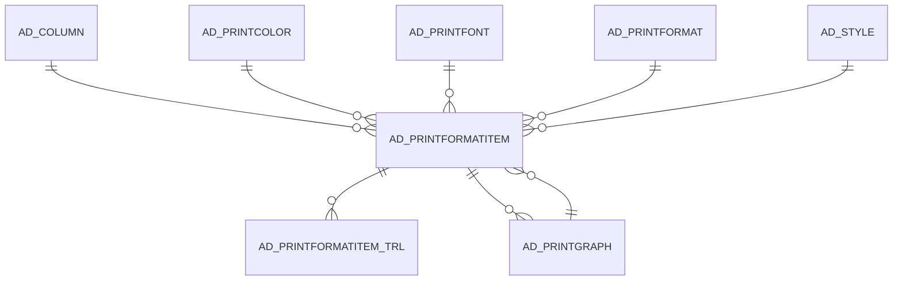

# AD_PRINTFORMATITEM

Area [AD](../../data-model/ad/index.md) · class **config** (proposed) · read from database `idempiere-db` (owner `ADEMPIERE`) · 2737 row(s) when profiled

Application model: `org.compiere.model.X_AD_PrintFormatItem`, access level 7 - System - Client - Org.

## Columns

| column | type | key | not null | business name | references (code) | nulls | distinct |
|---|---|---|---|---|---|---|---|
| `AD_PRINTFORMATITEM_ID` | NUMBER(10,0) | PK | yes | Print Format Item |  | 0 | 2737 |
| `AD_CLIENT_ID` | NUMBER(10,0) |  | yes | Tenant |  | 0 | 2 |
| `AD_ORG_ID` | NUMBER(10,0) |  | yes | Organization |  | 0 | 1 |
| `ISACTIVE` | CHAR(1) |  | yes | Active |  | 0 | 2 |
| `CREATED` | DATE |  | yes | Created |  | 0 | 1436 |
| `CREATEDBY` | NUMBER(10,0) |  | yes | Created By |  | 0 | 2 |
| `UPDATED` | DATE |  | yes | Updated |  | 0 | 1279 |
| `UPDATEDBY` | NUMBER(10,0) |  | yes | Updated By |  | 0 | 2 |
| `AD_PRINTFORMAT_ID` | NUMBER(10,0) |  | yes | Print Format | [AD_PRINTFORMAT](../../data-model/ad/ad_printformat.md) | 0 | 92 |
| `NAME` | VARCHAR2(60 CHAR) |  | yes | Name |  | 0 | 584 |
| `PRINTNAME` | VARCHAR2(2000 CHAR) |  |  | Print Text |  | 230 | 617 |
| `ISPRINTED` | CHAR(1) |  | yes | Printed |  | 0 | 2 |
| `PRINTAREATYPE` | CHAR(1) |  | yes | Area |  | 0 | 2 |
| `SEQNO` | NUMBER(10,0) |  | yes | Sequence |  | 0 | 96 |
| `PRINTFORMATTYPE` | CHAR(1) |  | yes | Format Type |  | 0 | 5 |
| `AD_COLUMN_ID` | NUMBER(10,0) |  |  | Column | [AD_COLUMN](../../data-model/ad/ad_column.md) | 65 | 1783 |
| `AD_PRINTFORMATCHILD_ID` | NUMBER(10,0) |  |  | Included Print Format | [AD_PRINTFORMAT](../../data-model/ad/ad_printformat.md) | 2711 | 21 |
| `ISRELATIVEPOSITION` | CHAR(1) |  | yes | Relative Position |  | 0 | 2 |
| `ISNEXTLINE` | CHAR(1) |  | yes | Next Line |  | 0 | 2 |
| `XSPACE` | NUMBER(10,0) |  | yes | X Space |  | 0 | 4 |
| `YSPACE` | NUMBER(10,0) |  | yes | Y Space |  | 0 | 9 |
| `XPOSITION` | NUMBER(10,0) |  | yes | X Position |  | 0 | 18 |
| `YPOSITION` | NUMBER(10,0) |  | yes | Y Position |  | 0 | 20 |
| `MAXWIDTH` | NUMBER(10,0) |  | yes | Max Width |  | 0 | 12 |
| `ISHEIGHTONELINE` | CHAR(1) |  | yes | One Line Only |  | 0 | 2 |
| `MAXHEIGHT` | NUMBER(10,0) |  | yes | Max Height |  | 0 | 4 |
| `FIELDALIGNMENTTYPE` | CHAR(1) |  | yes | Field Alignment |  | 0 | 5 |
| `LINEALIGNMENTTYPE` | CHAR(1) |  | yes | Line Alignment |  | 0 | 2 |
| `AD_PRINTCOLOR_ID` | NUMBER(10,0) |  |  | Print Color | [AD_PRINTCOLOR](../../data-model/ad/ad_printcolor.md) | 2664 | 3 |
| `AD_PRINTFONT_ID` | NUMBER(10,0) |  |  | Print Font | [AD_PRINTFONT](../../data-model/ad/ad_printfont.md) | 2622 | 6 |
| `ISORDERBY` | CHAR(1) |  | yes | Order by |  | 0 | 2 |
| `SORTNO` | NUMBER(10,0) |  | yes | Record Sort No |  | 0 | 10 |
| `ISGROUPBY` | CHAR(1) |  | yes | Group by |  | 0 | 2 |
| `ISPAGEBREAK` | CHAR(1) |  | yes | Page break |  | 0 | 2 |
| `ISSUMMARIZED` | CHAR(1) |  | yes | Calculate Sum (&#931;) |  | 0 | 2 |
| `IMAGEISATTACHED` | CHAR(1) |  | yes | Image attached |  | 0 | 1 |
| `IMAGEURL` | VARCHAR2(120 CHAR) |  |  | Image URL |  | 2725 | 1 |
| `ISAVERAGED` | CHAR(1) |  | yes | Calculate Mean (&#956;) |  | 0 | 2 |
| `ISCOUNTED` | CHAR(1) |  | yes | Calculate Count (&#8470;) |  | 0 | 2 |
| `ISSETNLPOSITION` | CHAR(1) |  | yes | Set NL Position |  | 0 | 2 |
| `ISSUPPRESSNULL` | CHAR(1) |  | yes | Suppress Null |  | 0 | 2 |
| `BELOWCOLUMN` | NUMBER(10,0) |  |  | Below Column |  | 1374 | 18 |
| `AD_PRINTGRAPH_ID` | NUMBER(10,0) |  |  | Graph | [AD_PRINTGRAPH](../../data-model/ad/ad_printgraph.md) | 2737 | 0 |
| `ISFIXEDWIDTH` | CHAR(1) |  | yes | Fixed Width |  | 0 | 2 |
| `ISNEXTPAGE` | CHAR(1) |  | yes | Next Page |  | 0 | 1 |
| `PRINTNAMESUFFIX` | VARCHAR2(60 CHAR) |  |  | Print Label Suffix |  | 2717 | 3 |
| `ISMINCALC` | CHAR(1) |  | yes | Calculate Minimum (&#8595;) |  | 0 | 2 |
| `ISMAXCALC` | CHAR(1) |  | yes | Calculate Maximum (&#8593;) |  | 0 | 2 |
| `ISRUNNINGTOTAL` | CHAR(1) |  | yes | Running Total |  | 0 | 2 |
| `RUNNINGTOTALLINES` | NUMBER(10,0) |  |  | Running Total Lines |  | 1478 | 3 |
| `ISVARIANCECALC` | CHAR(1) |  | yes | Calculate Variance (&#963;²) |  | 0 | 1 |
| `ISDEVIATIONCALC` | CHAR(1) |  | yes | Calculate Deviation (&#963;) |  | 0 | 2 |
| `ISFILLEDRECTANGLE` | CHAR(1) |  | yes | Fill Shape |  | 0 | 2 |
| `LINEWIDTH` | NUMBER(10,0) |  |  | Line Width |  | 1051 | 2 |
| `ARCDIAMETER` | NUMBER(10,0) |  |  | Arc Diameter |  | 1051 | 2 |
| `SHAPETYPE` | CHAR(1) |  |  | Shape Type |  | 1162 | 2 |
| `ISCENTRALLYMAINTAINED` | CHAR(1) |  | yes | Centrally maintained |  | 0 | 2 |
| `ISIMAGEFIELD` | CHAR(1) |  | yes | Image Field |  | 0 | 2 |
| `BARCODETYPE` | CHAR(3) |  |  | Barcode Type |  | 2734 | 3 |
| `FORMATPATTERN` | VARCHAR2(60 CHAR) |  |  | Format Pattern |  | 2734 | 1 |
| `ISSUPPRESSREPEATS` | CHAR(1) |  | yes | Suppress Repeats |  | 0 | 1 |
| `AD_PRINTFORMATITEM_UU` | VARCHAR2(36 CHAR) |  |  | AD_PrintFormatItem_UU |  | 0 | 2737 |
| `ISDESC` | CHAR(1) |  | yes | Descending |  | 0 | 1 |
| `ISPRINTBARCODETEXT` | CHAR(1) |  | yes | Print Barcode Text |  | 0 | 2 |
| `DISPLAYLOGIC` | VARCHAR2(2000 CHAR) |  |  | Display Logic |  | 2737 | 0 |
| `SCRIPT` | VARCHAR2(2000 CHAR) |  |  | Script |  | 2737 | 0 |
| `ISPRINTINSTANCEATTRIBUTES` | CHAR(1) |  | yes | Print Attributes |  | 0 | 1 |
| `AD_FIELDSTYLE_ID` | NUMBER(10,0) |  |  | Field Style | [AD_STYLE](../../data-model/ad/ad_style.md) | 2737 | 0 |

*references (code)* is the table the application model's code says a column points to; *Foreign keys* below are the constraints the database declares. Counts come from the profile; no value is ever shown.

## Check constraints

| name | expression |
|---|---|
| `SYS_C0021944` | `IsDesc IN ('Y','N')` |
| `SYS_C0021945` | `IsPrintInstanceAttributes IN ('Y','N')` |
| `SYS_C0021946` | `IsSuppressRepeats IN ('Y','N')` |
| `SYS_C0021947` | `IsPrintBarcodeText IN ('Y','N')` |
| `SYS_C0021948` | `IsOrderBy in ('Y','N')` |
| `SYS_C0021949` | `IsSummarized in ('Y','N')` |
| `SYS_C0021950` | `IsPrinted in ('Y','N')` |
| `SYS_C0021951` | `IsGroupBy in ('Y','N')` |
| `SYS_C0021952` | `IsRelativePosition in ('Y','N')` |
| `SYS_C0021953` | `IsNextLine in ('Y','N')` |
| `SYS_C0021955` | `IsActive in ('Y','N')` |
| `SYS_C0021956` | `IsHeightOneLine in ('Y','N')` |
| `SYS_C0021957` | `IsPageBreak in ('Y','N')` |

## Foreign keys

**References**

| table | columns | on delete |
|---|---|---|
| [AD_COLUMN](../../data-model/ad/ad_column.md) | AD_PRINTFORMATITEM.AD_COLUMN_ID → AD_COLUMN.AD_COLUMN_ID | NO ACTION |
| [AD_PRINTCOLOR](../../data-model/ad/ad_printcolor.md) | AD_PRINTFORMATITEM.AD_PRINTCOLOR_ID → AD_PRINTCOLOR.AD_PRINTCOLOR_ID | NO ACTION |
| [AD_PRINTFONT](../../data-model/ad/ad_printfont.md) | AD_PRINTFORMATITEM.AD_PRINTFONT_ID → AD_PRINTFONT.AD_PRINTFONT_ID | NO ACTION |
| [AD_PRINTFORMAT](../../data-model/ad/ad_printformat.md) | AD_PRINTFORMATITEM.AD_PRINTFORMATCHILD_ID → AD_PRINTFORMAT.AD_PRINTFORMAT_ID | SET NULL |
| [AD_PRINTGRAPH](../../data-model/ad/ad_printgraph.md) | AD_PRINTFORMATITEM.AD_PRINTGRAPH_ID → AD_PRINTGRAPH.AD_PRINTGRAPH_ID | NO ACTION |
| [AD_STYLE](../../data-model/ad/ad_style.md) | AD_PRINTFORMATITEM.AD_FIELDSTYLE_ID → AD_STYLE.AD_STYLE_ID | NO ACTION |

**Referenced by**

| table | columns | on delete |
|---|---|---|
| [AD_PRINTFORMATITEM_TRL](../../data-model/ad/ad_printformatitem_trl.md) | AD_PRINTFORMATITEM_TRL.AD_PRINTFORMATITEM_ID → AD_PRINTFORMATITEM.AD_PRINTFORMATITEM_ID | CASCADE |
| [AD_PRINTGRAPH](../../data-model/ad/ad_printgraph.md) | AD_PRINTGRAPH.DATA_PRINTFORMATITEM_ID → AD_PRINTFORMATITEM.AD_PRINTFORMATITEM_ID | NO ACTION |

## Write behaviour

- updates: **raw_sql_skips_updated**
- deletes: **deleted_by_users**
- change log: **recorded**
- evidence: 7 citation(s)

## Read by

| kind | name |
|---|---|
| Procedure | [AD_Synchronize](../../logic/ad_synchronize.md) |
| View | `RV_PRINTFORMATDETAIL` |
| View | `rv_printformatdetail` |

## Written by

| kind | name |
|---|---|
| Procedure | [AD_Synchronize](../../logic/ad_synchronize.md) |

## Schema history

55 change(s); the latest:

| applied | release | operation | column | tickets |
|---|---|---|---|---|
| 2025-12-12T12:12 | iD13 | `add_column` | ScaleFactor | IDEMPIERE-6789 |
| 2025-12-12T12:12 | iD13 | `add_column` | ScaleFactor | IDEMPIERE-6789 |
| 2023-04-09T15:47 | iD11 | `add_constraint` |  | IDEMPIERE-5567 |
| 2023-04-09T15:47 | iD11 | `add_constraint` |  | IDEMPIERE-5567 |
| 2022-02-28T09:01 | iD10 | `add_column` | AD_FieldStyle_ID | IDEMPIERE-5206 |
| 2022-02-28T09:01 | iD10 | `add_constraint` |  | IDEMPIERE-5206 |
| 2022-02-28T09:01 | iD10 | `add_column` | AD_FieldStyle_ID | IDEMPIERE-5206 |
| 2022-02-28T09:01 | iD10 | `add_constraint` |  | IDEMPIERE-5206 |
| 2021-12-05T16:45 | i8.2z | `add_constraint` |  | IDEMPIERE-5075 |
| 2021-12-05T16:45 | i8.2z | `drop_constraint` |  | IDEMPIERE-5075 |
| 2021-12-05T16:45 | i8.2z | `drop_constraint` |  | IDEMPIERE-5075 |
| 2021-12-05T16:45 | i8.2z | `drop_constraint` |  | IDEMPIERE-5075 |
| 2021-12-05T16:45 | i8.2z | `drop_constraint` |  | IDEMPIERE-5075 |
| 2021-12-05T16:45 | i8.2z | `drop_constraint` |  | IDEMPIERE-5075 |
| 2021-12-05T16:45 | i8.2z | `add_constraint` |  | IDEMPIERE-5075 |

## Open conflicts

| type | attribute | explanation |
|---|---|---|
| `mandatory_but_nullable` | `columns.AD_PrintFormatChild_ID.nullable` | unexplained |
| `model_column_missing` | `columns.ScaleFactor` | unexplained |

## Notes

<!-- ekos:manual id="table.ad_printformatitem.notes" -->
_Business notes about this table._
<!-- /ekos:manual -->
