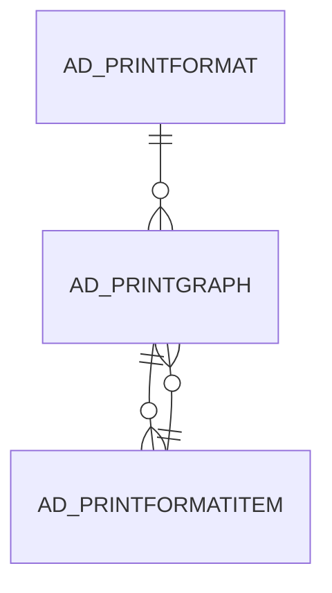

# AD_PRINTGRAPH

Area [AD](../../data-model/ad/index.md) · class **config** (proposed) · read from database `idempiere-db` (owner `ADEMPIERE`) · 0 row(s) when profiled

Application model: `org.compiere.model.X_AD_PrintGraph`, access level 7 - System - Client - Org.

## Columns

| column | type | key | not null | business name | references (code) | nulls | distinct |
|---|---|---|---|---|---|---|---|
| `AD_PRINTGRAPH_ID` | NUMBER(10,0) | PK | yes | Graph |  | 0 | 0 |
| `AD_CLIENT_ID` | NUMBER(10,0) |  | yes | Tenant |  | 0 | 0 |
| `AD_ORG_ID` | NUMBER(10,0) |  | yes | Organization |  | 0 | 0 |
| `ISACTIVE` | CHAR(1) |  | yes | Active |  | 0 | 0 |
| `CREATED` | DATE |  | yes | Created |  | 0 | 0 |
| `CREATEDBY` | NUMBER(10,0) |  | yes | Created By |  | 0 | 0 |
| `UPDATED` | DATE |  | yes | Updated |  | 0 | 0 |
| `UPDATEDBY` | NUMBER(10,0) |  | yes | Updated By |  | 0 | 0 |
| `NAME` | VARCHAR2(60 CHAR) |  | yes | Name |  | 0 | 0 |
| `DESCRIPTION` | VARCHAR2(255 CHAR) |  |  | Description |  | 0 | 0 |
| `GRAPHTYPE` | CHAR(1) |  | yes | Graph Type |  | 0 | 0 |
| `DESCRIPTION_PRINTFORMATITEM_ID` | NUMBER(10,0) |  | yes | Description Column | [AD_PRINTFORMATITEM](../../data-model/ad/ad_printformatitem.md) | 0 | 0 |
| `DATA_PRINTFORMATITEM_ID` | NUMBER(10,0) |  | yes | Data Column | [AD_PRINTFORMATITEM](../../data-model/ad/ad_printformatitem.md) | 0 | 0 |
| `DATA1_PRINTFORMATITEM_ID` | NUMBER(10,0) |  |  | Data Column 2 | [AD_PRINTFORMATITEM](../../data-model/ad/ad_printformatitem.md) | 0 | 0 |
| `DATA2_PRINTFORMATITEM_ID` | NUMBER(10,0) |  |  | Data Column 3 | [AD_PRINTFORMATITEM](../../data-model/ad/ad_printformatitem.md) | 0 | 0 |
| `DATA3_PRINTFORMATITEM_ID` | NUMBER(10,0) |  |  | Data Column 4 | [AD_PRINTFORMATITEM](../../data-model/ad/ad_printformatitem.md) | 0 | 0 |
| `DATA4_PRINTFORMATITEM_ID` | NUMBER(10,0) |  |  | Data Column 5 | [AD_PRINTFORMATITEM](../../data-model/ad/ad_printformatitem.md) | 0 | 0 |
| `AD_PRINTFORMAT_ID` | NUMBER(10,0) |  | yes | Print Format | [AD_PRINTFORMAT](../../data-model/ad/ad_printformat.md) | 0 | 0 |
| `AD_PRINTGRAPH_UU` | VARCHAR2(36 CHAR) |  |  | AD_PrintGraph_UU |  | 0 | 0 |

*references (code)* is the table the application model's code says a column points to; *Foreign keys* below are the constraints the database declares. Counts come from the profile; no value is ever shown.

## Check constraints

| name | expression |
|---|---|
| `SYS_C0022250` | `IsActive in ('Y','N')` |

## Foreign keys

**References**

| table | columns | on delete |
|---|---|---|
| [AD_PRINTFORMAT](../../data-model/ad/ad_printformat.md) | AD_PRINTGRAPH.AD_PRINTFORMAT_ID → AD_PRINTFORMAT.AD_PRINTFORMAT_ID | NO ACTION |
| [AD_PRINTFORMATITEM](../../data-model/ad/ad_printformatitem.md) | AD_PRINTGRAPH.DATA_PRINTFORMATITEM_ID → AD_PRINTFORMATITEM.AD_PRINTFORMATITEM_ID | NO ACTION |

**Referenced by**

| table | columns | on delete |
|---|---|---|
| [AD_PRINTFORMATITEM](../../data-model/ad/ad_printformatitem.md) | AD_PRINTFORMATITEM.AD_PRINTGRAPH_ID → AD_PRINTGRAPH.AD_PRINTGRAPH_ID | NO ACTION |

## Write behaviour

- updates: **po_only**
- deletes: **deleted_by_users**
- change log: **recorded**
- evidence: 1 citation(s)

## Schema history

27 change(s); the latest:

| applied | release | operation | column | tickets |
|---|---|---|---|---|
| 2023-04-09T15:47 | iD11 | `add_constraint` |  | IDEMPIERE-5567 |
| 2023-04-09T15:47 | iD11 | `add_constraint` |  | IDEMPIERE-5567 |
| 2021-12-05T16:45 | i8.2z | `drop_constraint` |  | IDEMPIERE-5075 |
| 2021-12-05T16:45 | i8.2z | `drop_constraint` |  | IDEMPIERE-5075 |
| 2021-12-05T16:45 | i8.2z | `drop_constraint` |  | IDEMPIERE-5075 |
| 2021-12-05T16:45 | i8.2z | `add_constraint` |  | IDEMPIERE-5075 |
| 2021-12-05T16:45 | i8.2z | `add_constraint` |  | IDEMPIERE-5075 |
| 2021-12-05T16:45 | i8.2z | `add_constraint` |  | IDEMPIERE-5075 |
| 2021-12-05T16:45 | i8.2z | `add_constraint` |  | IDEMPIERE-5075 |
| 2021-12-05T16:45 | i8.2z | `drop_constraint` |  | IDEMPIERE-5075 |
| 2021-12-05T16:45 | i8.2z | `drop_constraint` |  | IDEMPIERE-5075 |
| 2021-12-05T16:45 | i8.2z | `add_constraint` |  | IDEMPIERE-5075 |
| 2021-12-05T16:45 | i8.2z | `drop_constraint` |  | IDEMPIERE-5075 |
| 2021-12-05T16:45 | i8.2z | `drop_constraint` |  | IDEMPIERE-5075 |
| 2021-12-05T16:45 | i8.2z | `add_constraint` |  | IDEMPIERE-5075 |

## Notes

<!-- ekos:manual id="table.ad_printgraph.notes" -->
_Business notes about this table._
<!-- /ekos:manual -->
