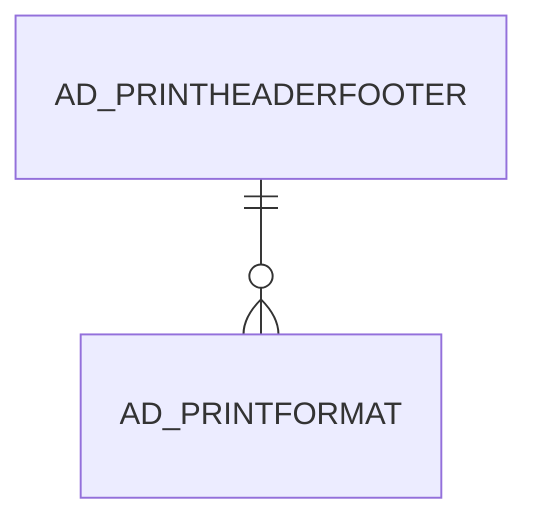

# AD_PRINTHEADERFOOTER

Area [AD](../../data-model/ad/index.md) · class **config** (proposed) · read from database `idempiere-db` (owner `ADEMPIERE`) · 0 row(s) when profiled

Application model: `org.compiere.model.X_AD_PrintHeaderFooter`, access level 6 - System - Client.

## Columns

| column | type | key | not null | business name | references (code) | nulls | distinct |
|---|---|---|---|---|---|---|---|
| `AD_CLIENT_ID` | NUMBER(10,0) |  | yes | Tenant |  | 0 | 0 |
| `AD_ORG_ID` | NUMBER(10,0) |  | yes | Organization |  | 0 | 0 |
| `AD_PRINTHEADERFOOTER_ID` | NUMBER(10,0) | PK | yes | Print Header/Footer |  | 0 | 0 |
| `AD_PRINTHEADERFOOTER_UU` | VARCHAR2(36 CHAR) |  |  | AD_PrintHeaderFooter_UU |  | 0 | 0 |
| `CREATED` | DATE |  | yes | Created |  | 0 | 0 |
| `CREATEDBY` | NUMBER(10,0) |  | yes | Created By |  | 0 | 0 |
| `ISACTIVE` | CHAR(1) |  | yes | Active |  | 0 | 0 |
| `NAME` | VARCHAR2(60 CHAR) |  | yes | Name |  | 0 | 0 |
| `SOURCECLASSNAME` | VARCHAR2(255 CHAR) |  | yes | Source Class |  | 0 | 0 |
| `UPDATED` | DATE |  | yes | Updated |  | 0 | 0 |
| `UPDATEDBY` | NUMBER(10,0) |  | yes | Updated By |  | 0 | 0 |

*references (code)* is the table the application model's code says a column points to; *Foreign keys* below are the constraints the database declares. Counts come from the profile; no value is ever shown.

## Check constraints

| name | expression |
|---|---|
| `SYS_C0020072` | `IsActive IN ('Y','N')` |

## Foreign keys

**References**

_None._

**Referenced by**

| table | columns | on delete |
|---|---|---|
| [AD_PRINTFORMAT](../../data-model/ad/ad_printformat.md) | AD_PRINTFORMAT.AD_PRINTHEADERFOOTER_ID → AD_PRINTHEADERFOOTER.AD_PRINTHEADERFOOTER_ID | NO ACTION |

## Write behaviour

- updates: **po_only**
- deletes: **deleted_by_users**
- change log: **recorded**
- evidence: 1 citation(s)

## Schema history

8 change(s); the latest:

| applied | release | operation | column | tickets |
|---|---|---|---|---|
| 2021-07-28T16:52 | i8.2z | `create_table` |  | IDEMPIERE-4894 |
| 2021-07-28T16:52 | i8.2z | `modify_column` | SourceClassName | IDEMPIERE-4894 |
| 2021-07-28T16:52 | i8.2z | `modify_column` | SourceClassName | IDEMPIERE-4894 |
| 2021-07-28T16:52 | i8.2z | `modify_column` | SourceClassName | IDEMPIERE-4894 |
| 2021-07-28T16:52 | i8.2z | `modify_column` | SourceClassName | IDEMPIERE-4894 |
| 2021-07-28T16:52 | i8.2z | `add_constraint` |  | IDEMPIERE-4894 |
| 2021-07-28T16:52 | i8.2z | `create_table` |  | IDEMPIERE-4894 |
| 2021-07-28T16:52 | i8.2z | `add_constraint` |  | IDEMPIERE-4894 |

## Notes

<!-- ekos:manual id="table.ad_printheaderfooter.notes" -->
_Business notes about this table._
<!-- /ekos:manual -->
