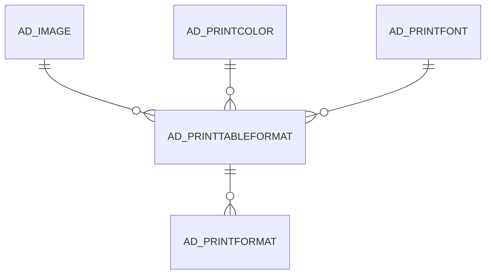

# AD_PRINTTABLEFORMAT

Area [AD](../../data-model/ad/index.md) · class **config** (proposed) · read from database `idempiere-db` (owner `ADEMPIERE`) · 2 row(s) when profiled

Application model: `org.compiere.model.X_AD_PrintTableFormat`, access level 6 - System - Client.

## Columns

| column | type | key | not null | business name | references (code) | nulls | distinct |
|---|---|---|---|---|---|---|---|
| `AD_PRINTTABLEFORMAT_ID` | NUMBER(10,0) | PK | yes | Print Table Format |  | 0 | 2 |
| `AD_CLIENT_ID` | NUMBER(10,0) |  | yes | Tenant |  | 0 | 1 |
| `AD_ORG_ID` | NUMBER(10,0) |  | yes | Organization |  | 0 | 1 |
| `ISACTIVE` | CHAR(1) |  | yes | Active |  | 0 | 1 |
| `CREATED` | DATE |  | yes | Created |  | 0 | 2 |
| `CREATEDBY` | NUMBER(10,0) |  | yes | Created By |  | 0 | 1 |
| `UPDATED` | DATE |  | yes | Updated |  | 0 | 2 |
| `UPDATEDBY` | NUMBER(10,0) |  | yes | Updated By |  | 0 | 2 |
| `HDR_PRINTFONT_ID` | NUMBER(10,0) |  |  | Header Row Font | [AD_PRINTFONT](../../data-model/ad/ad_printfont.md) | 1 | 1 |
| `HDRTEXTFG_PRINTCOLOR_ID` | NUMBER(10,0) |  |  | Header Row Color | [AD_PRINTCOLOR](../../data-model/ad/ad_printcolor.md) | 0 | 1 |
| `HDRTEXTBG_PRINTCOLOR_ID` | NUMBER(10,0) |  |  | Header Row BG Color | [AD_PRINTCOLOR](../../data-model/ad/ad_printcolor.md) | 0 | 2 |
| `HDRLINE_PRINTCOLOR_ID` | NUMBER(10,0) |  |  | Header Line Color | [AD_PRINTCOLOR](../../data-model/ad/ad_printcolor.md) | 1 | 1 |
| `FUNCT_PRINTFONT_ID` | NUMBER(10,0) |  |  | Function Font | [AD_PRINTFONT](../../data-model/ad/ad_printfont.md) | 1 | 1 |
| `FUNCTBG_PRINTCOLOR_ID` | NUMBER(10,0) |  |  | Function BG Color | [AD_PRINTCOLOR](../../data-model/ad/ad_printcolor.md) | 0 | 2 |
| `FUNCTFG_PRINTCOLOR_ID` | NUMBER(10,0) |  |  | Function Color | [AD_PRINTCOLOR](../../data-model/ad/ad_printcolor.md) | 0 | 1 |
| `LINE_PRINTCOLOR_ID` | NUMBER(10,0) |  |  | Line Color | [AD_PRINTCOLOR](../../data-model/ad/ad_printcolor.md) | 1 | 1 |
| `DESCRIPTION` | VARCHAR2(255 CHAR) |  |  | Description |  | 0 | 2 |
| `ISPAINTBOUNDARYLINES` | CHAR(1) |  | yes | Paint Boundary Lines |  | 0 | 1 |
| `ISPAINTHLINES` | CHAR(1) |  | yes | Paint Horizontal Lines |  | 0 | 1 |
| `ISPAINTVLINES` | CHAR(1) |  | yes | Paint Vertical Lines |  | 0 | 1 |
| `ISPRINTFUNCTIONSYMBOLS` | CHAR(1) |  | yes | Print Function Symbols |  | 0 | 2 |
| `NAME` | VARCHAR2(60 CHAR) |  | yes | Name |  | 0 | 2 |
| `ISDEFAULT` | CHAR(1) |  | yes | Default |  | 0 | 2 |
| `IMAGEURL` | VARCHAR2(120 CHAR) |  |  | Image URL |  | 2 | 0 |
| `HEADERLEFT` | VARCHAR2(255 CHAR) |  |  | Header Left |  | 2 | 0 |
| `HEADERCENTER` | VARCHAR2(255 CHAR) |  |  | Header Center |  | 2 | 0 |
| `HEADERRIGHT` | VARCHAR2(255 CHAR) |  |  | Header Right |  | 2 | 0 |
| `FOOTERLEFT` | VARCHAR2(255 CHAR) |  |  | Footer Left |  | 2 | 0 |
| `FOOTERCENTER` | VARCHAR2(255 CHAR) |  |  | Footer Center |  | 2 | 0 |
| `FOOTERRIGHT` | VARCHAR2(255 CHAR) |  |  | Footer Right |  | 2 | 0 |
| `IMAGEISATTACHED` | CHAR(1) |  |  | Image attached |  | 0 | 1 |
| `HDRSTROKE` | NUMBER |  |  | Header Stroke |  | 0 | 1 |
| `LINESTROKE` | NUMBER |  |  | Line Stroke |  | 0 | 1 |
| `HDRSTROKETYPE` | CHAR(1) |  |  | Header Stroke Type |  | 0 | 1 |
| `LINESTROKETYPE` | CHAR(1) |  |  | Line Stroke Type |  | 0 | 1 |
| `ISPAINTHEADERLINES` | CHAR(1) |  | yes | Paint Header Lines |  | 0 | 1 |
| `AD_IMAGE_ID` | NUMBER(10,0) |  |  | Image | [AD_IMAGE](../../data-model/ad/ad_image.md) | 2 | 0 |
| `ISMULTILINEHEADER` | CHAR(1) |  | yes | Multi Line Header |  | 0 | 1 |
| `AD_PRINTTABLEFORMAT_UU` | VARCHAR2(36 CHAR) |  |  | AD_PrintTableFormat_UU |  | 0 | 2 |

*references (code)* is the table the application model's code says a column points to; *Foreign keys* below are the constraints the database declares. Counts come from the profile; no value is ever shown.

## Check constraints

| name | expression |
|---|---|
| `SYS_C0022652` | `IsMultiLineHeader IN ('Y','N')` |
| `SYS_C0022653` | `IsActive in ('Y','N')` |

## Foreign keys

**References**

| table | columns | on delete |
|---|---|---|
| [AD_IMAGE](../../data-model/ad/ad_image.md) | AD_PRINTTABLEFORMAT.AD_IMAGE_ID → AD_IMAGE.AD_IMAGE_ID | NO ACTION |
| [AD_PRINTCOLOR](../../data-model/ad/ad_printcolor.md) | AD_PRINTTABLEFORMAT.FUNCTBG_PRINTCOLOR_ID → AD_PRINTCOLOR.AD_PRINTCOLOR_ID | NO ACTION |
| [AD_PRINTFONT](../../data-model/ad/ad_printfont.md) | AD_PRINTTABLEFORMAT.FUNCT_PRINTFONT_ID → AD_PRINTFONT.AD_PRINTFONT_ID | NO ACTION |

**Referenced by**

| table | columns | on delete |
|---|---|---|
| [AD_PRINTFORMAT](../../data-model/ad/ad_printformat.md) | AD_PRINTFORMAT.AD_PRINTTABLEFORMAT_ID → AD_PRINTTABLEFORMAT.AD_PRINTTABLEFORMAT_ID | NO ACTION |

## Write behaviour

- updates: **po_only**
- deletes: **deleted_by_users**
- change log: **recorded**
- evidence: 1 citation(s)

## Schema history

52 change(s); the latest:

| applied | release | operation | column | tickets |
|---|---|---|---|---|
| 2023-04-09T15:47 | iD11 | `add_constraint` |  | IDEMPIERE-5567 |
| 2023-04-09T15:47 | iD11 | `add_constraint` |  | IDEMPIERE-5567 |
| 2021-12-05T16:45 | i8.2z | `add_constraint` |  | IDEMPIERE-5075 |
| 2021-12-05T16:45 | i8.2z | `add_constraint` |  | IDEMPIERE-5075 |
| 2021-12-05T16:45 | i8.2z | `add_constraint` |  | IDEMPIERE-5075 |
| 2021-12-05T16:45 | i8.2z | `drop_constraint` |  | IDEMPIERE-5075 |
| 2021-12-05T16:45 | i8.2z | `add_constraint` |  | IDEMPIERE-5075 |
| 2021-12-05T16:45 | i8.2z | `drop_constraint` |  | IDEMPIERE-5075 |
| 2021-12-05T16:45 | i8.2z | `add_constraint` |  | IDEMPIERE-5075 |
| 2021-12-05T16:45 | i8.2z | `drop_constraint` |  | IDEMPIERE-5075 |
| 2021-12-05T16:45 | i8.2z | `add_constraint` |  | IDEMPIERE-5075 |
| 2021-12-05T16:45 | i8.2z | `drop_constraint` |  | IDEMPIERE-5075 |
| 2021-12-05T16:45 | i8.2z | `drop_constraint` |  | IDEMPIERE-5075 |
| 2021-12-05T16:45 | i8.2z | `add_constraint` |  | IDEMPIERE-5075 |
| 2021-12-05T16:45 | i8.2z | `drop_constraint` |  | IDEMPIERE-5075 |

## Notes

<!-- ekos:manual id="table.ad_printtableformat.notes" -->
_Business notes about this table._
<!-- /ekos:manual -->
