# AD_PROCESS

Area [AD](../../data-model/ad/index.md) · class **config** (proposed) · read from database `idempiere-db` (owner `ADEMPIERE`) · 472 row(s) when profiled

Application model: `org.compiere.model.X_AD_Process`, access level 4 - System.

## Columns

| column | type | key | not null | business name | references (code) | nulls | distinct |
|---|---|---|---|---|---|---|---|
| `AD_PROCESS_ID` | NUMBER(10,0) | PK | yes | Process |  | 0 | 472 |
| `AD_CLIENT_ID` | NUMBER(10,0) |  | yes | Tenant |  | 0 | 1 |
| `AD_ORG_ID` | NUMBER(10,0) |  | yes | Organization |  | 0 | 1 |
| `ISACTIVE` | CHAR(1) |  | yes | Active |  | 0 | 2 |
| `CREATED` | DATE |  | yes | Created |  | 0 | 461 |
| `CREATEDBY` | NUMBER(10,0) |  | yes | Created By |  | 0 | 3 |
| `UPDATED` | DATE |  | yes | Updated |  | 0 | 334 |
| `UPDATEDBY` | NUMBER(10,0) |  | yes | Updated By |  | 0 | 4 |
| `VALUE` | VARCHAR2(40 CHAR) |  | yes | Search Key |  | 0 | 472 |
| `NAME` | VARCHAR2(60 CHAR) |  | yes | Name |  | 0 | 451 |
| `DESCRIPTION` | VARCHAR2(255 CHAR) |  |  | Description |  | 115 | 343 |
| `HELP` | VARCHAR2(2000 CHAR) |  |  | Comment/Help |  | 231 | 224 |
| `ACCESSLEVEL` | CHAR(1) |  | yes | Data Access Level |  | 0 | 6 |
| `ENTITYTYPE` | VARCHAR2(40 CHAR) |  | yes | Entity Type |  | 0 | 5 |
| `PROCEDURENAME` | VARCHAR2(60 CHAR) |  |  | Procedure |  | 468 | 4 |
| `ISREPORT` | CHAR(1) |  | yes | Report |  | 0 | 2 |
| `ISDIRECTPRINT` | CHAR(1) |  |  | Direct print |  | 0 | 2 |
| `AD_REPORTVIEW_ID` | NUMBER(10,0) |  |  | Report View | [AD_REPORTVIEW](../../data-model/ad/ad_reportview.md) | 374 | 95 |
| `CLASSNAME` | VARCHAR2(255 CHAR) |  |  | Classname |  | 139 | 321 |
| `STATISTIC_COUNT` | NUMBER(10,0) |  |  | Statistic Count |  | 1 | 16 |
| `STATISTIC_SECONDS` | NUMBER |  |  | Statistic Seconds |  | 1 | 22 |
| `AD_PRINTFORMAT_ID` | NUMBER(10,0) |  |  | Print Format | [AD_PRINTFORMAT](../../data-model/ad/ad_printformat.md) | 468 | 4 |
| `WORKFLOWVALUE` | VARCHAR2(40 CHAR) |  |  | Workflow Key |  | 471 | 1 |
| `AD_WORKFLOW_ID` | NUMBER(10,0) |  |  | Workflow | [AD_WORKFLOW](../../data-model/ad/ad_workflow.md) | 443 | 29 |
| `ISBETAFUNCTIONALITY` | CHAR(1) |  | yes | Beta Functionality |  | 0 | 2 |
| `ISSERVERPROCESS` | CHAR(1) |  |  |  |  | 24 | 1 |
| `SHOWHELP` | CHAR(1) |  |  | Show Help |  | 1 | 3 |
| `JASPERREPORT` | VARCHAR2(255 CHAR) |  |  | Jasper Report |  | 472 | 0 |
| `AD_FORM_ID` | NUMBER(10,0) |  |  | Special Form | [AD_FORM](../../data-model/ad/ad_form.md) | 466 | 6 |
| `COPYFROMPROCESS` | CHAR(1) |  |  | Copy From Report and Process |  | 384 | 1 |
| `AD_PROCESS_UU` | VARCHAR2(36 CHAR) |  |  | AD_Process_UU |  | 0 | 472 |
| `AD_CTXHELP_ID` | NUMBER(10,0) |  |  | Context Help | [AD_CTXHELP](../../data-model/ad/ad_ctxhelp.md) | 472 | 0 |
| `EXECUTIONTYPE` | CHAR(1) |  |  | Execution Type |  | 472 | 0 |
| `ALLOWMULTIPLEEXECUTION` | VARCHAR2(2 CHAR) |  | yes | Allow Concurrent Execution |  | 0 | 5 |
| `FILENAMEPATTERN` | VARCHAR2(255 CHAR) |  |  | File Name Pattern |  | 472 | 0 |

*references (code)* is the table the application model's code says a column points to; *Foreign keys* below are the constraints the database declares. Counts come from the profile; no value is ever shown.

## Check constraints

| name | expression |
|---|---|
| `SYS_C0020705` | `IsActive in ('Y','N')` |
| `SYS_C0020708` | `IsReport in ('Y','N')` |
| `SYS_C0020709` | `IsDirectPrint in ('Y','N')` |

## Foreign keys

**References**

| table | columns | on delete |
|---|---|---|
| [AD_CTXHELP](../../data-model/ad/ad_ctxhelp.md) | AD_PROCESS.AD_CTXHELP_ID → AD_CTXHELP.AD_CTXHELP_ID | NO ACTION |
| [AD_ENTITYTYPE](../../data-model/ad/ad_entitytype.md) | AD_PROCESS.ENTITYTYPE → AD_ENTITYTYPE.ENTITYTYPE | NO ACTION |
| [AD_FORM](../../data-model/ad/ad_form.md) | AD_PROCESS.AD_FORM_ID → AD_FORM.AD_FORM_ID | NO ACTION |
| [AD_PRINTFORMAT](../../data-model/ad/ad_printformat.md) | AD_PROCESS.AD_PRINTFORMAT_ID → AD_PRINTFORMAT.AD_PRINTFORMAT_ID | NO ACTION |
| [AD_REPORTVIEW](../../data-model/ad/ad_reportview.md) | AD_PROCESS.AD_REPORTVIEW_ID → AD_REPORTVIEW.AD_REPORTVIEW_ID | NO ACTION |
| [AD_WORKFLOW](../../data-model/ad/ad_workflow.md) | AD_PROCESS.AD_WORKFLOW_ID → AD_WORKFLOW.AD_WORKFLOW_ID | NO ACTION |

**Referenced by**

| table | columns | on delete |
|---|---|---|
| [AD_ARCHIVE](../../data-model/ad/ad_archive.md) | AD_ARCHIVE.AD_PROCESS_ID → AD_PROCESS.AD_PROCESS_ID | NO ACTION |
| [AD_COLUMN](../../data-model/ad/ad_column.md) | AD_COLUMN.AD_PROCESS_ID → AD_PROCESS.AD_PROCESS_ID | SET NULL |
| [AD_INFOPROCESS](../../data-model/ad/ad_infoprocess.md) | AD_INFOPROCESS.AD_PROCESS_ID → AD_PROCESS.AD_PROCESS_ID | NO ACTION |
| [AD_INFOWINDOW](../../data-model/ad/ad_infowindow.md) | AD_INFOWINDOW.AD_PROCESS_ID → AD_PROCESS.AD_PROCESS_ID | NO ACTION |
| [AD_ISSUE](../../data-model/ad/ad_issue.md) | AD_ISSUE.AD_PROCESS_ID → AD_PROCESS.AD_PROCESS_ID | SET NULL |
| [AD_MENU](../../data-model/ad/ad_menu.md) | AD_MENU.AD_PROCESS_ID → AD_PROCESS.AD_PROCESS_ID | NO ACTION |
| [AD_PACKAGE_EXP_COMMON](../../data-model/ad/ad_package_exp_common.md) | AD_PACKAGE_EXP_COMMON.AD_PROCESS_ID → AD_PROCESS.AD_PROCESS_ID | NO ACTION |
| [AD_PACKAGE_EXP_DETAIL](../../data-model/ad/ad_package_exp_detail.md) | AD_PACKAGE_EXP_DETAIL.AD_PROCESS_ID → AD_PROCESS.AD_PROCESS_ID | NO ACTION |
| [AD_PINSTANCE](../../data-model/ad/ad_pinstance.md) | AD_PINSTANCE.AD_PROCESS_ID → AD_PROCESS.AD_PROCESS_ID | NO ACTION |
| [AD_PREFERENCE](../../data-model/ad/ad_preference.md) | AD_PREFERENCE.AD_PROCESS_ID → AD_PROCESS.AD_PROCESS_ID | NO ACTION |
| [AD_PRINTFORMAT](../../data-model/ad/ad_printformat.md) | AD_PRINTFORMAT.JASPERPROCESS_ID → AD_PROCESS.AD_PROCESS_ID | NO ACTION |
| [AD_PROCESS_ACCESS](../../data-model/ad/ad_process_access.md) | AD_PROCESS_ACCESS.AD_PROCESS_ID → AD_PROCESS.AD_PROCESS_ID | CASCADE |
| [AD_PROCESS_DRILLRULE](../../data-model/ad/ad_process_drillrule.md) | AD_PROCESS_DRILLRULE.AD_PROCESS_ID → AD_PROCESS.AD_PROCESS_ID | NO ACTION |
| [AD_PROCESS_PARA](../../data-model/ad/ad_process_para.md) | AD_PROCESS_PARA.AD_PROCESS_ID → AD_PROCESS.AD_PROCESS_ID | CASCADE |
| [AD_PROCESS_TRL](../../data-model/ad/ad_process_trl.md) | AD_PROCESS_TRL.AD_PROCESS_ID → AD_PROCESS.AD_PROCESS_ID | CASCADE |
| [AD_SCHEDULER](../../data-model/ad/ad_scheduler.md) | AD_SCHEDULER.AD_PROCESS_ID → AD_PROCESS.AD_PROCESS_ID | CASCADE |
| [AD_TAB](../../data-model/ad/ad_tab.md) | AD_TAB.AD_PROCESS_ID → AD_PROCESS.AD_PROCESS_ID | NO ACTION |
| [AD_TOOLBARBUTTON](../../data-model/ad/ad_toolbarbutton.md) | AD_TOOLBARBUTTON.AD_PROCESS_ID → AD_PROCESS.AD_PROCESS_ID | NO ACTION |
| [AD_TOOLBARBUTTONRESTRICT](../../data-model/ad/ad_toolbarbuttonrestrict.md) | AD_TOOLBARBUTTONRESTRICT.AD_PROCESS_ID → AD_PROCESS.AD_PROCESS_ID | NO ACTION |
| [AD_USERDEF_PROC](../../data-model/ad/ad_userdef_proc.md) | AD_USERDEF_PROC.AD_PROCESS_ID → AD_PROCESS.AD_PROCESS_ID | NO ACTION |
| [AD_USERDEF_TAB](../../data-model/ad/ad_userdef_tab.md) | AD_USERDEF_TAB.AD_PROCESS_ID → AD_PROCESS.AD_PROCESS_ID | NO ACTION |
| [AD_WF_NODE](../../data-model/ad/ad_wf_node.md) | AD_WF_NODE.AD_PROCESS_ID → AD_PROCESS.AD_PROCESS_ID | NO ACTION |
| [AD_WORKBENCHWINDOW](../../data-model/ad/ad_workbenchwindow.md) | AD_WORKBENCHWINDOW.AD_PROCESS_ID → AD_PROCESS.AD_PROCESS_ID | NO ACTION |
| [ASP_CLIENTEXCEPTION](../../data-model/asp/asp_clientexception.md) | ASP_CLIENTEXCEPTION.AD_PROCESS_ID → AD_PROCESS.AD_PROCESS_ID | NO ACTION |
| [ASP_PROCESS](../../data-model/asp/asp_process.md) | ASP_PROCESS.AD_PROCESS_ID → AD_PROCESS.AD_PROCESS_ID | NO ACTION |
| [PA_DASHBOARDCONTENT](../../data-model/pa/pa_dashboardcontent.md) | PA_DASHBOARDCONTENT.AD_PROCESS_ID → AD_PROCESS.AD_PROCESS_ID | NO ACTION |
| [PA_REPORT](../../data-model/pa/pa_report.md) | PA_REPORT.JASPERPROCESS_ID → AD_PROCESS.AD_PROCESS_ID | NO ACTION |
| [PP_ORDER_NODE](../../data-model/pp/pp_order_node.md) | PP_ORDER_NODE.AD_PROCESS_ID → AD_PROCESS.AD_PROCESS_ID | NO ACTION |

```mermaid
erDiagram
  AD_CTXHELP ||--o{ AD_PROCESS : ""
  AD_ENTITYTYPE ||--o{ AD_PROCESS : ""
  AD_FORM ||--o{ AD_PROCESS : ""
  AD_PRINTFORMAT ||--o{ AD_PROCESS : ""
  AD_PROCESS ||--o{ AD_ARCHIVE : ""
  AD_PROCESS ||--o{ AD_COLUMN : ""
  AD_PROCESS ||--o{ AD_INFOPROCESS : ""
  AD_PROCESS ||--o{ AD_INFOWINDOW : ""
  AD_PROCESS ||--o{ AD_ISSUE : ""
  AD_PROCESS ||--o{ AD_MENU : ""
  AD_PROCESS ||--o{ AD_PACKAGE_EXP_COMMON : ""
  AD_PROCESS ||--o{ AD_PACKAGE_EXP_DETAIL : ""
  AD_PROCESS ||--o{ AD_PINSTANCE : ""
  AD_PROCESS ||--o{ AD_PREFERENCE : ""
  AD_PROCESS ||--o{ AD_PRINTFORMAT : ""
  AD_PROCESS ||--o{ AD_PROCESS_ACCESS : ""
  AD_PROCESS ||--o{ AD_PROCESS_DRILLRULE : ""
  AD_PROCESS ||--o{ AD_PROCESS_PARA : ""
  AD_PROCESS ||--o{ AD_PROCESS_TRL : ""
  AD_PROCESS ||--o{ AD_SCHEDULER : ""
  AD_PROCESS ||--o{ AD_TAB : ""
  AD_PROCESS ||--o{ AD_TOOLBARBUTTON : ""
  AD_PROCESS ||--o{ AD_TOOLBARBUTTONRESTRICT : ""
  AD_PROCESS ||--o{ AD_USERDEF_PROC : ""
  AD_PROCESS ||--o{ AD_USERDEF_TAB : ""
  AD_PROCESS ||--o{ AD_WF_NODE : ""
  AD_PROCESS ||--o{ AD_WORKBENCHWINDOW : ""
  AD_PROCESS ||--o{ ASP_CLIENTEXCEPTION : ""
  AD_REPORTVIEW ||--o{ AD_PROCESS : ""
  AD_WORKFLOW ||--o{ AD_PROCESS : ""
```

4 more neighbour(s) not drawn.

## Write behaviour

- updates: **raw_sql_skips_updated**
- deletes: **deleted_by_users**
- change log: **recorded**
- evidence: 2 citation(s)

## Read by

| kind | name |
|---|---|
| Procedure | [AD_Synchronize](../../logic/ad_synchronize.md) |

## Schema history

64 change(s); the latest:

| applied | release | operation | column | tickets |
|---|---|---|---|---|
| 2023-08-24T13:36 | iD11 | `modify_column` | AllowMultipleExecution | IDEMPIERE-5835 |
| 2023-08-24T13:36 | iD11 | `modify_column` | AllowMultipleExecution | IDEMPIERE-5835 |
| 2023-08-24T13:36 | iD11 | `modify_column` | AllowMultipleExecution | IDEMPIERE-5835 |
| 2023-08-24T13:36 | iD11 | `modify_column` | AllowMultipleExecution | IDEMPIERE-5835 |
| 2023-08-24T13:36 | iD11 | `modify_column` | AllowMultipleExecution | IDEMPIERE-5835 |
| 2023-08-24T13:36 | iD11 | `modify_column` | AllowMultipleExecution | IDEMPIERE-5835 |
| 2023-04-09T15:47 | iD11 | `add_constraint` |  | IDEMPIERE-5567 |
| 2023-04-09T15:47 | iD11 | `add_constraint` |  | IDEMPIERE-5567 |
| 2022-03-15T16:32 | i9 | `add_column` | FileNamePattern | IDEMPIERE-4753 |
| 2022-03-15T16:32 | i9 | `add_column` | FileNamePattern | IDEMPIERE-4753 |
| 2021-12-05T16:45 | i8.2z | `drop_constraint` |  | IDEMPIERE-5075 |
| 2021-12-05T16:45 | i8.2z | `drop_constraint` |  | IDEMPIERE-5075 |
| 2021-12-05T16:45 | i8.2z | `add_constraint` |  | IDEMPIERE-5075 |
| 2021-12-05T16:45 | i8.2z | `drop_constraint` |  | IDEMPIERE-5075 |
| 2021-12-05T16:45 | i8.2z | `add_constraint` |  | IDEMPIERE-5075 |

## Notes

<!-- ekos:manual id="table.ad_process.notes" -->
_Business notes about this table._
<!-- /ekos:manual -->
