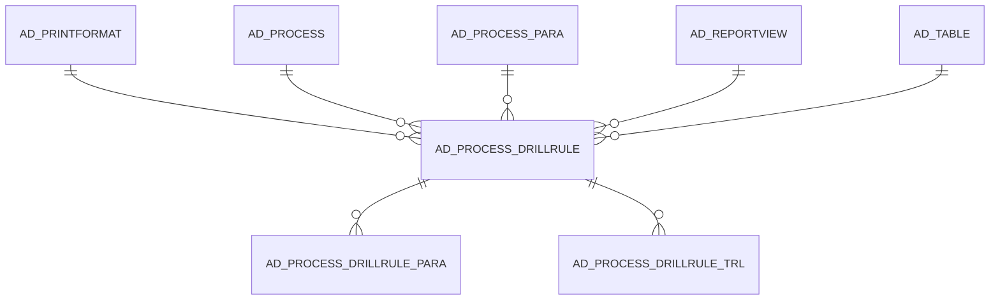

# AD_PROCESS_DRILLRULE

Area [AD](../../data-model/ad/index.md) · class **config** (proposed) · read from database `idempiere-db` (owner `ADEMPIERE`) · 0 row(s) when profiled

Application model: `org.compiere.model.X_AD_Process_DrillRule`, access level 6 - System - Client.

## Columns

| column | type | key | not null | business name | references (code) | nulls | distinct |
|---|---|---|---|---|---|---|---|
| `AD_PROCESS_DRILLRULE_ID` | NUMBER(10,0) | PK | yes | Drill Rule |  | 0 | 0 |
| `AD_CLIENT_ID` | NUMBER(10,0) |  | yes | Tenant |  | 0 | 0 |
| `AD_ORG_ID` | NUMBER(10,0) |  | yes | Organization |  | 0 | 0 |
| `ISACTIVE` | CHAR(1) |  | yes | Active |  | 0 | 0 |
| `CREATED` | DATE |  | yes | Created |  | 0 | 0 |
| `CREATEDBY` | NUMBER(10,0) |  | yes | Created By |  | 0 | 0 |
| `UPDATED` | DATE |  | yes | Updated |  | 0 | 0 |
| `UPDATEDBY` | NUMBER(10,0) |  | yes | Updated By |  | 0 | 0 |
| `NAME` | VARCHAR2(255 CHAR) |  | yes | Name |  | 0 | 0 |
| `DESCRIPTION` | VARCHAR2(255 CHAR) |  |  | Description |  | 0 | 0 |
| `SHOWHELP` | CHAR(1) |  |  | Show Help |  | 0 | 0 |
| `AD_PROCESS_ID` | NUMBER(10,0) |  | yes | Process | [AD_PROCESS](../../data-model/ad/ad_process.md) | 0 | 0 |
| `AD_TABLE_ID` | NUMBER(10,0) |  |  | Table | [AD_TABLE](../../data-model/ad/ad_table.md) | 0 | 0 |
| `AD_REPORTVIEW_ID` | NUMBER(10,0) |  |  | Report View | [AD_REPORTVIEW](../../data-model/ad/ad_reportview.md) | 0 | 0 |
| `AD_PRINTFORMAT_ID` | NUMBER(10,0) |  |  | Print Format | [AD_PRINTFORMAT](../../data-model/ad/ad_printformat.md) | 0 | 0 |
| `AD_PROCESS_DRILLRULE_UU` | VARCHAR2(36 CHAR) |  |  | AD_Process_DrillRule_UU |  | 0 | 0 |
| `AD_PROCESS_PARA_ID` | NUMBER(10,0) |  | yes | Process Parameter | [AD_PROCESS_PARA](../../data-model/ad/ad_process_para.md) | 0 | 0 |
| `ISVALID` | CHAR(1) |  | yes | Valid |  | 0 | 0 |

*references (code)* is the table the application model's code says a column points to; *Foreign keys* below are the constraints the database declares. Counts come from the profile; no value is ever shown.

## Check constraints

| name | expression |
|---|---|
| `SYS_C0021137` | `IsValid IN ('Y','N')` |
| `SYS_C0021139` | `IsActive IN ('Y','N')` |

## Foreign keys

**References**

| table | columns | on delete |
|---|---|---|
| [AD_PRINTFORMAT](../../data-model/ad/ad_printformat.md) | AD_PROCESS_DRILLRULE.AD_PRINTFORMAT_ID → AD_PRINTFORMAT.AD_PRINTFORMAT_ID | NO ACTION |
| [AD_PROCESS](../../data-model/ad/ad_process.md) | AD_PROCESS_DRILLRULE.AD_PROCESS_ID → AD_PROCESS.AD_PROCESS_ID | NO ACTION |
| [AD_PROCESS_PARA](../../data-model/ad/ad_process_para.md) | AD_PROCESS_DRILLRULE.AD_PROCESS_PARA_ID → AD_PROCESS_PARA.AD_PROCESS_PARA_ID | NO ACTION |
| [AD_REPORTVIEW](../../data-model/ad/ad_reportview.md) | AD_PROCESS_DRILLRULE.AD_REPORTVIEW_ID → AD_REPORTVIEW.AD_REPORTVIEW_ID | NO ACTION |
| [AD_TABLE](../../data-model/ad/ad_table.md) | AD_PROCESS_DRILLRULE.AD_TABLE_ID → AD_TABLE.AD_TABLE_ID | NO ACTION |

**Referenced by**

| table | columns | on delete |
|---|---|---|
| [AD_PROCESS_DRILLRULE_PARA](../../data-model/ad/ad_process_drillrule_para.md) | AD_PROCESS_DRILLRULE_PARA.AD_PROCESS_DRILLRULE_ID → AD_PROCESS_DRILLRULE.AD_PROCESS_DRILLRULE_ID | NO ACTION |
| [AD_PROCESS_DRILLRULE_TRL](../../data-model/ad/ad_process_drillrule_trl.md) | AD_PROCESS_DRILLRULE_TRL.AD_PROCESS_DRILLRULE_ID → AD_PROCESS_DRILLRULE.AD_PROCESS_DRILLRULE_ID | CASCADE |

## Write behaviour

- updates: **po_only**
- deletes: **deleted_by_users**
- change log: **recorded**
- evidence: 1 citation(s)

## Schema history

54 change(s); the latest:

| applied | release | operation | column | tickets |
|---|---|---|---|---|
| 2023-01-09T15:02 | iD10 | `add_column` | IsValid | IDEMPIERE-5538 |
| 2023-01-09T15:02 | iD10 | `add_column` | IsValid | IDEMPIERE-5538 |
| 2022-12-23T12:08 | iD10 | `modify_column` | Name | IDEMPIERE-5302 |
| 2022-12-23T12:08 | iD10 | `modify_column` | Name | IDEMPIERE-5302 |
| 2022-07-08T17:47 | iD10 | `add_column` | Created | IDEMPIERE-5302 |
| 2022-07-08T17:47 | iD10 | `add_column` | AD_Client_ID | IDEMPIERE-5302 |
| 2022-07-08T17:47 | iD10 | `add_column` | AD_Process_ID | IDEMPIERE-5302 |
| 2022-07-08T17:47 | iD10 | `add_column` | IsActive | IDEMPIERE-5302 |
| 2022-07-08T17:47 | iD10 | `add_column` | AD_PrintFormat_ID | IDEMPIERE-5302 |
| 2022-07-08T17:47 | iD10 | `add_constraint` |  | IDEMPIERE-5302 |
| 2022-07-08T17:47 | iD10 | `add_constraint` |  | IDEMPIERE-5302 |
| 2022-07-08T17:47 | iD10 | `add_constraint` |  | IDEMPIERE-5302 |
| 2022-07-08T17:47 | iD10 | `add_constraint` |  | IDEMPIERE-5302 |
| 2022-07-08T17:47 | iD10 | `add_column` | ShowHelp | IDEMPIERE-5302 |
| 2022-07-08T17:47 | iD10 | `modify_column` | AD_ReportView_ID | IDEMPIERE-5302 |

## Notes

<!-- ekos:manual id="table.ad_process_drillrule.notes" -->
_Business notes about this table._
<!-- /ekos:manual -->
