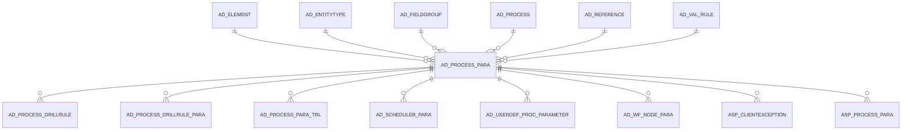

# AD_PROCESS_PARA

Area [AD](../../data-model/ad/index.md) · class **config** (proposed) · read from database `idempiere-db` (owner `ADEMPIERE`) · 1187 row(s) when profiled

Application model: `org.compiere.model.X_AD_Process_Para`, access level 4 - System.

## Columns

| column | type | key | not null | business name | references (code) | nulls | distinct |
|---|---|---|---|---|---|---|---|
| `AD_PROCESS_PARA_ID` | NUMBER(10,0) | PK | yes | Process Parameter |  | 0 | 1187 |
| `AD_CLIENT_ID` | NUMBER(10,0) |  | yes | Tenant |  | 0 | 1 |
| `AD_ORG_ID` | NUMBER(10,0) |  | yes | Organization |  | 0 | 1 |
| `ISACTIVE` | CHAR(1) |  | yes | Active |  | 0 | 2 |
| `CREATED` | DATE |  | yes | Created |  | 0 | 1142 |
| `CREATEDBY` | NUMBER(10,0) |  | yes | Created By |  | 0 | 3 |
| `UPDATED` | DATE |  | yes | Updated |  | 0 | 691 |
| `UPDATEDBY` | NUMBER(10,0) |  | yes | Updated By |  | 0 | 3 |
| `NAME` | VARCHAR2(60 CHAR) |  | yes | Name |  | 0 | 480 |
| `DESCRIPTION` | VARCHAR2(255 CHAR) |  |  | Description |  | 158 | 340 |
| `HELP` | VARCHAR2(2000 CHAR) |  |  | Comment/Help |  | 359 | 218 |
| `AD_PROCESS_ID` | NUMBER(10,0) |  | yes | Process | [AD_PROCESS](../../data-model/ad/ad_process.md) | 0 | 313 |
| `SEQNO` | NUMBER(10,0) |  | yes | Sequence |  | 0 | 44 |
| `AD_REFERENCE_ID` | NUMBER(10,0) |  | yes | Reference | [AD_REFERENCE](../../data-model/ad/ad_reference.md) | 0 | 20 |
| `AD_REFERENCE_VALUE_ID` | NUMBER(10,0) |  |  | Reference Key | [AD_REFERENCE](../../data-model/ad/ad_reference.md) | 912 | 93 |
| `AD_VAL_RULE_ID` | NUMBER(10,0) |  |  | Dynamic Validation | [AD_VAL_RULE](../../data-model/ad/ad_val_rule.md) | 1056 | 79 |
| `COLUMNNAME` | VARCHAR2(63 CHAR) |  | yes | DB Column Name |  | 0 | 464 |
| `ISCENTRALLYMAINTAINED` | CHAR(1) |  | yes | Centrally maintained |  | 0 | 2 |
| `FIELDLENGTH` | NUMBER(10,0) |  | yes | Length |  | 0 | 26 |
| `ISMANDATORY` | CHAR(1) |  | yes | Mandatory |  | 0 | 2 |
| `ISRANGE` | CHAR(1) |  | yes | Range |  | 0 | 2 |
| `DEFAULTVALUE` | VARCHAR2(2000 CHAR) |  |  | Default Logic |  | 823 | 77 |
| `DEFAULTVALUE2` | VARCHAR2(2000 CHAR) |  |  | Default Logic 2 |  | 1178 | 3 |
| `VFORMAT` | VARCHAR2(255 CHAR) |  |  | Value Format |  | 1185 | 1 |
| `VALUEMIN` | VARCHAR2(20 CHAR) |  |  | Min. Value |  | 1184 | 1 |
| `VALUEMAX` | VARCHAR2(20 CHAR) |  |  | Max. Value |  | 1186 | 1 |
| `AD_ELEMENT_ID` | NUMBER(10,0) |  |  | System Element | [AD_ELEMENT](../../data-model/ad/ad_element.md) | 175 | 368 |
| `ENTITYTYPE` | VARCHAR2(40 CHAR) |  | yes | Entity Type |  | 0 | 5 |
| `READONLYLOGIC` | VARCHAR2(2000 CHAR) |  |  | Read Only Logic |  | 1174 | 7 |
| `DISPLAYLOGIC` | VARCHAR2(2000 CHAR) |  |  | Display Logic |  | 1107 | 36 |
| `AD_PROCESS_PARA_UU` | VARCHAR2(36 CHAR) |  |  | AD_Process_Para_UU |  | 0 | 1187 |
| `ISENCRYPTED` | CHAR(1) |  | yes | Encrypted |  | 0 | 2 |
| `MANDATORYLOGIC` | VARCHAR2(2000 CHAR) |  |  | Mandatory Logic |  | 1175 | 10 |
| `PLACEHOLDER` | VARCHAR2(255 CHAR) |  |  | Placeholder |  | 1184 | 1 |
| `PLACEHOLDER2` | VARCHAR2(255 CHAR) |  |  | Placeholder2 |  | 1112 | 1 |
| `ISAUTOCOMPLETE` | CHAR(1) |  | yes | Auto complete |  | 0 | 1 |
| `AD_FIELDGROUP_ID` | NUMBER(10,0) |  |  | Field Group | [AD_FIELDGROUP](../../data-model/ad/ad_fieldgroup.md) | 1187 | 0 |
| `QUERY` | VARCHAR2(2000 CHAR) |  |  | Query |  | 1187 | 0 |
| `DATERANGEOPTION` | CHAR(1) |  | yes | Date Range Option |  | 0 | 1 |
| `ISSHOWNEGATEBUTTON` | CHAR(1) |  | yes | Show Negate Button |  | 0 | 2 |

*references (code)* is the table the application model's code says a column points to; *Foreign keys* below are the constraints the database declares. Counts come from the profile; no value is ever shown.

## Check constraints

| name | expression |
|---|---|
| `SYS_C0020636` | `IsAutocomplete IN ('Y','N')` |
| `SYS_C0020639` | `IsShowNegateButton IN ('Y','N')` |
| `SYS_C0020640` | `IsMandatory in ('Y','N')` |
| `SYS_C0020641` | `IsActive in ('Y','N')` |
| `SYS_C0020642` | `IsRange in ('Y','N')` |
| `SYS_C0020643` | `IsCentrallyMaintained in ('Y','N')` |
| `SYS_C0020644` | `IsEncrypted IN ('Y','N')` |

## Foreign keys

**References**

| table | columns | on delete |
|---|---|---|
| [AD_ELEMENT](../../data-model/ad/ad_element.md) | AD_PROCESS_PARA.AD_ELEMENT_ID → AD_ELEMENT.AD_ELEMENT_ID | NO ACTION |
| [AD_ENTITYTYPE](../../data-model/ad/ad_entitytype.md) | AD_PROCESS_PARA.ENTITYTYPE → AD_ENTITYTYPE.ENTITYTYPE | NO ACTION |
| [AD_FIELDGROUP](../../data-model/ad/ad_fieldgroup.md) | AD_PROCESS_PARA.AD_FIELDGROUP_ID → AD_FIELDGROUP.AD_FIELDGROUP_ID | NO ACTION |
| [AD_PROCESS](../../data-model/ad/ad_process.md) | AD_PROCESS_PARA.AD_PROCESS_ID → AD_PROCESS.AD_PROCESS_ID | CASCADE |
| [AD_REFERENCE](../../data-model/ad/ad_reference.md) | AD_PROCESS_PARA.AD_REFERENCE_VALUE_ID → AD_REFERENCE.AD_REFERENCE_ID | NO ACTION |
| [AD_VAL_RULE](../../data-model/ad/ad_val_rule.md) | AD_PROCESS_PARA.AD_VAL_RULE_ID → AD_VAL_RULE.AD_VAL_RULE_ID | NO ACTION |

**Referenced by**

| table | columns | on delete |
|---|---|---|
| [AD_PROCESS_DRILLRULE](../../data-model/ad/ad_process_drillrule.md) | AD_PROCESS_DRILLRULE.AD_PROCESS_PARA_ID → AD_PROCESS_PARA.AD_PROCESS_PARA_ID | NO ACTION |
| [AD_PROCESS_DRILLRULE_PARA](../../data-model/ad/ad_process_drillrule_para.md) | AD_PROCESS_DRILLRULE_PARA.AD_PROCESS_PARA_ID → AD_PROCESS_PARA.AD_PROCESS_PARA_ID | NO ACTION |
| [AD_PROCESS_PARA_TRL](../../data-model/ad/ad_process_para_trl.md) | AD_PROCESS_PARA_TRL.AD_PROCESS_PARA_ID → AD_PROCESS_PARA.AD_PROCESS_PARA_ID | CASCADE |
| [AD_SCHEDULER_PARA](../../data-model/ad/ad_scheduler_para.md) | AD_SCHEDULER_PARA.AD_PROCESS_PARA_ID → AD_PROCESS_PARA.AD_PROCESS_PARA_ID | CASCADE |
| [AD_USERDEF_PROC_PARAMETER](../../data-model/ad/ad_userdef_proc_parameter.md) | AD_USERDEF_PROC_PARAMETER.AD_PROCESS_PARA_ID → AD_PROCESS_PARA.AD_PROCESS_PARA_ID | NO ACTION |
| [AD_WF_NODE_PARA](../../data-model/ad/ad_wf_node_para.md) | AD_WF_NODE_PARA.AD_PROCESS_PARA_ID → AD_PROCESS_PARA.AD_PROCESS_PARA_ID | CASCADE |
| [ASP_CLIENTEXCEPTION](../../data-model/asp/asp_clientexception.md) | ASP_CLIENTEXCEPTION.AD_PROCESS_PARA_ID → AD_PROCESS_PARA.AD_PROCESS_PARA_ID | NO ACTION |
| [ASP_PROCESS_PARA](../../data-model/asp/asp_process_para.md) | ASP_PROCESS_PARA.AD_PROCESS_PARA_ID → AD_PROCESS_PARA.AD_PROCESS_PARA_ID | NO ACTION |

## Write behaviour

- updates: **raw_sql_skips_updated**
- deletes: **deleted_by_users, deleted_by_cascade**
- change log: **recorded**
- evidence: 10 citation(s)

## Read by

| kind | name |
|---|---|
| Procedure | [AD_Synchronize](../../logic/ad_synchronize.md) |

## Written by

| kind | name |
|---|---|
| Procedure | [AD_Synchronize](../../logic/ad_synchronize.md) |

## Schema history

88 change(s); the latest:

| applied | release | operation | column | tickets |
|---|---|---|---|---|
| 2024-04-03T12:26 | iD11 | `modify_column` | ColumnName | IDEMPIERE-6064 |
| 2024-04-03T12:26 | iD11 | `modify_column` | ColumnName | IDEMPIERE-6064 |
| 2023-04-09T15:47 | iD11 | `add_constraint` |  | IDEMPIERE-5567 |
| 2023-04-09T15:47 | iD11 | `add_constraint` |  | IDEMPIERE-5567 |
| 2023-03-02T09:10 | iD10 | `add_column` | IsShowNegateButton | IDEMPIERE-5595 |
| 2023-03-02T09:10 | iD10 | `add_column` | IsShowNegateButton | IDEMPIERE-5595 |
| 2023-02-06T08:40 | iD10 | `drop_column` | IsDisplayDateInWords | IDEMPIERE-5470 |
| 2023-02-06T08:40 | iD10 | `add_column` | DateRangeOption | IDEMPIERE-5470 |
| 2023-02-06T08:40 | iD10 | `add_column` | DateRangeOption | IDEMPIERE-5470 |
| 2023-02-06T08:40 | iD10 | `drop_column` | IsDisplayDateInWords | IDEMPIERE-5470 |
| 2022-12-02T08:05 | iD10 | `add_column` | IsDisplayDateInWords | IDEMPIERE-5470 |
| 2022-12-02T08:05 | iD10 | `add_column` | IsDisplayDateInWords | IDEMPIERE-5470 |
| 2021-12-05T16:45 | i8.2z | `add_constraint` |  | IDEMPIERE-5075 |
| 2021-12-05T16:45 | i8.2z | `drop_constraint` |  | IDEMPIERE-5075 |
| 2021-12-05T16:45 | i8.2z | `drop_constraint` |  | IDEMPIERE-5075 |

## Notes

<!-- ekos:manual id="table.ad_process_para.notes" -->
_Business notes about this table._
<!-- /ekos:manual -->
