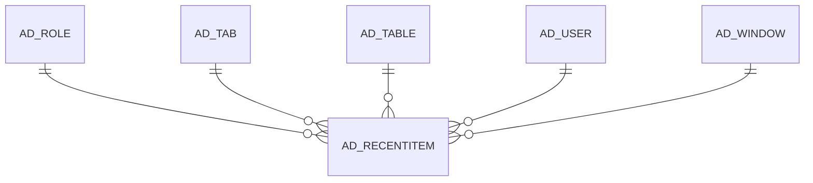

# AD_RECENTITEM

Area [AD](../../data-model/ad/index.md) · class **config** (proposed) · read from database `idempiere-db` (owner `ADEMPIERE`) · 0 row(s) when profiled

Application model: `org.compiere.model.X_AD_RecentItem`, access level 7 - System - Client - Org.

## Columns

| column | type | key | not null | business name | references (code) | nulls | distinct |
|---|---|---|---|---|---|---|---|
| `AD_CLIENT_ID` | NUMBER(10,0) |  | yes | Tenant |  | 0 | 0 |
| `AD_ORG_ID` | NUMBER(10,0) |  | yes | Organization |  | 0 | 0 |
| `AD_RECENTITEM_ID` | NUMBER(10,0) | PK | yes | Recent Item |  | 0 | 0 |
| `AD_ROLE_ID` | NUMBER(10,0) |  | yes | Role | [AD_ROLE](../../data-model/ad/ad_role.md) | 0 | 0 |
| `AD_TAB_ID` | NUMBER(10,0) |  |  | Tab | [AD_TAB](../../data-model/ad/ad_tab.md) | 0 | 0 |
| `AD_TABLE_ID` | NUMBER(10,0) |  | yes | Table | [AD_TABLE](../../data-model/ad/ad_table.md) | 0 | 0 |
| `AD_USER_ID` | NUMBER(10,0) |  |  | User/Contact | [AD_USER](../../data-model/ad/ad_user.md) | 0 | 0 |
| `AD_WINDOW_ID` | NUMBER(10,0) |  |  | Window | [AD_WINDOW](../../data-model/ad/ad_window.md) | 0 | 0 |
| `CREATED` | DATE |  | yes | Created |  | 0 | 0 |
| `CREATEDBY` | NUMBER(10,0) |  | yes | Created By |  | 0 | 0 |
| `ISACTIVE` | CHAR(1) |  | yes | Active |  | 0 | 0 |
| `RECORD_ID` | NUMBER(10,0) |  |  | Record ID |  | 0 | 0 |
| `UPDATED` | DATE |  | yes | Updated |  | 0 | 0 |
| `UPDATEDBY` | NUMBER(10,0) |  | yes | Updated By |  | 0 | 0 |
| `AD_RECENTITEM_UU` | VARCHAR2(36 CHAR) |  |  | AD_RecentItem_UU |  | 0 | 0 |
| `RECORD_UU` | VARCHAR2(36 CHAR) |  |  | Record UUID |  | 0 | 0 |

*references (code)* is the table the application model's code says a column points to; *Foreign keys* below are the constraints the database declares. Counts come from the profile; no value is ever shown.

## Check constraints

| name | expression |
|---|---|
| `SYS_C0021067` | `IsActive IN ('Y','N')` |

## Foreign keys

**References**

| table | columns | on delete |
|---|---|---|
| [AD_ROLE](../../data-model/ad/ad_role.md) | AD_RECENTITEM.AD_ROLE_ID → AD_ROLE.AD_ROLE_ID | CASCADE |
| [AD_TAB](../../data-model/ad/ad_tab.md) | AD_RECENTITEM.AD_TAB_ID → AD_TAB.AD_TAB_ID | CASCADE |
| [AD_TABLE](../../data-model/ad/ad_table.md) | AD_RECENTITEM.AD_TABLE_ID → AD_TABLE.AD_TABLE_ID | CASCADE |
| [AD_USER](../../data-model/ad/ad_user.md) | AD_RECENTITEM.AD_USER_ID → AD_USER.AD_USER_ID | CASCADE |
| [AD_WINDOW](../../data-model/ad/ad_window.md) | AD_RECENTITEM.AD_WINDOW_ID → AD_WINDOW.AD_WINDOW_ID | CASCADE |

**Referenced by**

_None._

## Write behaviour

- updates: **raw_sql_sets_updated**
- deletes: **deleted_by_app, deleted_by_users, deleted_by_cascade**
- change log: **not_recorded**
- evidence: 11 citation(s)

## Schema history

55 change(s); the latest:

| applied | release | operation | column | tickets |
|---|---|---|---|---|
| 2023-05-23T16:09 | iD11 | `create_index` |  | IDEMPIERE-5567 |
| 2023-05-23T16:09 | iD11 | `add_column` | Record_UU | IDEMPIERE-5567 |
| 2023-05-23T16:09 | iD11 | `create_index` |  | IDEMPIERE-5567 |
| 2023-05-23T16:09 | iD11 | `modify_column` | Record_ID | IDEMPIERE-5567 |
| 2023-05-23T16:09 | iD11 | `modify_column` | Record_ID | IDEMPIERE-5567 |
| 2023-05-23T16:09 | iD11 | `add_column` | Record_UU | IDEMPIERE-5567 |
| 2023-05-23T16:09 | iD11 | `create_index` |  | IDEMPIERE-5567 |
| 2023-05-23T16:09 | iD11 | `modify_column` | Record_ID | IDEMPIERE-5567 |
| 2023-05-23T16:09 | iD11 | `modify_column` | Record_ID | IDEMPIERE-5567 |
| 2023-05-23T16:09 | iD11 | `create_index` |  | IDEMPIERE-5567 |
| 2023-04-09T15:47 | iD11 | `add_constraint` |  | IDEMPIERE-5567 |
| 2023-04-09T15:47 | iD11 | `add_constraint` |  | IDEMPIERE-5567 |
| 2022-03-16T13:42 | i9 | `create_index` |  | IDEMPIERE-5221 |
| 2022-03-16T13:42 | i9 | `create_index` |  | IDEMPIERE-5221 |
| 2020-08-04T01:00 | i7.1z | `drop_column` | tmp_col_1_tmp | IDEMPIERE-3862 |

## Notes

<!-- ekos:manual id="table.ad_recentitem.notes" -->
_Business notes about this table._
<!-- /ekos:manual -->
