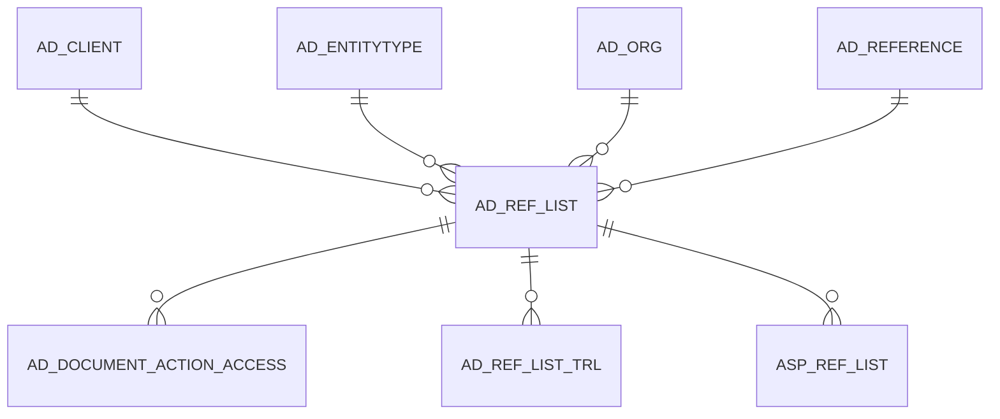

# AD_REF_LIST

Area [AD](../../data-model/ad/index.md) · class **config** (proposed) · read from database `idempiere-db` (owner `ADEMPIERE`) · 1499 row(s) when profiled

Application model: `org.compiere.model.X_AD_Ref_List`, access level 4 - System.

## Columns

| column | type | key | not null | business name | references (code) | nulls | distinct |
|---|---|---|---|---|---|---|---|
| `AD_REF_LIST_ID` | NUMBER(10,0) | PK | yes | Reference List |  | 0 | 1499 |
| `AD_CLIENT_ID` | NUMBER(10,0) |  | yes | Tenant |  | 0 | 1 |
| `AD_ORG_ID` | NUMBER(10,0) |  | yes | Organization |  | 0 | 1 |
| `ISACTIVE` | CHAR(1) |  | yes | Active |  | 0 | 2 |
| `CREATED` | DATE |  | yes | Created |  | 0 | 1238 |
| `CREATEDBY` | NUMBER(10,0) |  | yes | Created By |  | 0 | 3 |
| `UPDATED` | DATE |  | yes | Updated |  | 0 | 987 |
| `UPDATEDBY` | NUMBER(10,0) |  | yes | Updated By |  | 0 | 3 |
| `VALUE` | VARCHAR2(60 CHAR) |  | yes | Search Key |  | 0 | 520 |
| `NAME` | VARCHAR2(60 CHAR) |  | yes | Name |  | 0 | 1202 |
| `DESCRIPTION` | VARCHAR2(255 CHAR) |  |  | Description |  | 1206 | 275 |
| `AD_REFERENCE_ID` | NUMBER(10,0) |  | yes | Reference | [AD_REFERENCE](../../data-model/ad/ad_reference.md) | 0 | 301 |
| `VALIDFROM` | DATE |  |  | Valid from |  | 1499 | 0 |
| `VALIDTO` | DATE |  |  | Valid to |  | 1499 | 0 |
| `ENTITYTYPE` | VARCHAR2(40 CHAR) |  | yes | Entity Type |  | 0 | 5 |
| `AD_REF_LIST_UU` | VARCHAR2(36 CHAR) |  |  | AD_Ref_List_UU |  | 0 | 1499 |

*references (code)* is the table the application model's code says a column points to; *Foreign keys* below are the constraints the database declares. Counts come from the profile; no value is ever shown.

## Check constraints

| name | expression |
|---|---|
| `SYS_C0020682` | `IsActive in ('Y','N')` |

## Foreign keys

**References**

| table | columns | on delete |
|---|---|---|
| [AD_CLIENT](../../data-model/ad/ad_client.md) | AD_REF_LIST.AD_CLIENT_ID → AD_CLIENT.AD_CLIENT_ID | NO ACTION |
| [AD_ENTITYTYPE](../../data-model/ad/ad_entitytype.md) | AD_REF_LIST.ENTITYTYPE → AD_ENTITYTYPE.ENTITYTYPE | NO ACTION |
| [AD_ORG](../../data-model/ad/ad_org.md) | AD_REF_LIST.AD_ORG_ID → AD_ORG.AD_ORG_ID | NO ACTION |
| [AD_REFERENCE](../../data-model/ad/ad_reference.md) | AD_REF_LIST.AD_REFERENCE_ID → AD_REFERENCE.AD_REFERENCE_ID | CASCADE |

**Referenced by**

| table | columns | on delete |
|---|---|---|
| [AD_DOCUMENT_ACTION_ACCESS](../../data-model/ad/ad_document_action_access.md) | AD_DOCUMENT_ACTION_ACCESS.AD_REF_LIST_ID → AD_REF_LIST.AD_REF_LIST_ID | NO ACTION |
| [AD_REF_LIST_TRL](../../data-model/ad/ad_ref_list_trl.md) | AD_REF_LIST_TRL.AD_REF_LIST_ID → AD_REF_LIST.AD_REF_LIST_ID | CASCADE |
| [ASP_REF_LIST](../../data-model/asp/asp_ref_list.md) | ASP_REF_LIST.AD_REF_LIST_ID → AD_REF_LIST.AD_REF_LIST_ID | NO ACTION |

## Write behaviour

- updates: **po_only**
- deletes: **deleted_by_users, deleted_by_cascade**
- change log: **recorded**
- evidence: 2 citation(s)

## Schema history

29 change(s); the latest:

| applied | release | operation | column | tickets |
|---|---|---|---|---|
| 2023-04-09T15:47 | iD11 | `add_constraint` |  | IDEMPIERE-5567 |
| 2023-04-09T15:47 | iD11 | `add_constraint` |  | IDEMPIERE-5567 |
| 2021-12-05T16:45 | i8.2z | `drop_constraint` |  | IDEMPIERE-5075 |
| 2021-12-05T16:45 | i8.2z | `drop_constraint` |  | IDEMPIERE-5075 |
| 2021-12-05T16:45 | i8.2z | `drop_constraint` |  | IDEMPIERE-5075 |
| 2021-12-05T16:45 | i8.2z | `drop_constraint` |  | IDEMPIERE-5075 |
| 2021-12-05T16:45 | i8.2z | `add_constraint` |  | IDEMPIERE-5075 |
| 2021-12-05T16:45 | i8.2z | `add_constraint` |  | IDEMPIERE-5075 |
| 2021-12-05T16:45 | i8.2z | `add_constraint` |  | IDEMPIERE-5075 |
| 2021-12-05T16:45 | i8.2z | `add_constraint` |  | IDEMPIERE-5075 |
| 2020-08-04T01:00 | i7.1z | `modify_column` | NAME | IDEMPIERE-3862 |
| 2020-08-04T01:00 | i7.1z | `add_column` | tmp_col_1_tmp | IDEMPIERE-3862 |
| 2020-08-04T01:00 | i7.1z | `drop_column` | tmp_col_4_tmp | IDEMPIERE-3862 |
| 2020-08-04T01:00 | i7.1z | `modify_column` | VALUE | IDEMPIERE-3862 |
| 2020-08-04T01:00 | i7.1z | `drop_column` | tmp_col_1_tmp | IDEMPIERE-3862 |

## Notes

<!-- ekos:manual id="table.ad_ref_list.notes" -->
_Business notes about this table._
<!-- /ekos:manual -->
