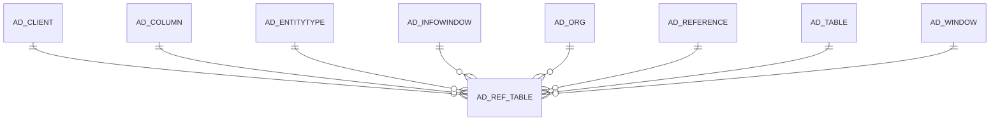

# AD_REF_TABLE

Area [AD](../../data-model/ad/index.md) · class **config** (proposed) · read from database `idempiere-db` (owner `ADEMPIERE`) · 233 row(s) when profiled

Application model: `org.compiere.model.X_AD_Ref_Table`, access level 4 - System.

## Columns

| column | type | key | not null | business name | references (code) | nulls | distinct |
|---|---|---|---|---|---|---|---|
| `AD_REFERENCE_ID` | NUMBER(10,0) | PK | yes | Reference | [AD_REFERENCE](../../data-model/ad/ad_reference.md) | 0 | 233 |
| `AD_CLIENT_ID` | NUMBER(10,0) |  | yes | Tenant |  | 0 | 1 |
| `AD_ORG_ID` | NUMBER(10,0) |  | yes | Organization |  | 0 | 1 |
| `ISACTIVE` | CHAR(1) |  | yes | Active |  | 0 | 1 |
| `CREATED` | DATE |  | yes | Created |  | 0 | 205 |
| `CREATEDBY` | NUMBER(10,0) |  | yes | Created By |  | 0 | 3 |
| `UPDATED` | DATE |  | yes | Updated |  | 0 | 145 |
| `UPDATEDBY` | NUMBER(10,0) |  | yes | Updated By |  | 0 | 3 |
| `AD_TABLE_ID` | NUMBER(10,0) |  | yes | Table | [AD_TABLE](../../data-model/ad/ad_table.md) | 0 | 149 |
| `AD_KEY` | NUMBER(10,0) |  | yes | Key column |  | 0 | 149 |
| `AD_DISPLAY` | NUMBER(10,0) |  | yes | Display column |  | 0 | 157 |
| `ISVALUEDISPLAYED` | CHAR(1) |  | yes | Display Value |  | 0 | 1 |
| `WHERECLAUSE` | VARCHAR2(2000 CHAR) |  |  | Sql WHERE |  | 137 | 96 |
| `ORDERBYCLAUSE` | VARCHAR2(2000 CHAR) |  |  | Sql ORDER BY |  | 181 | 32 |
| `ENTITYTYPE` | VARCHAR2(40 CHAR) |  | yes | Entity Type |  | 0 | 4 |
| `AD_WINDOW_ID` | NUMBER(10,0) |  |  | Window | [AD_WINDOW](../../data-model/ad/ad_window.md) | 226 | 6 |
| `AD_REF_TABLE_UU` | VARCHAR2(36 CHAR) |  |  | AD_Ref_Table_UU |  | 0 | 233 |
| `AD_INFOWINDOW_ID` | NUMBER(10,0) |  |  | Info Window | [AD_INFOWINDOW](../../data-model/ad/ad_infowindow.md) | 233 | 0 |

*references (code)* is the table the application model's code says a column points to; *Foreign keys* below are the constraints the database declares. Counts come from the profile; no value is ever shown.

## Check constraints

| name | expression |
|---|---|
| `SYS_C0021173` | `isValueDisplayed in ('Y','N')` |
| `SYS_C0021174` | `IsActive in ('Y','N')` |

## Foreign keys

**References**

| table | columns | on delete |
|---|---|---|
| [AD_CLIENT](../../data-model/ad/ad_client.md) | AD_REF_TABLE.AD_CLIENT_ID → AD_CLIENT.AD_CLIENT_ID | NO ACTION |
| [AD_COLUMN](../../data-model/ad/ad_column.md) | AD_REF_TABLE.AD_DISPLAY → AD_COLUMN.AD_COLUMN_ID | NO ACTION |
| [AD_ENTITYTYPE](../../data-model/ad/ad_entitytype.md) | AD_REF_TABLE.ENTITYTYPE → AD_ENTITYTYPE.ENTITYTYPE | NO ACTION |
| [AD_INFOWINDOW](../../data-model/ad/ad_infowindow.md) | AD_REF_TABLE.AD_INFOWINDOW_ID → AD_INFOWINDOW.AD_INFOWINDOW_ID | NO ACTION |
| [AD_ORG](../../data-model/ad/ad_org.md) | AD_REF_TABLE.AD_ORG_ID → AD_ORG.AD_ORG_ID | NO ACTION |
| [AD_REFERENCE](../../data-model/ad/ad_reference.md) | AD_REF_TABLE.AD_REFERENCE_ID → AD_REFERENCE.AD_REFERENCE_ID | CASCADE |
| [AD_TABLE](../../data-model/ad/ad_table.md) | AD_REF_TABLE.AD_TABLE_ID → AD_TABLE.AD_TABLE_ID | NO ACTION |
| [AD_WINDOW](../../data-model/ad/ad_window.md) | AD_REF_TABLE.AD_WINDOW_ID → AD_WINDOW.AD_WINDOW_ID | NO ACTION |

**Referenced by**

_None._

## Write behaviour

- updates: **po_only**
- deletes: **deleted_by_users, deleted_by_cascade**
- change log: **recorded**
- evidence: 2 citation(s)

## Schema history

36 change(s); the latest:

| applied | release | operation | column | tickets |
|---|---|---|---|---|
| 2024-06-06T06:55 | iD13 | `add_column` | IsDisplayIdentifier | IDEMPIERE-6163 |
| 2024-06-06T06:55 | iD13 | `add_column` | DisplaySQL | IDEMPIERE-6163 |
| 2024-06-06T06:55 | iD13 | `add_column` | IsDisplayIdentifier | IDEMPIERE-6163 |
| 2024-06-06T06:55 | iD13 | `add_column` | DisplaySQL | IDEMPIERE-6163 |
| 2023-04-09T15:47 | iD11 | `add_constraint` |  | IDEMPIERE-5567 |
| 2023-04-09T15:47 | iD11 | `add_constraint` |  | IDEMPIERE-5567 |
| 2021-12-05T16:45 | i8.2z | `drop_constraint` |  | IDEMPIERE-5075 |
| 2021-12-05T16:45 | i8.2z | `drop_constraint` |  | IDEMPIERE-5075 |
| 2021-12-05T16:45 | i8.2z | `drop_constraint` |  | IDEMPIERE-5075 |
| 2021-12-05T16:45 | i8.2z | `drop_constraint` |  | IDEMPIERE-5075 |
| 2021-12-05T16:45 | i8.2z | `drop_constraint` |  | IDEMPIERE-5075 |
| 2021-12-05T16:45 | i8.2z | `add_constraint` |  | IDEMPIERE-5075 |
| 2021-12-05T16:45 | i8.2z | `add_constraint` |  | IDEMPIERE-5075 |
| 2021-12-05T16:45 | i8.2z | `add_constraint` |  | IDEMPIERE-5075 |
| 2021-12-05T16:45 | i8.2z | `add_constraint` |  | IDEMPIERE-5075 |

## Open conflicts

| type | attribute | explanation |
|---|---|---|
| `model_column_missing` | `columns.DisplaySQL` | unexplained |
| `model_column_missing` | `columns.IsDisplayIdentifier` | unexplained |

## Notes

<!-- ekos:manual id="table.ad_ref_table.notes" -->
_Business notes about this table._
<!-- /ekos:manual -->
