# AD_REFERENCE

Area [AD](../../data-model/ad/index.md) · class **config** (proposed) · read from database `idempiere-db` (owner `ADEMPIERE`) · 586 row(s) when profiled

Application model: `org.compiere.model.X_AD_Reference`, access level 4 - System.

## Columns

| column | type | key | not null | business name | references (code) | nulls | distinct |
|---|---|---|---|---|---|---|---|
| `AD_REFERENCE_ID` | NUMBER(10,0) | PK | yes | Reference |  | 0 | 586 |
| `AD_CLIENT_ID` | NUMBER(10,0) |  | yes | Tenant |  | 0 | 1 |
| `AD_ORG_ID` | NUMBER(10,0) |  | yes | Organization |  | 0 | 1 |
| `ISACTIVE` | CHAR(1) |  | yes | Active |  | 0 | 2 |
| `CREATED` | DATE |  | yes | Created |  | 0 | 500 |
| `CREATEDBY` | NUMBER(10,0) |  | yes | Created By |  | 0 | 3 |
| `UPDATED` | DATE |  | yes | Updated |  | 0 | 418 |
| `UPDATEDBY` | NUMBER(10,0) |  | yes | Updated By |  | 0 | 3 |
| `NAME` | VARCHAR2(60 CHAR) |  | yes | Name |  | 0 | 586 |
| `DESCRIPTION` | VARCHAR2(255 CHAR) |  |  | Description |  | 319 | 253 |
| `HELP` | VARCHAR2(2000 CHAR) |  |  | Comment/Help |  | 564 | 21 |
| `VALIDATIONTYPE` | CHAR(1) |  | yes | Validation type |  | 0 | 3 |
| `VFORMAT` | VARCHAR2(40 CHAR) |  |  | Value Format |  | 533 | 12 |
| `ENTITYTYPE` | VARCHAR2(40 CHAR) |  | yes | Entity Type |  | 0 | 5 |
| `ISORDERBYVALUE` | CHAR(1) |  |  | Order By Value |  | 0 | 2 |
| `AD_REFERENCE_UU` | VARCHAR2(36 CHAR) |  |  | AD_Reference_UU |  | 0 | 586 |
| `AD_ELEMENT_ID` | NUMBER(10,0) |  |  | System Element | [AD_ELEMENT](../../data-model/ad/ad_element.md) | 585 | 1 |
| `SHOWINACTIVE` | VARCHAR2(4 CHAR) |  | yes | Show Inactive |  | 0 | 1 |

*references (code)* is the table the application model's code says a column points to; *Foreign keys* below are the constraints the database declares. Counts come from the profile; no value is ever shown.

## Check constraints

| name | expression |
|---|---|
| `SYS_C0020074` | `IsActive in ('Y','N')` |

## Foreign keys

**References**

| table | columns | on delete |
|---|---|---|
| [AD_CLIENT](../../data-model/ad/ad_client.md) | AD_REFERENCE.AD_CLIENT_ID → AD_CLIENT.AD_CLIENT_ID | NO ACTION |
| [AD_ELEMENT](../../data-model/ad/ad_element.md) | AD_REFERENCE.AD_ELEMENT_ID → AD_ELEMENT.AD_ELEMENT_ID | NO ACTION |
| [AD_ENTITYTYPE](../../data-model/ad/ad_entitytype.md) | AD_REFERENCE.ENTITYTYPE → AD_ENTITYTYPE.ENTITYTYPE | NO ACTION |
| [AD_ORG](../../data-model/ad/ad_org.md) | AD_REFERENCE.AD_ORG_ID → AD_ORG.AD_ORG_ID | NO ACTION |

**Referenced by**

| table | columns | on delete |
|---|---|---|
| [AD_ATTRIBUTE](../../data-model/ad/ad_attribute.md) | AD_ATTRIBUTE.AD_REFERENCE_VALUE_ID → AD_REFERENCE.AD_REFERENCE_ID | NO ACTION |
| [AD_COLUMN](../../data-model/ad/ad_column.md) | AD_COLUMN.AD_REFERENCE_ID → AD_REFERENCE.AD_REFERENCE_ID | NO ACTION |
| [AD_FIELD](../../data-model/ad/ad_field.md) | AD_FIELD.AD_REFERENCE_VALUE_ID → AD_REFERENCE.AD_REFERENCE_ID | NO ACTION |
| [AD_INFOCOLUMN](../../data-model/ad/ad_infocolumn.md) | AD_INFOCOLUMN.AD_REFERENCE_VALUE_ID → AD_REFERENCE.AD_REFERENCE_ID | NO ACTION |
| [AD_PACKAGE_EXP_DETAIL](../../data-model/ad/ad_package_exp_detail.md) | AD_PACKAGE_EXP_DETAIL.AD_REFERENCE_ID → AD_REFERENCE.AD_REFERENCE_ID | NO ACTION |
| [AD_PACKAGE_IMP_BACKUP](../../data-model/ad/ad_package_imp_backup.md) | AD_PACKAGE_IMP_BACKUP.AD_REFERENCE_ID → AD_REFERENCE.AD_REFERENCE_ID | NO ACTION |
| [AD_PROCESS_PARA](../../data-model/ad/ad_process_para.md) | AD_PROCESS_PARA.AD_REFERENCE_VALUE_ID → AD_REFERENCE.AD_REFERENCE_ID | NO ACTION |
| [AD_REFERENCE_TRL](../../data-model/ad/ad_reference_trl.md) | AD_REFERENCE_TRL.AD_REFERENCE_ID → AD_REFERENCE.AD_REFERENCE_ID | CASCADE |
| [AD_REF_LIST](../../data-model/ad/ad_ref_list.md) | AD_REF_LIST.AD_REFERENCE_ID → AD_REFERENCE.AD_REFERENCE_ID | CASCADE |
| [AD_REF_TABLE](../../data-model/ad/ad_ref_table.md) | AD_REF_TABLE.AD_REFERENCE_ID → AD_REFERENCE.AD_REFERENCE_ID | CASCADE |
| [AD_RELATIONTYPE](../../data-model/ad/ad_relationtype.md) | AD_RELATIONTYPE.AD_REFERENCE_SOURCE_ID → AD_REFERENCE.AD_REFERENCE_ID | NO ACTION |
| [AD_USERDEF_FIELD](../../data-model/ad/ad_userdef_field.md) | AD_USERDEF_FIELD.AD_REFERENCE_VALUE_ID → AD_REFERENCE.AD_REFERENCE_ID | NO ACTION |
| [AD_USERDEF_INFO_COLUMN](../../data-model/ad/ad_userdef_info_column.md) | AD_USERDEF_INFO_COLUMN.AD_REFERENCE_VALUE_ID → AD_REFERENCE.AD_REFERENCE_ID | NO ACTION |
| [AD_USERDEF_PROC_PARAMETER](../../data-model/ad/ad_userdef_proc_parameter.md) | AD_USERDEF_PROC_PARAMETER.AD_REFERENCE_VALUE_ID → AD_REFERENCE.AD_REFERENCE_ID | NO ACTION |
| [ASP_REF_LIST](../../data-model/asp/asp_ref_list.md) | ASP_REF_LIST.AD_REFERENCE_ID → AD_REFERENCE.AD_REFERENCE_ID | NO ACTION |
| [A_REGISTRATIONATTRIBUTE](../../data-model/a/a_registrationattribute.md) | A_REGISTRATIONATTRIBUTE.AD_REFERENCE_VALUE_ID → AD_REFERENCE.AD_REFERENCE_ID | NO ACTION |
| [HR_CONCEPT](../../data-model/hr/hr_concept.md) | HR_CONCEPT.AD_REFERENCE_ID → AD_REFERENCE.AD_REFERENCE_ID | NO ACTION |
| [M_ATTRIBUTE](../../data-model/m/m_attribute.md) | M_ATTRIBUTE.AD_REFERENCE_VALUE_ID → AD_REFERENCE.AD_REFERENCE_ID | NO ACTION |
| [WS_WEBSERVICEFIELDINPUT](../../data-model/ws/ws_webservicefieldinput.md) | WS_WEBSERVICEFIELDINPUT.AD_REFERENCE_VALUE_ID → AD_REFERENCE.AD_REFERENCE_ID | NO ACTION |

```mermaid
erDiagram
  AD_CLIENT ||--o{ AD_REFERENCE : ""
  AD_ELEMENT ||--o{ AD_REFERENCE : ""
  AD_ENTITYTYPE ||--o{ AD_REFERENCE : ""
  AD_ORG ||--o{ AD_REFERENCE : ""
  AD_REFERENCE ||--o{ AD_ATTRIBUTE : ""
  AD_REFERENCE ||--o{ AD_COLUMN : ""
  AD_REFERENCE ||--o{ AD_FIELD : ""
  AD_REFERENCE ||--o{ AD_INFOCOLUMN : ""
  AD_REFERENCE ||--o{ AD_PACKAGE_EXP_DETAIL : ""
  AD_REFERENCE ||--o{ AD_PACKAGE_IMP_BACKUP : ""
  AD_REFERENCE ||--o{ AD_PROCESS_PARA : ""
  AD_REFERENCE ||--o{ AD_REFERENCE_TRL : ""
  AD_REFERENCE ||--o{ AD_REF_LIST : ""
  AD_REFERENCE ||--o{ AD_REF_TABLE : ""
  AD_REFERENCE ||--o{ AD_RELATIONTYPE : ""
  AD_REFERENCE ||--o{ AD_USERDEF_FIELD : ""
  AD_REFERENCE ||--o{ AD_USERDEF_INFO_COLUMN : ""
  AD_REFERENCE ||--o{ AD_USERDEF_PROC_PARAMETER : ""
  AD_REFERENCE ||--o{ ASP_REF_LIST : ""
  AD_REFERENCE ||--o{ A_REGISTRATIONATTRIBUTE : ""
  AD_REFERENCE ||--o{ HR_CONCEPT : ""
  AD_REFERENCE ||--o{ M_ATTRIBUTE : ""
  AD_REFERENCE ||--o{ WS_WEBSERVICEFIELDINPUT : ""
```

## Write behaviour

- updates: **po_only**
- deletes: **deleted_by_users**
- change log: **recorded**
- evidence: 1 citation(s)

## Read by

| kind | name |
|---|---|
| View | `ad_field_v` |
| View | `ad_field_vt` |

## Schema history

32 change(s); the latest:

| applied | release | operation | column | tickets |
|---|---|---|---|---|
| 2023-04-09T15:47 | iD11 | `add_constraint` |  | IDEMPIERE-5567 |
| 2023-04-09T15:47 | iD11 | `add_constraint` |  | IDEMPIERE-5567 |
| 2023-02-13T15:20 | iD10 | `add_column` | ShowInactive | IDEMPIERE-5573 |
| 2023-02-13T15:20 | iD10 | `add_column` | ShowInactive | IDEMPIERE-5573 |
| 2021-12-05T16:45 | i8.2z | `add_constraint` |  | IDEMPIERE-5075 |
| 2021-12-05T16:45 | i8.2z | `drop_constraint` |  | IDEMPIERE-5075 |
| 2021-12-05T16:45 | i8.2z | `drop_constraint` |  | IDEMPIERE-5075 |
| 2021-12-05T16:45 | i8.2z | `add_constraint` |  | IDEMPIERE-5075 |
| 2021-12-05T16:45 | i8.2z | `add_constraint` |  | IDEMPIERE-5075 |
| 2021-12-05T16:45 | i8.2z | `drop_constraint` |  | IDEMPIERE-5075 |
| 2020-08-04T01:00 | i7.1z | `modify_column` | ENTITYTYPE | IDEMPIERE-3862 |
| 2020-08-04T01:00 | i7.1z | `drop_column` | tmp_col_5_tmp | IDEMPIERE-3862 |
| 2020-08-04T01:00 | i7.1z | `drop_column` | tmp_col_4_tmp | IDEMPIERE-3862 |
| 2020-08-04T01:00 | i7.1z | `drop_column` | tmp_col_1_tmp | IDEMPIERE-3862 |
| 2020-08-04T01:00 | i7.1z | `modify_column` | AD_REFERENCE_UU | IDEMPIERE-3862 |

## Notes

<!-- ekos:manual id="table.ad_reference.notes" -->
_Business notes about this table._
<!-- /ekos:manual -->
