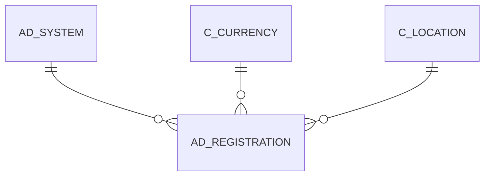

# AD_REGISTRATION

System Registration (Singeton)

Area [AD](../../data-model/ad/index.md) · class **config** (proposed) · read from database `idempiere-db` (owner `ADEMPIERE`) · 0 row(s) when profiled

Application model: `org.compiere.model.X_AD_Registration`, access level 4 - System.

## Columns

| column | type | key | not null | business name | references (code) | nulls | distinct |
|---|---|---|---|---|---|---|---|
| `AD_REGISTRATION_ID` | NUMBER(10,0) | PK | yes | System Registration |  | 0 | 0 |
| `AD_CLIENT_ID` | NUMBER(10,0) | PK | yes | Tenant |  | 0 | 0 |
| `AD_SYSTEM_ID` | NUMBER(10,0) | PK | yes | System | [AD_SYSTEM](../../data-model/ad/ad_system.md) | 0 | 0 |
| `AD_ORG_ID` | NUMBER(10,0) |  | yes | Organization |  | 0 | 0 |
| `ISACTIVE` | CHAR(1) |  | yes | Active |  | 0 | 0 |
| `CREATED` | DATE |  | yes | Created |  | 0 | 0 |
| `CREATEDBY` | NUMBER(10,0) |  | yes | Created By |  | 0 | 0 |
| `UPDATED` | DATE |  | yes | Updated |  | 0 | 0 |
| `UPDATEDBY` | NUMBER(10,0) |  | yes | Updated By |  | 0 | 0 |
| `ISREGISTERED` | CHAR(1) |  | yes | Registered |  | 0 | 0 |
| `RECORD_ID` | NUMBER(10,0) |  |  | Record ID |  | 0 | 0 |
| `DESCRIPTION` | VARCHAR2(255 CHAR) |  |  | Description |  | 0 | 0 |
| `C_LOCATION_ID` | NUMBER(10,0) |  |  | Address | [C_LOCATION](../../data-model/c/c_location.md) | 0 | 0 |
| `ISINPRODUCTION` | CHAR(1) |  | yes | In Production |  | 0 | 0 |
| `STARTPRODUCTIONDATE` | DATE |  |  | Start Implementation/Production |  | 0 | 0 |
| `ISALLOWPUBLISH` | CHAR(1) |  | yes | Allowed to be Published |  | 0 | 0 |
| `ISALLOWSTATISTICS` | CHAR(1) |  | yes | Maintain Statistics |  | 0 | 0 |
| `PLATFORMINFO` | VARCHAR2(255 CHAR) |  |  | Platform Info |  | 0 | 0 |
| `INDUSTRYINFO` | VARCHAR2(255 CHAR) |  |  | Industry Info |  | 0 | 0 |
| `SALESVOLUME` | NUMBER(10,0) |  |  | Sales Volume in 1.000 |  | 0 | 0 |
| `C_CURRENCY_ID` | NUMBER(10,0) |  |  | Currency | [C_CURRENCY](../../data-model/c/c_currency.md) | 0 | 0 |
| `NUMBEREMPLOYEES` | NUMBER(10,0) |  |  | Employees |  | 0 | 0 |
| `PROCESSING` | CHAR(1) |  |  | Process Now |  | 0 | 0 |
| `REMOTE_HOST` | VARCHAR2(120 CHAR) |  |  | Remote Host |  | 0 | 0 |
| `REMOTE_ADDR` | VARCHAR2(60 CHAR) |  |  | Remote Addr |  | 0 | 0 |
| `AD_REGISTRATION_UU` | VARCHAR2(36 CHAR) |  |  | AD_Registration_UU |  | 0 | 0 |

*references (code)* is the table the application model's code says a column points to; *Foreign keys* below are the constraints the database declares. Counts come from the profile; no value is ever shown.

## Check constraints

| name | expression |
|---|---|
| `SYS_C0021700` | `IsActive in ('Y','N')` |
| `SYS_C0021701` | `IsInProduction in ('Y','N')` |
| `SYS_C0021702` | `IsRegistered in ('Y','N')` |
| `SYS_C0021703` | `IsAllowPublish in ('Y','N')` |
| `SYS_C0021704` | `IsAllowStatistics in ('Y','N')` |

## Foreign keys

**References**

| table | columns | on delete |
|---|---|---|
| [AD_SYSTEM](../../data-model/ad/ad_system.md) | AD_REGISTRATION.AD_SYSTEM_ID, AD_CLIENT_ID → AD_SYSTEM.AD_SYSTEM_ID, AD_CLIENT_ID | NO ACTION |
| [C_CURRENCY](../../data-model/c/c_currency.md) | AD_REGISTRATION.C_CURRENCY_ID → C_CURRENCY.C_CURRENCY_ID | NO ACTION |
| [C_LOCATION](../../data-model/c/c_location.md) | AD_REGISTRATION.C_LOCATION_ID → C_LOCATION.C_LOCATION_ID | NO ACTION |

**Referenced by**

_None._

## Write behaviour

- updates: **po_only**
- deletes: **soft_delete_only**
- change log: **recorded**
- evidence: 1 citation(s)

## Schema history

26 change(s); the latest:

| applied | release | operation | column | tickets |
|---|---|---|---|---|
| 2023-04-09T15:47 | iD11 | `add_constraint` |  | IDEMPIERE-5567 |
| 2023-04-09T15:47 | iD11 | `add_constraint` |  | IDEMPIERE-5567 |
| 2021-12-05T16:45 | i8.2z | `drop_constraint` |  | IDEMPIERE-5075 |
| 2021-12-05T16:45 | i8.2z | `add_constraint` |  | IDEMPIERE-5075 |
| 2021-12-05T16:45 | i8.2z | `drop_constraint` |  | IDEMPIERE-5075 |
| 2021-12-05T16:45 | i8.2z | `add_constraint` |  | IDEMPIERE-5075 |
| 2021-12-05T16:45 | i8.2z | `drop_constraint` |  | IDEMPIERE-5075 |
| 2021-12-05T16:45 | i8.2z | `add_constraint` |  | IDEMPIERE-5075 |
| 2020-08-04T01:00 | i7.1z | `modify_column` | INDUSTRYINFO | IDEMPIERE-3862 |
| 2020-08-04T01:00 | i7.1z | `add_column` | tmp_col_4_tmp | IDEMPIERE-3862 |
| 2020-08-04T01:00 | i7.1z | `modify_column` | DESCRIPTION | IDEMPIERE-3862 |
| 2020-08-04T01:00 | i7.1z | `drop_column` | tmp_col_6_tmp | IDEMPIERE-3862 |
| 2020-08-04T01:00 | i7.1z | `drop_column` | tmp_col_5_tmp | IDEMPIERE-3862 |
| 2020-08-04T01:00 | i7.1z | `drop_column` | tmp_col_3_tmp | IDEMPIERE-3862 |
| 2020-08-04T01:00 | i7.1z | `drop_column` | tmp_col_2_tmp | IDEMPIERE-3862 |

## Notes

<!-- ekos:manual id="table.ad_registration.notes" -->
_Business notes about this table._
<!-- /ekos:manual -->
