# AD_ROLE

Area [AD](../../data-model/ad/index.md) · class **config** (proposed) · read from database `idempiere-db` (owner `ADEMPIERE`) · 5 row(s) when profiled

Application model: `org.compiere.model.X_AD_Role`, access level 6 - System - Client.

## Columns

| column | type | key | not null | business name | references (code) | nulls | distinct |
|---|---|---|---|---|---|---|---|
| `AD_ROLE_ID` | NUMBER(10,0) | PK | yes | Role |  | 0 | 5 |
| `AD_CLIENT_ID` | NUMBER(10,0) |  | yes | Tenant |  | 0 | 2 |
| `AD_ORG_ID` | NUMBER(10,0) |  | yes | Organization |  | 0 | 1 |
| `ISACTIVE` | CHAR(1) |  | yes | Active |  | 0 | 1 |
| `CREATED` | DATE |  | yes | Created |  | 0 | 4 |
| `CREATEDBY` | NUMBER(10,0) |  | yes | Created By |  | 0 | 2 |
| `UPDATED` | DATE |  | yes | Updated |  | 0 | 4 |
| `NAME` | VARCHAR2(60 CHAR) |  | yes | Name |  | 0 | 5 |
| `UPDATEDBY` | NUMBER(10,0) |  | yes | Updated By |  | 0 | 1 |
| `DESCRIPTION` | VARCHAR2(255 CHAR) |  |  | Description |  | 1 | 4 |
| `USERLEVEL` | CHAR(3) |  | yes | User Level |  | 0 | 3 |
| `C_CURRENCY_ID` | NUMBER(10,0) |  |  | Currency | [C_CURRENCY](../../data-model/c/c_currency.md) | 1 | 1 |
| `AMTAPPROVAL` | NUMBER |  |  | Approval Amount |  | 0 | 3 |
| `AD_TREE_MENU_ID` | NUMBER(10,0) |  |  | Menu Tree | [AD_TREE](../../data-model/ad/ad_tree.md) | 5 | 0 |
| `ISMANUAL` | CHAR(1) |  | yes | Manual |  | 0 | 2 |
| `ISSHOWACCT` | CHAR(1) |  | yes | Show Accounting |  | 0 | 2 |
| `ISPERSONALLOCK` | CHAR(1) |  | yes | Personal Lock |  | 0 | 2 |
| `ISPERSONALACCESS` | CHAR(1) |  | yes | Personal Access |  | 0 | 1 |
| `ISCANEXPORT` | CHAR(1) |  | yes | Can Export |  | 0 | 2 |
| `ISCANREPORT` | CHAR(1) |  | yes | Can Report |  | 0 | 2 |
| `SUPERVISOR_ID` | NUMBER(10,0) |  |  | Supervisor | [AD_USER](../../data-model/ad/ad_user.md) | 4 | 1 |
| `ISCANAPPROVEOWNDOC` | CHAR(1) |  | yes | Approve own Documents |  | 0 | 2 |
| `ISACCESSALLORGS` | CHAR(1) |  | yes | Access all Orgs |  | 0 | 2 |
| `ISCHANGELOG` | CHAR(1) |  | yes | Maintain Change Log |  | 0 | 2 |
| `PREFERENCETYPE` | CHAR(1) |  | yes | Preference Level |  | 0 | 3 |
| `OVERWRITEPRICELIMIT` | CHAR(1) |  | yes | Overwrite Price Limit |  | 0 | 2 |
| `ISUSEUSERORGACCESS` | CHAR(1) |  | yes | Use User Org Access |  | 0 | 1 |
| `AD_TREE_ORG_ID` | NUMBER(10,0) |  |  | Organization Tree | [AD_TREE](../../data-model/ad/ad_tree.md) | 5 | 0 |
| `CONFIRMQUERYRECORDS` | NUMBER(10,0) |  | yes | Confirm Query Records |  | 0 | 1 |
| `MAXQUERYRECORDS` | NUMBER(10,0) |  | yes | Max Query Records |  | 0 | 1 |
| `CONNECTIONPROFILE` | CHAR(1) |  |  |  |  | 5 | 0 |
| `ALLOW_INFO_ACCOUNT` | CHAR(1) |  | yes | Allow Info Account |  | 0 | 2 |
| `ALLOW_INFO_ASSET` | CHAR(1) |  | yes | Allow Info Asset |  | 0 | 2 |
| `ALLOW_INFO_BPARTNER` | CHAR(1) |  | yes | Allow Info BPartner |  | 0 | 2 |
| `ALLOW_INFO_CASHJOURNAL` | CHAR(1) |  | yes |  |  | 0 | 1 |
| `ALLOW_INFO_INOUT` | CHAR(1) |  | yes | Allow Shipment Info |  | 0 | 2 |
| `ALLOW_INFO_INVOICE` | CHAR(1) |  | yes | Allow Info Invoice |  | 0 | 2 |
| `ALLOW_INFO_ORDER` | CHAR(1) |  | yes | Allow Info Order |  | 0 | 2 |
| `ALLOW_INFO_PAYMENT` | CHAR(1) |  | yes | Allow Info Payment |  | 0 | 2 |
| `ALLOW_INFO_PRODUCT` | CHAR(1) |  | yes | Allow Info Product |  | 0 | 2 |
| `ALLOW_INFO_RESOURCE` | CHAR(1) |  | yes | Allow Info Resource |  | 0 | 2 |
| `ALLOW_INFO_SCHEDULE` | CHAR(1) |  | yes | Allow Info Schedule |  | 0 | 2 |
| `USERDISCOUNT` | NUMBER(22,2) |  |  | User Discount |  | 4 | 1 |
| `ALLOW_INFO_MRP` | CHAR(1) |  | yes |  |  | 0 | 1 |
| `ALLOW_INFO_CRP` | CHAR(1) |  | yes |  |  | 0 | 1 |
| `ISDISCOUNTUPTOLIMITPRICE` | CHAR(1) |  | yes | Is Discount Up to Limit Price |  | 0 | 1 |
| `ISDISCOUNTALLOWEDONTOTAL` | CHAR(1) |  | yes | Is Discount Allowed On Total |  | 0 | 1 |
| `AMTAPPROVALACCUM` | NUMBER(10,0) |  |  | Approval Amount Accumulated |  | 5 | 0 |
| `DAYSAPPROVALACCUM` | NUMBER(10,0) |  |  | Days Approval Accumulated |  | 5 | 0 |
| `AD_ROLE_UU` | VARCHAR2(36 CHAR) |  |  | AD_Role_UU |  | 0 | 5 |
| `ISMENUAUTOEXPAND` | CHAR(1) |  | yes | Auto expand menu |  | 0 | 1 |
| `ISMASTERROLE` | CHAR(1) |  | yes | Role Template |  | 0 | 1 |
| `ISACCESSADVANCED` | CHAR(1) |  |  | Access Advanced |  | 0 | 2 |
| `ROLETYPE` | VARCHAR2(2 CHAR) |  |  | Role Type |  | 3 | 2 |
| `ISCLIENTADMINISTRATOR` | CHAR(1) |  | yes | Tenant Administrator |  | 0 | 2 |
| `PREDEFINEDCONTEXTVARIABLES` | VARCHAR2(4000 CHAR) |  |  | Predefined Context Variables |  | 5 | 0 |

*references (code)* is the table the application model's code says a column points to; *Foreign keys* below are the constraints the database declares. Counts come from the profile; no value is ever shown.

## Check constraints

| name | expression |
|---|---|
| `SYS_C0020210` | `IsAccessAdvanced IN ('Y','N')` |
| `SYS_C0020211` | `IsMenuAutoExpand IN ('Y','N')` |
| `SYS_C0020212` | `Allow_Info_MRP IN ('Y','N')` |
| `SYS_C0020213` | `Allow_Info_CRP IN ('Y','N')` |
| `SYS_C0020214` | `IsActive in ('Y','N')` |
| `SYS_C0020216` | `IsClientAdministrator IN ('Y','N')` |
| `SYS_C0020218` | `IsMasterRole IN ('Y','N')` |

## Foreign keys

**References**

| table | columns | on delete |
|---|---|---|
| [AD_CLIENT](../../data-model/ad/ad_client.md) | AD_ROLE.AD_CLIENT_ID → AD_CLIENT.AD_CLIENT_ID | NO ACTION |
| [AD_ORG](../../data-model/ad/ad_org.md) | AD_ROLE.AD_ORG_ID → AD_ORG.AD_ORG_ID | NO ACTION |
| [AD_TREE](../../data-model/ad/ad_tree.md) | AD_ROLE.AD_TREE_ORG_ID → AD_TREE.AD_TREE_ID | NO ACTION |
| [AD_USER](../../data-model/ad/ad_user.md) | AD_ROLE.SUPERVISOR_ID → AD_USER.AD_USER_ID | NO ACTION |
| [C_CURRENCY](../../data-model/c/c_currency.md) | AD_ROLE.C_CURRENCY_ID → C_CURRENCY.C_CURRENCY_ID | NO ACTION |

**Referenced by**

| table | columns | on delete |
|---|---|---|
| [AD_ALERTRECIPIENT](../../data-model/ad/ad_alertrecipient.md) | AD_ALERTRECIPIENT.AD_ROLE_ID → AD_ROLE.AD_ROLE_ID | NO ACTION |
| [AD_BROADCASTMESSAGE](../../data-model/ad/ad_broadcastmessage.md) | AD_BROADCASTMESSAGE.AD_ROLE_ID → AD_ROLE.AD_ROLE_ID | NO ACTION |
| [AD_COLUMN_ACCESS](../../data-model/ad/ad_column_access.md) | AD_COLUMN_ACCESS.AD_ROLE_ID → AD_ROLE.AD_ROLE_ID | NO ACTION |
| [AD_DOCUMENT_ACTION_ACCESS](../../data-model/ad/ad_document_action_access.md) | AD_DOCUMENT_ACTION_ACCESS.AD_ROLE_ID → AD_ROLE.AD_ROLE_ID | NO ACTION |
| [AD_FORM_ACCESS](../../data-model/ad/ad_form_access.md) | AD_FORM_ACCESS.AD_ROLE_ID → AD_ROLE.AD_ROLE_ID | CASCADE |
| [AD_IMPORTTEMPLATEACCESS](../../data-model/ad/ad_importtemplateaccess.md) | AD_IMPORTTEMPLATEACCESS.AD_ROLE_ID → AD_ROLE.AD_ROLE_ID | NO ACTION |
| [AD_INFOWINDOW_ACCESS](../../data-model/ad/ad_infowindow_access.md) | AD_INFOWINDOW_ACCESS.AD_ROLE_ID → AD_ROLE.AD_ROLE_ID | NO ACTION |
| [AD_PACKAGE_EXP_COMMON](../../data-model/ad/ad_package_exp_common.md) | AD_PACKAGE_EXP_COMMON.AD_ROLE_ID → AD_ROLE.AD_ROLE_ID | NO ACTION |
| [AD_PACKAGE_EXP_DETAIL](../../data-model/ad/ad_package_exp_detail.md) | AD_PACKAGE_EXP_DETAIL.AD_ROLE_ID → AD_ROLE.AD_ROLE_ID | NO ACTION |
| [AD_PROCESS_ACCESS](../../data-model/ad/ad_process_access.md) | AD_PROCESS_ACCESS.AD_ROLE_ID → AD_ROLE.AD_ROLE_ID | CASCADE |
| [AD_RECENTITEM](../../data-model/ad/ad_recentitem.md) | AD_RECENTITEM.AD_ROLE_ID → AD_ROLE.AD_ROLE_ID | CASCADE |
| [AD_RECORD_ACCESS](../../data-model/ad/ad_record_access.md) | AD_RECORD_ACCESS.AD_ROLE_ID → AD_ROLE.AD_ROLE_ID | NO ACTION |
| [AD_ROLE_INCLUDED](../../data-model/ad/ad_role_included.md) | AD_ROLE_INCLUDED.AD_ROLE_ID → AD_ROLE.AD_ROLE_ID | CASCADE |
| [AD_ROLE_ORGACCESS](../../data-model/ad/ad_role_orgaccess.md) | AD_ROLE_ORGACCESS.AD_ROLE_ID → AD_ROLE.AD_ROLE_ID | CASCADE |
| [AD_SCHEDULERRECIPIENT](../../data-model/ad/ad_schedulerrecipient.md) | AD_SCHEDULERRECIPIENT.AD_ROLE_ID → AD_ROLE.AD_ROLE_ID | NO ACTION |
| [AD_SESSION](../../data-model/ad/ad_session.md) | AD_SESSION.AD_ROLE_ID → AD_ROLE.AD_ROLE_ID | NO ACTION |
| [AD_TABLEVALRULE](../../data-model/ad/ad_tablevalrule.md) | AD_TABLEVALRULE.AD_ROLE_ID → AD_ROLE.AD_ROLE_ID | CASCADE |
| [AD_TABLE_ACCESS](../../data-model/ad/ad_table_access.md) | AD_TABLE_ACCESS.AD_ROLE_ID → AD_ROLE.AD_ROLE_ID | CASCADE |
| [AD_TASK_ACCESS](../../data-model/ad/ad_task_access.md) | AD_TASK_ACCESS.AD_ROLE_ID → AD_ROLE.AD_ROLE_ID | CASCADE |
| [AD_TOOLBARBUTTONRESTRICT](../../data-model/ad/ad_toolbarbuttonrestrict.md) | AD_TOOLBARBUTTONRESTRICT.AD_ROLE_ID → AD_ROLE.AD_ROLE_ID | NO ACTION |
| [AD_USERDEF_INFO](../../data-model/ad/ad_userdef_info.md) | AD_USERDEF_INFO.AD_ROLE_ID → AD_ROLE.AD_ROLE_ID | CASCADE |
| [AD_USERDEF_PROC](../../data-model/ad/ad_userdef_proc.md) | AD_USERDEF_PROC.AD_ROLE_ID → AD_ROLE.AD_ROLE_ID | CASCADE |
| [AD_USERDEF_THEME](../../data-model/ad/ad_userdef_theme.md) | AD_USERDEF_THEME.AD_ROLE_ID → AD_ROLE.AD_ROLE_ID | CASCADE |
| [AD_USERDEF_WIN](../../data-model/ad/ad_userdef_win.md) | AD_USERDEF_WIN.AD_ROLE_ID → AD_ROLE.AD_ROLE_ID | NO ACTION |
| [AD_USERQUERY](../../data-model/ad/ad_userquery.md) | AD_USERQUERY.AD_ROLE_ID → AD_ROLE.AD_ROLE_ID | CASCADE |
| [AD_USER_ROLES](../../data-model/ad/ad_user_roles.md) | AD_USER_ROLES.AD_ROLE_ID → AD_ROLE.AD_ROLE_ID | CASCADE |
| [AD_WF_RESPONSIBLE](../../data-model/ad/ad_wf_responsible.md) | AD_WF_RESPONSIBLE.AD_ROLE_ID → AD_ROLE.AD_ROLE_ID | NO ACTION |
| [AD_WINDOW_ACCESS](../../data-model/ad/ad_window_access.md) | AD_WINDOW_ACCESS.AD_ROLE_ID → AD_ROLE.AD_ROLE_ID | CASCADE |
| [AD_WORKFLOW_ACCESS](../../data-model/ad/ad_workflow_access.md) | AD_WORKFLOW_ACCESS.AD_ROLE_ID → AD_ROLE.AD_ROLE_ID | CASCADE |
| [CM_ACCESSLISTROLE](../../data-model/cm/cm_accesslistrole.md) | CM_ACCESSLISTROLE.AD_ROLE_ID → AD_ROLE.AD_ROLE_ID | CASCADE |
| [PA_DASHBOARDCONTENT](../../data-model/pa/pa_dashboardcontent.md) | PA_DASHBOARDCONTENT.AD_ROLE_ID → AD_ROLE.AD_ROLE_ID | NO ACTION |
| [PA_DASHBOARDCONTENT_ACCESS](../../data-model/pa/pa_dashboardcontent_access.md) | PA_DASHBOARDCONTENT_ACCESS.AD_ROLE_ID → AD_ROLE.AD_ROLE_ID | NO ACTION |
| [PA_DASHBOARDPREFERENCE](../../data-model/pa/pa_dashboardpreference.md) | PA_DASHBOARDPREFERENCE.AD_ROLE_ID → AD_ROLE.AD_ROLE_ID | NO ACTION |
| [PA_DOCUMENTSTATUS](../../data-model/pa/pa_documentstatus.md) | PA_DOCUMENTSTATUS.AD_ROLE_ID → AD_ROLE.AD_ROLE_ID | CASCADE |
| [PA_DOCUMENTSTATUSACCESS](../../data-model/pa/pa_documentstatusaccess.md) | PA_DOCUMENTSTATUSACCESS.AD_ROLE_ID → AD_ROLE.AD_ROLE_ID | CASCADE |
| [PA_GOAL](../../data-model/pa/pa_goal.md) | PA_GOAL.AD_ROLE_ID → AD_ROLE.AD_ROLE_ID | NO ACTION |
| [R_REQUEST](../../data-model/r/r_request.md) | R_REQUEST.AD_ROLE_ID → AD_ROLE.AD_ROLE_ID | NO ACTION |
| [R_REQUESTACTION](../../data-model/r/r_requestaction.md) | R_REQUESTACTION.AD_ROLE_ID → AD_ROLE.AD_ROLE_ID | NO ACTION |
| [U_ROLEMENU](../../data-model/u/u_rolemenu.md) | U_ROLEMENU.AD_ROLE_ID → AD_ROLE.AD_ROLE_ID | NO ACTION |
| [WS_WEBSERVICETYPEACCESS](../../data-model/ws/ws_webservicetypeaccess.md) | WS_WEBSERVICETYPEACCESS.AD_ROLE_ID → AD_ROLE.AD_ROLE_ID | NO ACTION |

```mermaid
erDiagram
  AD_CLIENT ||--o{ AD_ROLE : ""
  AD_ORG ||--o{ AD_ROLE : ""
  AD_ROLE ||--o{ AD_ALERTRECIPIENT : ""
  AD_ROLE ||--o{ AD_BROADCASTMESSAGE : ""
  AD_ROLE ||--o{ AD_COLUMN_ACCESS : ""
  AD_ROLE ||--o{ AD_DOCUMENT_ACTION_ACCESS : ""
  AD_ROLE ||--o{ AD_FORM_ACCESS : ""
  AD_ROLE ||--o{ AD_IMPORTTEMPLATEACCESS : ""
  AD_ROLE ||--o{ AD_INFOWINDOW_ACCESS : ""
  AD_ROLE ||--o{ AD_PACKAGE_EXP_COMMON : ""
  AD_ROLE ||--o{ AD_PACKAGE_EXP_DETAIL : ""
  AD_ROLE ||--o{ AD_PROCESS_ACCESS : ""
  AD_ROLE ||--o{ AD_RECENTITEM : ""
  AD_ROLE ||--o{ AD_RECORD_ACCESS : ""
  AD_ROLE ||--o{ AD_ROLE_INCLUDED : ""
  AD_ROLE ||--o{ AD_ROLE_ORGACCESS : ""
  AD_ROLE ||--o{ AD_SCHEDULERRECIPIENT : ""
  AD_ROLE ||--o{ AD_SESSION : ""
  AD_ROLE ||--o{ AD_TABLEVALRULE : ""
  AD_ROLE ||--o{ AD_TABLE_ACCESS : ""
  AD_ROLE ||--o{ AD_TASK_ACCESS : ""
  AD_ROLE ||--o{ AD_TOOLBARBUTTONRESTRICT : ""
  AD_ROLE ||--o{ AD_USERDEF_INFO : ""
  AD_ROLE ||--o{ AD_USERDEF_PROC : ""
  AD_ROLE ||--o{ AD_USERDEF_THEME : ""
  AD_ROLE ||--o{ AD_USERDEF_WIN : ""
  AD_ROLE ||--o{ AD_USERQUERY : ""
  AD_TREE ||--o{ AD_ROLE : ""
  AD_USER ||--o{ AD_ROLE : ""
```

16 more neighbour(s) not drawn.

## Write behaviour

- updates: **po_only**
- deletes: **deleted_by_users**
- change log: **recorded**
- evidence: 1 citation(s)

## Read by

| kind | name |
|---|---|
| Procedure | [role_access_update](../../logic/role_access_update.md) |
| View | `AD_ALLROLES_V` |
| View | `AD_ALLUSERROLES_V` |
| View | `AD_SESSIONINFO_V` |
| View | `AD_USER_ROLES_V` |
| View | `ad_allroles_v` |
| View | `ad_alluserroles_v` |
| View | `ad_sessioninfo_v` |
| View | `ad_user_roles_v` |

## Schema history

36 change(s); the latest:

| applied | release | operation | column | tickets |
|---|---|---|---|---|
| 2025-10-14T15:35 | iD12 | `modify_column` | UserLevel | IDEMPIERE-6697 |
| 2025-10-14T15:35 | iD12 | `modify_column` | UserLevel | IDEMPIERE-6697 |
| 2023-04-09T15:47 | iD11 | `add_constraint` |  | IDEMPIERE-5567 |
| 2023-04-09T15:47 | iD11 | `add_constraint` |  | IDEMPIERE-5567 |
| 2023-03-26T23:58 | iD11 | `add_column` | PredefinedContextVariables | IDEMPIERE-5647 |
| 2023-03-26T23:58 | iD11 | `add_column` | PredefinedContextVariables | IDEMPIERE-5647 |
| 2022-03-03T14:17 | i9 | `add_column` | IsClientAdministrator | IDEMPIERE-5214 |
| 2022-03-03T14:17 | i9 | `add_column` | IsClientAdministrator | IDEMPIERE-5214 |
| 2021-12-05T16:45 | i8.2z | `add_constraint` |  | IDEMPIERE-5075 |
| 2021-12-05T16:45 | i8.2z | `add_constraint` |  | IDEMPIERE-5075 |
| 2021-12-05T16:45 | i8.2z | `add_constraint` |  | IDEMPIERE-5075 |
| 2021-12-05T16:45 | i8.2z | `add_constraint` |  | IDEMPIERE-5075 |
| 2021-12-05T16:45 | i8.2z | `add_constraint` |  | IDEMPIERE-5075 |
| 2021-12-05T16:45 | i8.2z | `add_constraint` |  | IDEMPIERE-5075 |
| 2021-12-05T16:45 | i8.2z | `drop_constraint` |  | IDEMPIERE-5075 |

## Notes

<!-- ekos:manual id="table.ad_role.notes" -->
_Business notes about this table._
<!-- /ekos:manual -->
