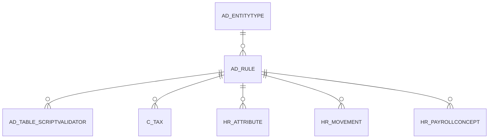

# AD_RULE

Area [AD](../../data-model/ad/index.md) · class **config** (proposed) · read from database `idempiere-db` (owner `ADEMPIERE`) · 4 row(s) when profiled

Application model: `org.compiere.model.X_AD_Rule`, access level 4 - System.

## Columns

| column | type | key | not null | business name | references (code) | nulls | distinct |
|---|---|---|---|---|---|---|---|
| `AD_CLIENT_ID` | NUMBER(10,0) |  | yes | Tenant |  | 0 | 1 |
| `AD_ORG_ID` | NUMBER(10,0) |  | yes | Organization |  | 0 | 1 |
| `AD_RULE_ID` | NUMBER(10,0) | PK | yes | Rule |  | 0 | 4 |
| `ACCESSLEVEL` | CHAR(1) |  |  | Data Access Level |  | 1 | 1 |
| `CREATED` | DATE |  | yes | Created |  | 0 | 4 |
| `CREATEDBY` | NUMBER(10,0) |  | yes | Created By |  | 0 | 1 |
| `DESCRIPTION` | VARCHAR2(255 CHAR) |  |  | Description |  | 4 | 0 |
| `ENTITYTYPE` | VARCHAR2(40 CHAR) |  |  | Entity Type |  | 0 | 1 |
| `EVENTTYPE` | CHAR(1) |  |  | Event Type |  | 0 | 1 |
| `HELP` | VARCHAR2(2000 CHAR) |  |  | Comment/Help |  | 4 | 0 |
| `ISACTIVE` | CHAR(1) |  | yes | Active |  | 0 | 1 |
| `NAME` | VARCHAR2(60 CHAR) |  | yes | Name |  | 0 | 4 |
| `RULETYPE` | CHAR(1) |  |  | Rule Type |  | 0 | 1 |
| `SCRIPT` | VARCHAR2(4000 CHAR) |  |  | Script |  | 0 | 4 |
| `UPDATED` | DATE |  | yes | Updated |  | 0 | 4 |
| `UPDATEDBY` | NUMBER(10,0) |  | yes | Updated By |  | 0 | 1 |
| `VALUE` | VARCHAR2(40 CHAR) |  | yes | Search Key |  | 0 | 4 |
| `AD_RULE_UU` | VARCHAR2(36 CHAR) |  |  | AD_Rule_UU |  | 0 | 4 |

*references (code)* is the table the application model's code says a column points to; *Foreign keys* below are the constraints the database declares. Counts come from the profile; no value is ever shown.

## Check constraints

| name | expression |
|---|---|
| `SYS_C0021267` | `IsActive IN ('Y','N')` |

## Foreign keys

**References**

| table | columns | on delete |
|---|---|---|
| [AD_ENTITYTYPE](../../data-model/ad/ad_entitytype.md) | AD_RULE.ENTITYTYPE → AD_ENTITYTYPE.ENTITYTYPE | NO ACTION |

**Referenced by**

| table | columns | on delete |
|---|---|---|
| [AD_TABLE_SCRIPTVALIDATOR](../../data-model/ad/ad_table_scriptvalidator.md) | AD_TABLE_SCRIPTVALIDATOR.AD_RULE_ID → AD_RULE.AD_RULE_ID | NO ACTION |
| [C_TAX](../../data-model/c/c_tax.md) | C_TAX.AD_RULE_ID → AD_RULE.AD_RULE_ID | NO ACTION |
| [HR_ATTRIBUTE](../../data-model/hr/hr_attribute.md) | HR_ATTRIBUTE.AD_RULE_ID → AD_RULE.AD_RULE_ID | NO ACTION |
| [HR_MOVEMENT](../../data-model/hr/hr_movement.md) | HR_MOVEMENT.AD_RULE_ID → AD_RULE.AD_RULE_ID | NO ACTION |
| [HR_PAYROLLCONCEPT](../../data-model/hr/hr_payrollconcept.md) | HR_PAYROLLCONCEPT.AD_RULE_ID → AD_RULE.AD_RULE_ID | NO ACTION |

## Write behaviour

- updates: **po_only**
- deletes: **deleted_by_users**
- change log: **recorded**
- evidence: 1 citation(s)

## Schema history

37 change(s); the latest:

| applied | release | operation | column | tickets |
|---|---|---|---|---|
| 2023-04-09T15:47 | iD11 | `add_constraint` |  | IDEMPIERE-5567 |
| 2023-04-09T15:47 | iD11 | `add_constraint` |  | IDEMPIERE-5567 |
| 2021-12-05T16:45 | i8.2z | `drop_constraint` |  | IDEMPIERE-5075 |
| 2021-12-05T16:45 | i8.2z | `add_constraint` |  | IDEMPIERE-5075 |
| 2020-12-18T16:42 | i8.1z | `modify_column` | Script | IDEMPIERE-1575 |
| 2020-12-18T16:42 | i8.1z | `modify_column` | Script | IDEMPIERE-1575 |
| 2020-08-04T01:00 | i7.1z | `add_column` | tmp_col_6_tmp | IDEMPIERE-3862 |
| 2020-08-04T01:00 | i7.1z | `drop_column` | tmp_col_6_tmp | IDEMPIERE-3862 |
| 2020-08-04T01:00 | i7.1z | `modify_column` | ENTITYTYPE | IDEMPIERE-3862 |
| 2020-08-04T01:00 | i7.1z | `modify_column` | NAME | IDEMPIERE-3862 |
| 2020-08-04T01:00 | i7.1z | `add_column` | tmp_col_4_tmp | IDEMPIERE-3862 |
| 2020-08-04T01:00 | i7.1z | `drop_column` | tmp_col_5_tmp | IDEMPIERE-3862 |
| 2020-08-04T01:00 | i7.1z | `modify_column` | HELP | IDEMPIERE-3862 |
| 2020-08-04T01:00 | i7.1z | `drop_column` | tmp_col_3_tmp | IDEMPIERE-3862 |
| 2020-08-04T01:00 | i7.1z | `modify_column` | SCRIPT | IDEMPIERE-3862 |

## Open conflicts

| type | attribute | explanation |
|---|---|---|
| `mandatory_but_nullable` | `columns.EntityType.nullable` | unexplained |
| `mandatory_but_nullable` | `columns.EventType.nullable` | unexplained |
| `mandatory_but_nullable` | `columns.RuleType.nullable` | unexplained |

## Notes

<!-- ekos:manual id="table.ad_rule.notes" -->
_Business notes about this table._
<!-- /ekos:manual -->
