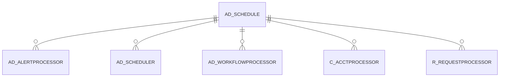

# AD_SCHEDULE

Area [AD](../../data-model/ad/index.md) · class **config** (proposed) · read from database `idempiere-db` (owner `ADEMPIERE`) · 5 row(s) when profiled

Application model: `org.compiere.model.X_AD_Schedule`, access level 4 - System.

## Columns

| column | type | key | not null | business name | references (code) | nulls | distinct |
|---|---|---|---|---|---|---|---|
| `AD_CLIENT_ID` | NUMBER(10,0) |  | yes | Tenant |  | 0 | 1 |
| `AD_ORG_ID` | NUMBER(10,0) |  | yes | Organization |  | 0 | 1 |
| `AD_SCHEDULE_ID` | NUMBER(10,0) | PK | yes | Schedule |  | 0 | 5 |
| `CREATED` | DATE |  | yes | Created |  | 0 | 5 |
| `CREATEDBY` | NUMBER(10,0) |  | yes | Created By |  | 0 | 1 |
| `CRONPATTERN` | VARCHAR2(255 CHAR) |  |  | Cron Scheduling Pattern |  | 5 | 0 |
| `DESCRIPTION` | VARCHAR2(225 CHAR) |  |  | Description |  | 3 | 1 |
| `FREQUENCY` | NUMBER(10,0) |  |  | Frequency |  | 0 | 5 |
| `FREQUENCYTYPE` | CHAR(1) |  |  | Frequency Type |  | 0 | 3 |
| `ISACTIVE` | VARCHAR2(1 CHAR) |  | yes | Active |  | 0 | 1 |
| `MONTHDAY` | NUMBER(10,0) |  |  | Day of the Month |  | 0 | 1 |
| `RUNONLYONIP` | VARCHAR2(60 CHAR) |  |  | Run only on IP |  | 5 | 0 |
| `SCHEDULETYPE` | CHAR(1) |  |  | Schedule Type |  | 0 | 1 |
| `UPDATED` | DATE |  | yes | Updated |  | 0 | 5 |
| `UPDATEDBY` | NUMBER(10,0) |  | yes | Updated By |  | 0 | 1 |
| `WEEKDAY` | CHAR(1) |  |  | Day of the Week |  | 5 | 0 |
| `NAME` | VARCHAR2(60 CHAR) |  | yes | Name |  | 0 | 5 |
| `AD_SCHEDULE_UU` | VARCHAR2(36 CHAR) |  |  | AD_Schedule_UU |  | 0 | 5 |
| `ISIGNOREPROCESSINGTIME` | CHAR(1) |  | yes | Ignore Processing Time |  | 0 | 1 |
| `ISSYSTEMSCHEDULE` | CHAR(1) |  | yes | System Schedule |  | 0 | 1 |

*references (code)* is the table the application model's code says a column points to; *Foreign keys* below are the constraints the database declares. Counts come from the profile; no value is ever shown.

## Check constraints

| name | expression |
|---|---|
| `SYS_C0022891` | `IsIgnoreProcessingTime IN ('Y','N')` |
| `SYS_C0022892` | `IsSystemSchedule IN ('Y','N')` |

## Foreign keys

**References**

_None._

**Referenced by**

| table | columns | on delete |
|---|---|---|
| [AD_ALERTPROCESSOR](../../data-model/ad/ad_alertprocessor.md) | AD_ALERTPROCESSOR.AD_SCHEDULE_ID → AD_SCHEDULE.AD_SCHEDULE_ID | NO ACTION |
| [AD_SCHEDULER](../../data-model/ad/ad_scheduler.md) | AD_SCHEDULER.AD_SCHEDULE_ID → AD_SCHEDULE.AD_SCHEDULE_ID | NO ACTION |
| [AD_WORKFLOWPROCESSOR](../../data-model/ad/ad_workflowprocessor.md) | AD_WORKFLOWPROCESSOR.AD_SCHEDULE_ID → AD_SCHEDULE.AD_SCHEDULE_ID | NO ACTION |
| [C_ACCTPROCESSOR](../../data-model/c/c_acctprocessor.md) | C_ACCTPROCESSOR.AD_SCHEDULE_ID → AD_SCHEDULE.AD_SCHEDULE_ID | NO ACTION |
| [R_REQUESTPROCESSOR](../../data-model/r/r_requestprocessor.md) | R_REQUESTPROCESSOR.AD_SCHEDULE_ID → AD_SCHEDULE.AD_SCHEDULE_ID | NO ACTION |

## Write behaviour

- updates: **po_only**
- deletes: **deleted_by_users**
- change log: **recorded**
- evidence: 1 citation(s)

## Schema history

32 change(s); the latest:

| applied | release | operation | column | tickets |
|---|---|---|---|---|
| 2023-04-09T15:47 | iD11 | `add_constraint` |  | IDEMPIERE-5567 |
| 2023-04-09T15:47 | iD11 | `add_constraint` |  | IDEMPIERE-5567 |
| 2020-08-04T01:00 | i7.1z | `drop_column` | tmp_col_4_tmp | IDEMPIERE-3862 |
| 2020-08-04T01:00 | i7.1z | `add_column` | tmp_col_1_tmp | IDEMPIERE-3862 |
| 2020-08-04T01:00 | i7.1z | `modify_column` | DESCRIPTION | IDEMPIERE-3862 |
| 2020-08-04T01:00 | i7.1z | `drop_column` | tmp_col_1_tmp | IDEMPIERE-3862 |
| 2020-08-04T01:00 | i7.1z | `modify_column` | ISACTIVE | IDEMPIERE-3862 |
| 2020-08-04T01:00 | i7.1z | `add_column` | tmp_col_5_tmp | IDEMPIERE-3862 |
| 2020-08-04T01:00 | i7.1z | `modify_column` | NAME | IDEMPIERE-3862 |
| 2020-08-04T01:00 | i7.1z | `drop_column` | tmp_col_3_tmp | IDEMPIERE-3862 |
| 2020-08-04T01:00 | i7.1z | `add_column` | tmp_col_2_tmp | IDEMPIERE-3862 |
| 2020-08-04T01:00 | i7.1z | `modify_column` | AD_SCHEDULE_UU | IDEMPIERE-3862 |
| 2020-08-04T01:00 | i7.1z | `modify_column` | ISACTIVE | IDEMPIERE-3862 |
| 2020-08-04T01:00 | i7.1z | `drop_column` | tmp_col_2_tmp | IDEMPIERE-3862 |
| 2020-08-04T01:00 | i7.1z | `modify_column` | NAME | IDEMPIERE-3862 |

## Notes

<!-- ekos:manual id="table.ad_schedule.notes" -->
_Business notes about this table._
<!-- /ekos:manual -->
