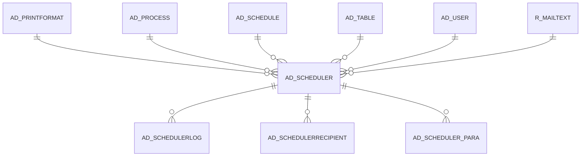

# AD_SCHEDULER

Area [AD](../../data-model/ad/index.md) · class **config** (proposed) · read from database `idempiere-db` (owner `ADEMPIERE`) · 0 row(s) when profiled

Application model: `org.compiere.model.X_AD_Scheduler`, access level 6 - System - Client.

## Columns

| column | type | key | not null | business name | references (code) | nulls | distinct |
|---|---|---|---|---|---|---|---|
| `AD_SCHEDULER_ID` | NUMBER(10,0) | PK | yes | Scheduler |  | 0 | 0 |
| `AD_CLIENT_ID` | NUMBER(10,0) |  | yes | Tenant |  | 0 | 0 |
| `AD_ORG_ID` | NUMBER(10,0) |  | yes | Organization |  | 0 | 0 |
| `ISACTIVE` | CHAR(1) |  | yes | Active |  | 0 | 0 |
| `CREATED` | DATE |  | yes | Created |  | 0 | 0 |
| `CREATEDBY` | NUMBER(10,0) |  | yes | Created By |  | 0 | 0 |
| `UPDATED` | DATE |  | yes | Updated |  | 0 | 0 |
| `UPDATEDBY` | NUMBER(10,0) |  | yes | Updated By |  | 0 | 0 |
| `NAME` | VARCHAR2(60 CHAR) |  | yes | Name |  | 0 | 0 |
| `DESCRIPTION` | VARCHAR2(255 CHAR) |  |  | Description |  | 0 | 0 |
| `AD_PROCESS_ID` | NUMBER(10,0) |  | yes | Process | [AD_PROCESS](../../data-model/ad/ad_process.md) | 0 | 0 |
| `FREQUENCYTYPE` | CHAR(1) |  |  |  |  | 0 | 0 |
| `FREQUENCY` | NUMBER(10,0) |  |  |  |  | 0 | 0 |
| `DATELASTRUN` | TIMESTAMP(6) WITH TIME ZONE |  |  | Date Last Run |  | 0 | 0 |
| `DATENEXTRUN` | TIMESTAMP(6) WITH TIME ZONE |  |  | Date Next Run |  | 0 | 0 |
| `SUPERVISOR_ID` | NUMBER(10,0) |  | yes | Supervisor | [AD_USER](../../data-model/ad/ad_user.md) | 0 | 0 |
| `KEEPLOGDAYS` | NUMBER(10,0) |  | yes | Days to keep Log |  | 0 | 0 |
| `PROCESSING` | CHAR(1) |  |  | Process Now |  | 0 | 0 |
| `WEEKDAY` | CHAR(1) |  |  |  |  | 0 | 0 |
| `SCHEDULETYPE` | CHAR(1) |  | yes |  |  | 0 | 0 |
| `MONTHDAY` | NUMBER(10,0) |  |  |  |  | 0 | 0 |
| `ISIGNOREPROCESSINGTIME` | CHAR(1) |  |  |  |  | 0 | 0 |
| `CRONPATTERN` | VARCHAR2(255 CHAR) |  |  |  |  | 0 | 0 |
| `AD_TABLE_ID` | NUMBER(10,0) |  |  | Table | [AD_TABLE](../../data-model/ad/ad_table.md) | 0 | 0 |
| `RECORD_ID` | NUMBER(10,0) |  |  | Record ID |  | 0 | 0 |
| `AD_SCHEDULER_UU` | VARCHAR2(36 CHAR) |  |  | AD_Scheduler_UU |  | 0 | 0 |
| `AD_SCHEDULE_ID` | NUMBER(10,0) |  | yes | Schedule | [AD_SCHEDULE](../../data-model/ad/ad_schedule.md) | 0 | 0 |
| `R_MAILTEXT_ID` | NUMBER(10,0) |  |  | Mail Template | [R_MAILTEXT](../../data-model/r/r_mailtext.md) | 0 | 0 |
| `REPORTOUTPUTTYPE` | VARCHAR2(4 CHAR) |  |  | Report Output Type |  | 0 | 0 |
| `AD_PRINTFORMAT_ID` | NUMBER(10,0) |  |  | Print Format | [AD_PRINTFORMAT](../../data-model/ad/ad_printformat.md) | 0 | 0 |

*references (code)* is the table the application model's code says a column points to; *Foreign keys* below are the constraints the database declares. Counts come from the profile; no value is ever shown.

## Check constraints

| name | expression |
|---|---|
| `SYS_C0021401` | `IsIgnoreProcessingTime IN ('Y','N')` |

## Foreign keys

**References**

| table | columns | on delete |
|---|---|---|
| [AD_PRINTFORMAT](../../data-model/ad/ad_printformat.md) | AD_SCHEDULER.AD_PRINTFORMAT_ID → AD_PRINTFORMAT.AD_PRINTFORMAT_ID | SET NULL |
| [AD_PROCESS](../../data-model/ad/ad_process.md) | AD_SCHEDULER.AD_PROCESS_ID → AD_PROCESS.AD_PROCESS_ID | CASCADE |
| [AD_SCHEDULE](../../data-model/ad/ad_schedule.md) | AD_SCHEDULER.AD_SCHEDULE_ID → AD_SCHEDULE.AD_SCHEDULE_ID | NO ACTION |
| [AD_TABLE](../../data-model/ad/ad_table.md) | AD_SCHEDULER.AD_TABLE_ID → AD_TABLE.AD_TABLE_ID | NO ACTION |
| [AD_USER](../../data-model/ad/ad_user.md) | AD_SCHEDULER.SUPERVISOR_ID → AD_USER.AD_USER_ID | NO ACTION |
| [R_MAILTEXT](../../data-model/r/r_mailtext.md) | AD_SCHEDULER.R_MAILTEXT_ID → R_MAILTEXT.R_MAILTEXT_ID | NO ACTION |

**Referenced by**

| table | columns | on delete |
|---|---|---|
| `AD_SCHEDULERLOG` | AD_SCHEDULERLOG.AD_SCHEDULER_ID → AD_SCHEDULER.AD_SCHEDULER_ID | CASCADE |
| [AD_SCHEDULERRECIPIENT](../../data-model/ad/ad_schedulerrecipient.md) | AD_SCHEDULERRECIPIENT.AD_SCHEDULER_ID → AD_SCHEDULER.AD_SCHEDULER_ID | NO ACTION |
| [AD_SCHEDULER_PARA](../../data-model/ad/ad_scheduler_para.md) | AD_SCHEDULER_PARA.AD_SCHEDULER_ID → AD_SCHEDULER.AD_SCHEDULER_ID | CASCADE |

## Write behaviour

- updates: **po_only**
- deletes: **deleted_by_users, deleted_by_cascade**
- change log: **recorded**
- evidence: 2 citation(s)

## Schema history

39 change(s); the latest:

| applied | release | operation | column | tickets |
|---|---|---|---|---|
| 2023-04-09T15:47 | iD11 | `add_constraint` |  | IDEMPIERE-5567 |
| 2023-04-09T15:47 | iD11 | `add_constraint` |  | IDEMPIERE-5567 |
| 2022-03-24T08:30 | iD10 | `add_column` | Tmp_DateNextRun | IDEMPIERE-5093 |
| 2022-03-24T08:30 | iD10 | `modify_column` | DateNextRun | IDEMPIERE-5093 |
| 2022-03-24T08:30 | iD10 | `drop_column` | DateNextRun | IDEMPIERE-5093 |
| 2022-03-24T08:30 | iD10 | `rename_column` | Tmp_DateLastRun | IDEMPIERE-5093 |
| 2022-03-24T08:30 | iD10 | `modify_column` | DateLastRun | IDEMPIERE-5093 |
| 2022-03-24T08:30 | iD10 | `drop_column` | DateLastRun | IDEMPIERE-5093 |
| 2022-03-24T08:30 | iD10 | `add_column` | Tmp_DateLastRun | IDEMPIERE-5093 |
| 2022-03-24T08:30 | iD10 | `rename_column` | Tmp_DateNextRun | IDEMPIERE-5093 |
| 2021-12-05T16:45 | i8.2z | `add_constraint` |  | IDEMPIERE-5075 |
| 2021-12-05T16:45 | i8.2z | `drop_constraint` |  | IDEMPIERE-5075 |
| 2021-12-05T16:45 | i8.2z | `drop_constraint` |  | IDEMPIERE-5075 |
| 2021-12-05T16:45 | i8.2z | `add_constraint` |  | IDEMPIERE-5075 |
| 2021-12-05T16:45 | i8.2z | `drop_constraint` |  | IDEMPIERE-5075 |

## Notes

<!-- ekos:manual id="table.ad_scheduler.notes" -->
_Business notes about this table._
<!-- /ekos:manual -->
