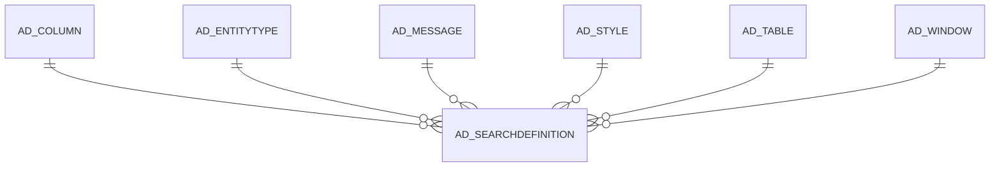

# AD_SEARCHDEFINITION

Area [AD](../../data-model/ad/index.md) · class **config** (proposed) · read from database `idempiere-db` (owner `ADEMPIERE`) · 2 row(s) when profiled

Application model: `org.compiere.model.X_AD_SearchDefinition`, access level 4 - System.

## Columns

| column | type | key | not null | business name | references (code) | nulls | distinct |
|---|---|---|---|---|---|---|---|
| `AD_CLIENT_ID` | NUMBER(10,0) |  | yes | Tenant |  | 0 | 1 |
| `AD_COLUMN_ID` | NUMBER(10,0) |  |  | Column | [AD_COLUMN](../../data-model/ad/ad_column.md) | 1 | 1 |
| `AD_ORG_ID` | NUMBER(10,0) |  | yes | Organization |  | 0 | 1 |
| `AD_SEARCHDEFINITION_ID` | NUMBER(10,0) | PK | yes | Search Definition |  | 0 | 2 |
| `AD_TABLE_ID` | NUMBER(10,0) |  | yes | Table | [AD_TABLE](../../data-model/ad/ad_table.md) | 0 | 2 |
| `AD_WINDOW_ID` | NUMBER(10,0) |  | yes | Window | [AD_WINDOW](../../data-model/ad/ad_window.md) | 0 | 2 |
| `CREATED` | DATE |  | yes | Created |  | 0 | 2 |
| `CREATEDBY` | NUMBER(10,0) |  |  | Created By |  | 0 | 1 |
| `DATATYPE` | VARCHAR2(1 CHAR) |  | yes | Data Type |  | 0 | 1 |
| `DESCRIPTION` | VARCHAR2(255 CHAR) |  |  | Description |  | 0 | 2 |
| `ISACTIVE` | CHAR(1) |  | yes | Active |  | 0 | 1 |
| `NAME` | VARCHAR2(60 CHAR) |  |  | Name |  | 0 | 2 |
| `QUERY` | VARCHAR2(2000 CHAR) |  |  | Query |  | 1 | 1 |
| `SEARCHTYPE` | VARCHAR2(1 CHAR) |  | yes | Search Type |  | 0 | 2 |
| `TRANSACTIONCODE` | VARCHAR2(8 CHAR) |  |  | Transaction Code |  | 0 | 2 |
| `UPDATED` | DATE |  | yes | Updated |  | 0 | 2 |
| `UPDATEDBY` | NUMBER(10,0) |  | yes | Updated By |  | 0 | 1 |
| `PO_WINDOW_ID` | NUMBER(10,0) |  |  | PO Window | [AD_WINDOW](../../data-model/ad/ad_window.md) | 1 | 1 |
| `ISDEFAULT` | CHAR(1) |  | yes | Default |  | 0 | 2 |
| `AD_SEARCHDEFINITION_UU` | VARCHAR2(36 CHAR) |  |  | AD_SearchDefinition_UU |  | 0 | 2 |
| `ENTITYTYPE` | VARCHAR2(40 CHAR) |  | yes | Entity Type |  | 0 | 1 |
| `AD_MESSAGE_ID` | NUMBER(10,0) |  |  | Message | [AD_MESSAGE](../../data-model/ad/ad_message.md) | 2 | 0 |
| `AD_STYLE_ID` | NUMBER(10,0) |  |  | Style | [AD_STYLE](../../data-model/ad/ad_style.md) | 2 | 0 |

*references (code)* is the table the application model's code says a column points to; *Foreign keys* below are the constraints the database declares. Counts come from the profile; no value is ever shown.

## Check constraints

| name | expression |
|---|---|
| `SYS_C0022932` | `IsActive IN ('Y','N')` |
| `SYS_C0022934` | `IsDefault IN ('Y','N')` |

## Foreign keys

**References**

| table | columns | on delete |
|---|---|---|
| [AD_COLUMN](../../data-model/ad/ad_column.md) | AD_SEARCHDEFINITION.AD_COLUMN_ID → AD_COLUMN.AD_COLUMN_ID | NO ACTION |
| [AD_ENTITYTYPE](../../data-model/ad/ad_entitytype.md) | AD_SEARCHDEFINITION.ENTITYTYPE → AD_ENTITYTYPE.ENTITYTYPE | NO ACTION |
| [AD_MESSAGE](../../data-model/ad/ad_message.md) | AD_SEARCHDEFINITION.AD_MESSAGE_ID → AD_MESSAGE.AD_MESSAGE_ID | NO ACTION |
| [AD_STYLE](../../data-model/ad/ad_style.md) | AD_SEARCHDEFINITION.AD_STYLE_ID → AD_STYLE.AD_STYLE_ID | NO ACTION |
| [AD_TABLE](../../data-model/ad/ad_table.md) | AD_SEARCHDEFINITION.AD_TABLE_ID → AD_TABLE.AD_TABLE_ID | NO ACTION |
| [AD_WINDOW](../../data-model/ad/ad_window.md) | AD_SEARCHDEFINITION.AD_WINDOW_ID → AD_WINDOW.AD_WINDOW_ID | NO ACTION |

**Referenced by**

_None._

## Write behaviour

- updates: **po_only**
- deletes: **deleted_by_users**
- change log: **recorded**
- evidence: 1 citation(s)

## Schema history

62 change(s); the latest:

| applied | release | operation | column | tickets |
|---|---|---|---|---|
| 2026-01-08T14:11 | iD13 | `modify_column` | SearchType | IDEMPIERE-6810 |
| 2026-01-08T14:11 | iD13 | `modify_column` | SearchType | IDEMPIERE-6810 |
| 2024-11-08T16:38 | iD12 | `add_constraint` |  | IDEMPIERE-6253 |
| 2024-11-08T16:38 | iD12 | `add_column` | AD_Style_ID | IDEMPIERE-6253 |
| 2024-11-08T16:38 | iD12 | `add_column` | AD_Style_ID | IDEMPIERE-6253 |
| 2024-11-08T16:38 | iD12 | `add_constraint` |  | IDEMPIERE-6253 |
| 2024-11-07T15:01 | iD12 | `add_column` | AD_Message_ID | IDEMPIERE-6253 |
| 2024-11-07T15:01 | iD12 | `add_constraint` |  | IDEMPIERE-6253 |
| 2024-11-07T15:01 | iD12 | `add_column` | AD_Message_ID | IDEMPIERE-6253 |
| 2024-11-07T15:01 | iD12 | `add_constraint` |  | IDEMPIERE-6253 |
| 2023-04-09T15:47 | iD11 | `add_constraint` |  | IDEMPIERE-5567 |
| 2023-04-09T15:47 | iD11 | `add_constraint` |  | IDEMPIERE-5567 |
| 2021-12-05T16:45 | i8.2z | `drop_constraint` |  | IDEMPIERE-5075 |
| 2021-12-05T16:45 | i8.2z | `add_constraint` |  | IDEMPIERE-5075 |
| 2021-12-05T16:45 | i8.2z | `add_constraint` |  | IDEMPIERE-5075 |

## Notes

<!-- ekos:manual id="table.ad_searchdefinition.notes" -->
_Business notes about this table._
<!-- /ekos:manual -->
