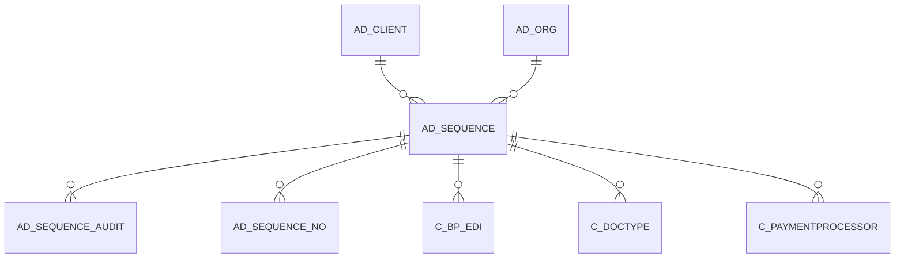

# AD_SEQUENCE

Area [AD](../../data-model/ad/index.md) · class **config** (proposed) · read from database `idempiere-db` (owner `ADEMPIERE`) · 1438 row(s) when profiled

Application model: `org.compiere.model.X_AD_Sequence`, access level 6 - System - Client.

## Columns

| column | type | key | not null | business name | references (code) | nulls | distinct |
|---|---|---|---|---|---|---|---|
| `AD_SEQUENCE_ID` | NUMBER(10,0) | PK | yes | Sequence |  | 0 | 1438 |
| `AD_CLIENT_ID` | NUMBER(10,0) |  | yes | Tenant |  | 0 | 2 |
| `AD_ORG_ID` | NUMBER(10,0) |  | yes | Organization |  | 0 | 1 |
| `ISACTIVE` | CHAR(1) |  |  | Active |  | 0 | 1 |
| `CREATED` | DATE |  | yes | Created |  | 0 | 847 |
| `CREATEDBY` | NUMBER(10,0) |  | yes | Created By |  | 0 | 3 |
| `UPDATED` | DATE |  | yes | Updated |  | 0 | 769 |
| `UPDATEDBY` | NUMBER(10,0) |  | yes | Updated By |  | 0 | 3 |
| `NAME` | VARCHAR2(60 CHAR) |  | yes | Name |  | 0 | 1268 |
| `DESCRIPTION` | VARCHAR2(255 CHAR) |  |  | Description |  | 147 | 1120 |
| `VFORMAT` | VARCHAR2(40 CHAR) |  |  | Value Format |  | 1438 | 0 |
| `ISAUTOSEQUENCE` | CHAR(1) |  | yes | Auto numbering |  | 0 | 2 |
| `INCREMENTNO` | NUMBER(10,0) |  | yes | Increment |  | 0 | 1 |
| `STARTNO` | NUMBER(10,0) |  | yes | Start No |  | 0 | 26 |
| `CURRENTNEXT` | NUMBER(10,0) |  | yes | Current Next |  | 0 | 40 |
| `CURRENTNEXTSYS` | NUMBER(10,0) |  | yes | Current Next (System) |  | 0 | 92 |
| `ISAUDITED` | CHAR(1) |  |  | Activate Audit |  | 0 | 1 |
| `ISTABLEID` | CHAR(1) |  |  | Used for Record ID |  | 0 | 2 |
| `PREFIX` | VARCHAR2(255 CHAR) |  |  | Prefix |  | 1436 | 2 |
| `SUFFIX` | VARCHAR2(255 CHAR) |  |  | Suffix |  | 1436 | 2 |
| `STARTNEWYEAR` | CHAR(1) |  |  | Restart sequence every Year |  | 0 | 2 |
| `DATECOLUMN` | VARCHAR2(124 CHAR) |  |  | Date Column |  | 1437 | 1 |
| `DECIMALPATTERN` | VARCHAR2(40 CHAR) |  |  | Decimal Pattern |  | 1437 | 1 |
| `AD_SEQUENCE_UU` | VARCHAR2(36 CHAR) |  |  | AD_Sequence_UU |  | 0 | 1438 |
| `STARTNEWMONTH` | CHAR(1) |  | yes | Restart sequence every month |  | 0 | 2 |
| `ISORGLEVELSEQUENCE` | CHAR(1) |  | yes | Organization level |  | 0 | 2 |
| `ORGCOLUMN` | VARCHAR2(124 CHAR) |  |  | Org Column |  | 1437 | 1 |

*references (code)* is the table the application model's code says a column points to; *Foreign keys* below are the constraints the database declares. Counts come from the profile; no value is ever shown.

## Check constraints

| name | expression |
|---|---|
| `SYS_C0022329` | `StartNewMonth IN ('Y','N')` |
| `SYS_C0022330` | `IsActive in ('Y','N')` |
| `SYS_C0022331` | `IsAudited in ('Y','N')` |
| `SYS_C0022332` | `IsAutoSequence in ('Y','N')` |
| `SYS_C0022333` | `IsOrgLevelSequence IN ('Y','N')` |
| `SYS_C0022335` | `IsTableID in ('Y','N')` |
| `SYS_C0022336` | `StartNewYear in ('Y','N')` |

## Foreign keys

**References**

| table | columns | on delete |
|---|---|---|
| [AD_CLIENT](../../data-model/ad/ad_client.md) | AD_SEQUENCE.AD_CLIENT_ID → AD_CLIENT.AD_CLIENT_ID | NO ACTION |
| [AD_ORG](../../data-model/ad/ad_org.md) | AD_SEQUENCE.AD_ORG_ID → AD_ORG.AD_ORG_ID | NO ACTION |

**Referenced by**

| table | columns | on delete |
|---|---|---|
| [AD_SEQUENCE_AUDIT](../../data-model/ad/ad_sequence_audit.md) | AD_SEQUENCE_AUDIT.AD_SEQUENCE_ID → AD_SEQUENCE.AD_SEQUENCE_ID | CASCADE |
| [AD_SEQUENCE_NO](../../data-model/ad/ad_sequence_no.md) | AD_SEQUENCE_NO.AD_SEQUENCE_ID → AD_SEQUENCE.AD_SEQUENCE_ID | CASCADE |
| [C_BP_EDI](../../data-model/c/c_bp_edi.md) | C_BP_EDI.AD_SEQUENCE_ID → AD_SEQUENCE.AD_SEQUENCE_ID | NO ACTION |
| [C_DOCTYPE](../../data-model/c/c_doctype.md) | C_DOCTYPE.DOCNOSEQUENCE_ID → AD_SEQUENCE.AD_SEQUENCE_ID | NO ACTION |
| [C_PAYMENTPROCESSOR](../../data-model/c/c_paymentprocessor.md) | C_PAYMENTPROCESSOR.AD_SEQUENCE_ID → AD_SEQUENCE.AD_SEQUENCE_ID | NO ACTION |

## Write behaviour

- updates: **raw_sql_skips_updated**
- deletes: **soft_delete_only**
- change log: **recorded**
- evidence: 14 citation(s)

## Read by

| kind | name |
|---|---|
| Procedure | [nextID](../../logic/nextid.md) |
| Procedure | [nextid](../../logic/nextid.md) |

## Written by

| kind | name |
|---|---|
| Procedure | [AD_Sequence_Doc](../../logic/ad_sequence_doc.md) |
| Procedure | [AD_Sequence_DocType](../../logic/ad_sequence_doctype.md) |
| Procedure | [AD_Sequence_Next](../../logic/ad_sequence_next.md) |
| Procedure | [nextID](../../logic/nextid.md) |
| Procedure | [nextid](../../logic/nextid.md) |

## Schema history

37 change(s); the latest:

| applied | release | operation | column | tickets |
|---|---|---|---|---|
| 2024-04-03T12:26 | iD11 | `modify_column` | DateColumn | IDEMPIERE-6064 |
| 2024-04-03T12:26 | iD11 | `modify_column` | DateColumn | IDEMPIERE-6064 |
| 2024-04-03T12:26 | iD11 | `modify_column` | OrgColumn | IDEMPIERE-6064 |
| 2024-04-03T12:26 | iD11 | `modify_column` | OrgColumn | IDEMPIERE-6064 |
| 2023-04-09T15:47 | iD11 | `add_constraint` |  | IDEMPIERE-5567 |
| 2023-04-09T15:47 | iD11 | `add_constraint` |  | IDEMPIERE-5567 |
| 2022-03-16T13:42 | i9 | `create_index` |  | IDEMPIERE-5221 |
| 2022-03-16T13:42 | i9 | `create_index` |  | IDEMPIERE-5221 |
| 2021-12-05T16:45 | i8.2z | `drop_constraint` |  | IDEMPIERE-5075 |
| 2021-12-05T16:45 | i8.2z | `add_constraint` |  | IDEMPIERE-5075 |
| 2021-12-05T16:45 | i8.2z | `add_constraint` |  | IDEMPIERE-5075 |
| 2021-12-05T16:45 | i8.2z | `drop_constraint` |  | IDEMPIERE-5075 |
| 2020-08-04T01:00 | i7.1z | `modify_column` | AD_SEQUENCE_UU | IDEMPIERE-3862 |
| 2020-08-04T01:00 | i7.1z | `modify_column` | DECIMALPATTERN | IDEMPIERE-3862 |
| 2020-08-04T01:00 | i7.1z | `add_column` | tmp_col_5_tmp | IDEMPIERE-3862 |

## Notes

<!-- ekos:manual id="table.ad_sequence.notes" -->
_Business notes about this table._
<!-- /ekos:manual -->
