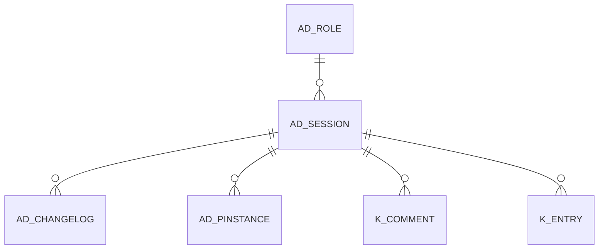

# AD_SESSION

Area [AD](../../data-model/ad/index.md) · class **config** (proposed) · read from database `idempiere-db` (owner `ADEMPIERE`) · 0 row(s) when profiled

Application model: `org.compiere.model.X_AD_Session`, access level 6 - System - Client.

## Columns

| column | type | key | not null | business name | references (code) | nulls | distinct |
|---|---|---|---|---|---|---|---|
| `AD_SESSION_ID` | NUMBER(10,0) | PK | yes | Session |  | 0 | 0 |
| `AD_CLIENT_ID` | NUMBER(10,0) |  | yes | Tenant |  | 0 | 0 |
| `AD_ORG_ID` | NUMBER(10,0) |  | yes | Organization |  | 0 | 0 |
| `ISACTIVE` | CHAR(1) |  | yes | Active |  | 0 | 0 |
| `CREATED` | DATE |  | yes | Created |  | 0 | 0 |
| `CREATEDBY` | NUMBER(10,0) |  | yes | Created By |  | 0 | 0 |
| `UPDATED` | DATE |  | yes | Updated |  | 0 | 0 |
| `UPDATEDBY` | NUMBER(10,0) |  | yes | Updated By |  | 0 | 0 |
| `WEBSESSION` | VARCHAR2(40 CHAR) |  |  | Web Session |  | 0 | 0 |
| `REMOTE_ADDR` | VARCHAR2(60 CHAR) |  |  | Remote Addr |  | 0 | 0 |
| `REMOTE_HOST` | VARCHAR2(120 CHAR) |  |  | Remote Host |  | 0 | 0 |
| `PROCESSED` | CHAR(1) |  | yes | Processed |  | 0 | 0 |
| `DESCRIPTION` | VARCHAR2(2000 CHAR) |  |  | Description |  | 0 | 0 |
| `AD_ROLE_ID` | NUMBER(10,0) |  |  | Role | [AD_ROLE](../../data-model/ad/ad_role.md) | 0 | 0 |
| `LOGINDATE` | DATE |  |  | Login date |  | 0 | 0 |
| `AD_SESSION_UU` | VARCHAR2(36 CHAR) |  |  | AD_Session_UU |  | 0 | 0 |
| `SERVERNAME` | VARCHAR2(80 CHAR) |  |  | Server Name |  | 0 | 0 |

*references (code)* is the table the application model's code says a column points to; *Foreign keys* below are the constraints the database declares. Counts come from the profile; no value is ever shown.

## Foreign keys

**References**

| table | columns | on delete |
|---|---|---|
| [AD_ROLE](../../data-model/ad/ad_role.md) | AD_SESSION.AD_ROLE_ID → AD_ROLE.AD_ROLE_ID | NO ACTION |

**Referenced by**

| table | columns | on delete |
|---|---|---|
| `AD_CHANGELOG` | AD_CHANGELOG.AD_SESSION_ID → AD_SESSION.AD_SESSION_ID | NO ACTION |
| [AD_PINSTANCE](../../data-model/ad/ad_pinstance.md) | AD_PINSTANCE.AD_SESSION_ID → AD_SESSION.AD_SESSION_ID | NO ACTION |
| [K_COMMENT](../../data-model/k/k_comment.md) | K_COMMENT.AD_SESSION_ID → AD_SESSION.AD_SESSION_ID | NO ACTION |
| [K_ENTRY](../../data-model/k/k_entry.md) | K_ENTRY.AD_SESSION_ID → AD_SESSION.AD_SESSION_ID | NO ACTION |

## Write behaviour

- updates: **raw_sql_skips_updated**
- deletes: **deleted_by_users**
- change log: **recorded**
- evidence: 3 citation(s)

## Read by

| kind | name |
|---|---|
| View | `AD_SESSIONINFO_V` |
| View | `ad_sessioninfo_v` |

## Schema history

24 change(s); the latest:

| applied | release | operation | column | tickets |
|---|---|---|---|---|
| 2023-04-09T15:47 | iD11 | `add_constraint` |  | IDEMPIERE-5567 |
| 2023-04-09T15:47 | iD11 | `add_constraint` |  | IDEMPIERE-5567 |
| 2022-03-16T13:42 | i9 | `create_index` |  | IDEMPIERE-5221 |
| 2022-03-16T13:42 | i9 | `create_index` |  | IDEMPIERE-5221 |
| 2021-12-05T16:45 | i8.2z | `drop_constraint` |  | IDEMPIERE-5075 |
| 2021-12-05T16:45 | i8.2z | `add_constraint` |  | IDEMPIERE-5075 |
| 2020-08-04T01:00 | i7.1z | `add_column` | tmp_col_3_tmp | IDEMPIERE-3862 |
| 2020-08-04T01:00 | i7.1z | `modify_column` | SERVERNAME | IDEMPIERE-3862 |
| 2020-08-04T01:00 | i7.1z | `modify_column` | DESCRIPTION | IDEMPIERE-3862 |
| 2020-08-04T01:00 | i7.1z | `modify_column` | WEBSESSION | IDEMPIERE-3862 |
| 2020-08-04T01:00 | i7.1z | `add_column` | tmp_col_4_tmp | IDEMPIERE-3862 |
| 2020-08-04T01:00 | i7.1z | `add_column` | tmp_col_1_tmp | IDEMPIERE-3862 |
| 2020-08-04T01:00 | i7.1z | `drop_column` | tmp_col_5_tmp | IDEMPIERE-3862 |
| 2020-08-04T01:00 | i7.1z | `drop_column` | tmp_col_1_tmp | IDEMPIERE-3862 |
| 2020-08-04T01:00 | i7.1z | `modify_column` | REMOTE_ADDR | IDEMPIERE-3862 |

## Notes

<!-- ekos:manual id="table.ad_session.notes" -->
_Business notes about this table._
<!-- /ekos:manual -->
