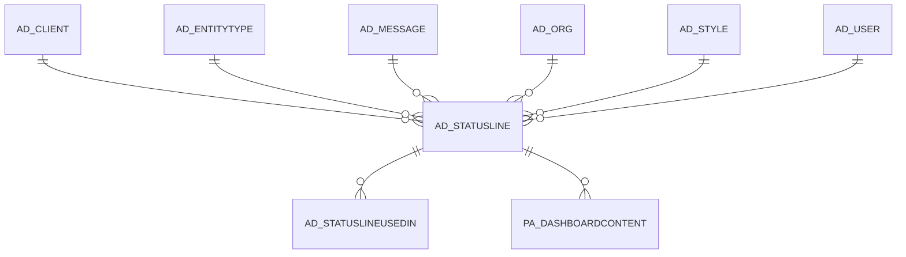

# AD_STATUSLINE

Area [AD](../../data-model/ad/index.md) · class **config** (proposed) · read from database `idempiere-db` (owner `ADEMPIERE`) · 7 row(s) when profiled

Application model: `org.compiere.model.X_AD_StatusLine`, access level 4 - System.

## Columns

| column | type | key | not null | business name | references (code) | nulls | distinct |
|---|---|---|---|---|---|---|---|
| `AD_STATUSLINE_ID` | NUMBER(10,0) | PK | yes | Status Line |  | 0 | 7 |
| `AD_CLIENT_ID` | NUMBER(10,0) |  | yes | Tenant |  | 0 | 1 |
| `AD_ORG_ID` | NUMBER(10,0) |  | yes | Organization |  | 0 | 1 |
| `AD_STATUSLINE_UU` | VARCHAR2(36 CHAR) |  |  | AD_StatusLine_UU |  | 0 | 7 |
| `CREATED` | DATE |  | yes | Created |  | 0 | 7 |
| `CREATEDBY` | NUMBER(10,0) |  | yes | Created By |  | 0 | 1 |
| `ENTITYTYPE` | VARCHAR2(40 CHAR) |  | yes | Entity Type |  | 0 | 1 |
| `ISACTIVE` | CHAR(1) |  | yes | Active |  | 0 | 1 |
| `NAME` | VARCHAR2(60 CHAR) |  | yes | Name |  | 0 | 7 |
| `UPDATED` | DATE |  | yes | Updated |  | 0 | 7 |
| `UPDATEDBY` | NUMBER(10,0) |  | yes | Updated By |  | 0 | 1 |
| `AD_MESSAGE_ID` | NUMBER(10,0) |  | yes | Message | [AD_MESSAGE](../../data-model/ad/ad_message.md) | 0 | 6 |
| `SQLSTATEMENT` | VARCHAR2(2000 CHAR) |  | yes | SQL Expression/Statement |  | 0 | 7 |
| `AD_STYLE_ID` | NUMBER(10,0) |  |  | Style | [AD_STYLE](../../data-model/ad/ad_style.md) | 7 | 0 |

*references (code)* is the table the application model's code says a column points to; *Foreign keys* below are the constraints the database declares. Counts come from the profile; no value is ever shown.

## Check constraints

| name | expression |
|---|---|
| `SYS_C0021351` | `IsActive IN ('Y','N')` |

## Foreign keys

**References**

| table | columns | on delete |
|---|---|---|
| [AD_CLIENT](../../data-model/ad/ad_client.md) | AD_STATUSLINE.AD_CLIENT_ID → AD_CLIENT.AD_CLIENT_ID | NO ACTION |
| [AD_ENTITYTYPE](../../data-model/ad/ad_entitytype.md) | AD_STATUSLINE.ENTITYTYPE → AD_ENTITYTYPE.ENTITYTYPE | NO ACTION |
| [AD_MESSAGE](../../data-model/ad/ad_message.md) | AD_STATUSLINE.AD_MESSAGE_ID → AD_MESSAGE.AD_MESSAGE_ID | NO ACTION |
| [AD_ORG](../../data-model/ad/ad_org.md) | AD_STATUSLINE.AD_ORG_ID → AD_ORG.AD_ORG_ID | NO ACTION |
| [AD_STYLE](../../data-model/ad/ad_style.md) | AD_STATUSLINE.AD_STYLE_ID → AD_STYLE.AD_STYLE_ID | NO ACTION |
| [AD_USER](../../data-model/ad/ad_user.md) | AD_STATUSLINE.CREATEDBY → AD_USER.AD_USER_ID | NO ACTION |

**Referenced by**

| table | columns | on delete |
|---|---|---|
| [AD_STATUSLINEUSEDIN](../../data-model/ad/ad_statuslineusedin.md) | AD_STATUSLINEUSEDIN.AD_STATUSLINE_ID → AD_STATUSLINE.AD_STATUSLINE_ID | NO ACTION |
| [PA_DASHBOARDCONTENT](../../data-model/pa/pa_dashboardcontent.md) | PA_DASHBOARDCONTENT.AD_STATUSLINE_ID → AD_STATUSLINE.AD_STATUSLINE_ID | NO ACTION |

## Write behaviour

- updates: **po_only**
- deletes: **deleted_by_users**
- change log: **recorded**
- evidence: 1 citation(s)

## Schema history

50 change(s); the latest:

| applied | release | operation | column | tickets |
|---|---|---|---|---|
| 2024-11-28T16:54 | iD12 | `add_column` | AD_Style_ID | IDEMPIERE-6321 |
| 2024-11-28T16:54 | iD12 | `add_column` | AD_Style_ID | IDEMPIERE-6321 |
| 2024-11-28T16:54 | iD12 | `add_constraint` |  | IDEMPIERE-6321 |
| 2024-11-28T16:54 | iD12 | `add_constraint` |  | IDEMPIERE-6321 |
| 2020-08-04T01:00 | i7.1z | `modify_column` | SQLSTATEMENT | IDEMPIERE-3862 |
| 2020-08-04T01:00 | i7.1z | `modify_column` | ENTITYTYPE | IDEMPIERE-3862 |
| 2020-08-04T01:00 | i7.1z | `modify_column` | AD_STATUSLINE_UU | IDEMPIERE-3862 |
| 2020-08-04T01:00 | i7.1z | `modify_column` | NAME | IDEMPIERE-3862 |
| 2014-01-12T21:52 | i2.0z | `modify_column` | EntityType | IDEMPIERE-1684 |
| 2014-01-12T21:52 | i2.0z | `modify_column` | EntityType | IDEMPIERE-1684 |
| 2014-01-12T15:25 | i2.0z | `add_constraint` |  | IDEMPIERE-1150 |
| 2014-01-12T15:25 | i2.0z | `add_column` | AD_StatusLine_UU | IDEMPIERE-1150 |
| 2014-01-12T15:25 | i2.0z | `add_column` | EntityType | IDEMPIERE-1150 |
| 2014-01-12T15:25 | i2.0z | `add_column` | IsActive | IDEMPIERE-1150 |
| 2014-01-12T15:25 | i2.0z | `add_constraint` |  | IDEMPIERE-1150 |

## Notes

<!-- ekos:manual id="table.ad_statusline.notes" -->
_Business notes about this table._
<!-- /ekos:manual -->
